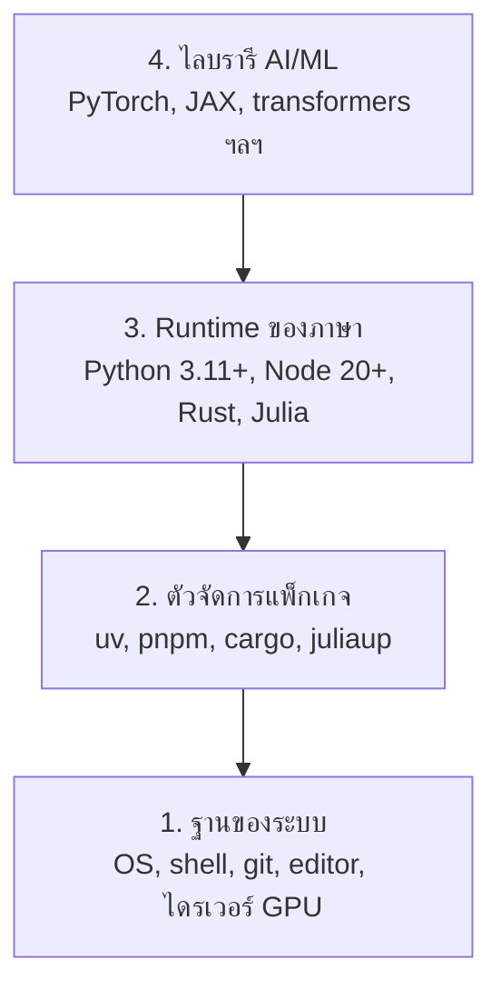

> เครื่องมือหล่อหลอมวิธีคิดของคุณ ตั้งค่าครั้งเดียว แต่ตั้งให้ถูก

**ประเภท:** ลงมือสร้าง (Build)
**ภาษา:** Python, Node.js, Rust
**ความรู้ที่ควรมีก่อน:** ไม่มี
**เวลา:** ~45 นาที

## สิ่งที่จะได้เรียนรู้

- ติดตั้ง Python 3.11 ขึ้นไป, Node.js 20 ขึ้นไป และชุดเครื่องมือ Rust ตั้งแต่ศูนย์
- ตั้งค่าสภาพแวดล้อมเสมือน (virtual environment) และตัวจัดการแพ็กเกจ เพื่อให้ build ซ้ำได้ผลเหมือนเดิมทุกครั้ง
- ตรวจว่าเข้าถึง GPU ผ่าน CUDA/MPS ได้ แล้วลองรันการคำนวณ tensor ทดสอบ
- เข้าใจโครงสร้าง 4 ชั้น: ระบบ, แพ็กเกจ, runtime และไลบรารี AI

## ปัญหา

คุณกำลังจะเรียนวิศวกรรม AI กว่า 500 บท ด้วย Python, TypeScript, Rust และ Julia ถ้าสภาพแวดล้อมสำหรับพัฒนาพัง ทุกบทจะกลายเป็นการต่อสู้กับเครื่องมือแทนที่จะได้เรียน

คนส่วนใหญ่ข้ามขั้นตอนตั้งค่าสภาพแวดล้อม แล้วก็ต้องเสียเวลาหลายชั่วโมงไล่แก้ error ตอน import, เวอร์ชันชนกัน และไดรเวอร์ CUDA ที่หายไป เราจะทำเรื่องนี้ครั้งเดียว และทำให้ถูกต้อง

## แนวคิด

สภาพแวดล้อมสำหรับงานวิศวกรรม AI มี 4 ชั้น:



เราติดตั้งจากล่างขึ้นบน แต่ละชั้นต้องพึ่งชั้นที่อยู่ใต้มัน

```figure
s0-env-stack
```

## ลงมือสร้าง (Build It)

### ขั้นที่ 1: ฐานของระบบ

ตรวจดูระบบของคุณและติดตั้งเครื่องมือพื้นฐาน

```bash
# macOS
xcode-select --install
brew install git curl wget

# Ubuntu/Debian
sudo apt update && sudo apt install -y build-essential git curl wget unzip

# Windows (use WSL2)
wsl --install -d Ubuntu-24.04
```

### ขั้นที่ 2: Python ด้วย uv

เราใช้ `uv` ซึ่งเร็วกว่า pip 10-100 เท่า และจัดการ virtual environment ให้อัตโนมัติ

```bash
curl -LsSf https://astral.sh/uv/install.sh | sh

uv python install 3.12

uv venv
source .venv/bin/activate  # or .venv\Scripts\activate on Windows

uv pip install numpy matplotlib jupyter
```

ตรวจสอบ:

```python
import sys
print(f"Python {sys.version}")

import numpy as np
print(f"NumPy {np.__version__}")
a = np.array([1, 2, 3])
print(f"Vector: {a}, dot product with itself: {np.dot(a, a)}")
```

### ขั้นที่ 3: Node.js กับ pnpm

ใช้ในบทที่เป็น TypeScript (เอเจนต์, เซิร์ฟเวอร์ MCP, เว็บแอป)

```bash
curl -fsSL https://fnm.vercel.app/install | bash
fnm install 22
fnm use 22

npm install -g pnpm

node -e "console.log('Node', process.version)"
```

ตัวติดตั้ง fnm จะตรวจหา `unzip` ก่อน ถ้าไม่มีจะหยุดพร้อมข้อความ `Not installing fnm due to missing dependencies.` เพราะบน Linux ต้องแตกไฟล์ zip ส่วนบน macOS จะติดตั้งผ่าน Homebrew เครื่อง macOS มี `unzip` มาให้แล้ว ส่วน Ubuntu, Debian และ WSL2 ได้มาจากคำสั่ง apt ในขั้นที่ 1 (ถ้าข้ามขั้นนั้นไป ให้รัน `sudo apt install -y unzip`)

**macOS / Apple Silicon (M1/M2/M3/M4):** ถ้าตัวติดตั้งหยุดพร้อม `Error: Cannot install under Rosetta 2 in ARM default prefix (/opt/homebrew)` แปลว่า terminal ของคุณรันผ่าน Rosetta 2 (คำสั่ง `arch` พิมพ์ว่า `i386`) ขณะที่ Homebrew เป็นแบบ arm64 ให้ติดตั้ง fnm โดยบังคับเป็น arm64 ผูกเข้ากับ shell แล้วรันคำสั่งด้านบนใหม่ตั้งแต่ `fnm install 22`:

```bash
arch -arm64 brew install fnm
echo 'eval "$(fnm env --use-on-cd)"' >> ~/.zshrc
source ~/.zshrc
```

### ขั้นที่ 4: Rust

ใช้ในบทที่ต้องการประสิทธิภาพสูง (การรันโมเดล, งานระดับระบบ)

```bash
curl --proto '=https' --tlsv1.2 -sSf https://sh.rustup.rs | sh

rustc --version
cargo --version
```

### ขั้นที่ 5: Julia (ไม่บังคับ)

ใช้ในบทที่เน้นคณิตศาสตร์ ซึ่ง Julia ทำได้ดี

```bash
curl -fsSL https://install.julialang.org | sh

julia -e 'println("Julia ", VERSION)'
```

### ขั้นที่ 6: ตั้งค่า GPU (ถ้ามี)

**NVIDIA (Linux / Windows):**

```bash
nvidia-smi

# Install PyTorch with CUDA
uv pip install torch torchvision torchaudio --index-url https://download.pytorch.org/whl/cu124
```

**macOS / Apple Silicon (M1/M2/M3/M4):** บน Mac ไม่มี CUDA ซึ่งเป็นเรื่องปกติ ไม่ใช่ความผิดพลาด **อย่า**ใส่ `--index-url .../cuXXX` (wheel เหล่านั้นมีเฉพาะ Linux/Windows การติดตั้งจะล้มเหลว) ให้ติดตั้งแบบธรรมดา ซึ่งมี backend GPU แบบ MPS (Metal) ของ Apple มาด้วย:

```bash
uv pip install torch torchvision torchaudio
```

ตรวจสอบ (ใช้ได้ทุกแพลตฟอร์ม):

```python
import torch
print(f"CUDA available: {torch.cuda.is_available()}")           # False on macOS — expected
print(f"MPS available:  {torch.backends.mps.is_available()}")   # True on Apple Silicon
if torch.cuda.is_available():
    print(f"GPU: {torch.cuda.get_device_name(0)}")
```

ไม่มี GPU? ไม่เป็นไร บทส่วนใหญ่ใช้ CPU ได้ ส่วนบทที่ต้องฝึกโมเดลหนักๆ ให้ใช้ Google Colab หรือ GPU บนคลาวด์

### ขั้นที่ 7: ตรวจเส้นทางที่คุณจะเริ่มเรียน

รันทุกคำสั่งในบทนี้จากโฟลเดอร์รากของ repository คือโฟลเดอร์ที่มี `README.md` และ `phases/` อยู่ข้างใน การตรวจก่อนเริ่ม (preflight) จะตรวจเฉพาะสิ่งที่ต้องใช้เพื่อเริ่มเส้นทางที่เลือก และข้ามเครื่องมือของบทหลังๆ ไปโดยค่าเริ่มต้น ผู้เรียนใหม่จะได้เห็นคำตอบที่ชัดเจนข้อเดียว แทนที่จะเจอคำเตือนเต็มหน้าจอ

เริ่มเส้นทางผู้เริ่มต้นแบบเต็ม:

```bash
python3 phases/00-setup-and-tooling/01-dev-environment/code/verify.py --route beginner
```

หรือตรวจเฉพาะเส้นทางที่ต้องการ:

```bash
python3 phases/00-setup-and-tooling/01-dev-environment/code/verify.py --route ml-foundations
python3 phases/00-setup-and-tooling/01-dev-environment/code/verify.py --route llm-engineering
python3 phases/00-setup-and-tooling/01-dev-environment/code/verify.py --route agents
python3 phases/00-setup-and-tooling/01-dev-environment/code/verify.py --route mcp
python3 phases/00-setup-and-tooling/01-dev-environment/code/verify.py --route agent-skills
python3 phases/00-setup-and-tooling/01-dev-environment/code/verify.py --route certification
```

เพิ่ม `--show-later` เมื่ออยากให้การตรวจรอบเดียวกันนี้ดูเครื่องมือเสริมและ dependency ที่บทหลังๆ ใช้ด้วย เครื่องมือของบทหลังที่ยังไม่มีจะไม่ขวางเส้นทางที่เลือก

การตรวจที่จำเป็นข้อไหนไม่ผ่าน จะแสดง path ที่ตรวจพบหรือ error ตอน import พร้อมคำสั่งแก้ที่ใช้ได้ทันที เส้นทาง Agent Skills และ certification จะแสดงรายการให้ตรวจด้วยตัวเองบนโปรแกรม AI ที่ใช้ด้วย เพราะสคริปต์ Python พิสูจน์ไม่ได้ว่าโปรแกรม AI ค้นพบ skill แล้ว หรือว่าขอบเขต skill ที่เลือกเขียนไฟล์ได้

เมื่อการตรวจของเส้นทางผู้เริ่มต้นผ่าน สคริปต์จะพิมพ์บทแรกที่รันได้ออกมาให้:

```text
Ready to start Beginner course.
Next: python3 phases/01-math-foundations/01-linear-algebra-intuition/code/vectors.py
```

## นำไปใช้ (Use It)

สภาพแวดล้อมของคุณพร้อมสำหรับเส้นทางที่ตรวจแล้ว เครื่องมือของบทหลังๆ ให้ค่อยติดตั้งเมื่อบทนั้นขอ ไม่ต้องติดตั้งครบทั้งชุดจนบทแรกเริ่มไม่ได้ นี่คือสิ่งที่คุณจะได้ใช้ตลอดหลักสูตร:

| ภาษา | ใช้ใน | ตัวจัดการแพ็กเกจ |
|----------|---------|-----------------|
| Python | Phase 1-12 (ML, DL, NLP, Vision, Audio, LLM) | uv |
| TypeScript | Phase 13-17 (Tools, เอเจนต์, Swarm, Infra) | pnpm |
| Rust | Phase 12, 15-17 (ระบบที่ต้องการประสิทธิภาพสูง) | cargo |
| Julia | Phase 1 (พื้นฐานคณิตศาสตร์) | Pkg |

## ส่งมอบ (Ship It)

บทนี้ได้สคริปต์ตรวจสอบที่ใครก็รันเพื่อเช็กการตั้งค่าของตัวเองได้

ดู `outputs/prompt-env-check.md` สำหรับ prompt ที่ช่วยให้ผู้ช่วย AI วินิจฉัยปัญหาของสภาพแวดล้อมได้

## แบบฝึกหัด

1. รันสคริปต์ตรวจสอบแล้วแก้ทุกข้อที่ไม่ผ่าน
2. สร้าง virtual environment ของ Python สำหรับหลักสูตรนี้ แล้วติดตั้ง PyTorch
3. เขียน "hello world" ทั้ง 4 ภาษา แล้วรันให้ครบทุกภาษา

### คำใบ้

**แบบฝึกหัดที่ 1** รัน `python3 phases/00-setup-and-tooling/01-dev-environment/code/verify.py --route beginner` จากโฟลเดอร์รากของ repository แล้วแก้บรรทัดแรกที่ไม่ผ่านก่อนจะไปดูบรรทัดถัดไป ถือว่าเสร็จเมื่อรันสคริปต์อีกครั้งแล้วการตรวจที่จำเป็นผ่านทุกข้อ

**แบบฝึกหัดที่ 2** สร้างสภาพแวดล้อมด้วย `uv venv` ที่โฟลเดอร์รากของ repository เปิดใช้งาน (activate) แล้วติดตั้ง PyTorch ด้วยคำสั่งในขั้นที่ 6 ที่ตรงกับฮาร์ดแวร์ของคุณ รัน `python -c "import torch; print(torch.__version__)"` ภายในสภาพแวดล้อมนั้น ถ้าได้เลขเวอร์ชันออกมาแปลว่าติดตั้งสำเร็จ

**แบบฝึกหัดที่ 3** ใช้ runtime ทั้ง 4 ตัวจากโครงสร้างในหัวข้อแนวคิด: Python, TypeScript บน Node.js, Rust และ Julia เขียนไฟล์เล็กๆ ภาษาละไฟล์ แล้วรันด้วย `python3`, `npx tsx` (Node.js รันไฟล์ `.ts` ตรงๆ ไม่ได้), `cargo run` หรือ `rustc` และ `julia` ทุกครั้งที่รันต้องพิมพ์ข้อความของคุณออกมาและจบด้วย exit code 0
