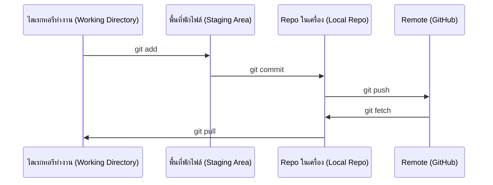

> การควบคุมเวอร์ชันไม่ใช่ทางเลือก ทุกการทดลอง ทุกโมเดล ทุกบทเรียนที่คุณสร้างที่นี่จะถูกติดตามไว้

**ประเภท:** เรียนรู้ (Learn)
**ภาษา:** --
**ความรู้ที่ควรมีก่อน:** Phase 0 บทที่ 01
**เวลา:** ~30 นาที

## สิ่งที่จะได้เรียนรู้

- ตั้งค่าตัวตนใน git และใช้ขั้นตอนประจำวัน คือ add, commit และ push
- สร้างและรวม branch เพื่อแยกการทดลองออกไป โดยไม่ทำให้ main พัง
- เขียนไฟล์ `.gitignore` ที่กันไฟล์ checkpoint ของโมเดลและไฟล์ไบนารีขนาดใหญ่ออกไป
- ไล่ดูประวัติ commit ด้วย `git log` เพื่อเข้าใจว่าโปรเจกต์เปลี่ยนไปอย่างไร

## ปัญหา

คุณกำลังจะเขียนไฟล์โค้ดหลายร้อยไฟล์ตลอด 20 phase ถ้าไม่มีระบบควบคุมเวอร์ชัน (version control) งานจะหาย จะทำของพังแล้วย้อนกลับไม่ได้ และไม่มีทางทำงานร่วมกับคนอื่นได้

Git คือเครื่องมือ GitHub คือที่เก็บโค้ด บทนี้สอนเฉพาะสิ่งที่ต้องใช้ในหลักสูตรนี้ ไม่มากไปกว่านั้น

## แนวคิด



สามเรื่องที่ต้องจำ:
1. บันทึกบ่อยๆ (`git commit`)
2. push ขึ้น remote (`git push`)
3. แตก branch เมื่อจะทดลอง (`git checkout -b experiment`)

```figure
s0-commit-dag
```

## ลงมือสร้าง (Build It)

### ขั้นที่ 1: ตั้งค่า git

```bash
git config --global user.name "Your Name"
git config --global user.email "you@example.com"
```

### ขั้นที่ 2: ขั้นตอนประจำวัน

```bash
git status
git add file.py
git commit -m "Add perceptron implementation"
git push origin main
```

### ขั้นที่ 3: แตก branch เพื่อทดลอง

```bash
git checkout -b experiment/new-optimizer

# ... make changes, commit ...

git checkout main
git merge experiment/new-optimizer
```

### ขั้นที่ 4: ทำงานกับ repo ของหลักสูตรนี้

คุณ push เข้า repo ของหลักสูตรโดยตรงไม่ได้ เพราะมีแค่ผู้ดูแลที่มีสิทธิ์เขียน ให้ fork บน GitHub ก่อน (ปุ่ม Fork มุมขวาบน) เพื่อให้ `origin` ชี้ไปที่สำเนาของคุณเอง:

```bash
git clone https://github.com/YOUR-USERNAME/ai-engineering-from-scratch.git
cd ai-engineering-from-scratch

git checkout -b my-progress
# work through lessons, commit your code
git push origin my-progress
```

## นำไปใช้ (Use It)

สำหรับหลักสูตรนี้ คุณต้องใช้แค่คำสั่งเหล่านี้:

| คำสั่ง | ใช้เมื่อ |
|---------|------|
| `git clone` | ดึง repo ของหลักสูตรมา |
| `git add` + `git commit` | บันทึกงาน |
| `git push` | สำรองงานขึ้น GitHub |
| `git checkout -b` | ลองอะไรใหม่โดยไม่ทำให้ main พัง |
| `git log --oneline` | ดูว่าทำอะไรไปแล้วบ้าง |

แค่นั้นเอง หลักสูตรนี้ไม่ต้องใช้ rebase, cherry-pick หรือ submodule

## แบบฝึกหัด

1. fork repo นี้ clone fork ของคุณมา สร้าง branch ชื่อ `my-progress` สร้างไฟล์ commit แล้ว push
2. สร้างไฟล์ `.gitignore` ที่กันไฟล์ checkpoint ของโมเดลออกไป (`.pt`, `.pth`, `.safetensors`)
3. ดูประวัติ commit ของ repo นี้ด้วย `git log --oneline` แล้วอ่านว่าบทเรียนต่างๆ ถูกเพิ่มเข้ามาอย่างไร

### คำใบ้

**แบบฝึกหัดที่ 1** กด Fork บน GitHub แล้ว `git clone` URL ของ fork ของคุณเอง หลัง `git push -u origin my-progress` ให้เปิด fork ของคุณบน GitHub แล้วดูว่ารายการ branch มี `my-progress` พร้อมไฟล์ของคุณ

**แบบฝึกหัดที่ 2** เพิ่มรูปแบบหนึ่งบรรทัดต่อหนึ่งนามสกุล เช่น `*.pt` ลงในไฟล์ `.gitignore` ที่โฟลเดอร์รากของ repository สร้างไฟล์เปล่าของแต่ละนามสกุลแล้วรัน `git status` ต้องไม่มีไฟล์ไหนโผล่ในรายการไฟล์ที่ยังไม่ถูกติดตาม (untracked)

**แบบฝึกหัดที่ 3** รัน `git log --oneline` แล้วตามด้วย `git log --oneline -- phases/00-setup-and-tooling` เพื่อดูเฉพาะ commit ที่แก้ phase นี้ เลือกมาหนึ่ง commit แล้วรัน `git show --stat <hash>` เพื่อดูว่าเพิ่มไฟล์บทเรียนอะไรเข้ามา

## คำศัพท์สำคัญ

| คำศัพท์ | ที่คนมักพูด | ความหมายจริง |
|------|----------------|----------------------|
| Commit | "เซฟ" | ภาพ snapshot ของทั้งโปรเจกต์ ณ เวลาหนึ่ง |
| Branch | "สำเนา" | ตัวชี้ไปยัง commit ที่ขยับไปข้างหน้าเมื่อคุณทำงานต่อ |
| Merge | "รวมโค้ด" | การนำการเปลี่ยนแปลงจาก branch หนึ่งไปใส่อีก branch หนึ่ง |
| Remote | "คลาวด์" | สำเนาของ repo ที่เก็บไว้ที่อื่น (GitHub, GitLab) |
