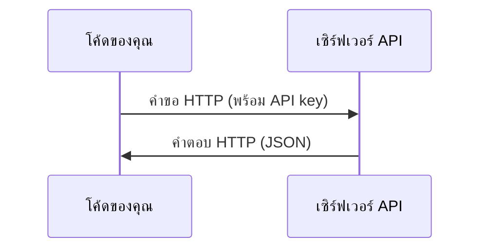

> API ของ AI ทุกเจ้าทำงานแบบเดียวกัน: ส่งคำขอ ได้คำตอบกลับมา รายละเอียดเปลี่ยนได้ แต่รูปแบบไม่เปลี่ยน

**ประเภท:** ลงมือสร้าง (Build)
**ภาษา:** Python, TypeScript
**ความรู้ที่ควรมีก่อน:** Phase 0 บทที่ 01
**เวลา:** ~30 นาที

## สิ่งที่จะได้เรียนรู้

- เก็บ API key อย่างปลอดภัยด้วยตัวแปรสภาพแวดล้อม (environment variable) และไฟล์ `.env`
- เรียก API ของ LLM ทั้งผ่าน Anthropic Python SDK และผ่าน HTTP โดยตรง
- เทียบรูปแบบคำขอและคำตอบระหว่างแบบใช้ SDK กับแบบ HTTP ตรง เพื่อใช้ไล่หาปัญหา
- จำแนกและรับมือกับ error ที่เจอบ่อยของ API รวมถึงการยืนยันตัวตนและการจำกัดอัตรา (rate limit)

## ปัญหา

ตั้งแต่ Phase 11 คุณจะเรียก API ของ LLM (Anthropic, OpenAI, Google) และใน Phase 13-16 คุณจะสร้างเอเจนต์ที่เรียก API เหล่านี้วนเป็นลูป คุณต้องรู้ว่า API key ทำงานอย่างไร เก็บอย่างไรให้ปลอดภัย และเรียก API ครั้งแรกอย่างไร

## แนวคิด



การเรียก API ทุกครั้งมี:
1. endpoint (URL)
2. API key (การยืนยันตัวตน)
3. ตัวคำขอ (request body: สิ่งที่คุณต้องการ)
4. ตัวคำตอบ (response body: สิ่งที่ได้กลับมา)

```figure
s0-secret-inject
```

## ลงมือสร้าง (Build It)

### ขั้นที่ 1: เก็บ API key ให้ปลอดภัย

อย่าใส่ API key ไว้ในโค้ดเด็ดขาด ให้ใช้ตัวแปรสภาพแวดล้อม

```bash
export ANTHROPIC_API_KEY="sk-ant-..."
export OPENAI_API_KEY="sk-..."
```

หรือใช้ไฟล์ `.env` (และเพิ่มไฟล์นี้ลงใน `.gitignore`):

```
ANTHROPIC_API_KEY=sk-ant-...
OPENAI_API_KEY=sk-...
```

### ขั้นที่ 2: เรียก API ครั้งแรก (Python)

```python
import os

import anthropic

client = anthropic.Anthropic()

MODEL = os.environ.get("LLM_MODEL", "claude-sonnet-5")

response = client.messages.create(
    model=MODEL,
    max_tokens=256,
    messages=[{"role": "user", "content": "What is a neural network in one sentence?"}]
)

print(response.content[0].text)
```

`LLM_MODEL` ใช้เลือก id ของโมเดล Anthropic ค่าเริ่มต้นคือชื่อย่อของ Sonnet แบบไม่ระบุวันที่ ผู้ให้บริการอื่น (OpenAI, Google และเจ้าอื่นๆ) ใช้รูปแบบเดียวกันคือ key คู่กับ id ของโมเดล แต่แต่ละเจ้ามี SDK, endpoint และโครงสร้างคำขอ/คำตอบของตัวเอง

### ขั้นที่ 3: เรียก API ครั้งแรก (TypeScript)

```typescript
import Anthropic from "@anthropic-ai/sdk";

const client = new Anthropic();

const MODEL = process.env.LLM_MODEL ?? "claude-sonnet-5";

const response = await client.messages.create({
  model: MODEL,
  max_tokens: 256,
  messages: [{ role: "user", content: "What is a neural network in one sentence?" }],
});

console.log(response.content[0].text);
```

### ขั้นที่ 4: HTTP ตรงๆ (ไม่ใช้ SDK)

```python
import os
import urllib.request
import json

url = "https://api.anthropic.com/v1/messages"
headers = {
    "Content-Type": "application/json",
    "x-api-key": os.environ["ANTHROPIC_API_KEY"],
    "anthropic-version": "2023-06-01",
}
body = json.dumps({
    "model": os.environ.get("LLM_MODEL", "claude-sonnet-5"),
    "max_tokens": 256,
    "messages": [{"role": "user", "content": "What is a neural network in one sentence?"}],
}).encode()

req = urllib.request.Request(url, data=body, headers=headers, method="POST")
with urllib.request.urlopen(req) as resp:
    result = json.loads(resp.read())
    print(result["content"][0]["text"])
```

นี่คือสิ่งที่ SDK ทำอยู่เบื้องหลัง การเข้าใจการเรียกผ่าน HTTP ตรงๆ ช่วยได้มากเวลาไล่หาปัญหา

## นำไปใช้ (Use It)

สำหรับหลักสูตรนี้:

| API | ต้องใช้เมื่อ | ใช้ฟรี |
|-----|-----------------|-----------|
| Anthropic (Claude) | Phase 11-16 (เอเจนต์, tool) | เครดิต $5 เมื่อสมัคร |
| OpenAI | Phase 11 (ใช้เปรียบเทียบ) | เครดิต $5 เมื่อสมัคร |
| Hugging Face | Phase 4-10 (โมเดล, ชุดข้อมูล) | ฟรี |

ตอนนี้ยังไม่ต้องมีครบทุกเจ้า ค่อยตั้งค่าเมื่อบทเรียนต้องใช้

## ส่งมอบ (Ship It)

บทนี้ได้:
- `outputs/prompt-api-troubleshooter.md` - ใช้วินิจฉัย error ที่เจอบ่อยของ API

## แบบฝึกหัด

1. สร้าง API key ของ Anthropic แล้วเรียก API ครั้งแรก
2. ลองแบบ HTTP ตรงๆ แล้วเทียบรูปแบบคำตอบกับแบบ SDK
3. ลองใช้ API key ผิดโดยตั้งใจ แล้วอ่านข้อความ error

### คำใบ้

**แบบฝึกหัดที่ 1** สร้าง key ใน Anthropic Console ใส่ไว้ใน `ANTHROPIC_API_KEY` ตามที่บทเรียนแสดง แล้วรัน `code/first_api_call.py` ถือว่าเรียกสำเร็จเมื่อสคริปต์พิมพ์คำตอบของโมเดลออกมาโดยไม่มี error

**แบบฝึกหัดที่ 2** ฟังก์ชันทั้งสองใน `code/first_api_call.py` พิมพ์แค่ข้อความกับจำนวน token เพิ่ม `print(response)` ใน `call_with_sdk()` และ `print(result)` ใน `call_raw_http()` แล้วรันสคริปต์เพื่อดูคำตอบแบบเต็มทั้งสองแบบ เทียบชื่อฟิลด์ดู: JSON ดิบมีฟิลด์ `content`, `usage` และ `stop_reason` แบบเดียวกับที่ SDK แปลงเป็น attribute ของ object

**แบบฝึกหัดที่ 3** ตั้ง `ANTHROPIC_API_KEY` เป็นค่าปลอมใน terminal หน้าต่างเดียว แล้วรันสคริปต์อีกครั้ง หารหัสสถานะ HTTP และชนิดของ error ในผลลัพธ์ การยืนยันตัวตนที่ล้มเหลวจะได้สถานะ 401

## คำศัพท์สำคัญ

| คำศัพท์ | ที่คนมักพูด | ความหมายจริง |
|------|----------------|----------------------|
| API key | "รหัสผ่านของ API" | สตริงเฉพาะตัวที่ระบุบัญชีของคุณและอนุญาตให้ส่งคำขอได้ |
| Rate limit | "โดนบีบความเร็ว" | จำนวนคำขอสูงสุดต่อนาที/ชั่วโมง เพื่อกันการใช้ในทางที่ผิดและให้ทุกคนได้ใช้อย่างเป็นธรรม |
| Token | "คำหนึ่งคำ" (ในบริบทของ API) | หน่วยคิดเงิน: token ขาเข้าและขาออกถูกนับและคิดเงินแยกกัน |
| Streaming | "คำตอบแบบเรียลไทม์" | ได้คำตอบทีละคำ แทนที่จะรอจนได้คำตอบทั้งหมด |
