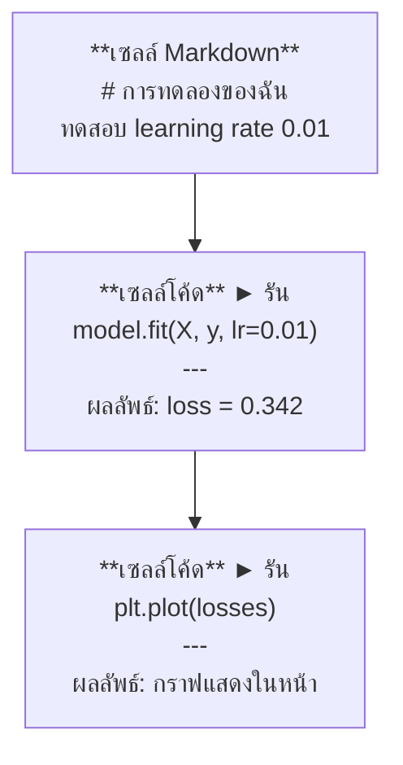
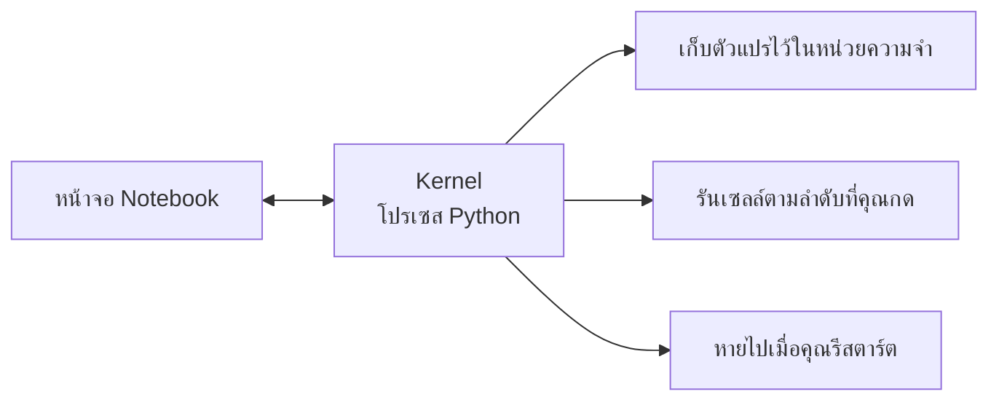

> notebook คือโต๊ะทดลองของงานวิศวกรรม AI ลองต้นแบบที่นี่ แล้วค่อยย้ายส่วนที่ใช้ได้ไปเป็นโค้ดใช้งานจริง

**ประเภท:** ลงมือสร้าง (Build)
**ภาษา:** Python
**ความรู้ที่ควรมีก่อน:** Phase 0 บทที่ 01
**เวลา:** ~30 นาที

## สิ่งที่จะได้เรียนรู้

- ติดตั้งและเปิด JupyterLab, Jupyter Notebook หรือ VS Code ที่ลงส่วนเสริม Jupyter
- ใช้ magic command (`%timeit`, `%%time`, `%matplotlib inline`) เพื่อจับเวลาและแสดงกราฟในหน้า notebook
- แยกได้ว่าเมื่อไรควรใช้ notebook เมื่อไรควรใช้สคริปต์ และใช้แนวทาง "สำรวจใน notebook, ส่งมอบเป็นสคริปต์"
- รู้จักและหลีกเลี่ยงกับดักที่เจอบ่อยใน notebook: รันไม่ตามลำดับ, สถานะที่ซ่อนอยู่ และหน่วยความจำรั่ว

## ปัญหา

paper, บทสอน และการแข่งขันบน Kaggle ด้าน AI แทบทุกอันใช้ Jupyter notebook มันให้รันโค้ดทีละส่วน เห็นผลลัพธ์ทันทีใต้โค้ด เขียนคำอธิบายปนกับโค้ด และลองซ้ำได้เร็ว ถ้าเรียน AI โดยไม่ใช้ notebook ก็เหมือนทำการบ้านคณิตศาสตร์โดยไม่มีกระดาษทด

แต่ notebook ก็มีกับดักจริงๆ คนใช้มันทำทุกอย่าง รวมถึงงานที่มันทำได้แย่มาก การรู้ว่าเมื่อไรควรใช้ notebook และเมื่อไรควรใช้สคริปต์ จะช่วยให้ไม่ต้องเจอฝันร้ายตอนไล่หาบั๊กในภายหลัง

## แนวคิด

notebook คือรายการของเซลล์ (cell) แต่ละเซลล์เป็นโค้ดหรือข้อความอย่างใดอย่างหนึ่ง



kernel คือโปรเซส Python ที่ทำงานอยู่เบื้องหลัง เมื่อคุณรันเซลล์ notebook จะส่งโค้ดไปให้ kernel ซึ่งรันแล้วส่งผลลัพธ์กลับมา ทุกเซลล์ใช้ kernel ตัวเดียวกัน ตัวแปรจึงคงอยู่ข้ามเซลล์



ส่วนที่ว่า "ตามลำดับที่คุณกด" นี่แหละ เป็นทั้งพลังพิเศษและกับดักที่ยิงเท้าตัวเอง

```figure
s0-cell-order
```

## ลงมือสร้าง (Build It)

### ขั้นที่ 1: เลือกหน้าจอที่จะใช้

สามตัวเลือก ไฟล์รูปแบบเดียว:

| หน้าจอ | ติดตั้ง | เหมาะกับ |
|-----------|---------|----------|
| JupyterLab | `pip install jupyterlab` แล้ว `jupyter lab` | ได้ประสบการณ์แบบ IDE เต็มรูปแบบ หลายแท็บ มีตัวเรียกดูไฟล์และ terminal |
| Jupyter Notebook | `pip install notebook` แล้ว `jupyter notebook` | เรียบง่าย เบา เปิดทีละ notebook |
| VS Code | ติดตั้งส่วนเสริม "Jupyter" | อยู่ใน editor ที่ใช้อยู่แล้ว ผูกกับ git และไล่บั๊กได้ |

ทั้งสามตัวอ่านและเขียนไฟล์ `.ipynb` แบบเดียวกัน เลือกตัวที่ชอบได้เลย ในงาน AI นิยมใช้ JupyterLab มากที่สุด

```bash
pip install jupyterlab
jupyter lab
```

### ขั้นที่ 2: ปุ่มลัดที่สำคัญ

คุณทำงานได้สองโหมด กด `Escape` เพื่อเข้าโหมดคำสั่ง (command mode, แถบสีน้ำเงินด้านซ้าย) และกด `Enter` เพื่อเข้าโหมดแก้ไข (edit mode, แถบสีเขียว)

**โหมดคำสั่ง (ใช้บ่อยที่สุด):**

| ปุ่ม | ทำอะไร |
|-----|--------|
| `Shift+Enter` | รันเซลล์ แล้วไปเซลล์ถัดไป |
| `A` | แทรกเซลล์ด้านบน |
| `B` | แทรกเซลล์ด้านล่าง |
| `DD` | ลบเซลล์ |
| `M` | เปลี่ยนเป็น markdown |
| `Y` | เปลี่ยนเป็นโค้ด |
| `Z` | ย้อนการทำกับเซลล์ |
| `Ctrl+Shift+H` | แสดงปุ่มลัดทั้งหมด |

**โหมดแก้ไข:**

| ปุ่ม | ทำอะไร |
|-----|--------|
| `Tab` | เติมคำอัตโนมัติ |
| `Shift+Tab` | แสดงรูปแบบการเรียกฟังก์ชัน |
| `Ctrl+/` | เปิด/ปิดคอมเมนต์ |

`Shift+Enter` คือปุ่มที่คุณจะกดวันละเป็นพันครั้ง ให้จำปุ่มนี้ก่อน

### ขั้นที่ 3: ชนิดของเซลล์

**เซลล์โค้ด** รัน Python แล้วแสดงผลลัพธ์:

```python
import numpy as np
data = np.random.randn(1000)
data.mean(), data.std()
```

ผลลัพธ์: `(0.0032, 0.9987)`

**เซลล์ Markdown** แสดงข้อความที่จัดรูปแบบแล้ว ใช้บันทึกว่ากำลังทำอะไรและทำไป รองรับหัวข้อ ตัวหนา ตัวเอียง สูตรคณิตแบบ LaTeX (`$E = mc^2$`) ตาราง และรูปภาพ

### ขั้นที่ 4: Magic command

คำสั่งเหล่านี้ไม่ใช่ Python แต่เป็นคำสั่งเฉพาะของ Jupyter ที่ขึ้นต้นด้วย `%` (line magic ใช้กับบรรทัดเดียว) หรือ `%%` (cell magic ใช้กับทั้งเซลล์)

**จับเวลาโค้ด:**

```python
%timeit np.random.randn(10000)
```

ผลลัพธ์: `45.2 us +/- 1.3 us per loop`

```python
%%time
model.fit(X_train, y_train, epochs=10)
```

ผลลัพธ์: `Wall time: 2.34 s`

`%timeit` รันโค้ดหลายๆ รอบแล้วหาค่าเฉลี่ย ส่วน `%%time` รันครั้งเดียว ใช้ `%timeit` กับการวัดความเร็วโค้ดสั้นๆ และใช้ `%%time` กับการฝึกโมเดล

**เปิดให้กราฟแสดงในหน้า:**

```python
%matplotlib inline
```

ทุกครั้งที่เรียก `plt.plot()` หรือ `plt.show()` กราฟจะแสดงใน notebook ทันที

**ติดตั้งแพ็กเกจโดยไม่ต้องออกจาก notebook:**

```python
!pip install scikit-learn
```

เครื่องหมาย `!` นำหน้าใช้รันคำสั่ง shell อะไรก็ได้

**ดูตัวแปรสภาพแวดล้อม:**

```python
%env CUDA_VISIBLE_DEVICES
```

### ขั้นที่ 5: แสดงผลลัพธ์แบบสวยงามในหน้า

notebook แสดงค่าของนิพจน์สุดท้ายในเซลล์ให้อัตโนมัติ แต่คุณควบคุมได้:

```python
import pandas as pd

df = pd.DataFrame({
    "model": ["Linear", "Random Forest", "Neural Net"],
    "accuracy": [0.72, 0.89, 0.94],
    "training_time": [0.1, 2.3, 45.6]
})
df
```

โค้ดนี้แสดงเป็นตาราง HTML ที่จัดรูปแบบแล้ว ไม่ใช่ข้อความดิบ กราฟก็เช่นกัน:

```python
import matplotlib.pyplot as plt

plt.figure(figsize=(8, 4))
plt.plot([1, 2, 3, 4], [1, 4, 2, 3])
plt.title("Inline Plot")
plt.show()
```

กราฟจะขึ้นอยู่ใต้เซลล์ทันที นี่คือเหตุผลที่ notebook ครองงาน AI คุณเห็นข้อมูล กราฟ และโค้ดไปพร้อมกัน

สำหรับรูปภาพ:

```python
from IPython.display import Image, display
display(Image(filename="architecture.png"))
```

### ขั้นที่ 6: Google Colab

Colab คือ Jupyter notebook ฟรีบนคลาวด์ มี GPU ให้ มีไลบรารีติดตั้งไว้แล้ว และเชื่อมกับ Google Drive ได้ ไม่ต้องตั้งค่าอะไรเลย

1. ไปที่ [colab.research.google.com](https://colab.research.google.com)
2. อัปโหลดไฟล์ `.ipynb` ไฟล์ไหนก็ได้ของหลักสูตรนี้
3. Runtime > Change runtime type > T4 GPU (ฟรี)

สิ่งที่ Colab ต่างจาก Jupyter ในเครื่อง:
- ไฟล์ไม่คงอยู่ข้าม session (บันทึกลง Drive หรือดาวน์โหลดเก็บไว้)
- ติดตั้งไว้ให้แล้ว: numpy, pandas, matplotlib, torch, tensorflow, sklearn
- ใช้ `from google.colab import files` เพื่ออัปโหลด/ดาวน์โหลดไฟล์
- ใช้ `from google.colab import drive; drive.mount('/content/drive')` เพื่อเก็บไฟล์ถาวร
- session หมดเวลาหลังไม่ได้ใช้งาน 90 นาที (รุ่นฟรี)

## นำไปใช้ (Use It)

### Notebook หรือสคริปต์: เมื่อไรใช้อะไร

| ใช้ notebook สำหรับ | ใช้สคริปต์สำหรับ |
|-------------------|-----------------|
| สำรวจชุดข้อมูล | ไปป์ไลน์การฝึกโมเดล |
| ลองต้นแบบโมเดล | เครื่องมือที่ใช้ซ้ำได้ |
| แสดงผลลัพธ์เป็นภาพ | ทุกอย่างที่มี `if __name__` |
| อธิบายงานของคุณ | โค้ดที่รันตามตารางเวลา |
| ทดลองเร็วๆ | โค้ดใช้งานจริง (production) |
| แบบฝึกหัดของหลักสูตร | แพ็กเกจและไลบรารี |

กฎคือ **สำรวจใน notebook, ส่งมอบเป็นสคริปต์**

ขั้นตอนที่ใช้กันทั่วไปในงาน AI:
1. สำรวจข้อมูลใน notebook
2. ลองต้นแบบโมเดลใน notebook
3. เมื่อใช้ได้แล้ว ย้ายโค้ดไปไว้ในไฟล์ `.py`
4. import ไฟล์ `.py` เหล่านั้นกลับมาใน notebook เพื่อทดลองต่อ

### กับดักที่เจอบ่อย

**รันไม่ตามลำดับ (out-of-order execution)** คุณรันเซลล์ 5 แล้วเซลล์ 2 แล้วเซลล์ 7 notebook ใช้ได้บนเครื่องคุณ แต่พังเมื่อคนอื่นรันจากบนลงล่าง วิธีแก้: กด Kernel > Restart & Run All ก่อนแชร์

**สถานะที่ซ่อนอยู่ (hidden state)** คุณลบเซลล์ไปแล้ว แต่ตัวแปรที่เซลล์นั้นสร้างยังอยู่ในหน่วยความจำ notebook ดูสะอาด แต่ยังพึ่งเซลล์ผีที่ไม่มีอยู่แล้ว วิธีแก้: รีสตาร์ต kernel เป็นประจำ

**หน่วยความจำรั่ว (memory leak)** โหลดชุดข้อมูล 4GB ฝึกโมเดล แล้วโหลดชุดข้อมูลอีกชุด โดยไม่มีอะไรถูกคืนเลย วิธีแก้: `del variable_name` และ `gc.collect()` หรือรีสตาร์ต kernel

## ส่งมอบ (Ship It)

บทนี้ได้:
- `outputs/prompt-notebook-helper.md` สำหรับไล่หาปัญหาของ notebook

## แบบฝึกหัด

1. เปิด JupyterLab สร้าง notebook แล้วใช้ `%timeit` เทียบ list comprehension กับ numpy ในการสร้าง array ของเลขสุ่ม 100,000 ตัว
2. สร้าง notebook ที่มีทั้งเซลล์ markdown และเซลล์โค้ด ที่โหลดไฟล์ CSV แสดง dataframe และวาดกราฟ จากนั้นกด Kernel > Restart & Run All เพื่อยืนยันว่ารันจากบนลงล่างได้
3. นำโค้ดจาก `code/notebook_tips.py` ไปวางใน notebook ของ Colab แล้วรันด้วย GPU ฟรี

### คำใบ้

**แบบฝึกหัดที่ 1** เปิด JupyterLab ด้วย `jupyter lab` แล้วแยกแต่ละแบบไว้คนละเซลล์ที่ขึ้นต้นด้วย `%timeit` ใช้ขนาด 100,000 เท่ากันทั้งสองเซลล์ เวลาที่วัดได้จะได้เป็นงานเดียวกัน

**แบบฝึกหัดที่ 2** ใช้ `pd.read_csv` โหลดข้อมูล แสดง dataframe ไว้เป็นบรรทัดสุดท้ายของเซลล์ แล้ววาดกราฟด้วย `df.plot()` หรือ matplotlib หลังกด Kernel > Restart & Run All ทุกเซลล์ต้องมีตัวเลขลำดับการรัน และต้องไม่มีเซลล์ไหนขึ้น error

**แบบฝึกหัดที่ 3** ใน Colab ให้เลือก Runtime > Change runtime type > GPU ก่อนวางโค้ด ถือว่ารันถูกต้องเมื่อทุกฟังก์ชันใน `code/notebook_tips.py` พิมพ์หัวข้อของตัวเองออกมา และ `torch.cuda.is_available()` คืนค่า `True` ในเซลล์

## คำศัพท์สำคัญ

| คำศัพท์ | ที่คนมักพูด | ความหมายจริง |
|------|----------------|----------------------|
| Kernel | "ตัวที่รันโค้ดของฉัน" | โปรเซส Python แยกต่างหากที่รันเซลล์และเก็บตัวแปรไว้ในหน่วยความจำ |
| Cell | "บล็อกโค้ด" | หน่วยใน notebook ที่รันได้อิสระ เป็นโค้ดหรือ markdown อย่างใดอย่างหนึ่ง |
| Magic command | "ทริกของ Jupyter" | คำสั่งพิเศษที่ขึ้นต้นด้วย `%` หรือ `%%` ใช้ควบคุมสภาพแวดล้อมของ notebook |
| `.ipynb` | "ไฟล์ notebook" | ไฟล์ JSON ที่เก็บเซลล์ ผลลัพธ์ และ metadata ย่อมาจาก IPython Notebook |

## อ่านเพิ่มเติม

- [JupyterLab Docs](https://jupyterlab.readthedocs.io/) สำหรับความสามารถทั้งหมด
- [Google Colab FAQ](https://research.google.com/colaboratory/faq.html) สำหรับข้อจำกัดและความสามารถเฉพาะของ Colab
- [28 Jupyter Notebook Tips](https://www.dataquest.io/blog/jupyter-notebook-tips-tricks-shortcuts/) สำหรับปุ่มลัดของผู้ใช้ระดับสูง
