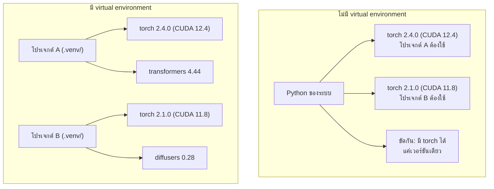

> นรกของ dependency มีอยู่จริง virtual environment คือยารักษา

**ประเภท:** ลงมือสร้าง (Build)
**ภาษา:** Shell
**ความรู้ที่ควรมีก่อน:** Phase 0 บทที่ 01
**เวลา:** ~30 นาที

## สิ่งที่จะได้เรียนรู้

- สร้าง virtual environment ที่แยกจากกันด้วย `uv`, `venv` หรือ `conda`
- เขียน `pyproject.toml` ที่มีกลุ่ม dependency แบบเลือกติดตั้ง และสร้างไฟล์ lock เพื่อให้ติดตั้งซ้ำได้ผลเหมือนเดิม
- วินิจฉัยและแก้ปัญหาที่เจอบ่อย: ติดตั้งลงระบบ (global), ใช้ pip ปนกับ conda, เวอร์ชัน CUDA ไม่ตรงกัน
- ใช้กลยุทธ์แยกสภาพแวดล้อมตาม phase สำหรับโปรเจกต์ที่ dependency ขัดกัน

## ปัญหา

คุณติดตั้ง PyTorch 2.4 สำหรับโปรเจกต์ fine-tune สัปดาห์ต่อมา อีกโปรเจกต์ต้องใช้ PyTorch 2.1 เพราะล็อก build ของ CUDA ไว้ คุณอัปเกรดแบบ global แล้วโปรเจกต์แรกพัง พอดาวน์เกรด โปรเจกต์ที่สองก็พัง

นี่คือนรกของ dependency (dependency hell) ซึ่งเกิดตลอดเวลาในงาน AI/ML เพราะ:

- PyTorch, JAX และ TensorFlow ต่างก็มาพร้อมตัวเชื่อม CUDA ของตัวเอง
- ไลบรารีโมเดลล็อกเวอร์ชันของเฟรมเวิร์กไว้เฉพาะเจาะจง
- `pip install` แบบ global เขียนทับของเดิมที่มีอยู่
- build สำหรับ CUDA 11.8 ใช้กับไดรเวอร์ CUDA 12.x ไม่ได้ (และกลับกัน)

วิธีแก้: ทุกโปรเจกต์มีสภาพแวดล้อมแยกของตัวเอง พร้อมแพ็กเกจของตัวเอง

## แนวคิด



```figure
s0-env-isolation
```

## ลงมือสร้าง (Build It)

### ทางเลือกที่ 1: uv venv (แนะนำ)

`uv` คือตัวจัดการแพ็กเกจ Python ที่เร็วที่สุด (เร็วกว่า pip 10-100 เท่า) จัดการ virtual environment, เวอร์ชันของ Python และการแก้ dependency ได้ในเครื่องมือเดียว

```bash
curl -LsSf https://astral.sh/uv/install.sh | sh

uv python install 3.12

cd your-project
uv venv
source .venv/bin/activate
```

ติดตั้งแพ็กเกจ:

```bash
uv pip install torch numpy
```

สร้างโปรเจกต์พร้อม `pyproject.toml` ในขั้นตอนเดียว:

```bash
uv init my-ai-project
cd my-ai-project
uv add torch numpy matplotlib
```

### ทางเลือกที่ 2: venv (มีมากับ Python)

ถ้าติดตั้ง `uv` ไม่ได้ Python มี `venv` มาให้:

```bash
python3 -m venv .venv
source .venv/bin/activate  # Linux/macOS
.venv\Scripts\activate     # Windows

pip install torch numpy
```

ช้ากว่า `uv` แต่ใช้ได้ทุกที่ที่มี Python

### ทางเลือกที่ 3: conda (เมื่อจำเป็น)

conda จัดการ dependency ที่ไม่ใช่ Python ได้ด้วย เช่น CUDA toolkit, cuDNN และไลบรารีภาษา C ใช้ conda เมื่อ:

- ต้องการ CUDA toolkit เวอร์ชันเฉพาะ โดยไม่ติดตั้งลงทั้งระบบ
- ใช้คลัสเตอร์ร่วมกับคนอื่น ซึ่งติดตั้งแพ็กเกจระดับระบบไม่ได้
- คำแนะนำการติดตั้งของไลบรารีบอกว่า "ให้ใช้ conda"

```bash
# Install miniconda (not the full Anaconda)
curl -LsSf https://repo.anaconda.com/miniconda/Miniconda3-latest-Linux-x86_64.sh -o miniconda.sh
bash miniconda.sh -b

conda create -n myproject python=3.12
conda activate myproject

conda install pytorch torchvision torchaudio pytorch-cuda=12.4 -c pytorch -c nvidia
```

กฎข้อเดียว: ถ้าใช้ conda กับสภาพแวดล้อมไหน ให้ใช้ conda กับทุกแพ็กเกจในสภาพแวดล้อมนั้น การใช้ `pip install` ปนเข้าไปใน conda env ทำให้ dependency ขัดกันจนไล่แก้ได้ยากมาก

### สำหรับหลักสูตรนี้: แยกตาม phase

คุณอาจสร้างสภาพแวดล้อมเดียวสำหรับทั้งหลักสูตรก็ได้ แต่อย่าทำ เพราะแต่ละ phase ต้องใช้ dependency ต่างกัน (บางครั้งขัดกันด้วย)

กลยุทธ์:

```
ai-engineering-from-scratch/
├── .venv/                    <-- env เบาๆ ที่ใช้ร่วมกันสำหรับ phase 0-3
├── phases/
│   ├── 04-neural-networks/
│   │   └── .venv/            <-- env ของ PyTorch
│   ├── 05-cnns/
│   │   └── .venv/            <-- env ของ PyTorch ตัวเดียวกัน (symlink หรือใช้ร่วมกัน)
│   ├── 08-transformers/
│   │   └── .venv/            <-- อาจต้องใช้ transformer คนละเวอร์ชัน
│   └── 11-llm-apis/
│       └── .venv/            <-- SDK ของ API ไม่ต้องใช้ torch
```

สคริปต์ `code/env_setup.sh` สร้างสภาพแวดล้อมพื้นฐานของหลักสูตรนี้ให้

## พื้นฐานของ pyproject.toml

ทุกโปรเจกต์ Python ควรมี `pyproject.toml` ไฟล์เดียวนี้ใช้แทน `setup.py`, `setup.cfg` และ `requirements.txt`

```toml
[project]
name = "ai-engineering-from-scratch"
version = "0.1.0"
requires-python = ">=3.11"
dependencies = [
    "numpy>=1.26",
    "matplotlib>=3.8",
    "jupyter>=1.0",
    "scikit-learn>=1.4",
]

[project.optional-dependencies]
torch = ["torch>=2.3", "torchvision>=0.18"]
llm = ["anthropic>=0.39", "openai>=1.50"]
```

จากนั้นติดตั้ง:

```bash
uv pip install -e ".[torch]"    # base + PyTorch
uv pip install -e ".[llm]"     # base + LLM SDKs
uv pip install -e ".[torch,llm]" # everything
```

## ไฟล์ lock

ไฟล์ lock (lockfile) ล็อก dependency ทุกตัว (รวมถึง dependency ทางอ้อม) ไว้ที่เวอร์ชันที่แน่นอน จึงรับประกันว่าติดตั้งซ้ำได้ผลเหมือนเดิม: ใครติดตั้งจากไฟล์ lock ก็ได้แพ็กเกจชุดเดียวกันทุกตัว

```bash
# uv generates uv.lock automatically when using uv add
uv add numpy

# pip-tools approach
uv pip compile pyproject.toml -o requirements.lock
uv pip install -r requirements.lock
```

commit ไฟล์ lock เข้า git เมื่อคนอื่น clone repo ไป ก็ติดตั้งจากไฟล์ lock และได้เวอร์ชันเดียวกันทุกตัว

## ข้อผิดพลาดที่เจอบ่อย

### 1. ติดตั้งลงระบบ (global)

```bash
pip install torch  # BAD: installs to system Python

source .venv/bin/activate
pip install torch  # GOOD: installs to virtual environment
```

ตรวจดูว่าแพ็กเกจถูกติดตั้งไปที่ไหน:

```bash
which python       # should show .venv/bin/python, not /usr/bin/python
which pip           # should show .venv/bin/pip
```

### 2. ใช้ pip ปนกับ conda

```bash
conda create -n myenv python=3.12
conda activate myenv
conda install pytorch -c pytorch
pip install some-other-package   # BAD: can break conda's dependency tracking
conda install some-other-package # GOOD: let conda manage everything
```

ถ้าจำเป็นต้องใช้ pip ใน conda (บางแพ็กเกจมีแค่บน pip) ให้ติดตั้งแพ็กเกจของ conda ให้ครบก่อน แล้วค่อยติดตั้งแพ็กเกจของ pip เป็นอย่างสุดท้าย

### 3. ลืม activate

```bash
python train.py           # uses system Python, missing packages
source .venv/bin/activate
python train.py           # uses project Python, packages found
```

prompt ของ shell ควรแสดงชื่อสภาพแวดล้อม:

```
(.venv) $ python train.py
```

### 4. commit โฟลเดอร์ .venv เข้า git

```bash
echo ".venv/" >> .gitignore
```

virtual environment มีขนาด 200MB-2GB เป็นของเฉพาะเครื่อง ย้ายไปใช้เครื่องอื่นไม่ได้ ให้ commit `pyproject.toml` และไฟล์ lock แทน

### 5. เวอร์ชัน CUDA ไม่ตรงกัน

```bash
nvidia-smi                # shows driver CUDA version (e.g., 12.4)
python -c "import torch; print(torch.version.cuda)"  # shows PyTorch CUDA version

# These must be compatible.
# PyTorch CUDA version must be <= driver CUDA version.
```

## นำไปใช้ (Use It)

รันสคริปต์ตั้งค่าเพื่อสร้างสภาพแวดล้อมของหลักสูตร:

```bash
bash phases/00-setup-and-tooling/06-python-environments/code/env_setup.sh
```

สคริปต์นี้สร้าง `.venv` ที่โฟลเดอร์รากของ repo พร้อมติดตั้งและตรวจสอบ dependency หลักให้

## แบบฝึกหัด

1. รัน `env_setup.sh` แล้วตรวจว่าผ่านทุกข้อ
2. สร้าง virtual environment ตัวที่สอง ติดตั้ง numpy คนละเวอร์ชันลงไป แล้วยืนยันว่าสองสภาพแวดล้อมแยกจากกันจริง
3. เขียน `pyproject.toml` สำหรับโปรเจกต์ที่ต้องใช้ทั้ง PyTorch และ Anthropic SDK
4. ลองติดตั้งแพ็กเกจลงระบบโดยตั้งใจ (โดยไม่ activate venv) ดูว่าไปลงที่ไหน แล้วถอนการติดตั้ง

### คำใบ้

**แบบฝึกหัดที่ 1** รัน `bash phases/00-setup-and-tooling/06-python-environments/code/env_setup.sh` จากโฟลเดอร์รากของ repository อ่านผลลัพธ์ทีละบรรทัด เมื่อมีข้อที่ไม่ผ่าน ให้แก้ข้อนั้นข้อเดียวแล้วรันสคริปต์ใหม่ จนไม่มีข้อไหนไม่ผ่าน

**แบบฝึกหัดที่ 2** สร้างสภาพแวดล้อมตัวที่สองในโฟลเดอร์ใหม่ด้วย `uv venv` activate แล้วติดตั้ง numpy เวอร์ชันเก่าโดยระบุเวอร์ชัน เช่น `numpy==1.26.4` รัน `python -c "import numpy; print(numpy.__version__)"` ในแต่ละสภาพแวดล้อม เวอร์ชันที่ได้ต้องต่างกัน

**แบบฝึกหัดที่ 3** เริ่มจากตัวอย่างในหัวข้อพื้นฐานของ pyproject.toml แล้วใส่ `torch` และ `anthropic` ไว้ใต้ `dependencies` รัน `uv pip install -e .` หรือ `uv sync` ในสภาพแวดล้อมใหม่ ถือว่าไฟล์ถูกต้องเมื่อ import ทั้งสองแพ็กเกจได้โดยไม่มี error

**แบบฝึกหัดที่ 4** deactivate ทุกสภาพแวดล้อม รัน `pip install --user <small package>` แล้วรัน `pip show <package>` และอ่านบรรทัด `Location` ถอนการติดตั้งด้วย `pip uninstall <package>` แล้วรัน `pip show` อีกครั้งเพื่อยืนยันว่าหายไปแล้ว

## คำศัพท์สำคัญ

| คำศัพท์ | ที่คนมักพูด | ความหมายจริง |
|------|----------------|----------------------|
| Virtual environment | "venv" | โฟลเดอร์แยกที่มีตัวแปลภาษา Python และแพ็กเกจของตัวเอง แยกจาก Python ของระบบ |
| Lockfile | "dependency ที่ล็อกเวอร์ชันไว้" | ไฟล์ที่ระบุทุกแพ็กเกจพร้อมเวอร์ชันที่แน่นอน รับประกันว่าทุกเครื่องติดตั้งได้เหมือนกัน |
| pyproject.toml | "setup.py ตัวใหม่" | ไฟล์ตั้งค่าโปรเจกต์ Python มาตรฐาน ใช้แทน setup.py/setup.cfg/requirements.txt |
| Transitive dependency | "dependency ของ dependency" | แพ็กเกจ B ต้องใช้ C ถ้าคุณติดตั้ง A ซึ่งต้องใช้ B แล้ว C ก็คือ dependency ทางอ้อมของ A |
| CUDA mismatch | "GPU ใช้ไม่ได้" | PyTorch ถูกคอมไพล์มาสำหรับ CUDA คนละเวอร์ชันกับที่ไดรเวอร์ GPU ของคุณรองรับ |
