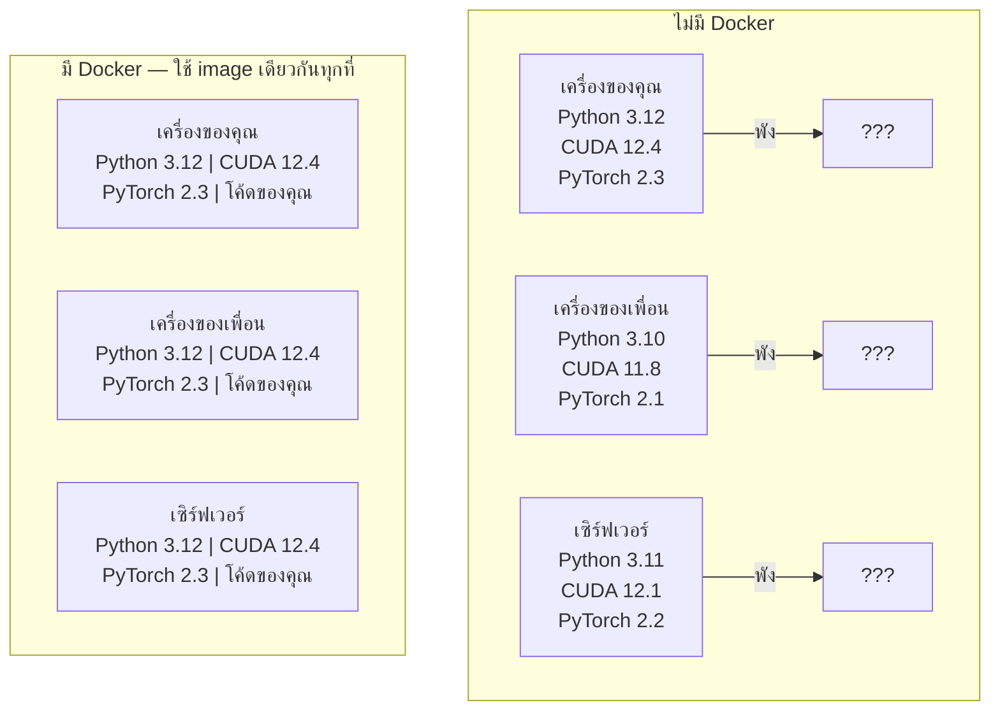

> container ทำให้คำว่า "บนเครื่องฉันรันได้นะ" กลายเป็นเรื่องในอดีต

**ประเภท:** ลงมือสร้าง (Build)
**ภาษา:** Docker
**ความรู้ที่ควรมีก่อน:** Phase 0 บทที่ 01 และ 03
**เวลา:** ~60 นาที

## สิ่งที่จะได้เรียนรู้

- build Docker image ที่ใช้ GPU ได้ พร้อม CUDA, PyTorch และไลบรารี AI จาก Dockerfile
- mount โฟลเดอร์ของเครื่องหลักเป็น volume เพื่อเก็บโมเดล ชุดข้อมูล และโค้ดไว้ แม้จะ build container ใหม่
- ตั้งค่า NVIDIA Container Toolkit ให้ container มองเห็น GPU
- ประสานแอป AI ที่มีหลายบริการ (เซิร์ฟเวอร์รันโมเดล + vector database) ด้วย Docker Compose

## ปัญหา

คุณฝึกโมเดลบนแล็ปท็อปด้วย PyTorch 2.3, CUDA 12.4 และ Python 3.12 แต่เพื่อนร่วมงานใช้ PyTorch 2.1, CUDA 11.8 และ Python 3.10 โมเดลของคุณพังบนเครื่องเขา แต่ Dockerfile ของคุณรันได้ทั้งสองเครื่อง

โปรเจกต์ AI คือฝันร้ายเรื่อง dependency ชุดเครื่องมือทั่วไปมีทั้ง Python, PyTorch, ไดรเวอร์ CUDA, cuDNN, ไลบรารีภาษา C ระดับระบบ และแพ็กเกจเฉพาะทางอย่าง flash-attn ที่ต้องใช้คอมไพเลอร์เวอร์ชันตรงเป๊ะ Docker รวบทั้งหมดนี้ไว้ใน image เดียวที่รันได้เหมือนกันทุกที่

## แนวคิด

Docker ห่อโค้ด runtime ไลบรารี และเครื่องมือระบบของคุณไว้ในหน่วยที่แยกจากกัน เรียกว่า container ลองนึกถึงเครื่องเสมือน (virtual machine) แบบเบา ต่างกันตรงที่มันใช้ kernel ของระบบปฏิบัติการบนเครื่องหลักร่วมกัน แทนที่จะรัน kernel ของตัวเอง จึงเปิดได้ในไม่กี่วินาทีแทนที่จะเป็นหลายนาที



### ทำไมโปรเจกต์ AI จึงต้องใช้ Docker มากกว่าโปรเจกต์ทั่วไป

1. **ไดรเวอร์ GPU เปราะบาง** โค้ดสำหรับ CUDA 12.4 รันบน CUDA 11.8 ไม่ได้ Docker แยก CUDA toolkit ไว้ใน container ขณะที่ใช้ไดรเวอร์ GPU ของเครื่องหลักร่วมกันผ่าน NVIDIA Container Toolkit

2. **น้ำหนักโมเดลมีขนาดใหญ่** โมเดล 7 พันล้านพารามิเตอร์มีขนาด 14 GB ใน fp16 คุณคงไม่อยากดาวน์โหลดใหม่ทุกครั้งที่ build Docker volume ช่วยให้ mount โฟลเดอร์โมเดลจากเครื่องหลักเข้าไปได้

3. **สถาปัตยกรรมแบบหลายบริการพบได้บ่อย** แอป AI จริงไม่ใช่แค่สคริปต์ Python ตัวเดียว แต่มีเซิร์ฟเวอร์รันโมเดล, vector database สำหรับ RAG และอาจมีหน้าเว็บด้วย Docker Compose ประสานทุกอย่างได้ด้วยคำสั่งเดียว

### คำศัพท์หลัก

| คำศัพท์ | ความหมาย |
|------|---------------|
| Image | แม่แบบที่อ่านได้อย่างเดียว เปรียบเป็นสูตรอาหาร build มาจาก Dockerfile |
| Container | image ที่กำลังรันอยู่ เปรียบเป็นครัวที่กำลังทำอาหาร |
| Dockerfile | คำสั่งสำหรับ build image ทีละชั้น (layer) |
| Volume | ที่เก็บข้อมูลถาวรที่อยู่รอดแม้ container ถูกรีสตาร์ต |
| docker-compose | เครื่องมือกำหนดแอปที่มีหลาย container ด้วยไฟล์ YAML |

### รูปแบบ container ที่ใช้บ่อยในงาน AI

```
Dev Container (container สำหรับพัฒนา)
  เครื่องมือครบชุด รองรับ editor มี Jupyter และเครื่องมือไล่บั๊ก
  ใช้ระหว่างพัฒนาและทดลอง

Training Container (container สำหรับฝึกโมเดล)
  เล็กที่สุด มีแค่สคริปต์ฝึกและ dependency
  รันบนคลัสเตอร์ GPU ไม่มี editor ไม่มี Jupyter

Inference Container (container สำหรับให้บริการโมเดล)
  ปรับมาเพื่อให้บริการ image เล็ก เปิดจากศูนย์ได้เร็ว
  รันหลัง load balancer ในระบบใช้งานจริง
```

```figure
s0-image-layers
```

## ลงมือสร้าง (Build It)

### ขั้นที่ 1: ติดตั้ง Docker

```bash
# macOS
brew install --cask docker
open /Applications/Docker.app

# Ubuntu
curl -fsSL https://get.docker.com | sh
sudo usermod -aG docker $USER
# Log out and back in for group change to take effect
```

ตรวจสอบ:

```bash
docker --version
docker run hello-world
```

### ขั้นที่ 2: ติดตั้ง NVIDIA Container Toolkit (Linux ที่มี GPU ของ NVIDIA)

เครื่องมือนี้ทำให้ Docker container เข้าถึง GPU ได้ ผู้ใช้ macOS และ Windows (WSL2) ข้ามขั้นนี้ได้ เพราะ Docker Desktop ส่งต่อ GPU ด้วยวิธีอื่นบนแพลตฟอร์มเหล่านั้น

```bash
distribution=$(. /etc/os-release;echo $ID$VERSION_ID)
curl -fsSL https://nvidia.github.io/libnvidia-container/gpgkey | sudo gpg --dearmor -o /usr/share/keyrings/nvidia-container-toolkit-keyring.gpg
curl -s -L https://nvidia.github.io/libnvidia-container/$distribution/libnvidia-container.list | \
    sed 's#deb https://#deb [signed-by=/usr/share/keyrings/nvidia-container-toolkit-keyring.gpg] https://#g' | \
    sudo tee /etc/apt/sources.list.d/nvidia-container-toolkit.list

sudo apt-get update
sudo apt-get install -y nvidia-container-toolkit
sudo nvidia-ctk runtime configure --runtime=docker
sudo systemctl restart docker
```

ทดสอบการเข้าถึง GPU ภายใน container:

```bash
docker run --rm --gpus all nvidia/cuda:12.4.1-base-ubuntu22.04 nvidia-smi
```

ถ้าเห็นข้อมูล GPU ของคุณ แปลว่า toolkit ใช้งานได้

### ขั้นที่ 3: เข้าใจ base image

การเลือก base image ให้เหมาะช่วยประหยัดเวลาไล่บั๊กได้หลายชั่วโมง

```
nvidia/cuda:12.4.1-devel-ubuntu22.04
  CUDA toolkit เต็มชุด มีคอมไพเลอร์
  ใช้เมื่อ: build แพ็กเกจที่ต้องใช้ nvcc (flash-attn, bitsandbytes)
  ขนาด: ~4 GB

nvidia/cuda:12.4.1-runtime-ubuntu22.04
  มีแค่ CUDA runtime ไม่มีคอมไพเลอร์
  ใช้เมื่อ: รันโค้ดที่ build มาแล้ว
  ขนาด: ~1.5 GB

pytorch/pytorch:2.6.0-cuda12.4-cudnn9-runtime
  ติดตั้ง PyTorch ไว้บน CUDA แล้ว
  ใช้เมื่อ: อยากข้ามขั้นตอนติดตั้ง PyTorch
  ขนาด: ~6 GB

python:3.12-slim
  ไม่มี CUDA ใช้ CPU อย่างเดียว
  ใช้เมื่อ: รันโมเดลบน CPU, เครื่องมือเบาๆ
  ขนาด: ~150 MB
```

### ขั้นที่ 4: เขียน Dockerfile สำหรับพัฒนางาน AI

นี่คือ Dockerfile ใน `code/Dockerfile` ลองไล่ดูทีละส่วน:

```dockerfile
FROM --platform=linux/amd64 nvidia/cuda:12.4.1-devel-ubuntu22.04

ENV DEBIAN_FRONTEND=noninteractive
ENV PYTHONUNBUFFERED=1

RUN apt-get update && apt-get install -y --no-install-recommends \
    software-properties-common \
    git \
    curl \
    build-essential \
    && add-apt-repository -y ppa:deadsnakes/ppa \
    && apt-get update && apt-get install -y --no-install-recommends \
    python3.12 \
    python3.12-venv \
    python3.12-dev \
    && rm -rf /var/lib/apt/lists/*

RUN update-alternatives --install /usr/bin/python python /usr/bin/python3.12 1

RUN curl -sSL https://raw.githubusercontent.com/pypa/get-pip/3b73145063be545b649ad9ca83ea8da5fc915a4f/public/get-pip.py -o /tmp/get-pip.py \
    && echo "a341e1a43e38001c551a1508a73ff23636a11970b61d901d9a1cad2a18f57055  /tmp/get-pip.py" | sha256sum -c - \
    && python /tmp/get-pip.py \
    && rm /tmp/get-pip.py \
    && update-alternatives --install /usr/bin/pip pip /usr/local/bin/pip3.12 1

RUN python -m pip install --no-cache-dir --upgrade pip setuptools wheel

RUN python -m pip install --no-cache-dir \
    torch==2.6.0+cu124 \
    torchvision==0.21.0+cu124 \
    torchaudio==2.6.0+cu124 \
    --index-url https://download.pytorch.org/whl/cu124

RUN python -m pip install --no-cache-dir \
    numpy \
    pandas \
    scikit-learn \
    matplotlib \
    jupyter \
    transformers \
    datasets \
    accelerate \
    safetensors

WORKDIR /workspace

VOLUME ["/workspace", "/models"]

EXPOSE 8888

CMD ["python"]
```

build:

```bash
docker build -t ai-dev -f phases/00-setup-and-tooling/07-docker-for-ai/code/Dockerfile .
```

ครั้งแรกจะใช้เวลาสักพัก (ดาวน์โหลด base image ของ CUDA + PyTorch) การ build ครั้งถัดไปจะใช้ layer ที่แคชไว้

**macOS / Apple Silicon (M1/M2/M3/M4):** `--platform=linux/amd64` ในบรรทัด `FROM` คือสิ่งที่ทำให้ build บน Mac สำเร็จ base image ของ CUDA มีแบบ arm64 ด้วย และ Docker Desktop จะเลือกแบบนั้นให้อัตโนมัติบน Apple Silicon แต่ PyTorch เผยแพร่ wheel แบบ `cu124` สำหรับ x86_64 เท่านั้น layer `pip install torch==2.6.0+cu124` จึงล้มเหลวด้วยข้อความ `No matching distribution found for torch==2.6.0+cu124` การระบุแพลตฟอร์มทำให้ดึง image แบบ x86_64 มารันผ่านการจำลอง (emulation): build ช้าลง และ container ไม่มี GPU (บน Mac ไม่มี CUDA อยู่แล้ว) ให้ตัด `--gpus all` ออกจากคำสั่ง `docker run` ด้านล่างเมื่อใช้ Mac ถ้าจะใช้ GPU บน Apple Silicon ให้รันบทเรียนบนเครื่องโดยตรงด้วย build แบบ MPS จากบทที่ 01 และเก็บ image นี้ไว้ใช้กับเครื่อง Linux แบบ x86_64 ที่มี GPU ของ NVIDIA

รัน:

```bash
docker run --rm -it --gpus all \
    -v $(pwd):/workspace \
    -v ~/models:/models \
    ai-dev python -c "import torch; print(f'PyTorch {torch.__version__}, CUDA: {torch.cuda.is_available()}')"
```

รัน Jupyter ภายใน container:

```bash
docker run --rm -it --gpus all \
    -v $(pwd):/workspace \
    -v ~/models:/models \
    -p 8888:8888 \
    ai-dev jupyter notebook --ip=0.0.0.0 --port=8888 --no-browser --allow-root
```

### ขั้นที่ 5: mount volume สำหรับข้อมูลและโมเดล

การ mount volume สำคัญมากในงาน AI ถ้าไม่มี โมเดลขนาด 14 GB ที่ดาวน์โหลดมาจะหายไปทันทีที่ container หยุด

```bash
# Mount your code
-v $(pwd):/workspace

# Mount a shared models directory
-v ~/models:/models

# Mount datasets
-v ~/datasets:/data
```

ในสคริปต์ฝึกโมเดล ให้โหลดจาก path ที่ mount ไว้:

```python
from transformers import AutoModel

model = AutoModel.from_pretrained("/models/llama-7b")
```

โมเดลอยู่ในระบบไฟล์ของเครื่องหลัก คุณ build container ใหม่ได้บ่อยเท่าที่ต้องการโดยไม่ต้องดาวน์โหลดใหม่

### ขั้นที่ 6: Docker Compose สำหรับแอป AI ที่มีหลายบริการ

แอป RAG จริงต้องมีเซิร์ฟเวอร์รันโมเดลและ vector database Docker Compose รันทั้งสองอย่างได้ด้วยคำสั่งเดียว

ดู `code/docker-compose.yml`:

```yaml
services:
  ai-dev:
    build:
      context: .
      dockerfile: Dockerfile
    deploy:
      resources:
        reservations:
          devices:
            - driver: nvidia
              count: all
              capabilities: [gpu]
    volumes:
      - ../../../:/workspace
      - ~/models:/models
      - ~/datasets:/data
    ports:
      - "8888:8888"
    stdin_open: true
    tty: true
    command: jupyter notebook --ip=0.0.0.0 --port=8888 --no-browser --allow-root

  qdrant:
    image: qdrant/qdrant:v1.12.5
    ports:
      - "6333:6333"
      - "6334:6334"
    volumes:
      - qdrant_data:/qdrant/storage

volumes:
  qdrant_data:
```

เปิดทุกอย่าง:

```bash
cd phases/00-setup-and-tooling/07-docker-for-ai/code
docker compose up -d
```

ตอนนี้ container สำหรับพัฒนางาน AI เข้าถึง vector database ได้ที่ `http://qdrant:6333` ผ่านชื่อบริการ เพราะ Docker Compose สร้างเครือข่ายที่ใช้ร่วมกันให้อัตโนมัติ

ทดสอบการเชื่อมต่อจากภายใน container ของ AI:

```python
from qdrant_client import QdrantClient

client = QdrantClient(host="qdrant", port=6333)
print(client.get_collections())
```

ปิดทุกอย่าง:

```bash
docker compose down
```

เพิ่ม `-v` ถ้าต้องการลบ volume ของ qdrant ด้วย:

```bash
docker compose down -v
```

### ขั้นที่ 7: คำสั่ง Docker ที่มีประโยชน์ในงาน AI

```bash
# List running containers
docker ps

# List all images and their sizes
docker images

# Remove unused images (reclaim disk space)
docker system prune -a

# Check GPU usage inside a running container
docker exec -it <container_id> nvidia-smi

# Copy a file from container to host
docker cp <container_id>:/workspace/results.csv ./results.csv

# View container logs
docker logs -f <container_id>
```

## นำไปใช้ (Use It)

ตอนนี้คุณมีสภาพแวดล้อมสำหรับพัฒนางาน AI ที่สร้างซ้ำได้เหมือนเดิมแล้ว สำหรับส่วนที่เหลือของหลักสูตร:

- ใช้ `docker compose up` เปิดสภาพแวดล้อมสำหรับพัฒนาพร้อม vector database ไปด้วยกัน
- mount โค้ด โมเดล และข้อมูลเป็น volume จะได้ไม่มีอะไรหายระหว่าง build ใหม่
- เมื่อบทเรียนต้องใช้แพ็กเกจ Python ใหม่ ให้เพิ่มลงใน Dockerfile แล้ว build ใหม่
- แชร์ Dockerfile ให้เพื่อนร่วมทีม เขาจะได้สภาพแวดล้อมเดียวกันทุกประการ

### ไม่มี GPU?

ตัด `--gpus all` และบล็อก deploy ของ NVIDIA ออก container ยังใช้กับบทเรียนที่ใช้ CPU ได้ PyTorch จะตรวจว่าไม่มี CUDA แล้วกลับไปใช้ CPU เอง

## แบบฝึกหัด

1. build Dockerfile แล้วรัน `python -c "import torch; print(torch.__version__)"` ภายใน container
2. เปิดชุด docker-compose แล้วตรวจว่า container ของ AI เข้าถึง Qdrant ได้ที่ `http://qdrant:6333/collections`
3. เพิ่ม `flask` ลงใน Dockerfile แล้ว build ใหม่ จากนั้นรันเซิร์ฟเวอร์ API ง่ายๆ ที่พอร์ต 5000 โดย map พอร์ตด้วย `-p 5000:5000`
4. วัดขนาด image ด้วย `docker images` แล้วลองเปลี่ยน base image จาก `devel` เป็น `runtime` แล้วเทียบขนาด

### คำใบ้

**แบบฝึกหัดที่ 1** build ด้วยคำสั่ง `docker build -t ai-dev -f phases/00-setup-and-tooling/07-docker-for-ai/code/Dockerfile .` จากบทเรียน แล้วรันคำสั่ง import ภายใน `docker run --rm ai-dev` ถ้าใช้ Mac ให้ตัด `--gpus all` ออกตามที่บทเรียนอธิบาย container ต้องพิมพ์เวอร์ชันที่ขึ้นต้นด้วย `2.6.0`

**แบบฝึกหัดที่ 2** รัน `docker compose up -d` ในโฟลเดอร์ `code/` แล้วเปิด shell ในบริการ `ai-dev` ด้วย `docker compose exec ai-dev bash` ข้างในให้รัน `curl http://qdrant:6333/collections` ถ้าได้คำตอบเป็น JSON แปลว่าชื่อบริการถูกแปลงเป็นที่อยู่ได้บนเครือข่ายของ compose

**แบบฝึกหัดที่ 3** เพิ่มบรรทัด `RUN pip install flask` ลงใน Dockerfile แล้ว build ใหม่ เปิดเซิร์ฟเวอร์ด้วย `host="0.0.0.0"` เพราะเซิร์ฟเวอร์ที่ผูกกับ localhost ภายใน container จะเข้าถึงจากข้างนอกไม่ได้ เปิด `http://localhost:5000` บนเครื่องของคุณเพื่อยืนยันว่าการ map พอร์ตใช้ได้

**แบบฝึกหัดที่ 4** รัน `docker images ai-dev` แล้วจดคอลัมน์ SIZE ไว้ เปลี่ยน `devel` เป็น `runtime` ในบรรทัด `FROM` build ด้วย tag ใหม่ แล้วเทียบขนาดทั้งสอง image แบบ runtime ไม่มีคอมไพเลอร์และไฟล์ header

## คำศัพท์สำคัญ

| คำศัพท์ | ที่คนมักพูด | ความหมายจริง |
|------|----------------|----------------------|
| Container | "VM แบบเบา" | โปรเซสที่แยกออกมา ใช้ kernel ของเครื่องหลัก แต่มีระบบไฟล์และเครือข่ายของตัวเอง |
| Image layer | "ขั้นที่แคชไว้" | คำสั่งแต่ละบรรทัดใน Dockerfile สร้าง layer หนึ่งชั้น layer ที่ไม่เปลี่ยนจะถูกแคชไว้ การ build ใหม่จึงเร็ว |
| NVIDIA Container Toolkit | "GPU ใน Docker" | ตัวเสริมของ runtime ที่ส่ง GPU ของเครื่องหลักเข้าไปใน container ผ่านตัวเลือก `--gpus` |
| Volume mount | "โฟลเดอร์ที่แชร์กัน" | โฟลเดอร์บนเครื่องหลักที่ map เข้าไปใน container การเปลี่ยนแปลงยังอยู่หลัง container หยุด |
| Base image | "จุดเริ่มต้น" | image ใน `FROM` ที่ Dockerfile ต่อยอดขึ้นไป เป็นตัวกำหนดว่ามีอะไรติดตั้งมาแล้วบ้าง |
