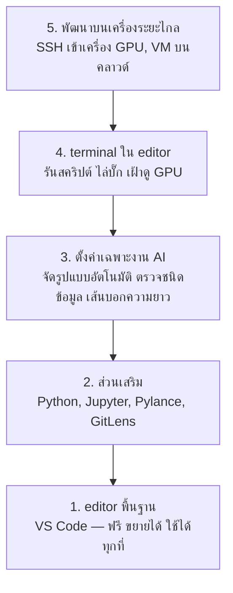

> editor คือผู้ช่วยนักบินของคุณ ตั้งค่าครั้งเดียวให้มันไม่เกะกะ แล้วเริ่มออกแรงช่วยคุณจริงๆ

**ประเภท:** ลงมือสร้าง (Build)
**ภาษา:** --
**ความรู้ที่ควรมีก่อน:** Phase 0 บทที่ 01
**เวลา:** ~20 นาที

## สิ่งที่จะได้เรียนรู้

- ติดตั้ง VS Code พร้อมส่วนเสริมที่จำเป็นสำหรับ Python, Jupyter, linting และ Remote SSH
- ตั้งค่าจัดรูปแบบโค้ดเมื่อบันทึก ตรวจชนิดข้อมูล และให้ผลลัพธ์ของ notebook เลื่อนดูได้ สำหรับงาน AI
- ตั้งค่า Remote SSH เพื่อแก้และไล่บั๊กโค้ดบนเครื่อง GPU ระยะไกลเหมือนอยู่ในเครื่องตัวเอง
- ประเมินทางเลือกอื่นของ editor (Cursor, Windsurf, Neovim) และข้อดีข้อเสียสำหรับงาน AI

## ปัญหา

คุณจะใช้เวลาหลายพันชั่วโมงใน editor ทั้งเขียน Python รัน notebook ไล่บั๊กลูปการฝึก และ SSH เข้าเครื่อง GPU editor ที่ตั้งค่าไม่ดีทำให้ทุกครั้งที่ทำงานมีแต่ความติดขัด: ไม่มีการเติมคำอัตโนมัติ ไม่มีคำใบ้ชนิดข้อมูล ไม่มี error แสดงในบรรทัด ต้องจัดรูปแบบเอง และใช้ terminal ได้ไม่คล่อง

การตั้งค่าให้ถูกใช้เวลา 20 นาที แต่ถ้าข้ามไป คุณจะเสีย 20 นาทีทุกวัน

## แนวคิด

การตั้งค่า editor สำหรับงานวิศวกรรม AI ต้องมี 5 อย่าง:



```figure
s0-lsp-roundtrip
```

## ลงมือสร้าง (Build It)

### ขั้นที่ 1: ติดตั้ง VS Code

VS Code คือ editor ที่แนะนำ ใช้ฟรี รันได้ทุกระบบปฏิบัติการ รองรับ Jupyter notebook อย่างเต็มที่ และมีส่วนเสริมครอบคลุมทุกอย่างที่ต้องใช้ในงาน AI

ดาวน์โหลดได้จาก [code.visualstudio.com](https://code.visualstudio.com/)

ตรวจสอบจาก terminal:

```bash
code --version
```

ถ้าบน macOS หาคำสั่ง `code` ไม่เจอ ให้เปิด VS Code กด `Cmd+Shift+P` พิมพ์ "Shell Command" แล้วเลือก "Install 'code' command in PATH"

### ขั้นที่ 2: ติดตั้งส่วนเสริมที่จำเป็น

เปิด terminal ใน VS Code (`` Ctrl+` `` ได้ทุกแพลตฟอร์ม) แล้วติดตั้งส่วนเสริมที่สำคัญกับงาน AI:

```bash
code --install-extension ms-python.python
code --install-extension ms-python.vscode-pylance
code --install-extension ms-toolsai.jupyter
code --install-extension eamodio.gitlens
code --install-extension ms-vscode-remote.remote-ssh
code --install-extension ms-python.debugpy
code --install-extension ms-python.black-formatter
code --install-extension charliermarsh.ruff
```

แต่ละตัวทำอะไร:

| ส่วนเสริม | ทำไม |
|-----------|-----|
| Python | รองรับภาษา ตรวจหา virtual env รันและไล่บั๊ก |
| Pylance | ตรวจชนิดข้อมูลเร็ว เติมคำอัตโนมัติ หาที่มาของ import |
| Jupyter | รัน notebook ใน VS Code มีตัวสำรวจตัวแปร |
| GitLens | ดูว่าใครแก้อะไร มี git blame ในบรรทัด |
| Remote SSH | เปิดโฟลเดอร์บนเครื่อง GPU ระยะไกลเหมือนอยู่ในเครื่องตัวเอง |
| Debugpy | ไล่บั๊ก Python ทีละขั้น |
| Black Formatter | จัดรูปแบบอัตโนมัติเมื่อบันทึก ได้สไตล์เดียวกันทั้งโปรเจกต์ |
| Ruff | lint เร็ว จับข้อผิดพลาดที่พบบ่อย |

ไฟล์ `code/vscode/extensions.json` ของบทนี้มีรายการแนะนำครบทั้งหมด คัดลอกไปไว้ที่ `.vscode/extensions.json` ในโฟลเดอร์โปรเจกต์ แล้ว VS Code จะชวนให้ติดตั้งเมื่อเปิดโฟลเดอร์นั้น

### ขั้นที่ 3: ตั้งค่า

คัดลอกการตั้งค่าจาก `code/vscode/settings.json` ของบทนี้ หรือใส่เองผ่าน `Settings > Open Settings (JSON)`

การตั้งค่าหลักสำหรับงาน AI:

```jsonc
{
    "python.analysis.typeCheckingMode": "basic",
    "editor.formatOnSave": true,
    "editor.rulers": [88, 120],
    "notebook.output.scrolling": true,
    "files.autoSave": "afterDelay"
}
```

ทำไมจึงสำคัญ:

- **ตรวจชนิดข้อมูลระดับ basic**: จับชนิดของอาร์กิวเมนต์ที่ผิดได้ก่อนรัน ช่วยประหยัดเวลาไล่บั๊กเรื่อง shape ของ tensor ไม่ตรงกันและพารามิเตอร์ของ API ที่ผิด
- **จัดรูปแบบเมื่อบันทึก**: ไม่ต้องคิดเรื่องการจัดรูปแบบอีกเลย Black จัดการให้
- **เส้นบอกความยาวที่ 88 และ 120**: Black ตัดบรรทัดที่ 88 ส่วนเส้นที่ 120 บอกว่า docstring และคอมเมนต์เริ่มยาวเกินไป
- **เลื่อนดูผลลัพธ์ของ notebook ได้**: ลูปการฝึกพิมพ์ผลออกมาหลายพันบรรทัด ถ้าเลื่อนไม่ได้ แผงผลลัพธ์จะยาวล้นจอ
- **บันทึกอัตโนมัติ**: คุณจะลืมบันทึกแน่ๆ แล้วสคริปต์ฝึกจะรันโค้ดเก่า การบันทึกอัตโนมัติกันเรื่องนี้ได้

### ขั้นที่ 4: ใช้ terminal ใน editor

terminal ใน VS Code คือที่ที่คุณรันสคริปต์ฝึก เฝ้าดู GPU และจัดการสภาพแวดล้อม

ตั้งค่าให้เหมาะ:

```jsonc
{
    "terminal.integrated.defaultProfile.osx": "zsh",
    "terminal.integrated.defaultProfile.linux": "bash",
    "terminal.integrated.fontSize": 13,
    "terminal.integrated.scrollback": 10000
}
```

ปุ่มลัดที่มีประโยชน์:

| ทำอะไร | macOS | Linux/Windows |
|--------|-------|---------------|
| เปิด/ปิด terminal | `` Ctrl+` `` | `` Ctrl+` `` |
| terminal ใหม่ | `` Ctrl+Shift+` `` | `` Ctrl+Shift+` `` |
| แบ่ง terminal | `Cmd+\` | `Ctrl+Shift+5` |

การแบ่ง terminal มีประโยชน์มาก: ช่องหนึ่งรันสคริปต์ อีกช่องเฝ้าดู GPU ด้วย `nvidia-smi -l 1` หรือ `watch -n 1 nvidia-smi`

### ขั้นที่ 5: พัฒนาบนเครื่องระยะไกล (SSH เข้าเครื่อง GPU)

นี่คือส่วนเสริมที่สำคัญที่สุดสำหรับงาน AI คุณจะฝึกโมเดลบนเครื่องระยะไกล (VM บนคลาวด์, เซิร์ฟเวอร์ของแล็บ, Lambda, Vast.ai) Remote SSH ให้คุณเปิดระบบไฟล์ของเครื่องระยะไกล แก้ไฟล์ รัน terminal และไล่บั๊กได้เหมือนทุกอย่างอยู่ในเครื่องตัวเอง

การตั้งค่า:

1. ติดตั้งส่วนเสริม Remote SSH (ทำไปแล้วในขั้นที่ 2)
2. กด `Ctrl+Shift+P` (หรือ `Cmd+Shift+P`) พิมพ์ "Remote-SSH: Connect to Host"
3. ใส่ `user@your-gpu-box-ip`
4. VS Code ติดตั้งส่วนเซิร์ฟเวอร์ของตัวเองบนเครื่องระยะไกลให้อัตโนมัติ

ถ้าต้องการเข้าโดยไม่ต้องใส่รหัสผ่าน ให้ตั้งค่า SSH key:

```bash
ssh-keygen -t ed25519 -C "your-email@example.com"
ssh-copy-id user@your-gpu-box-ip
```

เพิ่มเครื่องไว้ใน `~/.ssh/config` จะได้สะดวก:

```
Host gpu-box
    HostName 203.0.113.50
    User ubuntu
    IdentityFile ~/.ssh/id_ed25519
    ForwardAgent yes
```

ตอนนี้ `Remote-SSH: Connect to Host > gpu-box` จะเชื่อมต่อได้ทันที

## ทางเลือกอื่น

### Cursor

[cursor.com](https://cursor.com) คือ VS Code ที่แยกมาพัฒนาต่อ (fork) พร้อมความสามารถสร้างโค้ดด้วย AI ในตัว ใช้ส่วนเสริมและรูปแบบการตั้งค่าเดียวกัน ถ้าคุณใช้ Cursor ทุกอย่างในบทนี้ยังใช้ได้ นำเข้า `settings.json` และ `extensions.json` ชุดเดียวกันได้เลย

### Windsurf

[windsurf.com](https://windsurf.com) เป็น VS Code fork อีกตัวที่เน้น AI เป็นหลัก เหมือนกันทุกอย่าง: ส่วนเสริมเดียวกัน รูปแบบการตั้งค่าเดียวกัน รองรับ Remote SSH เหมือนกัน

### Vim/Neovim

ถ้าคุณใช้ Vim หรือ Neovim อยู่แล้วและทำงานได้คล่อง ก็ใช้ต่อไปได้ การตั้งค่าขั้นต่ำสำหรับงาน Python ด้าน AI:

- **pyright** หรือ **pylsp** สำหรับตรวจชนิดข้อมูล (ผ่าน Mason หรือติดตั้งเอง)
- **nvim-lspconfig** สำหรับเชื่อมกับ language server
- **jupyter-vim** หรือ **molten-nvim** สำหรับรันแบบ notebook
- **telescope.nvim** สำหรับค้นหาไฟล์และสัญลักษณ์
- **none-ls.nvim** คู่กับ black และ ruff สำหรับจัดรูปแบบและ lint

ถ้ายังไม่เคยใช้ Vim อย่าเพิ่งเริ่มตอนนี้ เพราะการเรียนรู้ Vim จะแย่งเวลากับการเรียนวิศวกรรม AI ใช้ VS Code ไปก่อน

## นำไปใช้ (Use It)

เมื่อตั้งค่าแบบนี้แล้ว งานประจำวันของคุณจะเป็นแบบนี้:

1. เปิดโฟลเดอร์โปรเจกต์ใน VS Code (หรือเชื่อมต่อเครื่อง GPU ผ่าน Remote SSH)
2. เขียน Python ใน editor ที่มีการเติมคำอัตโนมัติ คำใบ้ชนิดข้อมูล และ error แสดงในบรรทัด
3. รัน Jupyter notebook ในหน้าเดียวกันด้วยส่วนเสริม Jupyter
4. ใช้ terminal ใน editor รันสคริปต์ฝึก `uv pip install` และเฝ้าดู GPU
5. ตรวจการเปลี่ยนแปลงด้วย GitLens ก่อน commit

## แบบฝึกหัด

1. ติดตั้ง VS Code และส่วนเสริมทั้งหมดในขั้นที่ 2
2. คัดลอก `settings.json` ของบทนี้ไปใส่ในการตั้งค่าของ VS Code
3. เปิดไฟล์ Python แล้วตรวจว่า Pylance แสดงคำใบ้ชนิดข้อมูล และ Black จัดรูปแบบเมื่อบันทึก
4. ถ้ามีเครื่องระยะไกลให้ใช้ ลองตั้งค่า Remote SSH แล้วเปิดโฟลเดอร์บนเครื่องนั้น

### คำใบ้

**แบบฝึกหัดที่ 1** ติดตั้งส่วนเสริมตามตารางในขั้นที่ 2 หรือติดตั้งทุก ID ใน `code/vscode/extensions.json` ด้วย `code --install-extension <id>` แล้วรัน `code --list-extensions` เทียบทีละ ID กับในไฟล์

**แบบฝึกหัดที่ 2** เปิด Settings > Open Settings (JSON) แล้วคัดลอกเนื้อหาของ `code/vscode/settings.json` ลงไป ถ้าในไฟล์มีการตั้งค่าอยู่แล้ว ให้รวม key เข้าด้วยกันและรักษาให้เป็น JSON ที่ถูกต้อง VS Code จะขีดเส้นแดงถ้าไฟล์ผิดรูปแบบ

**แบบฝึกหัดที่ 3** เขียนฟังก์ชันที่มี type annotation แล้วเอาเมาส์ชี้ที่จุดที่เรียกฟังก์ชันนั้น Pylance จะแสดงชนิดข้อมูลที่อนุมานได้ ลองเว้นวรรคเกินในบรรทัดหนึ่งแล้วบันทึกไฟล์ Black ต้องจัดรูปแบบบรรทัดนั้นใหม่ตอนบันทึก

**แบบฝึกหัดที่ 4** เพิ่มเซิร์ฟเวอร์ลงใน `~/.ssh/config` ก่อน แล้วยืนยันว่า `ssh <host>` ใช้ได้ใน terminal จากนั้นใช้คำสั่ง Remote SSH เชื่อมต่อ แถบสถานะจะแสดงชื่อเครื่องเมื่อ VS Code ทำงานบนเครื่องระยะไกล

## คำศัพท์สำคัญ

| คำศัพท์ | ที่คนมักพูด | ความหมายจริง |
|------|----------------|----------------------|
| LSP | "ตัวเติมคำอัตโนมัติ" | Language Server Protocol: มาตรฐานที่ให้ editor ขอข้อมูลชนิดข้อมูล คำแนะนำการเติมคำ และการวินิจฉัยปัญหา จากเซิร์ฟเวอร์เฉพาะของแต่ละภาษา |
| Pylance | "ปลั๊กอิน Python" | language server ของ Python จาก Microsoft ที่ใช้ Pyright ตรวจชนิดข้อมูลและทำ IntelliSense |
| Remote SSH | "ทำงานบนเซิร์ฟเวอร์" | ส่วนเสริมของ VS Code ที่รันเซิร์ฟเวอร์ขนาดเล็กบนเครื่องระยะไกล แล้วส่งหน้าจอมาที่ editor ในเครื่องคุณ |
| Format on save | "จัดสวยอัตโนมัติ" | editor รันตัวจัดรูปแบบ (Black, Ruff) ทุกครั้งที่บันทึก สไตล์โค้ดจึงเหมือนกันเสมอ |
