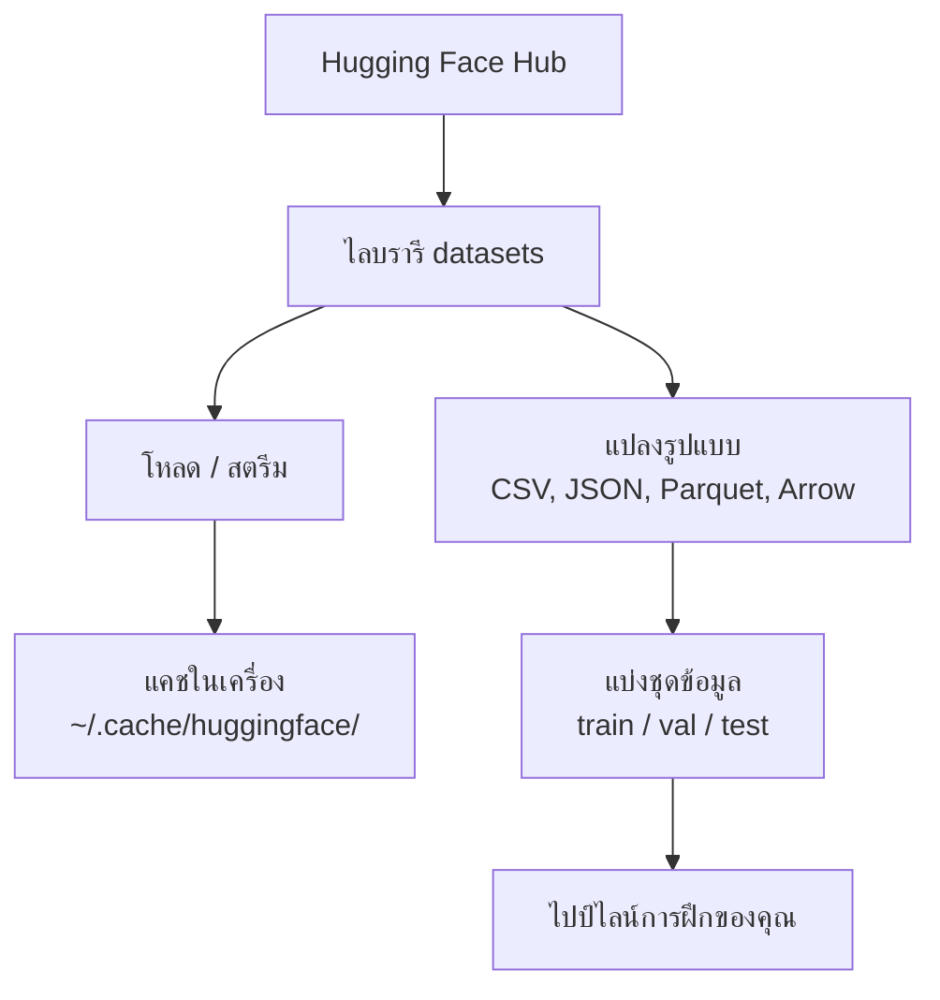

> ข้อมูลคือเชื้อเพลิง วิธีจัดการข้อมูลเป็นตัวกำหนดว่าคุณจะไปได้เร็วแค่ไหน

**ประเภท:** ลงมือสร้าง (Build)
**ภาษา:** Python
**ความรู้ที่ควรมีก่อน:** Phase 0 บทที่ 01
**เวลา:** ~45 นาที

## สิ่งที่จะได้เรียนรู้

- โหลด สตรีม และแคชชุดข้อมูลด้วยไลบรารี `datasets` ของ Hugging Face
- แปลงไปมาระหว่างรูปแบบ CSV, JSON, Parquet และ Arrow และอธิบายข้อดีข้อเสียของแต่ละแบบ
- แบ่งชุดข้อมูลเป็น train/validation/test ที่ทำซ้ำได้ด้วยการกำหนด random seed
- จัดการไฟล์โมเดลและชุดข้อมูลขนาดใหญ่ด้วย `.gitignore`, Git LFS หรือ DVC

## ปัญหา

โปรเจกต์ AI ทุกโปรเจกต์เริ่มจากข้อมูล คุณต้องหาชุดข้อมูล ดาวน์โหลด แปลงรูปแบบ แบ่งไว้สำหรับฝึกและประเมินผล และทำเวอร์ชันไว้เพื่อให้การทดลองทำซ้ำได้ การทำทั้งหมดนี้ด้วยมือทุกครั้งทั้งช้าและผิดพลาดง่าย คุณต้องมีขั้นตอนที่ทำซ้ำได้

## แนวคิด



ไลบรารี `datasets` ของ Hugging Face คือวิธีมาตรฐานในการโหลดข้อมูลสำหรับงาน AI จัดการการดาวน์โหลด การแคช การแปลงรูปแบบ และการสตรีมให้ตั้งแต่แรก

```figure
s0-data-pipeline
```

## ลงมือสร้าง (Build It)

### ขั้นที่ 1: ติดตั้งไลบรารี datasets

```bash
pip install datasets huggingface_hub
```

### ขั้นที่ 2: โหลดชุดข้อมูล

```python
from datasets import load_dataset

dataset = load_dataset("stanfordnlp/imdb")
print(dataset)
print(dataset["train"][0])
```

โค้ดนี้ดาวน์โหลดชุดข้อมูลรีวิวภาพยนตร์ IMDB หลังดาวน์โหลดครั้งแรก จะโหลดจากแคชที่ `~/.cache/huggingface/datasets/`

### ขั้นที่ 3: สตรีมชุดข้อมูลขนาดใหญ่

บางชุดข้อมูลใหญ่เกินกว่าจะเก็บลงดิสก์ได้ การสตรีม (streaming) จะโหลดทีละแถวโดยไม่ต้องดาวน์โหลดทั้งหมด

```python
dataset = load_dataset("wikimedia/wikipedia", "20231101.en", split="train", streaming=True)

for i, example in enumerate(dataset):
    print(example["title"])
    if i >= 4:
        break
```

การสตรีมได้ `IterableDataset` ออกมา คุณประมวลผลแต่ละแถวเมื่อมันมาถึง หน่วยความจำที่ใช้คงที่ไม่ว่าชุดข้อมูลจะใหญ่แค่ไหน

### ขั้นที่ 4: รูปแบบของชุดข้อมูล

ไลบรารี `datasets` ใช้ Apache Arrow อยู่เบื้องหลัง คุณแปลงเป็นรูปแบบอื่นได้ตามที่ไปป์ไลน์ต้องการ

```python
dataset = load_dataset("stanfordnlp/imdb", split="train")

dataset.to_csv("imdb_train.csv")
dataset.to_json("imdb_train.json")
dataset.to_parquet("imdb_train.parquet")
```

เปรียบเทียบรูปแบบ:

| รูปแบบ | ขนาด | ความเร็วในการอ่าน | เหมาะกับ |
|--------|------|-----------|----------|
| CSV | ใหญ่ | ช้า | คนอ่านง่าย, ใช้กับสเปรดชีต |
| JSON | ใหญ่ | ช้า | API, ข้อมูลซ้อนกันหลายชั้น |
| Parquet | เล็ก | เร็ว | งานวิเคราะห์, query แบบคอลัมน์ |
| Arrow | เล็ก | เร็วที่สุด | ประมวลผลในหน่วยความจำ (สิ่งที่ `datasets` ใช้อยู่ข้างใน) |

สำหรับงาน AI รูปแบบที่ดีที่สุดสำหรับเก็บข้อมูลคือ Parquet ส่วน Arrow คือรูปแบบที่ใช้ทำงานในหน่วยความจำ CSV และ JSON มีไว้แลกเปลี่ยนข้อมูล

### ขั้นที่ 5: แบ่งชุดข้อมูล

โปรเจกต์ ML ทุกโปรเจกต์ต้องแบ่งข้อมูลเป็นสามส่วน:

- **Train**: ชุดที่โมเดลใช้เรียนรู้ (ปกติ 80%)
- **Validation**: ชุดที่ใช้เช็กความคืบหน้าระหว่างฝึก (ปกติ 10%)
- **Test**: ชุดสำหรับประเมินผลครั้งสุดท้ายหลังฝึกเสร็จ (ปกติ 10%)

บางชุดข้อมูลแบ่งมาให้แล้ว ถ้าไม่ได้แบ่งมา ให้แบ่งเอง:

```python
dataset = load_dataset("stanfordnlp/imdb", split="train")

split = dataset.train_test_split(test_size=0.2, seed=42)
train_val = split["train"].train_test_split(test_size=0.125, seed=42)

train_ds = train_val["train"]
val_ds = train_val["test"]
test_ds = split["test"]

print(f"Train: {len(train_ds)}, Val: {len(val_ds)}, Test: {len(test_ds)}")
```

กำหนด seed ทุกครั้งเพื่อให้ทำซ้ำได้ seed เดียวกันจะได้การแบ่งแบบเดียวกันทุกครั้ง

### ขั้นที่ 6: ดาวน์โหลดและแคชโมเดล

โมเดลเป็นไฟล์ขนาดใหญ่ ไลบรารี `huggingface_hub` จัดการการดาวน์โหลดและแคชให้

```python
from huggingface_hub import hf_hub_download, snapshot_download

model_path = hf_hub_download(
    repo_id="sentence-transformers/all-MiniLM-L6-v2",
    filename="config.json"
)
print(f"Cached at: {model_path}")

model_dir = snapshot_download("sentence-transformers/all-MiniLM-L6-v2")
print(f"Full model at: {model_dir}")
```

โมเดลถูกแคชไว้ที่ `~/.cache/huggingface/hub/` เมื่อดาวน์โหลดแล้ว การรันครั้งถัดไปจะโหลดได้ทันที

### ขั้นที่ 7: จัดการไฟล์ขนาดใหญ่

น้ำหนักโมเดลและชุดข้อมูลขนาดใหญ่ไม่ควรเข้าไปอยู่ใน git มีสามทางเลือก:

**ทางเลือก A: .gitignore (ง่ายที่สุด)**

```
*.bin
*.safetensors
*.pt
*.onnx
data/*.parquet
data/*.csv
models/
```

**ทางเลือก B: Git LFS (ติดตามไฟล์ใหญ่ใน git)**

```bash
git lfs install
git lfs track "*.bin"
git lfs track "*.safetensors"
git add .gitattributes
```

Git LFS เก็บตัวชี้ (pointer) ไว้ใน repo ส่วนไฟล์จริงเก็บไว้บนเซิร์ฟเวอร์แยก GitHub ให้ใช้ฟรี 1 GB

**ทางเลือก C: DVC (data version control)**

```bash
pip install dvc
dvc init
dvc add data/training_set.parquet
git add data/training_set.parquet.dvc data/.gitignore
git commit -m "Track training data with DVC"
```

DVC สร้างไฟล์ `.dvc` ขนาดเล็กที่ชี้ไปยังข้อมูลของคุณ ส่วนตัวข้อมูลจริงอยู่บน S3, GCS หรือที่เก็บข้อมูลระยะไกลอื่น

| วิธี | ความซับซ้อน | เหมาะกับ |
|----------|-----------|----------|
| .gitignore | ต่ำ | โปรเจกต์ส่วนตัว, ข้อมูลที่ดาวน์โหลดใหม่ได้ |
| Git LFS | กลาง | ทีมที่แชร์น้ำหนักโมเดลผ่าน git |
| DVC | สูง | การทดลองที่ต้องทำซ้ำได้, ชุดข้อมูลขนาดใหญ่, ทีม |

สำหรับหลักสูตรนี้ `.gitignore` ก็พอ ใช้ DVC เมื่อต้องทำการทดลองซ้ำให้ได้ผลเดียวกันทุกเครื่อง

### ขั้นที่ 8: รูปแบบการเก็บข้อมูล

**เก็บในเครื่อง** ใช้ได้กับชุดข้อมูลที่เล็กกว่า ~10 GB แคชของ HF จัดการให้อัตโนมัติ

**เก็บบนคลาวด์** สำหรับข้อมูลที่ใหญ่กว่านั้นหรือใช้ร่วมกันหลายเครื่อง:

```python
import os

local_path = os.path.expanduser("~/.cache/huggingface/datasets/")

# s3_path = "s3://my-bucket/datasets/"
# gcs_path = "gs://my-bucket/datasets/"
```

DVC เชื่อมกับ S3 และ GCS ได้โดยตรง:

```bash
dvc remote add -d myremote s3://my-bucket/dvc-store
dvc push
```

สำหรับหลักสูตรนี้ เก็บในเครื่องก็พอ การเก็บบนคลาวด์จะเริ่มมีประโยชน์เมื่อคุณ fine-tune บนเครื่อง GPU ระยะไกล

## ชุดข้อมูลที่ใช้ในหลักสูตรนี้

| ชุดข้อมูล | บทเรียน | ขนาด | สอนเรื่องอะไร |
|---------|---------|------|----------------|
| IMDB | การตัดคำ (tokenization), การจำแนก | 84 MB | พื้นฐานการจำแนกข้อความ |
| WikiText | การสร้างแบบจำลองภาษา | 181 MB | การทำนาย token ถัดไป |
| SQuAD | ระบบถาม-ตอบ | 35 MB | การตอบคำถาม, การหาช่วงข้อความคำตอบ |
| Common Crawl (บางส่วน) | Embedding | แล้วแต่ส่วนที่ใช้ | การประมวลผลข้อความขนาดใหญ่ |
| MNIST | พื้นฐานด้านภาพ | 21 MB | พื้นฐานการจำแนกภาพ |
| COCO (บางส่วน) | Multimodal | แล้วแต่ส่วนที่ใช้ | คู่ภาพกับข้อความ |

ตอนนี้ยังไม่ต้องดาวน์โหลดทั้งหมด แต่ละบทจะบอกว่าต้องใช้อะไร

## นำไปใช้ (Use It)

รันสคริปต์เครื่องมือเพื่อตรวจว่าทุกอย่างใช้ได้:

```bash
python code/data_utils.py
```

สคริปต์นี้ดาวน์โหลดชุดข้อมูลเล็กๆ แปลงรูปแบบ แบ่งชุด แล้วพิมพ์สรุปออกมา

## ส่งมอบ (Ship It)

บทนี้ได้:
- `code/data_utils.py` - เครื่องมือโหลดและแคชข้อมูลที่ใช้ซ้ำได้
- `outputs/prompt-data-helper.md` - prompt สำหรับหาชุดข้อมูลที่เหมาะกับงาน

## แบบฝึกหัด

1. โหลดชุดข้อมูล `glue` ด้วย config `mrpc` แล้วดูตัวอย่าง 5 ตัวแรก
2. สตรีมชุดข้อมูล `c4` แล้วนับว่าประมวลผลได้กี่ตัวอย่างใน 10 วินาที
3. แปลงชุดข้อมูลเป็น Parquet แล้วเทียบขนาดไฟล์กับ CSV
4. แบ่ง train/val/test แบบ 70/15/15 ด้วย seed ที่กำหนดไว้ แล้วตรวจขนาดของแต่ละชุด

### คำใบ้

**แบบฝึกหัดที่ 1** เรียก `load_and_inspect("glue", "mrpc")` จาก `code/data_utils.py` หรือ `load_dataset("glue", "mrpc")` โดยตรง แล้วพิมพ์ `ds["train"][:5]` ทุกตัวอย่างต้องมีฟิลด์ `sentence1`, `sentence2` และ `label`

**แบบฝึกหัดที่ 2** โหลดชุดข้อมูลด้วย `streaming=True` แบบเดียวกับที่ `stream_dataset` ทำ แล้วอ่านตัวอย่างในลูปที่หยุดเมื่อ `time.time()` เลยเวลาเริ่มไปแล้ว 10 วินาที พิมพ์จำนวนที่นับได้ แล้วรันซ้ำอีกครั้ง เพราะการรันครั้งแรกรวมเวลาเริ่มเชื่อมต่อไว้ด้วย

**แบบฝึกหัดที่ 3** บันทึกชุดข้อมูลเดียวกันด้วย `to_csv` และ `to_parquet` แบบที่ `convert_format` ทำ แล้วเทียบขนาดด้วย `ls -lh` หรือ `os.path.getsize` โหลดไฟล์ Parquet กลับมาด้วย `load_from_parquet` แล้วตรวจว่าจำนวนแถวไม่เปลี่ยน

**แบบฝึกหัดที่ 4** ใช้ `train_test_split` สองครั้งโดยกำหนด `seed` ไว้: ครั้งแรกแยกออกมา 30 เปอร์เซ็นต์ แล้วแบ่ง 30 เปอร์เซ็นต์นั้นเป็นครึ่งๆ ความยาวทั้งสามชุดต้องรวมกันเท่ากับความยาวเดิม และการรันอีกครั้งด้วย seed เดิมต้องได้แถวแรกของแต่ละชุดเหมือนเดิม

## คำศัพท์สำคัญ

| คำศัพท์ | ที่คนมักพูด | ความหมายจริง |
|------|----------------|----------------------|
| Dataset split | "ข้อมูลฝึก" | ชุดย่อยที่ตั้งชื่อไว้ (train/val/test) ใช้ในขั้นต่างๆ ของวงจรงาน ML |
| Streaming | "โหลดแบบค่อยๆ มา" | ประมวลผลข้อมูลทีละแถวจากแหล่งระยะไกล โดยไม่ต้องดาวน์โหลดทั้งชุด |
| Parquet | "CSV ที่บีบอัดแล้ว" | รูปแบบไฟล์แบบเก็บเป็นคอลัมน์ ออกแบบมาให้ query เชิงวิเคราะห์เร็วและเก็บได้ประหยัด |
| Arrow | "dataframe ที่เร็ว" | รูปแบบเก็บข้อมูลเป็นคอลัมน์ในหน่วยความจำ ที่ไลบรารี datasets ใช้ภายในเพื่ออ่านโดยไม่ต้องคัดลอก (zero-copy) |
| Git LFS | "git สำหรับไฟล์ใหญ่" | ส่วนขยายที่เก็บไฟล์ใหญ่ไว้นอก git repo แต่เก็บตัวชี้ไว้ในระบบควบคุมเวอร์ชัน |
| DVC | "git สำหรับข้อมูล" | ระบบควบคุมเวอร์ชันสำหรับชุดข้อมูลและโมเดล ที่เชื่อมกับที่เก็บข้อมูลบนคลาวด์ |
| Cache | "ดาวน์โหลดไว้แล้ว" | สำเนาในเครื่องของข้อมูลที่ดึงมาก่อนหน้า เก็บไว้ที่ ~/.cache/huggingface/ เป็นค่าเริ่มต้น |
