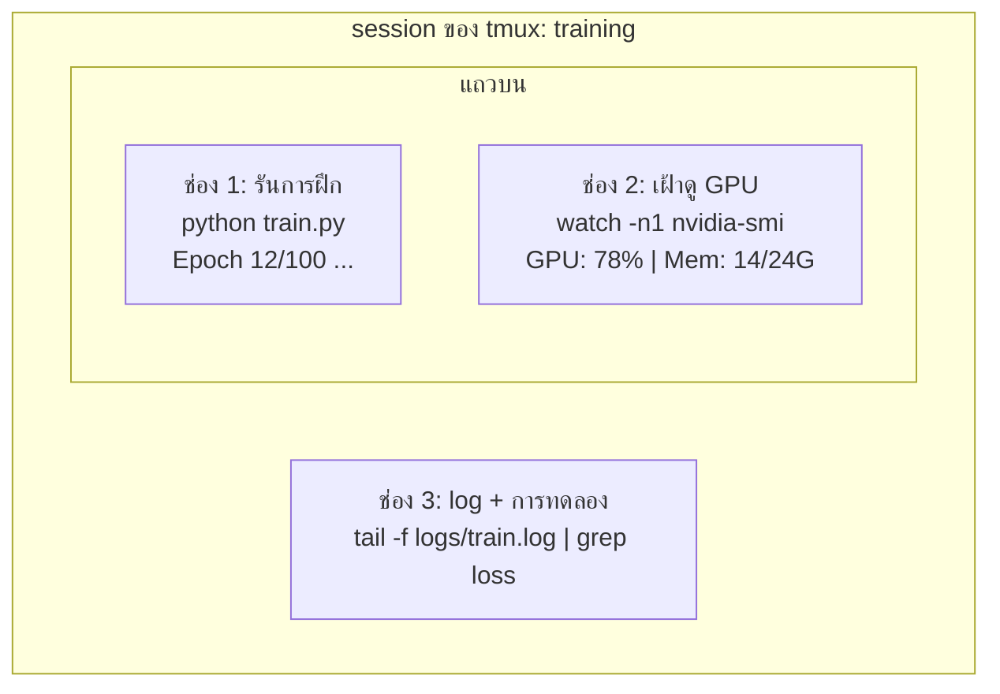

> terminal คือบ้านของวิศวกร AI ทำตัวให้คุ้นเคยกับที่นี่

**ประเภท:** เรียนรู้ (Learn)
**ภาษา:** --
**ความรู้ที่ควรมีก่อน:** Phase 0 บทที่ 01
**เวลา:** ~35 นาที

## สิ่งที่จะได้เรียนรู้

- ใช้ pipe, การเปลี่ยนทิศทาง (redirect) และ `grep` กรองและประมวลผล log การฝึกจาก command line
- สร้าง session ของ tmux ที่คงอยู่และมีหลายช่อง (pane) เพื่อฝึกโมเดลและเฝ้าดู GPU ไปพร้อมกัน
- เฝ้าดูทรัพยากรของระบบและ GPU ด้วย `htop`, `nvtop` และ `nvidia-smi`
- ส่งไฟล์ระหว่างเครื่องตัวเองกับเครื่องระยะไกลด้วย SSH, `scp` และ `rsync`

## ปัญหา

คุณจะใช้เวลาใน terminal มากกว่าใน editor ตัวไหนๆ ทั้งรันการฝึก เฝ้าดู GPU ตามดู log เชื่อมต่อ SSH ไปเครื่องระยะไกล และจัดการสภาพแวดล้อม ทุกขั้นตอนของงาน AI แตะ shell ทั้งนั้น ถ้าคุณช้าที่นี่ คุณจะช้าไปหมดทุกที่

บทนี้สอนทักษะ terminal ที่สำคัญกับงาน AI ไม่มีประวัติของ Unix ไม่ลงลึกการเขียนสคริปต์ Bash มีแค่สิ่งที่ต้องใช้

## แนวคิด



สามอย่างทำงานพร้อมกันใน terminal เดียว คุณ detach ออกมา กลับบ้าน SSH เข้าไปใหม่ แล้ว attach กลับได้ ระหว่างนั้นการฝึกยังรันต่อไป

```figure
s0-shell-pipeline
```

## ลงมือสร้าง (Build It)

### ขั้นที่ 1: รู้จัก shell ของคุณ

ตรวจดูว่าใช้ shell อะไรอยู่:

```bash
echo $SHELL
```

ระบบส่วนใหญ่ใช้ `bash` หรือ `zsh` ทั้งสองตัวใช้ได้ดี คำสั่งในหลักสูตรนี้ใช้ได้กับทั้งคู่

สิ่งสำคัญที่ควรรู้:

```bash
# Move around
cd ~/projects/ai-engineering-from-scratch
pwd
ls -la

# History search (most useful shortcut you'll learn)
# Ctrl+R then type part of a previous command
# Press Ctrl+R again to cycle through matches

# Clear terminal
clear   # or Ctrl+L

# Cancel a running command
# Ctrl+C

# Suspend a running command (resume with fg)
# Ctrl+Z
```

### ขั้นที่ 2: pipe และการเปลี่ยนทิศทาง

pipe เชื่อมคำสั่งเข้าด้วยกัน เป็นวิธีที่ใช้ประมวลผล log กรองผลลัพธ์ และต่อเครื่องมือหลายตัวเป็นทอดๆ คุณจะได้ใช้ตลอดเวลา

```bash
# Count how many times "loss" appears in a log
cat train.log | grep "loss" | wc -l

# Extract just the loss values from training output
grep "loss:" train.log | awk '{print $NF}' > losses.txt

# Watch a log file update in real time, filtering for errors
tail -f train.log | grep --line-buffered "ERROR"

# Sort experiments by final accuracy
grep "final_accuracy" results/*.log | sort -t= -k2 -n -r

# Redirect stdout and stderr to separate files
python train.py > output.log 2> errors.log

# Redirect both to the same file
python train.py > train_full.log 2>&1
```

การเปลี่ยนทิศทางสี่แบบกับ pipe ที่ต้องรู้:

| สัญลักษณ์ | ทำอะไร |
|--------|-------------|
| `>` | เขียน stdout ลงไฟล์ (เขียนทับ) |
| `>>` | ต่อท้าย stdout ลงไฟล์ |
| `2>` | เขียน stderr ลงไฟล์ |
| `2>&1` | ส่ง stderr ไปที่เดียวกับ stdout |
| `\|` | ส่ง stdout ของคำสั่งหนึ่งเป็น stdin ของคำสั่งถัดไป |

### ขั้นที่ 3: โปรเซสเบื้องหลัง

การฝึกใช้เวลาหลายชั่วโมง คุณคงไม่อยากเปิด terminal ค้างไว้ตลอด

```bash
# Run in background (output still goes to terminal)
python train.py &

# Run in background, immune to hangup (closing terminal won't kill it)
nohup python train.py > train.log 2>&1 &

# Check what's running in background
jobs
ps aux | grep train.py

# Bring a background job to foreground
fg %1

# Kill a background process
kill %1
# or find its PID and kill that
kill $(pgrep -f "train.py")
```

ความต่างระหว่าง `&`, `nohup` และ `screen`/`tmux`:

| วิธี | อยู่รอดเมื่อปิด terminal? | attach กลับได้? |
|--------|-------------------------|---------------|
| `command &` | ไม่ | ไม่ได้ |
| `nohup command &` | ใช่ | ไม่ได้ (ดูจากไฟล์ log) |
| `screen` / `tmux` | ใช่ | ได้ |

งานไหนที่นานเกินไม่กี่นาที ให้ใช้ tmux

### ขั้นที่ 4: tmux

tmux ให้คุณสร้าง session ของ terminal ที่คงอยู่และแบ่งได้หลายช่อง นี่คือเครื่องมือเดียวที่มีประโยชน์ที่สุดสำหรับจัดการการฝึกโมเดล

```bash
# Install
# macOS
brew install tmux
# Ubuntu
sudo apt install tmux

# Start a named session
tmux new -s training

# Split horizontally
# Ctrl+B then "

# Split vertically
# Ctrl+B then %

# Navigate between panes
# Ctrl+B then arrow keys

# Detach (session keeps running)
# Ctrl+B then d

# Reattach
tmux attach -t training

# List sessions
tmux ls

# Kill a session
tmux kill-session -t training
```

session ทั่วไปของงาน AI:

```bash
tmux new -s train

# Pane 1: start training
python train.py --epochs 100 --lr 1e-4

# Ctrl+B, " to split, then run GPU monitor
watch -n1 nvidia-smi

# Ctrl+B, % to split vertically, tail the logs
tail -f logs/experiment.log

# Now detach with Ctrl+B, d
# SSH out, go get coffee, come back
# tmux attach -t train
```

### ขั้นที่ 5: เฝ้าดูด้วย htop และ nvtop

```bash
# System processes (better than top)
htop

# GPU processes (if you have NVIDIA GPU)
# Install: sudo apt install nvtop (Ubuntu) or brew install nvtop (macOS)
nvtop

# Quick GPU check without nvtop
nvidia-smi

# Watch GPU usage update every second
watch -n1 nvidia-smi

# See which processes are using the GPU
nvidia-smi --query-compute-apps=pid,name,used_memory --format=csv
```

ปุ่มของ `htop` ที่จะได้ใช้:
- `F6` หรือ `>` เรียงตามคอลัมน์ (เรียงตามหน่วยความจำเพื่อหาหน่วยความจำรั่ว)
- `F5` เปิด/ปิดมุมมองแบบต้นไม้ (เห็นโปรเซสลูก)
- `F9` kill โปรเซส
- `/` ค้นหาโปรเซสตามชื่อ

### ขั้นที่ 6: SSH เข้าเครื่อง GPU ระยะไกล

เมื่อเช่า GPU บนคลาวด์ (Lambda, RunPod, Vast.ai) คุณจะเชื่อมต่อผ่าน SSH

```bash
# Basic connection
ssh user@gpu-box-ip

# With a specific key
ssh -i ~/.ssh/my_gpu_key user@gpu-box-ip

# Copy files to remote
scp model.pt user@gpu-box-ip:~/models/

# Copy files from remote
scp user@gpu-box-ip:~/results/metrics.json ./

# Sync a whole directory (faster for many files)
rsync -avz ./data/ user@gpu-box-ip:~/data/

# Port forward (access remote Jupyter/TensorBoard locally)
ssh -L 8888:localhost:8888 user@gpu-box-ip
# Now open localhost:8888 in your browser

# SSH config for convenience
# Add to ~/.ssh/config:
# Host gpu
#     HostName 192.168.1.100
#     User ubuntu
#     IdentityFile ~/.ssh/gpu_key
#
# Then just:
# ssh gpu
```

### ขั้นที่ 7: alias ที่มีประโยชน์สำหรับงาน AI

เพิ่มสิ่งเหล่านี้ลงใน `~/.bashrc` หรือ `~/.zshrc`:

```bash
source phases/00-setup-and-tooling/10-terminal-and-shell/code/shell_aliases.sh
```

หรือคัดลอกเฉพาะตัวที่ต้องการ alias หลักๆ มีดังนี้:

```bash
# GPU status at a glance
alias gpu='nvidia-smi --query-gpu=index,name,utilization.gpu,memory.used,memory.total,temperature.gpu --format=csv,noheader'

# Kill all Python training processes
alias killtraining='pkill -f "python.*train"'

# Quick virtual environment activate
alias ae='source .venv/bin/activate'

# Watch training loss
alias watchloss='tail -f logs/*.log | grep --line-buffered "loss"'
```

ดูชุดเต็มได้ใน `code/shell_aliases.sh`

### ขั้นที่ 8: รูปแบบคำสั่งใน terminal ที่ใช้บ่อยในงาน AI

รูปแบบเหล่านี้เจอซ้ำๆ ในงานจริง:

```bash
# Run training, log everything, notify when done
python train.py 2>&1 | tee train.log; echo "DONE" | mail -s "Training complete" you@email.com

# Compare two experiment logs side by side
diff <(grep "accuracy" exp1.log) <(grep "accuracy" exp2.log)

# Find the largest model files (clean up disk space)
find . -name "*.pt" -o -name "*.safetensors" | xargs du -h | sort -rh | head -20

# Download a model from Hugging Face
wget https://huggingface.co/model/resolve/main/model.safetensors

# Untar a dataset
tar xzf dataset.tar.gz -C ./data/

# Count lines in all Python files (see how big your project is)
find . -name "*.py" | xargs wc -l | tail -1

# Check disk space (training data fills disks fast)
df -h
du -sh ./data/*

# Environment variable check before training
env | grep -i cuda
env | grep -i torch
```

## นำไปใช้ (Use It)

นี่คือช่วงที่แต่ละเครื่องมือจะได้ใช้ในหลักสูตรนี้:

| เครื่องมือ | ใช้เมื่อ |
|------|----------------|
| tmux | ทุกครั้งที่ฝึกโมเดล (Phase 3 ขึ้นไป) |
| `tail -f` + `grep` | เฝ้าดู log การฝึก |
| `nohup` / `&` | งานเบื้องหลังสั้นๆ |
| `htop` / `nvtop` | ไล่หาสาเหตุที่การฝึกช้า, error หน่วยความจำไม่พอ (OOM) |
| SSH + `rsync` | ทำงานบน GPU บนคลาวด์ |
| pipe + การเปลี่ยนทิศทาง | ประมวลผลผลการทดลอง |
| alias | ประหยัดเวลากับคำสั่งที่พิมพ์ซ้ำๆ |

## แบบฝึกหัด

1. ติดตั้ง tmux สร้าง session ที่มีสามช่อง แล้วรัน `htop` ในช่องหนึ่ง `watch -n1 date` ในอีกช่อง และสคริปต์ Python ในช่องที่สาม จากนั้น detach แล้ว attach กลับ
2. เพิ่ม alias จาก `code/shell_aliases.sh` ลงในไฟล์ตั้งค่าของ shell แล้วโหลดใหม่ด้วย `source ~/.zshrc` (หรือ `~/.bashrc`)
3. สร้าง log การฝึกปลอมด้วย `for i in $(seq 1 100); do echo "epoch $i loss: $(echo "scale=4; 1/$i" | bc)"; sleep 0.1; done > fake_train.log` แล้วใช้ `grep`, `tail` และ `awk` ดึงเฉพาะค่า loss ออกมา
4. ตั้งค่า SSH config สำหรับเซิร์ฟเวอร์ที่คุณเข้าได้ (หรือใช้ `localhost` เพื่อฝึกไวยากรณ์)

### คำใบ้

**แบบฝึกหัดที่ 1** เริ่มด้วย `tmux new -s practice` แล้วแบ่งช่องด้วย prefix `Ctrl+B` ตามด้วย `"` และ `%` เลื่อนไปมาระหว่างช่องด้วย `Ctrl+B` กับปุ่มลูกศร detach ด้วย `Ctrl+B` แล้ว `d` รัน `tmux ls` แล้ว attach กลับด้วย `tmux attach -t practice` โปรแกรมทั้งสามต้องยังทำงานอยู่

**แบบฝึกหัดที่ 2** คัดลอกบรรทัดจาก `code/shell_aliases.sh` ไปต่อท้าย `~/.zshrc` หรือ `~/.bashrc` แล้วรัน `source` กับไฟล์นั้น รัน `alias` หรือ `type <name>` กับ alias ใหม่ตัวหนึ่ง เพื่อยืนยันว่า shell รู้จักแล้ว

**แบบฝึกหัดที่ 3** รัน `tail -5 fake_train.log` ก่อนเพื่อดูรูปแบบของแต่ละบรรทัด จากนั้นกรองด้วย `grep loss` แล้วพิมพ์เฉพาะฟิลด์สุดท้ายด้วย `awk '{print $NF}'` ผลลัพธ์ต้องเป็นตัวเลข 100 ตัวที่ค่อยๆ ลดลง

**แบบฝึกหัดที่ 4** คัดลอกบล็อก `Host gpu` จากบทเรียนไปไว้ใน `~/.ssh/config` แล้วเปลี่ยน `HostName` และ `User` เป็นเซิร์ฟเวอร์ของคุณ หรือเป็น `localhost` กับชื่อผู้ใช้ของคุณ รัน `ssh -G gpu` เพื่อพิมพ์การตั้งค่าที่ SSH จะใช้ ถ้ามีเซิร์ฟเวอร์ SSH ที่เข้าถึงได้และรับ key ของคุณ ให้รัน `ssh gpu` เพื่อเชื่อมต่อ

## คำศัพท์สำคัญ

| คำศัพท์ | ที่คนมักพูด | ความหมายจริง |
|------|----------------|----------------------|
| Shell | "terminal" | โปรแกรมที่ตีความคำสั่งของคุณ (bash, zsh, fish) |
| tmux | "terminal multiplexer" | โปรแกรมที่ให้รัน terminal หลาย session ในหน้าต่างเดียว และ detach/attach กลับได้ |
| Pipe | "ขีดตั้ง" | ตัวดำเนินการ `\|` ที่ส่งผลลัพธ์ของคำสั่งหนึ่งไปเป็นข้อมูลขาเข้าของอีกคำสั่ง |
| PID | "หมายเลขโปรเซส" | ตัวเลขเฉพาะที่ระบบให้กับทุกโปรเซสที่กำลังรัน ใช้เฝ้าดูหรือ kill โปรเซสนั้น |
| nohup | "no hangup" | รันคำสั่งให้ไม่สนสัญญาณ hangup การปิด terminal จึงไม่ทำให้มันหยุด |
| SSH | "เชื่อมต่อเซิร์ฟเวอร์" | Secure Shell โปรโตคอลแบบเข้ารหัสสำหรับรันคำสั่งบนเครื่องระยะไกล |
