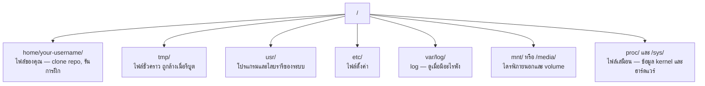

> งาน AI ส่วนใหญ่รันบน Linux คุณต้องรู้มากพอที่จะไม่ติดอยู่กับที่

**ประเภท:** เรียนรู้ (Learn)
**ภาษา:** --
**ความรู้ที่ควรมีก่อน:** Phase 0 บทที่ 01
**เวลา:** ~30 นาที

## สิ่งที่จะได้เรียนรู้

- ไปมาในระบบไฟล์ของ Linux และจัดการไฟล์พื้นฐานจาก command line
- จัดการสิทธิ์ของไฟล์ด้วย `chmod` และ `chown` เพื่อแก้ error "Permission denied"
- ติดตั้งแพ็กเกจระดับระบบด้วย `apt` และเตรียมเครื่อง GPU ใหม่ให้พร้อมสำหรับงาน AI
- รู้จุดต่างระหว่าง macOS กับ Linux ที่มักทำให้นักพัฒนาสะดุดเวลาทำงานบนเครื่องระยะไกล

## ปัญหา

คุณพัฒนางานบน macOS หรือ Windows แต่ทันทีที่ SSH เข้าเครื่อง GPU บนคลาวด์ เช่า instance ของ Lambda หรือเปิดเครื่อง EC2 คุณจะเจอ Ubuntu terminal คือหน้าจอเดียวที่มี ไม่มี Finder ไม่มี Explorer ไม่มี GUI ถ้าไปมาในระบบไฟล์ ติดตั้งแพ็กเกจ และจัดการโปรเซสจาก command line ไม่เป็น คุณจะต้องจ่ายค่า GPU ที่นั่งว่างอยู่ ขณะที่กำลัง google ว่า "แตกไฟล์ zip บน Linux ยังไง"

บทนี้คือคู่มือเอาตัวรอด ครอบคลุมเฉพาะสิ่งที่ต้องใช้เพื่อทำงาน AI บนเครื่อง Linux ระยะไกล ไม่มากไปกว่านั้น

## โครงสร้างระบบไฟล์

Linux จัดทุกอย่างไว้ใต้รากเดียวคือ `/` ไม่มี `C:\` หรือ `/Volumes` โฟลเดอร์ที่คุณจะได้แตะจริงๆ คือ:



โฟลเดอร์ home ของคุณคือ `~` หรือ `/home/your-username` เกือบทุกอย่างที่คุณทำจะเกิดขึ้นที่นี่

## คำสั่งที่ต้องรู้

นี่คือคำสั่ง 13 คำสั่งที่ครอบคลุมงานส่วนใหญ่บนเครื่อง GPU ระยะไกล

### ไปมาในระบบไฟล์

```bash
pwd                         # Where am I?
ls                          # What's here?
ls -la                      # What's here, including hidden files with details?
cd /path/to/dir             # Go there
cd ~                        # Go home
cd ..                       # Go up one level
```

### ไฟล์และโฟลเดอร์

```bash
mkdir my-project            # Create a directory
mkdir -p a/b/c              # Create nested directories in one shot

cp file.txt backup.txt      # Copy a file
cp -r src/ src-backup/      # Copy a directory (recursive)

mv old.txt new.txt          # Rename a file
mv file.txt /tmp/           # Move a file

rm file.txt                 # Delete a file (no trash, it's gone)
rm -rf my-dir/              # Delete a directory and everything inside
```

`rm -rf` ลบถาวร ย้อนกลับไม่ได้ ตรวจ path ให้ดีก่อนกด enter

### อ่านไฟล์

```bash
cat file.txt                # Print entire file
head -20 file.txt           # First 20 lines
tail -20 file.txt           # Last 20 lines
tail -f log.txt             # Follow a log file in real time (Ctrl+C to stop)
less file.txt               # Scroll through a file (q to quit)
```

### ค้นหา

```bash
grep "error" training.log           # Find lines containing "error"
grep -r "learning_rate" .           # Search all files in current directory
grep -i "cuda" config.yaml          # Case-insensitive search

find . -name "*.py"                 # Find all Python files under current dir
find . -name "*.ckpt" -size +1G     # Find checkpoint files larger than 1GB
```

## สิทธิ์ของไฟล์

ทุกไฟล์ใน Linux มีเจ้าของและบิตกำหนดสิทธิ์ (permission bits) คุณจะเจอเรื่องนี้เมื่อสคริปต์รันไม่ได้ หรือเขียนลงโฟลเดอร์ไม่ได้

```bash
ls -l train.py
# -rwxr-xr-- 1 user group 2048 Mar 19 10:00 train.py
#  ^^^             owner permissions: read, write, execute
#     ^^^          group permissions: read, execute
#        ^^        everyone else: read only
```

วิธีแก้ที่ใช้บ่อย:

```bash
chmod +x train.sh           # Make a script executable
chmod 755 deploy.sh         # Owner: full, others: read+execute
chmod 644 config.yaml       # Owner: read+write, others: read only

chown user:group file.txt   # Change who owns a file (needs sudo)
```

เมื่อเจอข้อความ "Permission denied" แทบทุกครั้งเป็นเรื่องสิทธิ์ `chmod +x` หรือ `sudo` แก้ได้เกือบทุกกรณี

## การจัดการแพ็กเกจ (apt)

Ubuntu ใช้ `apt` เป็นวิธีติดตั้งซอฟต์แวร์ระดับระบบ

```bash
sudo apt update             # Refresh the package list (always do this first)
sudo apt install -y htop    # Install a package (-y skips confirmation)
sudo apt install -y build-essential  # C compiler, make, etc. Needed by many Python packages
sudo apt install -y tmux    # Terminal multiplexer (keep sessions alive after disconnect)

apt list --installed        # What's installed?
sudo apt remove htop        # Uninstall
```

แพ็กเกจที่มักติดตั้งบนเครื่อง GPU ใหม่:

```bash
sudo apt update && sudo apt install -y \
    build-essential \
    git \
    curl \
    wget \
    tmux \
    htop \
    unzip \
    python3-venv
```

## ผู้ใช้และ sudo

ปกติคุณล็อกอินเป็นผู้ใช้ธรรมดา บางงานต้องใช้สิทธิ์ root (ผู้ดูแลระบบ)

```bash
whoami                      # What user am I?
sudo command                # Run a single command as root
sudo su                     # Become root (exit to go back, use sparingly)
```

บน instance GPU บนคลาวด์ ปกติคุณเป็นผู้ใช้คนเดียวและมีสิทธิ์ sudo อยู่แล้ว อย่ารันทุกอย่างเป็น root ใช้ sudo เฉพาะเมื่อจำเป็น

## โปรเซสและ systemd

เมื่อการฝึกค้าง หรืออยากดูว่ามีอะไรรันอยู่:

```bash
htop                        # Interactive process viewer (q to quit)
ps aux | grep python        # Find running Python processes
kill 12345                  # Gracefully stop process with PID 12345
kill -9 12345               # Force kill (use when graceful doesn't work)
nvidia-smi                  # GPU processes and memory usage
```

systemd จัดการบริการ (daemon ที่ทำงานเบื้องหลัง) คุณจะได้ใช้ถ้ารันเซิร์ฟเวอร์ให้บริการโมเดล:

```bash
sudo systemctl start nginx          # Start a service
sudo systemctl stop nginx           # Stop it
sudo systemctl restart nginx        # Restart it
sudo systemctl status nginx         # Check if it's running
sudo systemctl enable nginx         # Start automatically on boot
```

## พื้นที่ดิสก์

เครื่อง GPU มักมีพื้นที่ดิสก์จำกัด โมเดลและชุดข้อมูลกินพื้นที่เต็มเร็วมาก

```bash
df -h                       # Disk usage for all mounted drives
df -h /home                 # Disk usage for /home specifically

du -sh *                    # Size of each item in current directory
du -sh ~/.cache             # Size of your cache (pip, huggingface models land here)
du -sh /data/checkpoints/   # Check how big your checkpoints are

# Find the biggest space hogs
du -h --max-depth=1 / 2>/dev/null | sort -hr | head -20
```

วิธีประหยัดพื้นที่ที่ใช้บ่อย:

```bash
# Clear pip cache
pip cache purge

# Clear apt cache
sudo apt clean

# Remove old checkpoints you don't need
rm -rf checkpoints/epoch_01/ checkpoints/epoch_02/
```

## เครือข่าย

คุณจะดาวน์โหลดโมเดล ส่งไฟล์ และเรียก API จาก command line

```bash
# Download files
wget https://example.com/model.bin                   # Download a file
curl -O https://example.com/data.tar.gz              # Same thing with curl
curl -s https://api.example.com/health | python3 -m json.tool  # Hit an API, pretty-print JSON

# Transfer files between machines
scp model.bin user@remote:/data/                     # Copy file to remote machine
scp user@remote:/data/results.csv .                  # Copy file from remote to local
scp -r user@remote:/data/checkpoints/ ./local-dir/   # Copy directory

# Sync directories (faster than scp for large transfers, resumes on failure)
rsync -avz --progress ./data/ user@remote:/data/
rsync -avz --progress user@remote:/results/ ./results/
```

ใช้ `rsync` แทน `scp` กับทุกอย่างที่ใหญ่ เพราะส่งเฉพาะ byte ที่เปลี่ยน และรับมือกับการเชื่อมต่อที่หลุดกลางทางได้

## tmux: ให้ session อยู่ต่อ

เมื่อ SSH เข้าเครื่องระยะไกล การปิดแล็ปท็อปจะ kill การฝึกของคุณ tmux ป้องกันเรื่องนี้

```bash
tmux new -s train           # Start a new session named "train"
# ... start your training, then:
# Ctrl+B, then D            # Detach (training keeps running)

tmux ls                     # List sessions
tmux attach -t train        # Reattach to session

# Inside tmux:
# Ctrl+B, then %            # Split pane vertically
# Ctrl+B, then "            # Split pane horizontally
# Ctrl+B, then arrow keys   # Switch between panes
```

รันงานฝึกที่ใช้เวลานานใน tmux เสมอ ทุกครั้ง

## WSL2 สำหรับผู้ใช้ Windows

ถ้าใช้ Windows, WSL2 ให้สภาพแวดล้อม Linux จริงโดยไม่ต้องติดตั้งสองระบบในเครื่องเดียว (dual-boot)

```bash
# In PowerShell (admin)
wsl --install -d Ubuntu-24.04

# After restart, open Ubuntu from Start menu
sudo apt update && sudo apt upgrade -y
```

WSL2 รัน kernel ของ Linux จริง ทุกอย่างในบทนี้ใช้ได้ข้างใน ไฟล์ของ Windows อยู่ที่ `/mnt/c/Users/YourName/` เมื่อมองจากใน WSL

การส่ง GPU เข้าไปใช้ทำงานได้เมื่อติดตั้งไดรเวอร์ NVIDIA ไว้ฝั่ง Windows ให้ติดตั้งไดรเวอร์ NVIDIA ของ Windows (ไม่ใช่ของ Linux) แล้ว CUDA จะใช้ได้ใน WSL2

## จุดที่สะดุดบ่อย: จาก macOS ไป Linux

สิ่งที่จะทำให้คุณสะดุดถ้ามาจาก macOS:

| macOS | Linux | หมายเหตุ |
|-------|-------|-------|
| `brew install` | `sudo apt install` | บางครั้งชื่อแพ็กเกจต่างกัน `brew install htop` กับ `sudo apt install htop` ใช้ชื่อเดียวกัน แต่ `brew install readline` กับ `sudo apt install libreadline-dev` ไม่ใช่ |
| `open file.txt` | `xdg-open file.txt` | แต่บนเครื่องระยะไกลคุณจะไม่มี GUI ให้ใช้ `cat` หรือ `less` |
| `pbcopy` / `pbpaste` | ไม่มี | การส่งข้อมูลเข้า/ออกจาก clipboard ใช้ไม่ได้ผ่าน SSH |
| `~/.zshrc` | `~/.bashrc` | macOS ใช้ zsh เป็นค่าเริ่มต้น ส่วนเซิร์ฟเวอร์ Linux ส่วนใหญ่ใช้ bash |
| `/opt/homebrew/` | `/usr/bin/`, `/usr/local/bin/` | ไฟล์โปรแกรมอยู่คนละที่ |
| `sed -i '' 's/a/b/' file` | `sed -i 's/a/b/' file` | sed ของ macOS ต้องมีสตริงว่างหลัง `-i` ของ Linux ไม่ต้องมี |
| ระบบไฟล์ไม่สนตัวพิมพ์เล็กใหญ่ | ระบบไฟล์สนตัวพิมพ์เล็กใหญ่ | บน Linux `Model.py` กับ `model.py` เป็นคนละไฟล์ |
| ขึ้นบรรทัดใหม่ด้วย `\n` | ขึ้นบรรทัดใหม่ด้วย `\n` | เหมือนกัน แต่ Windows ใช้ `\r\n` ซึ่งทำให้สคริปต์ bash พัง แก้ได้ด้วย `dos2unix` |

## บัตรสรุปคำสั่ง

```
ไปมา:           pwd, ls, cd, find
ไฟล์:           cp, mv, rm, mkdir, cat, head, tail, less
ค้นหา:          grep, find
สิทธิ์:          chmod, chown, sudo
แพ็กเกจ:        apt update, apt install
โปรเซส:         htop, ps, kill, nvidia-smi
บริการ:         systemctl start/stop/restart/status
ดิสก์:           df -h, du -sh
เครือข่าย:      curl, wget, scp, rsync
session:        tmux new/attach/detach
```

```figure
s0-process-fork
```

## แบบฝึกหัด

1. SSH เข้าเครื่อง Linux เครื่องไหนก็ได้ (หรือเปิด WSL2) แล้วไปที่โฟลเดอร์ home สร้างโฟลเดอร์โปรเจกต์ สร้างไฟล์เปล่าสามไฟล์ในนั้นด้วย `touch` แล้วแสดงรายการด้วย `ls -la`
2. ติดตั้ง `htop` ด้วย apt รันขึ้นมา แล้วหาว่าโปรเซสไหนใช้หน่วยความจำมากที่สุด
3. เปิด session ของ tmux รัน `sleep 300` ข้างใน detach ออกมา แสดงรายการ session แล้ว attach กลับ
4. ใช้ `df -h` ดูพื้นที่ดิสก์ที่เหลือ แล้วใช้ `du -sh ~/.cache/*` หาว่าอะไรกินพื้นที่ในแคช
5. ส่งไฟล์จากเครื่องตัวเองไปเครื่องระยะไกลด้วย `scp` แล้วส่งไฟล์เดิมด้วย `rsync` เทียบประสบการณ์ทั้งสองแบบ

### คำใบ้

**แบบฝึกหัดที่ 1** ใช้ `cd ~`, `mkdir` แล้ว `cd` เข้าโฟลเดอร์ใหม่ จากนั้นรัน `touch` ตามด้วยชื่อไฟล์สามชื่อ ในผลของ `ls -la` ตรวจว่าทั้งสามไฟล์มีขนาด 0 และเจ้าของเป็นชื่อผู้ใช้ของคุณ

**แบบฝึกหัดที่ 2** ติดตั้งด้วย `sudo apt install -y htop` เปิดขึ้นมา แล้วกด `F6` (หรือคลิกชื่อคอลัมน์) เพื่อเรียงตาม `MEM%` โปรเซสบนสุดของรายการคือตัวที่ใช้หน่วยความจำมากที่สุด

**แบบฝึกหัดที่ 3** ใช้ `tmux new -s train` จากบทเรียน รัน `sleep 300` แล้ว detach ด้วย `Ctrl+B` ตามด้วย `d` รัน `tmux ls` เพื่อดู session แล้ว `tmux attach -t train` คำสั่ง `sleep` ต้องยังรันอยู่

**แบบฝึกหัดที่ 4** รัน `df -h` แล้วอ่านคอลัมน์ `Avail` ของระบบไฟล์ที่เก็บโฟลเดอร์ home ของคุณ จากนั้นรัน `du -sh ~/.cache/* | sort -h` เพื่อให้โฟลเดอร์ที่ใหญ่ที่สุดอยู่บรรทัดสุดท้าย

**แบบฝึกหัดที่ 5** คัดลอกไฟล์ด้วย `scp file.txt user@host:~/` แล้วรัน `rsync -avP file.txt user@host:~/` กับไฟล์เดียวกัน รันคำสั่ง `rsync` ซ้ำอีกครั้ง จะแทบไม่ส่งอะไรเลย เพราะไฟล์ฝั่งปลายทางไม่ได้เปลี่ยน
