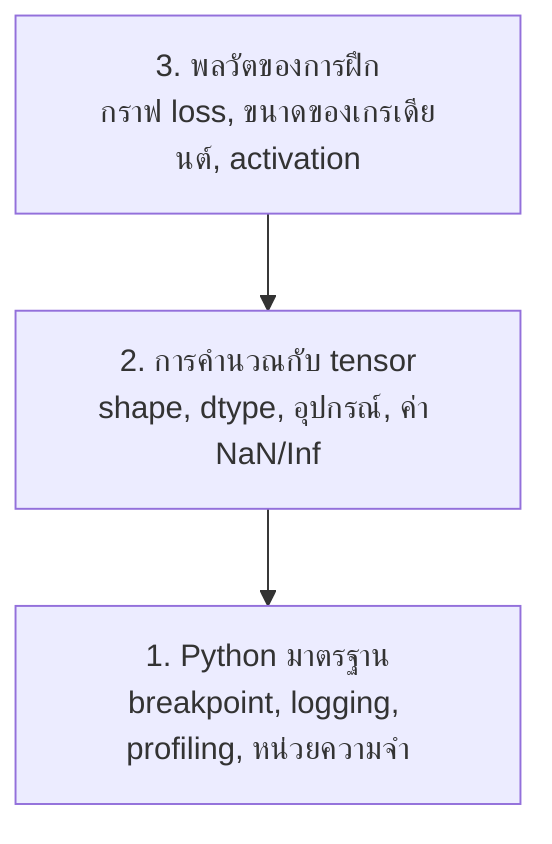

> บั๊กของงาน AI ที่ร้ายที่สุดไม่ทำให้โปรแกรมพัง มันฝึกโมเดลด้วยขยะไปเงียบๆ แล้วรายงานกราฟ loss ที่สวยงาม

**ประเภท:** ลงมือสร้าง (Build)
**ภาษา:** Python
**ความรู้ที่ควรมีก่อน:** บทที่ 1 (สภาพแวดล้อมสำหรับพัฒนา), เคยใช้ PyTorch เบื้องต้น
**เวลา:** ~60 นาที

## สิ่งที่จะได้เรียนรู้

- ใช้ `breakpoint()` แบบมีเงื่อนไขและ `debug_print` ตรวจ shape, dtype และค่า NaN ของ tensor ระหว่างการฝึก
- วัดประสิทธิภาพ (profile) ลูปการฝึกด้วย `cProfile`, `line_profiler` และ `tracemalloc` เพื่อหาคอขวด
- ตรวจจับบั๊กที่พบบ่อยในงาน AI: shape ไม่ตรงกัน, loss เป็น NaN, ข้อมูลรั่ว และ tensor อยู่ผิดอุปกรณ์
- ตั้งค่า TensorBoard เพื่อดูกราฟ loss, histogram ของน้ำหนัก และการกระจายของเกรเดียนต์

## ปัญหา

โค้ด AI ล้มเหลวต่างจากโค้ดทั่วไป เว็บแอปพังพร้อม stack trace แต่ลูปการฝึกที่ตั้งค่าผิดจะรันไป 8 ชั่วโมง เผาค่า GPU ไป $200 แล้วได้โมเดลที่ทำนายค่าเฉลี่ยออกมาทุกครั้งไม่ว่าข้อมูลขาเข้าจะเป็นอะไร โค้ดไม่เคย error เลย บั๊กคือ tensor ที่อยู่ผิดอุปกรณ์ การลืม `.detach()` หรือ label ที่รั่วเข้าไปปนกับ feature

คุณต้องมีเครื่องมือไล่บั๊กที่จับความล้มเหลวแบบเงียบๆ เหล่านี้ได้ ก่อนที่มันจะผลาญเวลาและทรัพยากรคำนวณของคุณ

## แนวคิด

การไล่บั๊กงาน AI มีสามระดับ:



คนส่วนใหญ่กระโดดไประดับ 3 ทันที (นั่งจ้อง TensorBoard) แต่ 80% ของบั๊กในงาน AI อยู่ในระดับ 1 และ 2

```figure
s0-flame-hot
```

## ลงมือสร้าง (Build It)

### ส่วนที่ 1: ไล่บั๊กด้วยการ print (ใช่ มันได้ผล)

การไล่บั๊กด้วย print มักถูกมองข้าม ซึ่งไม่ควร สำหรับโค้ดที่ใช้ tensor การ print แบบเจาะจงดีกว่าการเดินทีละบรรทัดใน debugger เพราะคุณต้องเห็น shape, dtype และช่วงของค่าไปพร้อมกัน

```python
def debug_print(name, tensor):
    print(f"{name}: shape={tensor.shape}, dtype={tensor.dtype}, "
          f"device={tensor.device}, "
          f"min={tensor.min().item():.4f}, max={tensor.max().item():.4f}, "
          f"mean={tensor.mean().item():.4f}, "
          f"has_nan={tensor.isnan().any().item()}")
```

เรียกฟังก์ชันนี้หลังทุกการคำนวณที่น่าสงสัย เมื่อเจอบั๊กแล้วก็ลบ print ทิ้ง ง่ายๆ แค่นั้น

### ส่วนที่ 2: debugger ของ Python (pdb และ breakpoint)

debugger ที่มากับ Python ถูกประเมินต่ำเกินไปสำหรับงาน AI ใส่ `breakpoint()` ลงในลูปการฝึก แล้วตรวจดู tensor แบบโต้ตอบได้

```python
def training_step(model, batch, criterion, optimizer):
    inputs, labels = batch
    outputs = model(inputs)
    loss = criterion(outputs, labels)

    if loss.item() > 100 or torch.isnan(loss):
        breakpoint()

    loss.backward()
    optimizer.step()
```

เมื่อ debugger หยุดให้คุณ คำสั่งที่มีประโยชน์คือ:

- `p outputs.shape` ดู shape
- `p loss.item()` ดูค่า loss
- `p torch.isnan(outputs).sum()` นับจำนวน NaN
- `p model.fc1.weight.grad` ดูเกรเดียนต์
- `c` ทำงานต่อ, `q` ออก

นี่คือการไล่บั๊กแบบมีเงื่อนไข จะหยุดก็ต่อเมื่อมีอะไรผิดปกติ สำหรับการฝึก 10,000 ก้าว เรื่องนี้สำคัญมาก

### ส่วนที่ 3: logging ของ Python

เปลี่ยนจาก print มาใช้ logging เมื่อการไล่บั๊กเกินกว่าการเช็กเร็วๆ

```python
import logging

logging.basicConfig(
    level=logging.INFO,
    format="%(asctime)s [%(levelname)s] %(message)s",
    handlers=[
        logging.FileHandler("training.log"),
        logging.StreamHandler()
    ]
)
logger = logging.getLogger(__name__)

logger.info("Starting training: lr=%.4f, batch_size=%d", lr, batch_size)
logger.warning("Loss spike detected: %.4f at step %d", loss.item(), step)
logger.error("NaN loss at step %d, stopping", step)
```

logging ให้ทั้งเวลา ระดับความรุนแรง และการเขียนลงไฟล์ เมื่อการฝึกพังตอนตีสาม คุณต้องการไฟล์ log ไม่ใช่ผลลัพธ์ใน terminal ที่เลื่อนหายไปแล้ว

### ส่วนที่ 4: จับเวลาเป็นช่วงๆ

การรู้ว่าเวลาหายไปไหน คือขั้นแรกของการปรับให้เร็วขึ้น

```python
import time

class Timer:
    def __init__(self, name=""):
        self.name = name

    def __enter__(self):
        self.start = time.perf_counter()
        return self

    def __exit__(self, *args):
        elapsed = time.perf_counter() - self.start
        print(f"[{self.name}] {elapsed:.4f}s")

with Timer("data loading"):
    batch = next(dataloader_iter)

with Timer("forward pass"):
    outputs = model(batch)

with Timer("backward pass"):
    loss.backward()
```

สิ่งที่มักพบ: การโหลดข้อมูลกินเวลา 60% ของการฝึก วิธีแก้คือ `num_workers > 0` ใน DataLoader ไม่ใช่ GPU ที่เร็วกว่า

### ส่วนที่ 5: cProfile และ line_profiler

เมื่อตัวจับเวลาที่เขียนเองไม่พอ:

```bash
python -m cProfile -s cumtime train.py
```

คำสั่งนี้แสดงการเรียกทุกฟังก์ชัน เรียงตามเวลาสะสม สำหรับการวัดทีละบรรทัด:

```bash
pip install line_profiler
```

```python
@profile
def train_step(model, data, target):
    output = model(data)
    loss = F.cross_entropy(output, target)
    loss.backward()
    return loss

# Run with: kernprof -l -v train.py
```

### ส่วนที่ 6: วัดการใช้หน่วยความจำ

#### หน่วยความจำของ CPU ด้วย tracemalloc

```python
import tracemalloc

tracemalloc.start()

# your code here
model = build_model()
data = load_dataset()

snapshot = tracemalloc.take_snapshot()
top_stats = snapshot.statistics("lineno")
for stat in top_stats[:10]:
    print(stat)
```

#### หน่วยความจำของ CPU ด้วย memory_profiler

```bash
pip install memory_profiler
```

```python
from memory_profiler import profile

@profile
def load_data():
    raw = read_csv("data.csv")       # watch memory jump here
    processed = preprocess(raw)       # and here
    return processed
```

รันด้วย `python -m memory_profiler your_script.py` เพื่อดูการใช้หน่วยความจำทีละบรรทัด

#### หน่วยความจำของ GPU ด้วย PyTorch

```python
import torch

if torch.cuda.is_available():
    print(torch.cuda.memory_summary())

    print(f"Allocated: {torch.cuda.memory_allocated() / 1e9:.2f} GB")
    print(f"Cached: {torch.cuda.memory_reserved() / 1e9:.2f} GB")
```

เมื่อเจอ OOM (หน่วยความจำไม่พอ):

1. ลดขนาด batch (ลองเป็นอย่างแรกเสมอ)
2. ใช้ `torch.cuda.empty_cache()` คืนหน่วยความจำที่แคชไว้
3. ใช้ `del tensor` ตามด้วย `torch.cuda.empty_cache()` กับผลลัพธ์ระหว่างทางที่ใหญ่
4. ใช้ mixed precision (`torch.cuda.amp`) เพื่อลดการใช้หน่วยความจำลงครึ่งหนึ่ง
5. ใช้ gradient checkpointing กับโมเดลที่ลึกมาก

### ส่วนที่ 7: บั๊กที่พบบ่อยในงาน AI และวิธีจับ

#### Shape ไม่ตรงกัน

บั๊กที่เจอบ่อยที่สุด tensor มี shape เป็น `[batch, features]` ขณะที่โมเดลคาดว่าจะได้ `[batch, channels, height, width]`

```python
def check_shapes(model, sample_input):
    print(f"Input: {sample_input.shape}")
    hooks = []

    def make_hook(name):
        def hook(module, inp, out):
            in_shape = inp[0].shape if isinstance(inp, tuple) else inp.shape
            out_shape = out.shape if hasattr(out, "shape") else type(out)
            print(f"  {name}: {in_shape} -> {out_shape}")
        return hook

    for name, module in model.named_modules():
        hooks.append(module.register_forward_hook(make_hook(name)))

    with torch.no_grad():
        model(sample_input)

    for h in hooks:
        h.remove()
```

รันครั้งเดียวด้วย batch ตัวอย่าง จะได้แผนที่การเปลี่ยน shape ทุกจุดในโมเดล

#### Loss เป็น NaN

loss เป็น NaN แปลว่ามีอะไรระเบิด สาเหตุที่พบบ่อย:

- learning rate สูงเกินไป
- หารด้วยศูนย์ใน loss ที่เขียนเอง
- หา log ของศูนย์หรือจำนวนลบ
- เกรเดียนต์ระเบิดใน RNN

```python
def detect_nan(model, loss, step):
    if torch.isnan(loss):
        print(f"NaN loss at step {step}")
        for name, param in model.named_parameters():
            if param.grad is not None:
                if torch.isnan(param.grad).any():
                    print(f"  NaN gradient in {name}")
                if torch.isinf(param.grad).any():
                    print(f"  Inf gradient in {name}")
        return True
    return False
```

#### ข้อมูลรั่ว

โมเดลได้ความแม่นยำ 99% บนชุด test ฟังดูดีมาก แต่นั่นคือบั๊ก

```python
def check_data_leakage(train_set, test_set, id_column="id"):
    train_ids = set(train_set[id_column].tolist())
    test_ids = set(test_set[id_column].tolist())
    overlap = train_ids & test_ids
    if overlap:
        print(f"DATA LEAKAGE: {len(overlap)} samples in both train and test")
        return True
    return False
```

ตรวจการรั่วตามเวลา (temporal leakage) ด้วย คือการใช้ข้อมูลในอนาคตไปทำนายอดีต ให้เรียงตามเวลาก่อนแบ่งชุดข้อมูล

#### อยู่ผิดอุปกรณ์

tensor ที่อยู่คนละอุปกรณ์ (CPU กับ GPU) ทำให้เกิด error ตอนรัน แต่บางครั้ง tensor หนึ่งค้างอยู่บน CPU เงียบๆ ขณะที่ทุกอย่างอยู่บน GPU แล้วการฝึกก็แค่ช้าลง

```python
def check_devices(model, *tensors):
    model_device = next(model.parameters()).device
    print(f"Model device: {model_device}")
    for i, t in enumerate(tensors):
        if t.device != model_device:
            print(f"  WARNING: tensor {i} on {t.device}, model on {model_device}")
```

### ส่วนที่ 8: พื้นฐาน TensorBoard

TensorBoard แสดงว่าเกิดอะไรขึ้นภายในการฝึกตลอดช่วงเวลา

```bash
pip install tensorboard
```

```python
from torch.utils.tensorboard import SummaryWriter

writer = SummaryWriter("runs/experiment_1")

for step in range(num_steps):
    loss = train_step(model, batch)

    writer.add_scalar("loss/train", loss.item(), step)
    writer.add_scalar("lr", optimizer.param_groups[0]["lr"], step)

    if step % 100 == 0:
        for name, param in model.named_parameters():
            writer.add_histogram(f"weights/{name}", param, step)
            if param.grad is not None:
                writer.add_histogram(f"grads/{name}", param.grad, step)

writer.close()
```

เปิดขึ้นมา:

```bash
tensorboard --logdir=runs
```

สิ่งที่ต้องมองหา:

- **loss ไม่ลดลง**: learning rate ต่ำเกินไป หรือโครงสร้างโมเดลมีปัญหา
- **loss แกว่งไปมาอย่างแรง**: learning rate สูงเกินไป
- **loss กลายเป็น NaN**: ตัวเลขไม่เสถียร (ดูหัวข้อ NaN ด้านบน)
- **loss ของ train ลดลง แต่ loss ของ val เพิ่มขึ้น**: overfitting
- **histogram ของน้ำหนักยุบเข้าหาศูนย์**: เกรเดียนต์หายไป (vanishing gradients)
- **histogram ของเกรเดียนต์ระเบิด**: ต้องใช้ gradient clipping

### ส่วนที่ 9: debugger ของ VS Code

สำหรับการไล่บั๊กแบบโต้ตอบ ให้ตั้งค่า VS Code ด้วย `launch.json`:

```json
{
    "version": "0.2.0",
    "configurations": [
        {
            "name": "Debug Training",
            "type": "debugpy",
            "request": "launch",
            "program": "${file}",
            "console": "integratedTerminal",
            "justMyCode": false
        }
    ]
}
```

ตั้ง breakpoint ด้วยการคลิกที่ขอบซ้ายของบรรทัด ใช้แผง Variables ดูคุณสมบัติของ tensor และ Debug Console ให้รันนิพจน์ Python อะไรก็ได้ระหว่างโปรแกรมหยุดอยู่

มีประโยชน์ตอนไล่ดูไปป์ไลน์เตรียมข้อมูลทีละขั้น ที่อยากเห็นผลของแต่ละการแปลง

## นำไปใช้ (Use It)

นี่คือขั้นตอนไล่บั๊กที่จับบั๊กงาน AI ได้เกือบทั้งหมด:

1. **ก่อนฝึก**: รัน `check_shapes` กับ batch ตัวอย่าง ตรวจว่ามิติของข้อมูลขาเข้าและขาออกตรงตามที่คาด
2. **10 ก้าวแรก**: ใช้ `debug_print` กับ loss, ผลลัพธ์ และเกรเดียนต์ ยืนยันว่าไม่มี NaN และค่าอยู่ในช่วงที่สมเหตุสมผล
3. **ระหว่างฝึก**: บันทึก loss, learning rate และขนาดของเกรเดียนต์ ใช้ TensorBoard แสดงผล
4. **เมื่อมีอะไรพัง**: ใส่ `breakpoint()` ตรงจุดที่พัง แล้วตรวจ tensor แบบโต้ตอบ
5. **เรื่องความเร็ว**: จับเวลาการโหลดข้อมูล เทียบกับ forward และ backward ถ้าหน่วยความจำใกล้เต็มให้วัดการใช้หน่วยความจำ

## ส่งมอบ (Ship It)

รันสคริปต์ชุดเครื่องมือไล่บั๊ก:

```bash
python phases/00-setup-and-tooling/12-debugging-and-profiling/code/debug_tools.py
```

ดู `outputs/prompt-debug-ai-code.md` สำหรับ prompt ที่ช่วยวินิจฉัยบั๊กเฉพาะของงาน AI

## แบบฝึกหัด

1. รัน `debug_tools.py` แล้วอ่านผลลัพธ์ของแต่ละส่วน แก้โมเดลจำลองให้เกิด NaN (ใบ้: หารด้วยศูนย์ใน forward pass) แล้วดูตัวตรวจจับจับได้
2. วัดประสิทธิภาพลูปการฝึกด้วย `cProfile` แล้วหาฟังก์ชันที่ช้าที่สุด
3. ใช้ `tracemalloc` หาว่าบรรทัดไหนในไปป์ไลน์โหลดข้อมูลจองหน่วยความจำมากที่สุด
4. ตั้งค่า TensorBoard สำหรับการฝึกง่ายๆ แล้วดูว่าโมเดล overfit หรือไม่
5. ใช้ `breakpoint()` ภายในลูปการฝึก ฝึกตรวจ shape อุปกรณ์ และค่าเกรเดียนต์ของ tensor จาก prompt ของ debugger

### คำใบ้

**แบบฝึกหัดที่ 1** รัน `python3 phases/00-setup-and-tooling/12-debugging-and-profiling/code/debug_tools.py` แล้วอ่านผลลัพธ์ของฟังก์ชันเดโมแต่ละตัว จากนั้นแก้โมเดลใน `demo_nan_detection` ให้ผลลัพธ์หารด้วยศูนย์ แล้วรันใหม่ `detect_nan` ต้องพิมพ์คำเตือน NaN พร้อมเลขก้าว

**แบบฝึกหัดที่ 2** รันลูปด้วย `python -m cProfile -s cumtime your_script.py` หรือครอบด้วย `cProfile.Profile()` อ่านแถวบนๆ ของคอลัมน์ `cumtime` ฟังก์ชันที่ใช้เวลามากที่สุดที่เป็นโค้ดของคุณเองคือตัวที่ช้าที่สุด

**แบบฝึกหัดที่ 3** เรียก `tracemalloc.start()` ก่อนโค้ดโหลดข้อมูล และ `tracemalloc.take_snapshot()` หลังจากนั้น แบบเดียวกับใน `demo_memory_tracking` พิมพ์ `snapshot.statistics("lineno")[:5]` บรรทัดแรกจะบอกไฟล์และเลขบรรทัดที่จองหน่วยความจำมากที่สุด

**แบบฝึกหัดที่ 4** บันทึก loss ของ train และ loss ของ validation ลง `SummaryWriter` ทุก epoch แล้วรัน `tensorboard --logdir=runs` ถ้า loss ของ train ยังลดลงเรื่อยๆ ขณะที่ loss ของ validation เพิ่มขึ้น แปลว่าโมเดล overfit

**แบบฝึกหัดที่ 5** ใส่ `breakpoint()` ไว้ในลูปหลัง `loss.backward()` แล้วรันสคริปต์ ที่ prompt `(Pdb)` ให้พิมพ์ `x.shape`, `x.device` และ `next(model.parameters()).grad` จากนั้นพิมพ์ `c` เพื่อไปก้าวถัดไป
