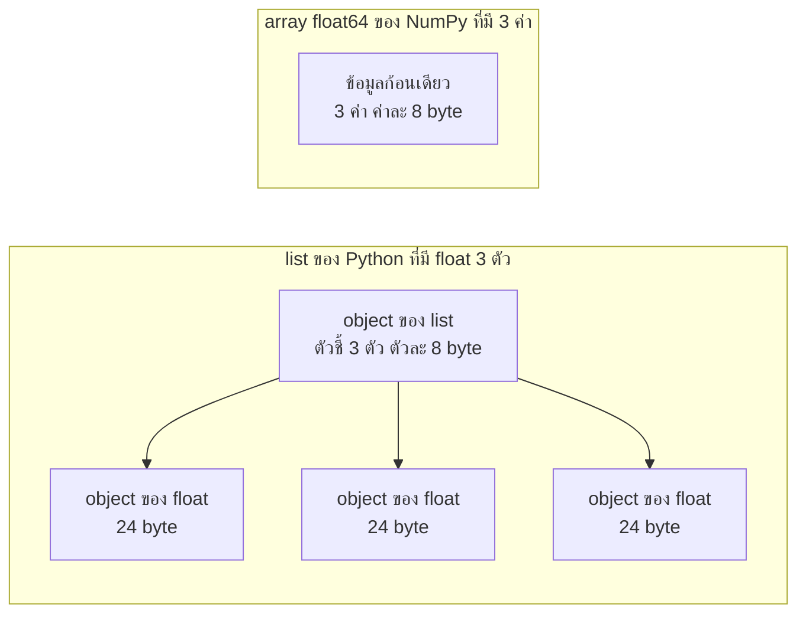

> โค้ดส่วนใหญ่ในหลักสูตรนี้ใช้สำนวน Python ชุดเล็กๆ ชุดเดียวกัน เรียนชุดนั้นให้จบที่นี่ ก่อนที่บทคณิตศาสตร์และบทโมเดลจะต้องพึ่งมัน

**ประเภท:** ลงมือสร้าง (Build)
**ภาษา:** Python, TypeScript
**ความรู้ที่ควรมีก่อน:** สภาพแวดล้อมสำหรับพัฒนา, สภาพแวดล้อมของ Python
**เวลา:** ~120 นาที

## สิ่งที่จะได้เรียนรู้

- อ่านและเขียนสำนวน (idiom) ที่โค้ดส่วนใหญ่ของหลักสูตรใช้ ตั้งแต่การแตกค่า (unpacking) และ f-string ไปจนถึง dataclass และ comprehension
- หาข้อผิดพลาดใน Python สามแบบที่ให้ผลผิดโดยไม่มี error: list ที่ใช้ร่วมกัน, ค่า default ที่เปลี่ยนแปลงได้ และ generator ที่ถูกใช้หมดไปแล้ว
- สร้างตัวโหลด CSV และ JSON, การแบ่งชุดข้อมูลแบบกำหนด seed และตัวสร้าง mini-batch ด้วยไลบรารีมาตรฐานอย่างเดียว
- เขียน dot product ค่าเฉลี่ย และส่วนเบี่ยงเบนมาตรฐานด้วย Python ล้วน แล้ววัดความเร็วและหน่วยความจำ
- อธิบายได้ว่าทำไมลูปของ Python ล้วนที่วนกับตัวเลขจึงช้า และ broadcasting ของ NumPy ย้ายลูปไปอยู่ในโค้ดที่คอมไพล์แล้วได้อย่างไร

## ปัญหา

บทเรียนหลังจาก phase นี้ใช้ Python ธรรมดาเขียนทั้งคณิตศาสตร์และโมเดล ในไฟล์ Python 541 ไฟล์ของบทเรียน มี 276 ไฟล์ที่ import `dataclasses` และ 187 ไฟล์เรียก `random.seed` หรือสร้างตัวสุ่ม `random.Random` ถ้าสำนวนเหล่านี้ใหม่สำหรับคุณ คุณจะต้องมานั่งอ่านไวยากรณ์ ทั้งที่อยากอ่านคณิตศาสตร์

Python ยังมีพฤติกรรมที่ให้ผลผิดโดยไม่มีข้อความ error เลย ชื่อสองชื่ออาจอ้างถึง list เดียวกัน การแก้ผ่านชื่อหนึ่งจึงไปเปลี่ยนอีกชื่อด้วย อาร์กิวเมนต์ default เก็บค่าไว้ข้ามการเรียกแต่ละครั้ง และ generator จะว่างเปล่าหลังวนไปแล้วหนึ่งรอบ การฝึก epoch ที่สองจึงไม่ได้ข้อมูลเลย และ loss ก็ไม่เปลี่ยน

ปัญหาสุดท้ายคือความเร็ว บนแล็ปท็อปที่ใช้ทดสอบ ลูปของ Python ล้วนที่วนกับ float หนึ่งล้านตัวใช้เวลาราว 30 มิลลิวินาที ส่วน NumPy คำนวณ dot product เดียวกันได้ในเวลาไม่ถึงหนึ่งมิลลิวินาที คุณต้องรู้เหตุผล เพื่อจะเลือกได้ว่าเมื่อไรควรใช้ลูปที่อ่านง่าย และเมื่อไรควรใช้การคำนวณกับ array

## แนวคิด

### โค้ดในหลักสูตรใช้อะไรบ้าง

เราอ่านไฟล์ Python ทั้ง 541 ไฟล์ใน `phases/*/*/code/` ด้วยโมดูล `ast` ตารางนี้นับจำนวนไฟล์ที่ใช้แต่ละโครงสร้างอย่างน้อยหนึ่งครั้ง ตัวเลขเป็นของวันที่เขียนบทนี้ และจะเปลี่ยนไปเมื่อมีบทเรียนเพิ่ม

| โครงสร้าง | จำนวนไฟล์ | สัดส่วน |
|-----------|-------|-------|
| การนิยามฟังก์ชัน | 541 | 100% |
| `if __name__ == "__main__":` | 529 | 98% |
| f-string | 517 | 96% |
| การแตกค่า tuple (unpacking) | 448 | 83% |
| คลาส | 379 | 70% |
| list comprehension | 375 | 69% |
| type hint ของฟังก์ชัน | 342 | 63% |
| generator expression | 326 | 60% |
| slice | 314 | 58% |
| `lambda` | 175 | 32% |
| `try` และ `except` | 120 | 22% |
| คำสั่ง `with` | 96 | 18% |
| dict comprehension | 93 | 17% |
| generator function ที่ใช้ `yield` | 14 | 3% |

สิ่งที่ import บอกว่าโมดูลมาตรฐานตัวไหนสำคัญ ในไฟล์ 541 ไฟล์ มี 340 ไฟล์ที่ขึ้นต้นด้วย `from __future__ import annotations` และ 276 ไฟล์ import `dataclasses` โมดูล `math`, `random` และ `json` อยู่ใน 187, 175 และ 126 ไฟล์ตามลำดับ โมดูล `collections` อยู่ใน 70 ไฟล์ ส่วน `itertools` อยู่ในแค่ 4 ไฟล์

ไม่มีบทไหนเรียก `map()` หรือ `filter()` เลย comprehension ทำหน้าที่นั้นแทน การเรียก `sorted`, `min`, `max` หรือ `.sort` พร้อมฟังก์ชัน `key=` มีในกว่า 140 ไฟล์ บทนี้จึงใช้เวลามากที่สุดกับสำนวนที่อยู่บนสุดของรายการเหล่านี้

### ชื่ออ้างถึง object

ใน Python ตัวแปรคือชื่อที่อ้างถึง object การกำหนดค่า (assignment) ผูกชื่อเข้ากับ object โดยไม่ได้คัดลอก object เมื่อชื่อสองชื่ออ้างถึง list เดียวกัน การเปลี่ยนผ่านชื่อไหนก็ตามจะเห็นผลจากทั้งสองชื่อ ตัวเลข สตริง และ tuple เปลี่ยนค่าไม่ได้ กฎนี้จึงไม่ก่อปัญหากับพวกมัน แต่ list, dict และ set เปลี่ยนค่าได้ ถ้าต้องการฉบับที่แยกจากกันให้คัดลอก

### list เก็บตัวชี้ ส่วน array เก็บตัวเลข

list ของ Python ไม่ได้เก็บตัวเลขโดยตรง แต่เก็บตัวชี้ (pointer) ซึ่งแต่ละตัวชี้ไปยัง object ของ Python ทั้งก้อน บน CPython แบบ 64 บิต ตัวชี้แต่ละตัวใช้ 8 byte และ object `float` แต่ละตัวใช้ 24 byte ส่วน array แบบ `float64` ของ NumPy เก็บค่าดิบขนาด 8 byte เรียงต่อกันในหน่วยความจำก้อนเดียว



ลูปที่วนกับ list ต้องทำงานเยอะมากต่อสมาชิกหนึ่งตัว ตัวแปลภาษารัน bytecode ทีละคำสั่ง สำหรับสมาชิกแต่ละตัว มันต้องตามตัวชี้ไป ตรวจชนิดของตัวตั้งแต่ละตัว แล้วเรียกโค้ดคูณ float และสร้าง object float ของ Python ขึ้นมาเก็บผลลัพธ์

NumPy คำนวณเลขชุดเดียวกันในลูปที่เป็นโค้ดคอมไพล์แล้ว วนกับค่าดิบโดยตรง ตรวจชนิดข้อมูลครั้งเดียวสำหรับทั้ง array และไม่สร้าง object ของ Python สำหรับสมาชิกแต่ละตัว โค้ดแบบ vectorized เขียนการคำนวณครั้งเดียวที่ใช้กับทั้ง array เช่น `(x - mean) / std` แล้วให้ไลบรารีเป็นตัววนลูป ฟังก์ชันเวกเตอร์ในบทนี้ทำตามกฎนี้ แต่ละฟังก์ชันทำการคำนวณกับ array หนึ่งอย่าง คุณจึงเปลี่ยนเป็นการเรียก NumPy ครั้งเดียวได้ในภายหลัง

### list เก็บทุกตัว ส่วน generator เก็บทีละตัว

list comprehension สร้างสมาชิกทุกตัวก่อนที่บรรทัดถัดไปจะรัน ส่วน generator สร้างทีละตัวทุกครั้งที่ผู้เรียกขอตัวถัดไป หน่วยความจำของ list โตตามจำนวนสมาชิก แต่หน่วยความจำของ generator แทบคงที่ไม่ว่าจะมีกี่ตัว

generator วนได้แค่ครั้งเดียว หลังสมาชิกตัวสุดท้าย มันจะ raise `StopIteration` ทุกครั้งที่ถูกขอ ลูป `for` รอบที่สองจึงไม่ได้อะไรเลย โค้ดฝึกอ่านชุดข้อมูลหนึ่งรอบต่อ epoch จึงต้องสร้าง generator ใหม่ทุก epoch

generator function พบน้อยในโค้ดของบทเรียน แต่ตัวโหลดข้อมูลที่บท deep learning ใช้คือ iterable ของ batch แนวคิดนี้จึงอยู่ในลูปการฝึกทุกลูป ภาพด้านล่างแสดงทั้งสองแบบกับข้อมูล 8 แถวชุดเดียวกัน

```figure
s0-list-vs-generator
```

## สำนวนที่ต้องใช้

ทุกบล็อกในหัวข้อนี้รันได้ด้วยตัวเอง บันทึกลงไฟล์แล้วรันด้วย `python3` บล็อกเหล่านี้ต้องใช้ Python 3.11 ขึ้นไป ซึ่งเป็นเวอร์ชันที่ติดตั้งไว้ในบทสภาพแวดล้อมสำหรับพัฒนา

### 1. ค่า คอลเลกชัน และการแตกค่า

Python มีคอลเลกชันในตัวสี่แบบ ควรรู้ว่าเมื่อไรใช้แบบไหน

| ชนิด | ตัวอย่าง | มีลำดับ | เปลี่ยนค่าได้ | การใช้ทั่วไปในหลักสูตร |
|------|---------|---------|------------|---------------------------|
| `list` | `[0.5, 1.2]` | ใช่ | ได้ | ตัวอย่างข้อมูล, ค่า loss, น้ำหนัก |
| `tuple` | `(32, 784)` | ใช่ | ไม่ได้ | shape, ระเบียนที่ไม่เปลี่ยน, key ของ dict |
| `dict` | `{"lr": 0.01}` | ตามลำดับที่ใส่ | ได้ | การตั้งค่า, คลังคำศัพท์, แถวของ JSON |
| `set` | `{"cat", "dog"}` | ไม่ | ได้ | token ที่ไม่ซ้ำ, ตรวจการทับกัน |

บล็อกนี้แสดงว่าการกำหนดค่าไม่ได้คัดลอก list

```python
weights = [0.5, -1.2, 3.0]
alias = weights
alias[0] = 99.0
print(weights)

independent = list(weights)
independent[1] = 0.0
print(weights, independent)

grid = [[0] * 3] * 2
grid[0][0] = 1
print(grid)

grid = [[0] * 3 for _ in range(2)]
grid[0][0] = 1
print(grid)
```

```text
[99.0, -1.2, 3.0]
[99.0, -1.2, 3.0] [99.0, 0.0, 3.0]
[[1, 0, 0], [1, 0, 0]]
[[1, 0, 0], [0, 0, 0]]
```

นิพจน์ `[[0] * 3] * 2` สร้าง list ชั้นนอกที่มีตัวอ้างถึง list ชั้นในตัวเดียวกันสองครั้ง ส่วน comprehension สร้าง list ชั้นในใหม่ให้ทุกแถว phase คณิตศาสตร์สร้างเมทริกซ์จาก list จึงควรใช้แบบ comprehension

การแตกค่า (unpacking) กำหนดสมาชิกของลำดับให้หลายชื่อในบรรทัดเดียว ชื่อที่มีดาวนำหน้าเก็บสมาชิกที่เหลือทั้งหมด f-string ใส่ค่าของนิพจน์ลงในสตริง และระบุรูปแบบหลังเครื่องหมายทวิภาคได้

```python
shape = (32, 784)
batch_size, n_features = shape
first, *middle, last = [1, 2, 3, 4, 5]
x, y = 1.0, 3.0
x, y = y, x

config = {"lr": 0.01, "epochs": 5}
config["seed"] = 7
tokens = ["the", "cat", "sat", "on", "the", "mat"]
vocab = set(tokens)

print(batch_size, n_features, first, middle, last, x, y)
print(config.get("momentum", 0.9), "cat" in vocab, len(vocab))
print(f"lr={config['lr']:.0e} loss={0.123456:.3f} n={60_000:,} {batch_size=}")
```

```text
32 784 1 [2, 3, 4] 5 3.0 1.0
0.9 True 5
lr=1e-02 loss=0.123 n=60,000 batch_size=32
```

`dict.get` คืนค่า default เมื่อไม่มี key นั้น การทดสอบ `in` กับ set ใช้เวลาพอๆ กันไม่ว่า set จะใหญ่แค่ไหน รูปแบบ `{batch_size=}` พิมพ์ทั้งชื่อและค่า ช่วยได้มากเวลาไล่บั๊ก

slice `a[start:stop:step]` รวม `start` แต่ไม่รวม `stop` index ที่ติดลบนับจากท้าย slice ของ list คือ list ใหม่ การ slice list ขนาดใหญ่จึงคัดลอกตัวชี้ทั้งหมด

```python
tokens = ["<s>", "the", "cat", "sat", "on", "the", "mat", "</s>"]
print(tokens[1:-1])
print(tokens[:3], tokens[-3:])
print(tokens[::2])
print(tokens[::-1][:2])
windows = [tokens[i:i + 3] for i in range(len(tokens) - 2)]
print(len(windows), windows[0])
```

```text
['the', 'cat', 'sat', 'on', 'the', 'mat']
['<s>', 'the', 'cat'] ['the', 'mat', '</s>']
['<s>', 'cat', 'on', 'mat']
['</s>', 'mat']
6 ['<s>', 'the', 'cat']
```

### 2. Comprehension

comprehension สร้าง list, dict หรือ set จาก iterable ในนิพจน์เดียว อ่านแล้วเหมือนสูตรคณิตศาสตร์ที่มันอธิบาย

```python
scores = [0.91, 0.42, 0.77, 0.15, 0.66]
labels = [1 if s >= 0.5 else 0 for s in scores]
high = [s for s in scores if s > 0.6]
squares = {i: i * i for i in range(4)}
lengths = {len(word) for word in ["a", "bb", "cc", "ddd"]}
sum_sq = sum(s * s for s in scores)

matrix = [[1, 2, 3], [4, 5, 6]]
transposed = [list(column) for column in zip(*matrix)]
flat = [v for row in matrix for v in row]

print(labels, high, squares, lengths, round(sum_sq, 4))
print(transposed, flat)
```

```text
[1, 0, 1, 0, 1] [0.91, 0.77, 0.66] {0: 0, 1: 1, 2: 4, 3: 9} {1, 2, 3} 2.0555
[[1, 4], [2, 5], [3, 6]] [1, 2, 3, 4, 5, 6]
```

`if` ที่ต่อท้ายเก็บไว้เฉพาะบางสมาชิก นิพจน์ก่อน `for` เป็นนิพจน์แบบมีเงื่อนไข `a if condition else b` ได้ และ `for` สองชั้นทำงานตามลำดับเดียวกับลูปซ้อนสองชั้น

วงเล็บกลมสร้าง generator expression ใน `sum(s * s for s in scores)` ฟังก์ชัน `sum` อ่านค่ากำลังสองทีละตัว และ Python ไม่ได้สร้าง list ขึ้นมาเลย ส่วนใน `zip(*matrix)` ดาวส่งแต่ละแถวเป็นอาร์กิวเมนต์แยกกัน แล้ว `zip` จับคู่สมาชิกที่อยู่ตำแหน่งเดียวกัน

### 3. ฟังก์ชัน อาร์กิวเมนต์ และ closure

ค่า default ทำให้อาร์กิวเมนต์ไม่บังคับใส่ อาร์กิวเมนต์แบบ keyword ระบุชื่อพารามิเตอร์ตอนเรียก ส่วน `*` ที่อยู่เดี่ยวๆ ในรายการพารามิเตอร์ทำให้พารามิเตอร์ที่ตามมาต้องส่งแบบ keyword เท่านั้น

```python
def clip(value, low=0.0, high=1.0):
    return max(low, min(high, value))


def train(data, *, lr=0.01, epochs=3):
    return f"{len(data)} samples, lr={lr}, epochs={epochs}"


def make_scaler(factor):
    def scale(values):
        return [v * factor for v in values]
    return scale


print(clip(1.7), clip(-3.0, low=-1.0), clip(0.4, high=0.3))
print(train([1, 2, 3], lr=0.1))
to_percent = make_scaler(100)
print(to_percent([0.25, 0.5]))
```

```text
1.0 -1.0 0.3
3 samples, lr=0.1, epochs=3
[25.0, 50.0]
```

เมื่อใช้อาร์กิวเมนต์แบบ keyword เท่านั้น การเรียกอย่าง `train(data, 0.1, 3)` จะเกิด `TypeError` ผู้เรียกต้องเขียน `lr=0.1` ตัวเลขสองตัวจึงสลับที่กันโดยไม่ตั้งใจไม่ได้

ฟังก์ชันชั้นใน `scale` ใช้ `factor` จากฟังก์ชันที่สร้างมันขึ้นมา Python เก็บ `factor` ไว้ตราบที่ `scale` ยังอยู่ ฟังก์ชันที่เก็บตัวแปรจากผู้สร้างไว้แบบนี้เรียกว่า closure ตัวปรับมาตรฐาน (standardizer) ในหัวข้อลงมือสร้างใช้ closure เก็บค่าสถิติของชุด train

`lambda` คือฟังก์ชันไม่มีชื่อที่มีนิพจน์เดียว โค้ดในหลักสูตรใช้ส่วนใหญ่เป็นฟังก์ชัน `key=` ซึ่งส่วนที่ 8 จะแสดงให้ดู

Python ประเมินค่า default ครั้งเดียว ตอนรันคำสั่ง `def` ทุกการเรียกที่ใช้ค่า default จึงได้ object ตัวเดียวกัน

```python
def add_bad(item, bucket=[]):
    bucket.append(item)
    return bucket


def add_good(item, bucket=None):
    if bucket is None:
        bucket = []
    bucket.append(item)
    return bucket


add_bad("a")
print(add_bad("b"))
add_good("a")
print(add_good("b"))
```

```text
['a', 'b']
['b']
```

ใช้ `None` เป็นค่า default ของ list, dict หรือ set แล้วสร้าง object ใหม่ภายในฟังก์ชัน

### 4. คลาสและ dataclass

decorator `@dataclass` เขียน `__init__`, `__repr__` และ `__eq__` ให้จากฟิลด์ที่มี annotation ถ้าใส่ `frozen=True` object จะเปลี่ยนค่าไม่ได้หลังสร้าง และใช้เป็น key ของ dict หรือใส่ใน set ได้

```python
from dataclasses import dataclass, field


@dataclass(frozen=True)
class Example:
    features: tuple[float, ...]
    label: int


@dataclass
class TrainConfig:
    lr: float = 0.01
    epochs: int = 5
    hidden: list[int] = field(default_factory=lambda: [64, 32])

    def describe(self):
        return f"lr={self.lr} epochs={self.epochs} hidden={self.hidden}"


ex = Example((1.5, 2.0), 1)
print(ex)
print(ex == Example((1.5, 2.0), 1), len({ex, Example((1.5, 2.0), 1)}))
print(TrainConfig(epochs=10).describe())
try:
    ex.label = 0
except AttributeError as err:
    print(type(err).__name__)
```

```text
Example(features=(1.5, 2.0), label=1)
True 1
lr=0.01 epochs=10 hidden=[64, 32]
FrozenInstanceError
```

`field(default_factory=...)` ให้ list ใหม่กับ instance แต่ละตัว ซึ่งแก้ปัญหาค่า default ที่ใช้ร่วมกันจากส่วนที่ 3 ภายใน dataclass

เมธอดพิเศษ (special method) เชื่อมคลาสเข้ากับไวยากรณ์ของ Python `len(ds)` เรียก `__len__` และ `ds[2]` เรียก `__getitem__`

```python
class SquaresDataset:
    def __init__(self, n):
        self.n = n

    def __len__(self):
        return self.n

    def __getitem__(self, index):
        if not 0 <= index < self.n:
            raise IndexError(index)
        return index, index * index


ds = SquaresDataset(4)
print(len(ds), ds[2])
print(list(ds))
```

```text
4 (2, 4)
[(0, 0), (1, 1), (2, 4), (3, 9)]
```

ลูป `for` ภายใน `list(ds)` ทำงานได้โดยไม่ต้องมีเมธอด `__iter__` Python เรียก `__getitem__` ด้วย 0, 1, 2 ไปเรื่อยๆ จนได้ `IndexError` dataset แบบ map-style ของ PyTorch ใช้สองเมธอดเดียวกันนี้ คือ `__len__` และ `__getitem__`

### 5. Iterator และ generator

iterable คือ object ใดก็ได้ที่ลูป `for` รับได้ `iter()` ขอ iterator จากมัน และ `next()` ขอสมาชิกทีละตัวจาก iterator เมื่อ iterator หมดสมาชิก มันจะ raise `StopIteration` ลูป `for` เรียก `next()` ให้คุณ และหยุดเมื่อเจอ `StopIteration`

```python
numbers = [10, 20, 30]
it = iter(numbers)
print(next(it), next(it), next(it))
try:
    next(it)
except StopIteration:
    print("no more items")


def countdown(n):
    while n > 0:
        yield n
        n -= 1


gen = countdown(3)
print(type(gen).__name__)
print(list(gen))
print(list(gen))
```

```text
10 20 30
no more items
generator
[3, 2, 1]
[]
```

ฟังก์ชันที่มี `yield` อยู่ข้างในคือ generator function การเรียกมันยังไม่รันโค้ดใดๆ แต่คืน object ของ generator ออกมา ทุกครั้งที่เรียก `next()` ตัวฟังก์ชันจะรันไปจนถึง `yield` ถัดไปแล้วหยุดรอ `list(gen)` ครั้งที่สองว่างเปล่า เพราะครั้งแรกใช้ generator ไปหมดแล้ว

generator อ่านไฟล์ทีละบรรทัดได้

```python
import os
import tempfile


def read_rows(path):
    with open(path, encoding="utf-8") as fh:
        header = fh.readline().rstrip("\n").split(",")
        for line in fh:
            yield dict(zip(header, line.rstrip("\n").split(",")))


with tempfile.TemporaryDirectory() as tmp:
    path = os.path.join(tmp, "rows.csv")
    with open(path, "w", encoding="utf-8") as fh:
        fh.write("x,label\n")
        fh.writelines(f"{i * 0.5},{i % 2}\n" for i in range(5))
    rows = read_rows(path)
    print(next(rows))
    print(sum(1 for _ in rows))
```

```text
{'x': '0.0', 'label': '0'}
4
```

`read_rows` เก็บไฟล์ไว้ในหน่วยความจำทีละบรรทัด นี่คือ `read_rows` ตัวเดียวกับในภาพ มันแยกด้วยจุลภาคเพื่อให้ตัวอย่างสั้น แต่ไฟล์ CSV จริงอาจมีจุลภาคอยู่ในฟิลด์ที่อยู่ในเครื่องหมายคำพูด หัวข้อลงมือสร้างจึงใช้โมดูล `csv`

```python
import sys

as_list = [i * i for i in range(1_000_000)]
as_generator = (i * i for i in range(1_000_000))
print(sys.getsizeof(as_list), sys.getsizeof(as_generator))
print(sum(as_list) == sum(as_generator))
```

บน CPython แบบ 64 บิต list รายงานขนาดราว 8 MB ส่วน generator ราว 200 byte `sys.getsizeof` นับแค่ตัวชี้ของ list ส่วน object ของจำนวนเต็มใช้หน่วยความจำมากกว่านั้นอีก หัวข้อลงมือสร้างวัดค่าสูงสุดจริงด้วย `tracemalloc` ซึ่งใช้ไปแล้วในบทการไล่บั๊กและการวัดประสิทธิภาพ

### 6. Context manager และ exception

คำสั่ง `with` รันโค้ดเตรียมการ ตามด้วยตัวบล็อก แล้วจึงรันโค้ดเก็บกวาด ส่วนเก็บกวาดจะรันแม้ตัวบล็อกจะเกิด exception object ของไฟล์ที่ได้จาก `open()` เป็น context manager ที่ปิดไฟล์ให้

ในบทการไล่บั๊กและการวัดประสิทธิภาพ เราเขียนคลาส `Timer` ที่มี `__enter__` และ `__exit__` ส่วน decorator `contextlib.contextmanager` สร้าง object แบบเดียวกันจาก generator โค้ดก่อน `yield` คือการเตรียม และบล็อก `finally` คือการเก็บกวาด

```python
import time
from contextlib import contextmanager


@contextmanager
def timer(label):
    start = time.perf_counter()
    try:
        yield
    finally:
        print(f"{label}: {(time.perf_counter() - start) * 1000:.1f} ms")


def parse_label(text):
    try:
        return int(text)
    except ValueError:
        raise ValueError(f"label must be an integer, got {text!r}") from None


with timer("sum of squares"):
    total = sum(i * i for i in range(200_000))

print(parse_label("3"))
try:
    parse_label("cat")
except ValueError as err:
    print("rejected:", err)
```

```text
sum of squares: 9.4 ms
3
rejected: label must be an integer, got 'cat'
```

เวลาบนเครื่องของคุณจะต่างออกไป ให้ระบุ exception ที่คาดไว้ให้ชัดใน `except` เช่น `ValueError` หรือ `KeyError` ส่วน `except:` ที่ไม่ระบุชนิดจะรับ `KeyboardInterrupt` ไปด้วย Ctrl+C จึงอาจหยุดลูปที่มีมันอยู่ไม่ได้ เมื่อข้อมูลขาเข้าผิด ให้ raise exception พร้อมข้อความที่ชัดเจน และเพิ่ม `from None` เมื่อข้อความของคุณใช้แทน traceback เดิม

### 7. Type hint, โมดูล และ main guard

type hint บอกผู้อ่านว่าฟังก์ชันรับอะไรและคืนอะไร Python ไม่ได้ตรวจตอนรันโค้ด แต่ตัวตรวจชนิดข้อมูลอย่าง mypy จะอ่านก่อนโค้ดรัน

```python
from __future__ import annotations

from collections.abc import Iterable, Sequence


def mean(values: Sequence[float]) -> float:
    if not values:
        raise ValueError("mean() needs at least one value")
    return sum(values) / len(values)


def count_tokens(docs: Iterable[str]) -> int:
    return sum(len(doc.split()) for doc in docs)


def main() -> None:
    print(mean([1.0, 2.0, 4.0]))
    print(count_tokens(["the cat sat", "on the mat"]))
    print(mean.__annotations__)


if __name__ == "__main__":
    main()
```

```text
2.3333333333333335
6
{'values': 'Sequence[float]', 'return': 'float'}
```

เมื่อมี `from __future__ import annotations` Python จะเก็บ hint แต่ละตัวเป็นสตริง ตามที่บรรทัดสุดท้ายแสดง `Sequence` หมายถึง object ใดก็ได้ที่มี `len()` และใช้ index ได้ เช่น list หรือ tuple ส่วน `Iterable` หมายถึง object ใดก็ได้ที่ลูป `for` รับได้ ไฟล์จำนวนมากในหลักสูตร import ชื่อเดียวกันนี้จาก `typing` ซึ่งก็ใช้ได้เหมือนกัน

ไฟล์ `.py` ทุกไฟล์คือโมดูล เมื่อรันไฟล์ด้วย `python3 file.py` Python ตั้ง `__name__` ของไฟล์นั้นเป็น `"__main__"` แต่เมื่อไฟล์อื่น import มัน `__name__` จะเป็นชื่อโมดูล guard นี้เรียก `main()` เฉพาะกรณีแรก เพราะมี guard นี้ test ใน `code/tests/` จึง import `main.py` ได้โดยไม่ทำให้เดโมเริ่มรัน

### 8. ไฟล์ JSON CSV และการเรียงลำดับ

`pathlib.Path` ต่อ path ด้วย `/` และอ่านหรือเขียนทั้งไฟล์ได้ในการเรียกครั้งเดียว ใส่ `encoding="utf-8"` ทุกครั้ง เพราะ encoding ตั้งต้นขึ้นกับระบบปฏิบัติการ

```python
import csv
import json
import tempfile
from pathlib import Path

rows = [
    {"text": "great movie", "label": 1, "score": 0.93},
    {"text": "boring plot", "label": 0, "score": 0.12},
    {"text": "fine acting", "label": 1, "score": 0.58},
]

with tempfile.TemporaryDirectory() as tmp:
    json_path = Path(tmp) / "reviews.json"
    json_path.write_text(json.dumps(rows, indent=2), encoding="utf-8")
    from_json = json.loads(json_path.read_text(encoding="utf-8"))

    csv_path = Path(tmp) / "reviews.csv"
    with csv_path.open("w", newline="", encoding="utf-8") as fh:
        writer = csv.DictWriter(fh, fieldnames=["text", "label", "score"])
        writer.writeheader()
        writer.writerows(rows)
    with csv_path.open(newline="", encoding="utf-8") as fh:
        from_csv = list(csv.DictReader(fh))

print(from_json == rows)
print(from_csv[0])

by_score = sorted(rows, key=lambda r: r["score"], reverse=True)
print([r["text"] for r in by_score])
print(max(rows, key=lambda r: r["score"])["text"])
print([r["text"] for r in sorted(rows, key=lambda r: (-r["label"], r["text"]))])
```

```text
True
{'text': 'great movie', 'label': '1', 'score': '0.93'}
['great movie', 'fine acting', 'boring plot']
great movie
['fine acting', 'great movie', 'boring plot']
```

JSON เก็บตัวเลขเป็นตัวเลข แต่ CSV คืนทุกฟิลด์เป็นสตริง คุณจึงต้องแปลงทีละฟิลด์เอง ให้เปิดไฟล์ CSV ด้วย `newline=""` ตามที่เอกสารของ `csv` แนะนำ

ฟังก์ชัน `key=` คืนค่าที่ Python ใช้เทียบสำหรับสมาชิกแต่ละตัว `sorted`, `min` และ `max` รับได้ทั้งหมด key ที่เป็น tuple เรียงตามค่าแรก และใช้ค่าที่สองเฉพาะเมื่อค่าแรกเท่ากัน เครื่องหมายลบทำให้ label ที่มากกว่าขึ้นก่อน การเรียงของ Python เป็นแบบ stable สมาชิกที่ key เท่ากันจึงคงลำดับเดิมไว้

### 9. การนับ การจัดกลุ่ม และเครื่องมือ iterator

สองโมดูลนี้มีโครงสร้างข้อมูลและเครื่องมือ iterator ที่ list และ dict ธรรมดาไม่มีให้

```python
from collections import Counter, defaultdict, deque
from itertools import chain, islice, product

labels = ["cat", "dog", "cat", "bird", "cat", "dog"]
counts = Counter(labels)
print(counts.most_common(2))

positions = defaultdict(list)
for i, label in enumerate(labels):
    positions[label].append(i)
print(dict(positions))

recent = deque(maxlen=3)
for loss in [2.0, 1.5, 1.2, 1.1, 0.9]:
    recent.append(loss)
print(list(recent), round(sum(recent) / len(recent), 3))

print(list(product([0.1, 0.01], [16, 32])))
print(list(chain([1, 2], [3], [4, 5])))
print(list(islice(range(100), 5, 10)))
```

```text
[('cat', 3), ('dog', 2)]
{'cat': [0, 2, 4], 'dog': [1, 5], 'bird': [3]}
[1.2, 1.1, 0.9] 1.067
[(0.1, 16), (0.1, 32), (0.01, 16), (0.01, 32)]
[1, 2, 3, 4, 5]
[5, 6, 7, 8, 9]
```

`Counter` นับสมาชิกที่ hash ได้ เช่น label หรือ token `defaultdict(list)` สร้าง list ว่างให้ครั้งแรกที่ใช้ key ใหม่ ลูปจัดกลุ่มจึงไม่ต้องตรวจ key ก่อน `deque(maxlen=3)` ลบสมาชิกที่เก่าที่สุดทิ้งเมื่อเพิ่มตัวที่สี่ จึงได้หน้าต่างเลื่อนของค่า loss ล่าสุด ส่วน `enumerate` ให้สมาชิกแต่ละตัวพร้อม index ของมัน

`product` ให้ทุกการจับคู่ของข้อมูลขาเข้า ซึ่งก็คือตารางไฮเปอร์พารามิเตอร์ (hyperparameter grid) `chain` ต่อ iterable หลายตัวเข้าด้วยกันแบบหัวต่อท้าย `islice` ตัด slice จาก iterator ใดก็ได้ รวมถึง generator ตัวสร้าง mini-batch ในหัวข้อลงมือสร้างใช้ `islice`

### 10. ทำไมลูปที่วนกับตัวเลขจึงช้า

โมดูล `dis` พิมพ์คำสั่ง bytecode ที่ตัวแปลภาษารันสำหรับฟังก์ชันหนึ่ง

```python
import dis


def dot(a, b):
    total = 0.0
    for x, y in zip(a, b):
        total += x * y
    return total


dis.dis(dot)
```

คำสั่งตั้งแต่ `FOR_ITER` จนถึงคำสั่งที่กระโดดกลับไปหามัน รันหนึ่งรอบต่อสมาชิกหนึ่งตัว ตกราวสิบคำสั่งต่อการคูณและบวกหนึ่งครั้ง ชื่อคำสั่งที่แน่นอนจะเปลี่ยนไปตามเวอร์ชันของ Python

ลูปจะเร็วขึ้นเมื่อขั้นตอนของมันรันเป็น bytecode น้อยลง ฟังก์ชันในตัวอย่าง `sum`, `map` และ `zip` เขียนด้วยภาษา C หัวข้อลงมือสร้างวัดผลนี้ด้วย Python ล้วน และหัวข้อนำไปใช้ย้ายลูปทั้งลูปไปไว้ใน NumPy

## ลงมือสร้าง (Build It)

ตอนนี้มาสร้างชิ้นส่วนที่บทหลังๆ ต้องใช้ ฉบับเต็มอยู่ใน `code/main.py` และ `code/tests/test_main.py` ใช้ทดสอบมัน ทุกบล็อกด้านล่างรันได้ด้วยตัวเอง

### ขั้นที่ 1: ชนิดข้อมูลระเบียนและตัวโหลดชุดข้อมูล

ตัวโหลดอ่านไฟล์ CSV หรือ JSON ให้ออกมาเป็นรูปแบบเดียวกัน คือ tuple ของ feature ที่เป็น float กับ label ที่เป็นจำนวนเต็ม

```python
import csv
import json
import tempfile
from dataclasses import dataclass
from pathlib import Path


@dataclass(frozen=True)
class Record:
    features: tuple[float, ...]
    label: int


def row_to_record(row, names, label_field="label"):
    if label_field not in row:
        raise ValueError(f"row has no {label_field!r} field: {row}")
    if set(row) != {*names, label_field}:
        raise ValueError(f"row fields {list(row)} do not match {[*names, label_field]}")
    return Record(tuple(float(row[name]) for name in names), int(row[label_field]))


def load_records(path, label_field="label"):
    path = Path(path)
    if path.suffix == ".json":
        rows = json.loads(path.read_text(encoding="utf-8"))
    elif path.suffix == ".csv":
        with path.open(newline="", encoding="utf-8") as fh:
            rows = list(csv.DictReader(fh))
    else:
        raise ValueError(f"unsupported file type: {path.suffix!r}")
    if not rows:
        return []
    names = [key for key in rows[0] if key != label_field]
    return [row_to_record(row, names, label_field) for row in rows]


with tempfile.TemporaryDirectory() as tmp:
    csv_path = Path(tmp) / "data.csv"
    csv_path.write_text("x1,x2,label\n1.5,60,1\n1.8,82.5,0\n", encoding="utf-8")
    json_path = Path(tmp) / "data.json"
    json_path.write_text('[{"x1": 1.5, "x2": 60, "label": 1}]', encoding="utf-8")
    print(load_records(csv_path))
    print(load_records(json_path))
```

```text
[Record(features=(1.5, 60.0), label=1), Record(features=(1.8, 82.5), label=0)]
[Record(features=(1.5, 60.0), label=1)]
```

แถวแรกเป็นตัวกำหนดชื่อ feature และลำดับของมัน `DictReader` และ `json.loads` เก็บ key ตามลำดับในไฟล์ และ dict ก็จำลำดับที่ใส่ key ไว้ แต่มาตรฐาน JSON ไม่ได้กำหนดลำดับของ key ใน object ไว้ `row_to_record` จึงอ่านแต่ละแถวตามชื่อ ตามลำดับของแถวแรก ถ้าไม่มี label, feature ขาดหรือเกิน หรือชนิดไฟล์ไม่รู้จัก จะเกิด `ValueError` พร้อมข้อความ ไฟล์ที่ผิดจึงหยุดการรันตั้งแต่ต้น `main.py` ยังมี `save_records` ที่เขียนไฟล์ได้ทั้งสองรูปแบบ

### ขั้นที่ 2: แบ่ง train กับ test แบบกำหนด seed

```python
import random


def train_test_split(items, test_fraction=0.2, seed=0):
    if not 0.0 < test_fraction < 1.0:
        raise ValueError(f"test_fraction must be between 0 and 1, got {test_fraction}")
    if len(items) < 2:
        raise ValueError(f"need at least 2 items to split, got {len(items)}")
    order = list(range(len(items)))
    random.Random(seed).shuffle(order)
    n_test = min(max(1, round(len(items) * test_fraction)), len(items) - 1)
    test = [items[i] for i in order[:n_test]]
    train = [items[i] for i in order[n_test:]]
    return train, test


items = list(range(10))
print(train_test_split(items, seed=1))
print(train_test_split(items, seed=1) == train_test_split(items, seed=1))
print(train_test_split(items, seed=2)[1])
print(items)
```

```text
([9, 7, 5, 3, 0, 4, 1, 2], [6, 8])
True
[5, 9]
[0, 1, 2, 3, 4, 5, 6, 7, 8, 9]
```

`random.Random(seed)` สร้างตัวสุ่มส่วนตัว ส่วน `random.seed(seed)` รีเซ็ตตัวสุ่มส่วนกลางตัวเดียวที่ทุกโมดูลใช้ร่วมกัน การเรียกจากไลบรารีอื่นจึงเปลี่ยนลำดับตัวเลขของคุณได้ ในหลักสูตรนี้ มีไฟล์บทเรียน 100 ไฟล์ที่เรียก `random.seed` และ 96 ไฟล์ที่สร้าง `random.Random` โค้ดใหม่ควรใช้ตัวสุ่มส่วนตัว

ฟังก์ชันนี้สลับ list ของ index list ขาเข้าจึงไม่เปลี่ยน seed เดียวกันให้การแบ่งแบบเดียวกันเสมอ แต่ละฝั่งมีอย่างน้อยหนึ่งตัว list ที่มีน้อยกว่า 2 ตัวจึงเกิด `ValueError` ให้แบ่งข้อมูลก่อนขั้นตอนใดๆ ที่เรียนรู้จากข้อมูล เช่นการปรับมาตรฐาน ในบทการไล่บั๊กและการวัดประสิทธิภาพ เราเห็นแล้วว่าการทับกันของข้อมูล train กับ test ทำให้คะแนน test สูงเกินจริง

### ขั้นที่ 3: ตัวสร้าง mini-batch

```python
from itertools import islice


def batches(items, batch_size, drop_last=False):
    if batch_size < 1:
        raise ValueError(f"batch_size must be at least 1, got {batch_size}")
    return _batch_iter(iter(items), batch_size, drop_last)


def _batch_iter(iterator, batch_size, drop_last):
    while True:
        batch = list(islice(iterator, batch_size))
        if not batch or (drop_last and len(batch) < batch_size):
            return
        yield batch


print(list(batches(range(10), 4)))
print(list(batches(range(10), 4, drop_last=True)))
squares = (i * i for i in range(7))
print([len(b) for b in batches(squares, 3)])

for epoch in range(2):
    sizes = [len(b) for b in batches(range(10), 4)]
    print(f"epoch {epoch}: {sizes}")
```

```text
[[0, 1, 2, 3], [4, 5, 6, 7], [8, 9]]
[[0, 1, 2, 3], [4, 5, 6, 7]]
[3, 3, 1]
epoch 0: [4, 4, 2]
epoch 1: [4, 4, 2]
```

`islice` หยิบสมาชิกจาก iterator ได้ไม่เกิน `batch_size` ตัว `batches` ต้องการแค่ `iter()` จึงรับได้ทั้ง list ไฟล์ และ generator ตัวอื่น batch สุดท้ายจะเล็กกว่าเมื่อความยาวไม่ใช่พหุคูณของขนาด batch ส่วน `drop_last=True` จะทิ้ง batch นั้น สำหรับโมเดลที่ต้องการ batch ขนาดคงที่

งานถูกแยกเป็นสองฟังก์ชัน เพราะ generator function ไม่รันโค้ดใดๆ จนกว่าจะเรียก `next()` ครั้งแรก ถ้าใส่การตรวจไว้ใน generator `batches(data, 0)` จะคืนค่าออกมาโดยไม่มี error แล้ว error จะไปโผล่ทีหลังจากในลูปการฝึก ฟังก์ชันชั้นนอกเป็นฟังก์ชันธรรมดา จึงตรวจอาร์กิวเมนต์ได้ทันที ลูป epoch เรียก `batches()` ใหม่ทุก epoch เพราะ generator ให้สมาชิกได้แค่ครั้งเดียว

### ขั้นที่ 4: คณิตศาสตร์ของเวกเตอร์และตัวปรับมาตรฐาน

```python
import math


def dot(a, b):
    return sum(x * y for x, y in zip(a, b, strict=True))


def mean(values):
    if not values:
        raise ValueError("mean() needs at least one value")
    return sum(values) / len(values)


def std(values):
    mu = mean(values)
    return math.sqrt(sum((v - mu) ** 2 for v in values) / len(values))


def make_standardizer(rows):
    columns = list(zip(*rows))
    means = [mean(c) for c in columns]
    scales = [s if s > 0 else 1.0 for s in (std(c) for c in columns)]

    def standardize(row):
        return [(v - m) / s for v, m, s in zip(row, means, scales, strict=True)]

    return standardize


print(dot([1.0, 2.0, 3.0], [4.0, 5.0, 6.0]))
values = [2.0, 4.0, 4.0, 4.0, 5.0, 5.0, 7.0, 9.0]
print(mean(values), std(values))

train_rows = [(1.0, 100.0), (2.0, 300.0), (3.0, 500.0)]
standardize = make_standardizer(train_rows)
print([[round(v, 3) for v in standardize(r)] for r in train_rows])
print([round(v, 3) for v in standardize((4.0, 700.0))])
```

```text
32.0
5.0 2.0
[[-1.225, -1.225], [0.0, 0.0], [1.225, 1.225]]
[2.449, 2.449]
```

เมื่อใส่ `strict=True` ฟังก์ชัน `zip` จะเกิด `ValueError` ถ้าเวกเตอร์สองตัวยาวไม่เท่ากัน ถ้าไม่ใส่ `zip` จะหยุดเมื่อตัวที่สั้นกว่าหมด แล้วได้คำตอบผิดโดยไม่มี error อาร์กิวเมนต์ `strict` ต้องใช้ Python 3.10 ขึ้นไป

`std` หารด้วย `n` จึงได้ส่วนเบี่ยงเบนมาตรฐานของประชากร (population standard deviation) แบบเดียวกับ `statistics.pstdev` ให้หารด้วย `n - 1` เมื่อจะประมาณการกระจายของประชากรที่ใหญ่กว่าจากกลุ่มตัวอย่าง

`make_standardizer` เป็น closure มันคำนวณค่าเฉลี่ยและส่วนเบี่ยงเบนมาตรฐานจากแถวของชุด train ครั้งเดียว แล้ว `standardize` ก็เก็บค่าเหล่านั้นไว้ คุณใช้ฟังก์ชันเดียวกันนี้กับแถวของชุด test ข้อมูล test จึงไม่มีผลกับค่าสถิติเลย คอลัมน์ที่เป็นค่าคงที่มีส่วนเบี่ยงเบนมาตรฐานเป็น 0 ตัวปรับมาตรฐานจึงใช้ตัวหารเป็น 1 กับคอลัมน์นั้น

### ขั้นที่ 5: รันครบทุกขั้น

`code/main.py` ต่อชิ้นส่วนทั้งหมดเข้าด้วยกัน สร้างระเบียน 400 ตัวจากสองกลุ่ม บันทึกเป็น CSV และ JSON แล้วโหลดทั้งสองไฟล์กลับมา จากนั้นแบ่งระเบียน ฟิตตัวปรับมาตรฐานกับชุด train และคำนวณจุดศูนย์กลาง (centroid) ของแต่ละคลาสจาก batch ขนาด 48

ตัวจำแนกแบบจุดศูนย์กลางที่ใกล้ที่สุด (nearest-centroid classifier) เก็บเวกเตอร์ feature เฉลี่ยของแต่ละคลาส แล้วทำนายเป็นคลาสที่ค่าเฉลี่ยใกล้ข้อมูลขาเข้ามากที่สุด `fit_centroids` บวกแถวสะสมทีละ batch จึงไม่ต้องเก็บชุด train ทั้งหมดไว้ในหน่วยความจำ ส่วน `predict` ใช้ `min()` กับฟังก์ชัน `key=` หาจุดศูนย์กลางที่ใกล้ที่สุด

```bash
python3 phases/00-setup-and-tooling/13-python-for-ai-engineering/code/main.py
npx tsx phases/00-setup-and-tooling/13-python-for-ai-engineering/code/main.ts
```

```text
Python for AI engineering: a standard-library toolkit
data     400 records, CSV and JSON load back unchanged: True
split    320 train, 80 test, records in both: 0
batches  size 48: [48, 48, 48, 48, 48, 48, 32]
scale    train feature means after standardizing: [0.0, 0.0]
model    nearest-centroid test accuracy: raw 0.86, standardized 0.89
speed    dot product of 200,000 floats, best of 5:
           index loop         6.60 ms
           zip generator      5.93 ms
           map + mul          2.89 ms
memory   peak bytes to sum 100,000 squares:
           list              4,000,616
           generator               472
```

feature สองตัวมีสเกลต่างกันมาก feature ที่สองกระจายกว้างกว่าตัวแรกสิบเท่า จึงเป็นตัวกำหนดระยะทางในข้อมูลดิบ ความแม่นยำแบบดิบจึงต่ำกว่า ตัวเลขความเร็วและหน่วยความจำของคุณจะต่างจากนี้

### ขั้นที่ 6: วัดความเร็วและหน่วยความจำ

```python
import operator
import random
import time
import tracemalloc


def dot_index_loop(a, b):
    total = 0.0
    for i in range(len(a)):
        total += a[i] * b[i]
    return total


def dot_zip(a, b):
    return sum(x * y for x, y in zip(a, b, strict=True))


def dot_map(a, b):
    return sum(map(operator.mul, a, b))


def best_time(fn, *args, repeat=5):
    times = []
    for _ in range(repeat):
        start = time.perf_counter()
        fn(*args)
        times.append(time.perf_counter() - start)
    return min(times)


def peak_bytes(fn):
    tracemalloc.start()
    try:
        fn()
        return tracemalloc.get_traced_memory()[1]
    finally:
        tracemalloc.stop()


rng = random.Random(0)
a = [rng.random() for _ in range(1_000_000)]
b = [rng.random() for _ in range(1_000_000)]
for fn in (dot_index_loop, dot_zip, dot_map):
    print(f"{fn.__name__:15} {best_time(fn, a, b) * 1000:7.2f} ms")

print(peak_bytes(lambda: sum([i * i for i in range(100_000)])))
print(peak_bytes(lambda: sum(i * i for i in range(100_000))))
```

`best_time` รายงานเวลาที่เร็วที่สุดจากหลายรอบ โปรแกรมอื่นบนเครื่องทำได้แค่เพิ่มเวลา ค่าต่ำสุดจึงใกล้ต้นทุนจริงที่สุด เอกสารของโมดูล `timeit` ก็แนะนำแบบเดียวกัน

บนแล็ปท็อปที่ใช้ทดสอบกับ Python 3.11 ลูปแบบ index ใช้เวลาราว 33 ms แบบ zip ราว 30 ms และแบบ `map` ราว 14 ms ทั้งสามแบบคำนวณเลขชุดเดียวกัน แบบ `map` เร็วกว่าเพราะ `map` และ `operator.mul` เขียนด้วยภาษา C จึงรัน bytecode น้อยลงต่อสมาชิกหนึ่งตัว ตัวเลขหน่วยความจำตรงกับภาพก่อนหน้า: ราว 4 MB สำหรับ list และไม่ถึง 1 KB สำหรับ generator

## นำไปใช้ (Use It)

### เวอร์ชันในไลบรารีมาตรฐาน

ไลบรารีมาตรฐานมีเวอร์ชันที่ผ่านการทดสอบแล้วของชิ้นส่วนส่วนใหญ่ที่คุณสร้าง

| คุณสร้าง | ไลบรารีมาตรฐาน | หมายเหตุ |
|-----------|------------------|------|
| `mean`, `std` | `statistics.fmean`, `statistics.pstdev` | test เทียบกับตัวนี้ |
| `dot` | `math.sumprod` | Python 3.12 ขึ้นไป |
| `batches` | `itertools.batched` | Python 3.12 ขึ้นไป ได้ tuple ออกมา |
| `best_time` | `timeit.repeat` | ปิด garbage collection ระหว่างรันด้วย |
| `peak_bytes` | `tracemalloc` | โมดูลเดียวกัน มี snapshot และสถิติรายบรรทัด |

```python
import statistics
import sys

values = [2.0, 4.0, 4.0, 4.0, 5.0, 5.0, 7.0, 9.0]
print(statistics.fmean(values), statistics.pstdev(values))

if sys.version_info >= (3, 12):
    import math
    from itertools import batched

    print(math.sumprod([1.0, 2.0, 3.0], [4.0, 5.0, 6.0]))
    print(list(batched(range(10), 4)))
```

```text
5.0 2.0
32.0
[(0, 1, 2, 3), (4, 5, 6, 7), (8, 9)]
```

หลักสูตรรองรับ Python 3.11 `main.py` จึงใช้ `dot` และ `batches` ของตัวเอง บน Python 3.11 บล็อกนี้พิมพ์แค่บรรทัดแรก

### คณิตศาสตร์เดียวกันด้วย array ที่คอมไพล์แล้ว

ติดตั้ง NumPy ใน virtual environment จากบทสภาพแวดล้อมของ Python เช่น `uv pip install numpy` โค้ดของบทเรียนและ test ไม่ต้องใช้มัน

```python
import time

import numpy as np

n = 1_000_000
rng = np.random.default_rng(0)
a = rng.random(n)
b = rng.random(n)
a_list, b_list = a.tolist(), b.tolist()

start = time.perf_counter()
slow = sum(x * y for x, y in zip(a_list, b_list))
python_ms = (time.perf_counter() - start) * 1000

start = time.perf_counter()
fast = float(a @ b)
numpy_ms = (time.perf_counter() - start) * 1000

print(f"pure Python {python_ms:8.2f} ms")
print(f"NumPy       {numpy_ms:8.2f} ms")
print(f"difference  {abs(slow - fast):.1e}")
print(a.dtype, a.itemsize, a.nbytes)
```

บนแล็ปท็อปที่ใช้ทดสอบ NumPy ใช้เวลาไม่ถึง 1 ms ส่วนแบบ Python ล้วนใช้ราว 30 ms ผลทั้งสองต่างกันที่หลักท้ายๆ เพราะสองแบบบวกผลคูณกันคนละลำดับ การบวกเลขทศนิยมแบบ floating point ในลำดับที่ต่างกันให้ผลต่างกันเล็กน้อย

NumPy เร็วกว่าด้วยสามเหตุผล:

- array เก็บค่า `float64` ดิบ ค่าละ 8 byte ในหน่วยความจำก้อนเดียว ส่วน list ของ float ต้องใช้ตัวชี้ 8 byte กับ object float 24 byte ต่อหนึ่งค่า
- ลูปรันในโค้ดที่คอมไพล์แล้ว NumPy ตรวจชนิดข้อมูลครั้งเดียวสำหรับทั้ง array และไม่สร้าง object ของ Python ให้สมาชิกแต่ละตัว
- ค่าที่อยู่ติดกันในหน่วยความจำทำให้ NumPy ใช้คำสั่ง SIMD ได้ ซึ่งประมวลผลหลายค่าด้วยคำสั่งเดียว

สำหรับ array ที่เล็กมาก ค่าใช้จ่ายคงที่ของการเรียก NumPy หนึ่งครั้งอาจมากกว่าลูป Python สั้นๆ แบบฝึกหัดที่ 4 ให้หาขนาดที่ NumPy เริ่มเร็วกว่าบนเครื่องของคุณ

### Broadcasting

broadcasting ทำให้ NumPy รวม array ที่ shape ต่างกันได้โดยไม่ต้องเขียนลูปในโค้ดของคุณ บล็อกนี้ทำงานเดียวกับ `make_standardizer` จากขั้นที่ 4

```python
import numpy as np

X = np.array([[1.0, 100.0], [2.0, 300.0], [3.0, 500.0]])
mu = X.mean(axis=0)
sigma = X.std(axis=0)
Z = (X - mu) / sigma
print(X.shape, mu.shape, Z.shape)
print(Z.round(3))

norms = np.sqrt((X ** 2).sum(axis=1, keepdims=True))
print(norms.shape, (X / norms).shape)
```

```text
(3, 2) (2,) (3, 2)
[[-1.225 -1.225]
 [ 0.     0.   ]
 [ 1.225  1.225]]
(3, 1) (3, 2)
```

NumPy เทียบ shape สองตัวจากมิติสุดท้ายย้อนไปมิติแรก สองมิติเข้ากันได้เมื่อเท่ากัน หรือเมื่อตัวใดตัวหนึ่งเป็น 1 มิติด้านหน้าที่ไม่มีนับเป็น 1 มิติขนาด 1 จะถูกใช้ซ้ำไปตามมิติที่ใหญ่กว่า และ NumPy ไม่ได้คัดลอกข้อมูลเลย

| shape ของ `X` | shape ของอีก array | ผลลัพธ์ |
|--------------|--------------------------|--------|
| `(3, 2)` | `(2,)` ค่าเฉลี่ยของแต่ละคอลัมน์ | `(3, 2)` |
| `(3, 2)` | `(3, 1)` norm ของแต่ละแถวแบบ `keepdims=True` | `(3, 2)` |
| `(3, 2)` | `(3,)` norm ของแต่ละแถวแบบไม่มี `keepdims` | `ValueError` |

แถวสุดท้ายคือ error ที่พบบ่อย NumPy เทียบ 2 ที่อยู่ท้ายกับ 3 และไม่มีตัวไหนเป็น 1 ให้ใส่ `keepdims=True` ไว้เมื่อยุบค่าตามแถวแล้วจะนำผลไปรวมกับ array เดิม

## ส่งมอบ (Ship It)

บทนี้ได้ `outputs/prompt-python-review.md` เป็น prompt สำหรับตรวจโค้ด Python ในโปรเจกต์ AI และงานข้อมูล ให้ไฟล์หรือ diff กับมัน แล้วมันจะตรวจหาสำนวนและข้อผิดพลาดแบบเงียบจากบทนี้:

- การอ้างถึงร่วมกัน และอาร์กิวเมนต์ default ที่เปลี่ยนแปลงได้
- generator ที่ถูก epoch ที่สองอ่านหลังจากถูกใช้หมดแล้ว
- ตัวเลขสุ่มที่ไม่ได้กำหนด seed หรือกำหนดแค่ seed ส่วนกลาง
- ค่าสถิติที่มาจากชุด test
- ลูปของ Python ล้วนที่วนกับ array ตัวเลขขนาดใหญ่

มันรายงานแต่ละจุดที่พบพร้อมตำแหน่ง ปัญหา และวิธีแก้

## แบบฝึกหัด

1. รัน `run_demo(seed=8)` จาก `main.py` หาว่าบรรทัดไหนของผลลัพธ์เปลี่ยน และบรรทัดไหนเหมือนเดิม อธิบายว่าทำไมขนาดของการแบ่งชุดจึงเหมือนเดิม
2. เขียน `median(values)` ด้วย Python ล้วน แล้วทดสอบเทียบกับ `statistics.median` กับ list ที่ยาวเป็นเลขคี่และเลขคู่
3. เขียน `stream_records(path)` เป็น generator ที่ yield `Record` ทีละตัวจากไฟล์ CSV สร้างไฟล์ 200,000 แถว แล้วเทียบหน่วยความจำสูงสุดของ `stream_records` กับ `load_records` ด้วย `tracemalloc`
4. เขียน `matvec(matrix, vector)` ด้วย Python ล้วนและด้วย NumPy วัดทั้งสองด้วย `best_time` ที่ขนาด 4, 64 และ 1024 แล้วหาขนาดที่ NumPy เริ่มเร็วกว่าบนเครื่องของคุณ
5. เขียนตัวสแกนโครงสร้างจากหัวข้อแนวคิด ใช้ `ast.parse` และ `ast.walk` กับทุกไฟล์ใน `phases/*/*/code/*.py` นับไฟล์ที่มี `ast.ListComp`, `ast.Yield` และ `ast.With` แล้วเทียบตัวเลขของคุณกับตาราง

### คำใบ้

**แบบฝึกหัดที่ 1** import `run_demo` จาก `code/main.py` แล้วเรียกด้วย `seed=7` และ `seed=8` จากนั้นพิมพ์ทั้งสองผลด้วย `format_report` ค่าที่มาจากข้อมูลสุ่มจะเปลี่ยน ส่วนขนาดของการแบ่งชุดขึ้นกับแค่ `n` และ `test_fraction` จึงเหมือนเดิม

**แบบฝึกหัดที่ 2** เรียงสำเนาของ list ก่อน แล้วเอาตัวกลางเมื่อความยาวเป็นเลขคี่ และค่าเฉลี่ยของสองตัวกลางเมื่อความยาวเป็นเลขคู่ เทียบผลกับ `statistics.median` บน list อย่าง `[3, 1, 2]` และ `[4, 1, 3, 2]` ทั้งสองต้องได้ตัวเลขเดียวกัน

**แบบฝึกหัดที่ 3** อ่าน `load_records` ใน `code/main.py` แล้วเก็บขั้นตอนแปลงข้อมูลไว้ แต่ใช้ `yield` ส่ง `Record` ทีละตัวแทนการต่อท้าย list ใช้ `save_records` กับ `make_dataset(200_000)` สร้างไฟล์ จากนั้นเทียบ `peak_bytes(lambda: load_records(path))` กับ `peak_bytes(lambda: sum(1 for _ in your_generator(path)))` generator ต้องถูกวนจนหมดภายใน callable ไม่อย่างนั้น `peak_bytes` จะวัดแค่ตอนสร้างมัน และต้องรายงานค่าสูงสุดที่เล็กกว่ามาก

**แบบฝึกหัดที่ 4** ใช้ `dot` เป็นแบบสำหรับเวอร์ชัน Python ล้วน โดยเรียกหนึ่งครั้งต่อหนึ่งแถว แล้วใช้ `np.array(matrix) @ np.array(vector)` สำหรับ NumPy จับเวลาทั้งสองด้วย `best_time` แล้วพิมพ์ตารางหนึ่งแถวต่อหนึ่งขนาด ผลทั้งสองต้องเท่ากันก่อนจะเทียบเวลา

**แบบฝึกหัดที่ 5** อ่านแต่ละไฟล์ด้วย `Path.read_text` แปลงด้วย `ast.parse` แล้วใช้ `any(isinstance(node, ast.ListComp) for node in ast.walk(tree))` ทดสอบโครงสร้างหนึ่งแบบ นับแต่ละไฟล์ครั้งเดียว เพราะตารางในหัวข้อแนวคิดนับเป็นไฟล์

## คำศัพท์สำคัญ

| คำศัพท์ | ที่คนมักพูด | ความหมายจริง |
|------|----------------|----------------------|
| Iterable | "ของที่วนลูปได้" | object ที่ `iter()` รับได้ เช่น list, ไฟล์ หรือ generator |
| Iterator | "ตัวชี้ตำแหน่ง" | object ที่เมธอด `__next__` คืนสมาชิกครั้งละหนึ่งตัว และ raise `StopIteration` เมื่อหมด |
| Generator | "list แบบขี้เกียจ" | iterator ที่ได้จากฟังก์ชันที่มี `yield` หรือจาก generator expression สร้างสมาชิกแต่ละตัวเมื่อถูกขอ และวนได้ครั้งเดียว |
| Comprehension | "ลูปบรรทัดเดียว" | นิพจน์ที่สร้าง list, dict หรือ set จาก iterable โดยกรองได้ด้วย |
| Closure | "ฟังก์ชันในฟังก์ชัน" | ฟังก์ชันที่เก็บตัวแปรจากฟังก์ชันที่สร้างมันไว้ |
| Dataclass | "struct" | คลาสที่ Python เขียนเมธอด `__init__`, `__repr__` และ `__eq__` ให้จากฟิลด์ที่มี annotation |
| Context manager | "บล็อก with" | object ที่รันโค้ดเตรียมการตอนเริ่มบล็อก `with` และโค้ดเก็บกวาดตอนจบ แม้จะเกิด exception |
| Seed | "เลขสุ่ม" | ค่าเริ่มต้นของตัวสุ่มเทียม (pseudo-random) seed เดียวกันให้ลำดับตัวเลขเดียวกัน |
| Vectorized code | "โค้ดที่เร็ว" | โค้ดที่ใช้การคำนวณหนึ่งอย่างกับทั้ง array ให้โค้ดที่คอมไพล์แล้วเป็นตัววนลูป |
| Broadcasting | "จับ shape ให้ตรงอัตโนมัติ" | กฎของ NumPy ที่รวม array ที่ shape ต่างกัน โดยใช้มิติขนาด 1 ซ้ำ โดยไม่คัดลอกข้อมูล |

## อ่านเพิ่มเติม

- [The Python Tutorial: Data Structures](https://docs.python.org/3/tutorial/datastructures.html): list, tuple, set, dict และ comprehension
- [The Python Tutorial: Classes](https://docs.python.org/3/tutorial/classes.html): scope, คลาส, iterator และ generator
- [dataclasses](https://docs.python.org/3/library/dataclasses.html): ทุกตัวเลือกของ decorator รวมถึง `frozen` และ `field`
- [collections](https://docs.python.org/3/library/collections.html): `Counter`, `defaultdict`, `deque` และ container แบบอื่นๆ
- [itertools](https://docs.python.org/3/library/itertools.html): `islice`, `chain`, `product`, `batched` และสูตรที่นำมาใช้ร่วมกัน
- [Sorting Techniques](https://docs.python.org/3/howto/sorting.html): ฟังก์ชัน key, การเรียงแบบ stable และการเรียงด้วยหลาย key
- [timeit](https://docs.python.org/3/library/timeit.html): วิธีวัดโค้ดชิ้นเล็กๆ และทำไมจึงควรรายงานค่าต่ำสุด
- [random](https://docs.python.org/3/library/random.html): ตัวสุ่มส่วนกลาง, instance ของ `random.Random` และการทำซ้ำให้ได้ผลเดิม
- [PEP 255: Simple Generators](https://peps.python.org/pep-0255/): ข้อเสนอที่เพิ่ม `yield` พร้อมเหตุผลของการออกแบบ
- [NumPy: Broadcasting](https://numpy.org/doc/stable/user/basics.broadcasting.html): กฎเรื่อง shape แบบเต็ม พร้อมแผนภาพ
- [Harris et al., Array programming with NumPy, Nature 585, 2020](https://doi.org/10.1038/s41586-020-2649-2): การออกแบบ array ของ NumPy และเหตุผลที่มันเร็ว
