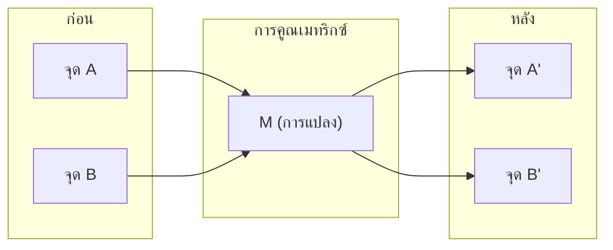
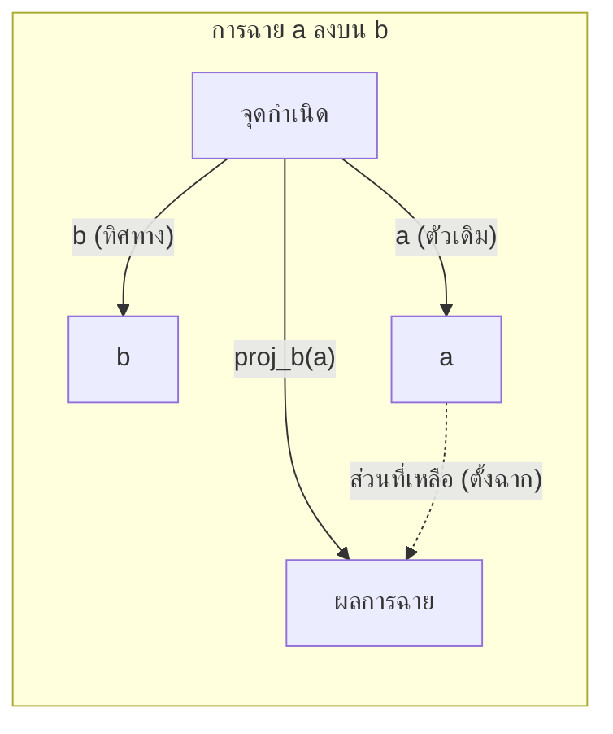

> โมเดล AI ทุกตัวก็คือคณิตศาสตร์ของเมทริกซ์ที่สวมหมวกหรูหรา

**ประเภท:** เรียนรู้ (Learn)
**ภาษา:** Python, Julia
**ความรู้ที่ควรมีก่อน:** Phase 0
**เวลา:** ~60 นาที

## สิ่งที่จะได้เรียนรู้

- เขียนการดำเนินการของเวกเตอร์และเมทริกซ์ (การบวก, dot product, การคูณเมทริกซ์) ขึ้นเองตั้งแต่ศูนย์ด้วย Python
- อธิบายในเชิงเรขาคณิตได้ว่า dot product, การฉาย (projection) และกระบวนการ Gram-Schmidt ทำอะไร
- หาความเป็นอิสระเชิงเส้น แรงก์ (rank) และฐานหลัก (basis) ของเซตเวกเตอร์ด้วยการลดแถว (row reduction)
- เชื่อมแนวคิดพีชคณิตเชิงเส้นเข้ากับการใช้งานใน AI: embedding, คะแนน attention และ LoRA

## ปัญหา

เปิด paper ด้าน ML ฉบับไหนก็ได้ ภายในหน้าแรกคุณจะเห็นเวกเตอร์ เมทริกซ์ dot product และการแปลง (transformation) ถ้าไม่มีความเข้าใจพีชคณิตเชิงเส้นแบบเห็นภาพ สิ่งเหล่านี้ก็เป็นแค่สัญลักษณ์ แต่ถ้ามี คุณจะเห็นว่าโครงข่ายประสาทเทียมกำลังทำอะไรจริงๆ คือการย้ายจุดไปมาในปริภูมิ (space)

คุณไม่ต้องเป็นนักคณิตศาสตร์ แค่ต้องเห็นว่าการดำเนินการเหล่านี้หมายถึงอะไรในเชิงเรขาคณิต แล้วเขียนโค้ดมันขึ้นเอง

## แนวคิด

### เวกเตอร์คือจุด (และทิศทาง)

เวกเตอร์ก็แค่รายการของตัวเลข แต่ตัวเลขเหล่านั้นมีความหมาย คือเป็นพิกัดในปริภูมิ

**เวกเตอร์ 2 มิติ [3, 2]:**

| x | y | จุด |
|---|---|-------|
| 3 | 2 | เวกเตอร์ชี้จากจุดกำเนิด (0,0) ไปที่ (3, 2) บนระนาบ |

เวกเตอร์นี้มีขนาด $\sqrt{3^2 + 2^2} = \sqrt{13}$ และชี้ไปทางขวาบน

ใน AI เวกเตอร์ใช้แทนทุกสิ่ง:
- คำหนึ่งคำ → เวกเตอร์ของตัวเลข 768 ตัว ("ความหมาย" ของมันใน embedding space)
- ภาพหนึ่งภาพ → เวกเตอร์ของค่าพิกเซลหลายล้านค่า
- ผู้ใช้หนึ่งคน → เวกเตอร์ของความชอบ

### เมทริกซ์คือการแปลง

เมทริกซ์แปลงเวกเตอร์หนึ่งไปเป็นอีกเวกเตอร์หนึ่ง หมุน ปรับขนาด ยืด หรือฉายก็ได้



ใน AI เมทริกซ์ก็คือตัวโมเดล:
- น้ำหนักของโครงข่ายประสาทเทียม → เมทริกซ์ที่แปลงข้อมูลขาเข้าเป็นข้อมูลขาออก
- คะแนน attention → เมทริกซ์ที่ตัดสินว่าจะให้ความสนใจตรงไหน
- embedding → เมทริกซ์ที่จับคู่คำกับเวกเตอร์

### Dot product วัดความคล้าย

dot product ของเวกเตอร์สองตัวบอกว่ามันคล้ายกันแค่ไหน

```math
\begin{aligned}
a \cdot b &= a_1 \times b_1 + a_2 \times b_2 + \cdots + a_n \times b_n \\[4pt]
\text{Same direction:} \quad a \cdot b &> 0 \quad \text{(similar)} \\
\text{Perpendicular:} \quad a \cdot b &= 0 \quad \text{(unrelated)} \\
\text{Opposite direction:} \quad a \cdot b &< 0 \quad \text{(dissimilar)}
\end{aligned}
```

(ทิศเดียวกัน: dot product เป็นบวก คือคล้ายกัน · ตั้งฉากกัน: เป็นศูนย์ คือไม่เกี่ยวกัน · ทิศตรงข้าม: เป็นลบ คือต่างกัน)

นี่คือวิธีที่ search engine, ระบบแนะนำ และ RAG ทำงานจริงๆ คือหาเวกเตอร์ที่ dot product สูง

### ความเป็นอิสระเชิงเส้น

เวกเตอร์ชุดหนึ่งเป็นอิสระเชิงเส้น (linearly independent) ถ้าไม่มีเวกเตอร์ตัวไหนในเซตเขียนเป็นผลรวมเชิงเส้นของตัวอื่นได้ ถ้า $v_1, v_2, v_3$ เป็นอิสระต่อกัน มันจะแผ่ (span) ครอบคลุมปริภูมิ 3 มิติ แต่ถ้าตัวหนึ่งเป็นผลรวมของตัวอื่น มันจะแผ่ได้แค่ระนาบเดียว

ทำไมจึงสำคัญกับ AI: เมทริกซ์ feature ของคุณควรมีคอลัมน์ที่เป็นอิสระเชิงเส้นต่อกัน ถ้า feature สองตัวสัมพันธ์กันสมบูรณ์ (ขึ้นต่อกันเชิงเส้น) โมเดลจะแยกผลของทั้งสองตัวไม่ออก ทำให้เกิด multicollinearity ใน regression เมทริกซ์น้ำหนักจะไม่เสถียร และการเปลี่ยนข้อมูลขาเข้าเพียงเล็กน้อยทำให้ผลลัพธ์แกว่งรุนแรง

**ตัวอย่างที่จับต้องได้:**

```
v1 = [1, 0, 0]
v2 = [0, 1, 0]
v3 = [2, 1, 0]   # v3 = 2*v1 + v2
```

$v_1$ และ $v_2$ เป็นอิสระต่อกัน ไม่มีตัวไหนเป็นผลคูณสเกลาร์หรือผลรวมของอีกตัว แต่ $v_3 = 2 v_1 + v_2$ ดังนั้น $\lbrace v_1, v_2, v_3 \rbrace$ เป็นเซตที่ขึ้นต่อกัน เวกเตอร์ทั้งสามอยู่บนระนาบ xy ไม่ว่าจะผสมกันอย่างไรก็ไปไม่ถึง [0, 0, 1] คุณมีเวกเตอร์สามตัว แต่มีอิสระแค่สองมิติ

ในชุดข้อมูล: ถ้า feature_3 = 2*feature_1 + feature_2 การเพิ่ม feature_3 ไม่ได้ให้ข้อมูลใหม่กับโมเดลเลย แย่กว่านั้น มันทำให้ normal equations เป็นเอกฐาน (singular) ไม่มีคำตอบเดียวสำหรับน้ำหนัก

### ฐานหลักและแรงก์

ฐานหลัก (basis) คือเซตเล็กที่สุดของเวกเตอร์ที่เป็นอิสระเชิงเส้น ซึ่งแผ่ครอบคลุมทั้งปริภูมิ จำนวนเวกเตอร์ในฐานหลักคือมิติของปริภูมินั้น

ฐานหลักมาตรฐานของปริภูมิ 3 มิติคือ {[1,0,0], [0,1,0], [0,0,1]} แต่เวกเตอร์สามตัวใดๆ ที่เป็นอิสระต่อกันใน 3 มิติก็เป็นฐานหลักที่ใช้ได้ การเลือกฐานหลักคือการเลือกระบบพิกัด

แรงก์ (rank) ของเมทริกซ์ = จำนวนคอลัมน์ที่เป็นอิสระเชิงเส้น = จำนวนแถวที่เป็นอิสระเชิงเส้น ถ้า $\text{rank} < \min(\text{rows}, \text{cols})$ เมทริกซ์นั้นขาดแรงก์ (rank-deficient) ซึ่งหมายความว่า:
- ระบบสมการมีคำตอบมากมายไม่สิ้นสุด (หรือไม่มีเลย)
- ข้อมูลสูญหายระหว่างการแปลง
- หาเมทริกซ์ผกผัน (inverse) ไม่ได้

| สถานการณ์ | แรงก์ | ความหมายสำหรับ ML |
|-----------|------|---------------------|
| แรงก์เต็ม $(\text{rank} = \min(m, n))$ | สูงสุดที่เป็นไปได้ | ถ้ามีแถวอย่างน้อยเท่าจำนวนคอลัมน์ (แรงก์เต็มตามคอลัมน์) คำตอบแบบกำลังสองน้อยที่สุดจะมีคำตอบเดียว ถ้ามีแถวน้อยกว่าคอลัมน์ จะมีคำตอบที่ตรงพอดีมากมายไม่สิ้นสุด |
| ขาดแรงก์ $(\text{rank} < \min(m, n))$ | ต่ำกว่าค่าสูงสุด | feature ซ้ำซ้อนกัน มีคำตอบของน้ำหนักมากมายไม่สิ้นสุด ต้องใช้ regularization |
| แรงก์ 1 | 1 | ทุกคอลัมน์คือเวกเตอร์ตัวเดียวกันที่ถูกปรับขนาด ข้อมูลทั้งหมดอยู่บนเส้นตรงเส้นเดียว |
| เกือบขาดแรงก์ (singular value เล็กมาก) | ต่ำในทางตัวเลข | เมทริกซ์มีสภาพไม่ดี (ill-conditioned) สัญญาณรบกวนเล็กน้อยในข้อมูลขาเข้าทำให้ผลลัพธ์เปลี่ยนมาก ให้ใช้ SVD แบบตัดทอนหรือ ridge regression |

### การฉาย (Projection)

การฉายเวกเตอร์ **a** ลงบนเวกเตอร์ **b** ให้ส่วนของ **a** ที่อยู่ในทิศของ **b**:

```math
\mathop{\mathrm{proj}}_b(a) = \frac{a \cdot b}{b \cdot b} \, b
```

ส่วนที่เหลือ $(a - \mathop{\mathrm{proj}}_b(a))$ ตั้งฉากกับ $b$ การแยกแบบตั้งฉากนี้คือรากฐานของการฟิตแบบกำลังสองน้อยที่สุด (least squares)

การฉายมีอยู่ทุกที่ใน ML:
- linear regression ทำให้ระยะจากค่าที่สังเกตไปยังปริภูมิคอลัมน์ (column space) น้อยที่สุด คำตอบของมันก็คือการฉาย
- PCA ฉายข้อมูลลงบนทิศที่มีความแปรปรวนสูงสุด
- attention ใน transformer คำนวณการฉายของ query ลงบน key



**ตัวอย่าง:** $a = [3, 4]$, $b = [1, 0]$

$\mathop{\mathrm{proj}}_b(a) = (3 \cdot 1 + 4 \cdot 0) / (1 \cdot 1 + 0 \cdot 0) \cdot [1, 0] = 3 \cdot [1, 0] = [3, 0]$

การฉายทิ้งส่วนประกอบในแกน y ไป นี่คือการลดมิติในรูปแบบที่ง่ายที่สุด คือทิ้งทิศที่คุณไม่สนใจไป

### กระบวนการ Gram-Schmidt

คือการแปลงเซตของเวกเตอร์ที่เป็นอิสระต่อกันใดๆ ให้เป็นฐานหลักเชิงตั้งฉากปกติ (orthonormal basis) คำว่า orthonormal หมายถึงเวกเตอร์ทุกตัวยาว 1 และทุกคู่ตั้งฉากกัน

อัลกอริทึม:
1. นำเวกเตอร์ตัวแรกมาทำให้ยาว 1 (normalize)
2. นำเวกเตอร์ตัวที่สอง ลบผลการฉายของมันลงบนตัวแรกออก แล้ว normalize
3. นำเวกเตอร์ตัวที่สาม ลบผลการฉายลงบนทุกตัวก่อนหน้าออก แล้ว normalize
4. ทำซ้ำกับเวกเตอร์ที่เหลือ

```
Input:  v1, v2, v3, ... (linearly independent)

u1 = v1 / |v1|

w2 = v2 - (v2 dot u1) * u1
u2 = w2 / |w2|

w3 = v3 - (v3 dot u1) * u1 - (v3 dot u2) * u2
u3 = w3 / |w3|

Output: u1, u2, u3, ... (orthonormal basis)
```

นี่คือการทำงานภายในของการแยก QR (QR decomposition) โดย Q คือฐานหลักเชิงตั้งฉากปกติ และ R เก็บสัมประสิทธิ์ของการฉาย การแยก QR ใช้ใน:
- การแก้ระบบสมการเชิงเส้น (เสถียรกว่าการกำจัดแบบเกาส์)
- การหาค่าลักษณะเฉพาะ (eigenvalue) ด้วยอัลกอริทึม QR
- regression แบบกำลังสองน้อยที่สุด (วิธีเชิงตัวเลขมาตรฐาน)

```figure
eigen-directions
```

## ลงมือสร้าง (Build It)

### ขั้นที่ 1: เวกเตอร์ตั้งแต่ศูนย์ (Python)

```python
class Vector:
    def __init__(self, components):
        self.components = list(components)
        self.dim = len(self.components)

    def __add__(self, other):
        return Vector([a + b for a, b in zip(self.components, other.components)])

    def __sub__(self, other):
        return Vector([a - b for a, b in zip(self.components, other.components)])

    def dot(self, other):
        return sum(a * b for a, b in zip(self.components, other.components))

    def magnitude(self):
        return sum(x**2 for x in self.components) ** 0.5

    def normalize(self):
        mag = self.magnitude()
        return Vector([x / mag for x in self.components])

    def cosine_similarity(self, other):
        return self.dot(other) / (self.magnitude() * other.magnitude())

    def __repr__(self):
        return f"Vector({self.components})"


a = Vector([1, 2, 3])
b = Vector([4, 5, 6])

print(f"a + b = {a + b}")
print(f"a · b = {a.dot(b)}")
print(f"|a| = {a.magnitude():.4f}")
print(f"cosine similarity = {a.cosine_similarity(b):.4f}")
```

### ขั้นที่ 2: เมทริกซ์ตั้งแต่ศูนย์ (Python)

```python
class Matrix:
    def __init__(self, rows):
        self.rows = [list(row) for row in rows]
        self.shape = (len(self.rows), len(self.rows[0]))

    def __matmul__(self, other):
        if isinstance(other, Vector):
            return Vector([
                sum(self.rows[i][j] * other.components[j] for j in range(self.shape[1]))
                for i in range(self.shape[0])
            ])
        rows = []
        for i in range(self.shape[0]):
            row = []
            for j in range(other.shape[1]):
                row.append(sum(
                    self.rows[i][k] * other.rows[k][j]
                    for k in range(self.shape[1])
                ))
            rows.append(row)
        return Matrix(rows)

    def transpose(self):
        return Matrix([
            [self.rows[j][i] for j in range(self.shape[0])]
            for i in range(self.shape[1])
        ])

    def __repr__(self):
        return f"Matrix({self.rows})"


rotation_90 = Matrix([[0, -1], [1, 0]])
point = Vector([3, 1])

rotated = rotation_90 @ point
print(f"Original: {point}")
print(f"Rotated 90°: {rotated}")
```

### ขั้นที่ 3: ทำไมเรื่องนี้สำคัญกับ AI

```python
import random

random.seed(42)
weights = Matrix([[random.gauss(0, 0.1) for _ in range(3)] for _ in range(2)])
input_vector = Vector([1.0, 0.5, -0.3])

output = weights @ input_vector
print(f"Input (3D): {input_vector}")
print(f"Output (2D): {output}")
print("This is what a neural network layer does -- matrix multiplication.")
```

### ขั้นที่ 4: เวอร์ชัน Julia

```julia
a = [1.0, 2.0, 3.0]
b = [4.0, 5.0, 6.0]

println("a + b = ", a + b)
println("a · b = ", a ⋅ b)       # Julia supports unicode operators
println("|a| = ", √(a ⋅ a))
println("cosine = ", (a ⋅ b) / (√(a ⋅ a) * √(b ⋅ b)))

# Matrix-vector multiplication
W = [0.1 -0.2 0.3; 0.4 0.5 -0.1]
x = [1.0, 0.5, -0.3]
println("Wx = ", W * x)
println("This is a neural network layer.")
```

### ขั้นที่ 5: ความเป็นอิสระเชิงเส้นและการฉายตั้งแต่ศูนย์ (Python)

```python
def is_linearly_independent(vectors):
    n = len(vectors)
    dim = len(vectors[0].components)
    mat = Matrix([v.components[:] for v in vectors])
    rows = [row[:] for row in mat.rows]
    rank = 0
    for col in range(dim):
        pivot = None
        for row in range(rank, len(rows)):
            if abs(rows[row][col]) > 1e-10:
                pivot = row
                break
        if pivot is None:
            continue
        rows[rank], rows[pivot] = rows[pivot], rows[rank]
        scale = rows[rank][col]
        rows[rank] = [x / scale for x in rows[rank]]
        for row in range(len(rows)):
            if row != rank and abs(rows[row][col]) > 1e-10:
                factor = rows[row][col]
                rows[row] = [rows[row][j] - factor * rows[rank][j] for j in range(dim)]
        rank += 1
    return rank == n


def project(a, b):
    scalar = a.dot(b) / b.dot(b)
    return Vector([scalar * x for x in b.components])


def gram_schmidt(vectors):
    orthonormal = []
    for v in vectors:
        w = v
        for u in orthonormal:
            proj = project(w, u)
            w = w - proj
        if w.magnitude() < 1e-10:
            continue
        orthonormal.append(w.normalize())
    return orthonormal


v1 = Vector([1, 0, 0])
v2 = Vector([1, 1, 0])
v3 = Vector([1, 1, 1])
basis = gram_schmidt([v1, v2, v3])
for i, u in enumerate(basis):
    print(f"u{i+1} = {u}")
    print(f"  |u{i+1}| = {u.magnitude():.6f}")

print(f"u1 · u2 = {basis[0].dot(basis[1]):.6f}")
print(f"u1 · u3 = {basis[0].dot(basis[2]):.6f}")
print(f"u2 · u3 = {basis[1].dot(basis[2]):.6f}")
```

## นำไปใช้ (Use It)

ทีนี้ทำสิ่งเดียวกันด้วย NumPy ซึ่งเป็นสิ่งที่คุณจะใช้จริงในทางปฏิบัติ:

```python
import numpy as np

a = np.array([1, 2, 3], dtype=float)
b = np.array([4, 5, 6], dtype=float)

print(f"a + b = {a + b}")
print(f"a · b = {np.dot(a, b)}")
print(f"|a| = {np.linalg.norm(a):.4f}")
print(f"cosine = {np.dot(a, b) / (np.linalg.norm(a) * np.linalg.norm(b)):.4f}")

W = np.random.randn(2, 3) * 0.1
x = np.array([1.0, 0.5, -0.3])
print(f"Wx = {W @ x}")
```

### แรงก์ การฉาย และ QR ด้วย NumPy

```python
import numpy as np

A = np.array([[1, 2], [2, 4]])
print(f"Rank: {np.linalg.matrix_rank(A)}")

a = np.array([3, 4])
b = np.array([1, 0])
proj = (np.dot(a, b) / np.dot(b, b)) * b
print(f"Projection of {a} onto {b}: {proj}")

Q, R = np.linalg.qr(np.random.randn(3, 3))
print(f"Q is orthogonal: {np.allclose(Q @ Q.T, np.eye(3))}")
print(f"R is upper triangular: {np.allclose(R, np.triu(R))}")
```

### PyTorch: tensor คือเวกเตอร์ที่หาอนุพันธ์อัตโนมัติได้

```python
import torch

x = torch.randn(3, requires_grad=True)
y = torch.tensor([1.0, 0.0, 0.0])

similarity = torch.dot(x, y)
similarity.backward()

print(f"x = {x.data}")
print(f"y = {y.data}")
print(f"dot product = {similarity.item():.4f}")
print(f"d(dot)/dx = {x.grad}")
```

เกรเดียนต์ของ dot product เทียบกับ x ก็คือ y นั่นเอง PyTorch คำนวณให้อัตโนมัติ ทุกการคำนวณในโครงข่ายประสาทเทียมสร้างจากการดำเนินการแบบนี้ ทั้งการคูณเมทริกซ์ dot product และการฉาย และการหาอนุพันธ์อัตโนมัติ (autodiff) ติดตามเกรเดียนต์ผ่านทุกขั้นตอน

คุณเพิ่งสร้างตั้งแต่ศูนย์ในสิ่งที่ NumPy ทำในบรรทัดเดียว ตอนนี้คุณรู้แล้วว่าเกิดอะไรขึ้นเบื้องหลัง

## ส่งมอบ (Ship It)

บทนี้ได้:
- `outputs/prompt-linear-algebra-tutor.md` -- prompt สำหรับให้ผู้ช่วย AI สอนพีชคณิตเชิงเส้นผ่านความเข้าใจเชิงเรขาคณิต

## ความเชื่อมโยง

ทุกอย่างในบทนี้เชื่อมกับส่วนเฉพาะของ AI สมัยใหม่:

| แนวคิด | พบได้ที่ |
|---------|------------------|
| Dot product | คะแนน attention ใน transformer, cosine similarity ใน RAG |
| การคูณเมทริกซ์ | ทุกชั้นของโครงข่ายประสาทเทียม, ทุกการแปลงเชิงเส้น |
| ความเป็นอิสระเชิงเส้น | การเลือก feature, การหลีกเลี่ยง multicollinearity |
| แรงก์ | การตัดสินว่าระบบสมการแก้ได้หรือไม่, LoRA (low-rank adaptation) |
| การฉาย | linear regression (ฉายลงบนปริภูมิคอลัมน์), PCA |
| Gram-Schmidt / QR | ตัวแก้สมการเชิงตัวเลข, การคำนวณค่าลักษณะเฉพาะ |
| ฐานหลักเชิงตั้งฉากปกติ | การคำนวณเชิงตัวเลขที่เสถียร, การแปลงแบบ whitening |

LoRA ควรได้รับการกล่าวถึงเป็นพิเศษ มัน fine-tune โมเดลภาษาขนาดใหญ่ด้วยการแยกการอัปเดตน้ำหนักเป็นเมทริกซ์แรงก์ต่ำ แทนที่จะอัปเดตเมทริกซ์น้ำหนักขนาด 4096x4096 (16 ล้านพารามิเตอร์) LoRA อัปเดตเมทริกซ์สองตัวขนาด 4096x16 และ 16x4096 (131K พารามิเตอร์) ข้อจำกัดแรงก์ 16 แปลว่า LoRA สมมติว่าการอัปเดตน้ำหนักอยู่ในปริภูมิย่อย 16 มิติของปริภูมิเต็ม 4096 มิติ นี่คือพีชคณิตเชิงเส้นที่ทำงานจริง

## แบบฝึกหัด

1. เขียน `Vector.angle_between(other)` ที่คืนมุมระหว่างเวกเตอร์สองตัวเป็นองศา
2. สร้างเมทริกซ์ปรับขนาด 2 มิติที่ทำให้พิกัด x เป็นสองเท่าและพิกัด y เป็นสามเท่า แล้วใช้กับเวกเตอร์ [1, 1]
3. จากเวกเตอร์คล้ายคำแบบสุ่ม 5 ตัว (50 มิติ) หาสองตัวที่คล้ายกันที่สุดด้วย cosine similarity
4. ตรวจว่าผลของ Gram-Schmidt เป็น orthonormal จริง: ทุกคู่มี dot product เป็น 0 และทุกตัวยาว 1
5. สร้างเมทริกซ์ 3x3 ที่มีแรงก์ 2 ตรวจด้วยเมธอด `rank()` แล้วอธิบายว่าคอลัมน์แผ่เป็นวัตถุเรขาคณิตแบบใด
6. ฉายเวกเตอร์ [1, 2, 3] ลงบน [1, 1, 1] ผลลัพธ์หมายถึงอะไรในเชิงเรขาคณิต

### คำใบ้

**แบบฝึกหัดที่ 1** เริ่มจาก `cosine_similarity` บังคับค่าให้อยู่ระหว่าง -1 ถึง 1 แล้วหา arc cosine และแปลงเรเดียนเป็นองศา ตรวจว่า `Vector([1, 0])` กับ `Vector([0, 1])` ได้ 90 และเวกเตอร์กับตัวเองได้ 0

**แบบฝึกหัดที่ 2** ใส่ตัวคูณปรับขนาดทั้งสองไว้บนเส้นทแยงมุมของเมทริกซ์ 2x2 และใส่ 0 ในอีกสองช่อง ผลของ [1, 1] ต้องได้ [2, 3]

**แบบฝึกหัดที่ 3** คำนวณ cosine similarity ของทุกคู่จากเวกเตอร์ 5 ตัว (10 คู่) แล้วเก็บค่าที่มากที่สุด ทดสอบลูปก่อนด้วยการเทียบเวกเตอร์กับตัวเอง ซึ่งต้องได้ 1

**แบบฝึกหัดที่ 4** ใช้ `gram_schmidt` กับเวกเตอร์สามตัวที่เป็นอิสระต่อกัน แล้วคำนวณ `dot` ของแต่ละคู่และ `magnitude` ของแต่ละตัว เทียบด้วยค่าคลาดเคลื่อนที่ยอมได้ เช่น `1e-9` เพราะเลขทศนิยมแบบ floating point ไม่ได้ให้ศูนย์พอดี

**แบบฝึกหัดที่ 5** ให้แถวหรือคอลัมน์ที่สามเป็นผลบวกของสองตัวแรก ทิศหนึ่งจะซ้ำกัน `rank()` ต้องคืน 2 และคอลัมน์จะแผ่เป็นระนาบที่ผ่านจุดกำเนิด

**แบบฝึกหัดที่ 6** คำนวณตัวคูณ $\frac{a \cdot b}{b \cdot b}$ แล้วคูณกับ $b$ หรือเรียก `project_onto` ตรวจว่าส่วนที่เหลือ $a$ ลบผลการฉาย มี dot product กับ [1, 1, 1] เป็น 0

## คำศัพท์สำคัญ

| คำศัพท์ | ที่คนมักพูด | ความหมายจริง |
|------|----------------|----------------------|
| Vector (เวกเตอร์) | "ลูกศร" | รายการตัวเลขที่แทนจุดหรือทิศทางในปริภูมิ n มิติ |
| Matrix (เมทริกซ์) | "ตารางตัวเลข" | การแปลงที่จับคู่เวกเตอร์จากปริภูมิหนึ่งไปอีกปริภูมิหนึ่ง |
| Dot product | "คูณแล้วบวก" | ตัววัดว่าเวกเตอร์สองตัวชี้ไปทางเดียวกันแค่ไหน เป็นหัวใจของการค้นหาความคล้าย |
| Embedding | "เวทมนตร์ของ AI" | เวกเตอร์ที่แทนความหมายของบางสิ่ง (คำ, ภาพ, ผู้ใช้) |
| Linear independence (ความเป็นอิสระเชิงเส้น) | "ไม่ทับกัน" | ไม่มีเวกเตอร์ตัวไหนในเซตเขียนเป็นผลรวมของตัวอื่นได้ |
| Rank (แรงก์) | "มีกี่มิติ" | จำนวนคอลัมน์ (หรือแถว) ที่เป็นอิสระเชิงเส้นในเมทริกซ์ |
| Projection (การฉาย) | "เงา" | ส่วนของเวกเตอร์หนึ่งที่อยู่ในทิศของอีกเวกเตอร์ |
| Basis (ฐานหลัก) | "แกนพิกัด" | เซตเล็กที่สุดของเวกเตอร์ที่เป็นอิสระต่อกันและแผ่ครอบคลุมทั้งปริภูมิ |
| Orthonormal | "เวกเตอร์หน่วยที่ตั้งฉากกัน" | เวกเตอร์ที่ตั้งฉากกันทุกคู่และยาว 1 ทุกตัว |

## สรุป

| สูตร | ความหมาย |
|---------|---------|
| $a \cdot b = \sum_i a_i b_i$ | dot product วัดว่าชี้ไปทางเดียวกันแค่ไหน เป็นหัวใจของคะแนน attention และ cosine similarity |
| $\cos\theta = \frac{a \cdot b}{\lvert a\rvert \lvert b\rvert}$ | มุมระหว่างเวกเตอร์ 1 คือทิศเดียวกัน 0 คือตั้งฉาก |
| $\lvert a\rvert = \sqrt{a \cdot a}$ | ขนาด (ความยาว) ของเวกเตอร์ |
| $y = Ax, y_i = \sum_j A_{ij} x_j$ | ผลคูณเมทริกซ์กับเวกเตอร์ ชั้นของโครงข่ายประสาทเทียมใช้มันกับข้อมูลขาเข้าทุกตัว |
| $\text{proj}_b a = \frac{a \cdot b}{b \cdot b} b$ | การฉาย $a$ ลงบน $b$ คือส่วนของ $a$ ที่อยู่ตามแนว $b$ |
| $b^\perp = a - \text{proj}_b a$ | ส่วนของ $a$ ที่ตั้งฉากกับ $b$ ใช้ใน Gram-Schmidt |
| $\text{rank}(A) \leq \min(m,n)$ | แรงก์คือจำนวนคอลัมน์ที่เป็นอิสระต่อกัน เป็นตัวตัดสินว่า $Ax = b$ มีคำตอบหรือไม่ |
| $\Delta W = BA$, $B$ is 4096×16, $A$ is 16×4096 | การอัปเดตแบบแรงก์ต่ำ LoRA แทนการอัปเดตขนาด 4096×4096 (16 ล้านพารามิเตอร์) ด้วยตัวประกอบแรงก์ 16 สองตัว (131K พารามิเตอร์) |
| ฐานหลักเชิงตั้งฉากปกติ: $\lvert v_i\rvert = 1, v_i \cdot v_j = 0$ | การแปลงที่เสถียรและย้อนกลับได้ เช่น whitening และการแยก QR |
