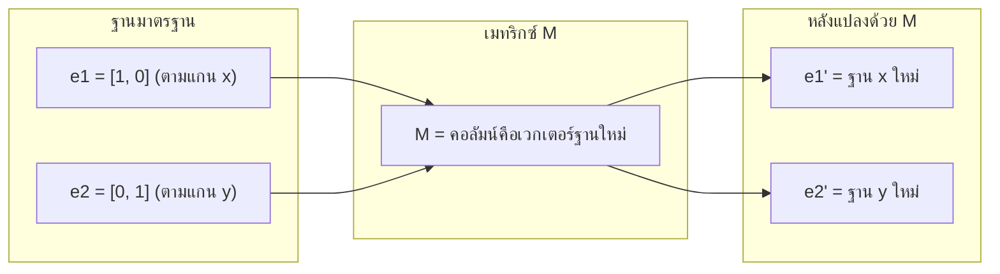
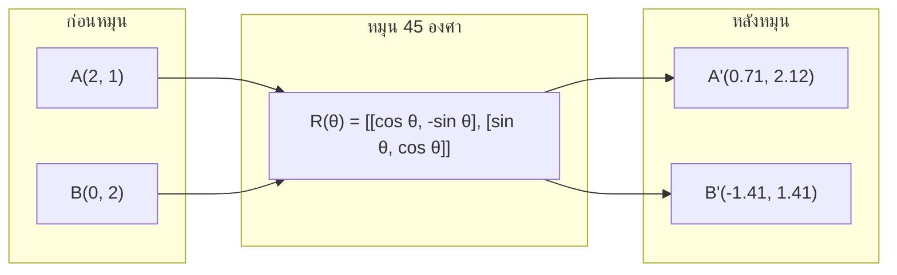
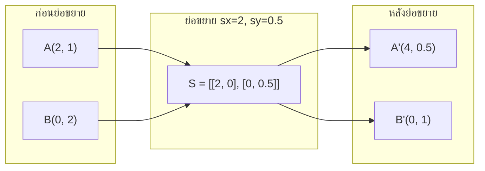
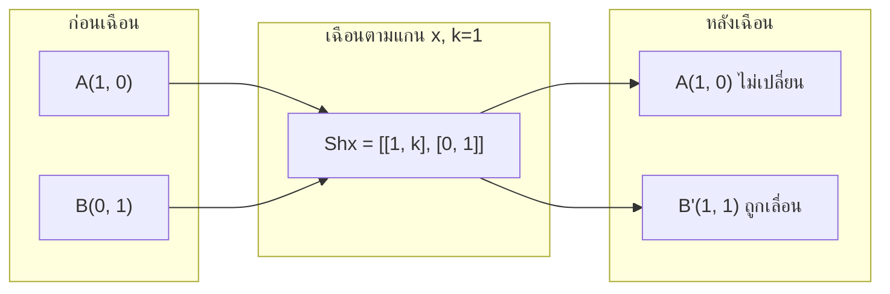
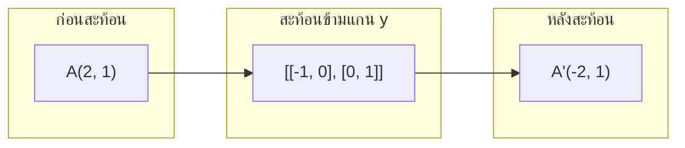
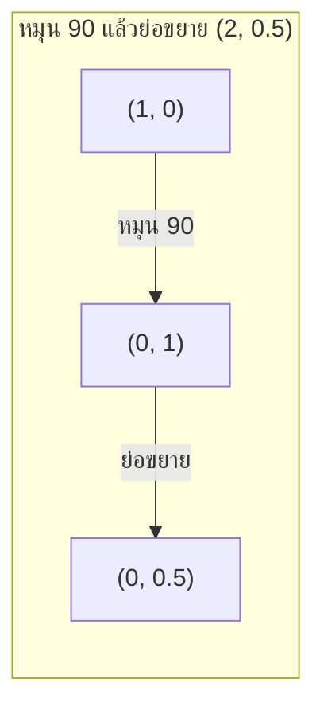
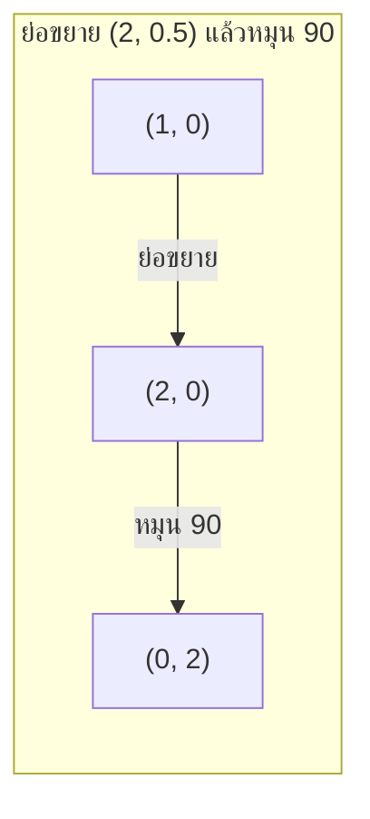

> เมทริกซ์คือเครื่องจักรที่ปรับรูปร่างของปริภูมิ รู้ว่ามันทำอะไรกับทุกจุด แล้วคุณจะเข้าใจการแปลงทั้งหมด

**ประเภท:** ลงมือสร้าง (Build)
**ภาษา:** Python, Julia
**ความรู้ที่ควรมีก่อน:** Phase 1 บทที่ 01-02 (พีชคณิตเชิงเส้นแบบเข้าใจภาพ, เวกเตอร์ เมทริกซ์ และการดำเนินการ)
**เวลา:** ~75 นาที

## สิ่งที่จะได้เรียนรู้

- สร้างเมทริกซ์การหมุน การย่อขยาย การเฉือน และการสะท้อน แล้วนำไปใช้กับจุดใน 2 มิติและ 3 มิติ
- ประกอบการแปลงหลายตัวเข้าด้วยกันด้วยการคูณเมทริกซ์ และตรวจให้เห็นว่าลำดับมีผล
- คำนวณค่าลักษณะเฉพาะ (eigenvalue) และเวกเตอร์ลักษณะเฉพาะ (eigenvector) ของเมทริกซ์ 2x2 จากสมการลักษณะเฉพาะ
- อธิบายว่าทำไมค่าลักษณะเฉพาะจึงกำหนดทิศทางของ PCA, เสถียรภาพของ RNN และพฤติกรรมของ spectral clustering

## ปัญหา

คุณอ่านเรื่อง PCA แล้วเจอว่า "หาเวกเตอร์ลักษณะเฉพาะของเมทริกซ์ความแปรปรวนร่วม" อ่านเรื่องเสถียรภาพของโมเดลแล้วเจอว่า "ตรวจว่าค่าลักษณะเฉพาะทุกตัวมีขนาดน้อยกว่า 1" อ่านเรื่อง data augmentation แล้วเจอว่า "หมุนภาพแบบสุ่ม" ทั้งหมดนี้ไม่มีความหมายจนกว่าคุณจะเข้าใจว่าเมทริกซ์ทำอะไรกับปริภูมิในเชิงเรขาคณิต

เมทริกซ์ไม่ใช่แค่ตารางตัวเลข มันคือเครื่องจักรที่กระทำกับปริภูมิ เมทริกซ์การหมุนหมุนจุด เมทริกซ์การย่อขยายยืดจุด เมทริกซ์การเฉือนเอียงจุด ทุกการแปลงที่โครงข่ายประสาทเทียมทำกับข้อมูลคือหนึ่งในการดำเนินการเหล่านี้ หรือการนำมันมาประกอบกัน บทนี้ทำให้การดำเนินการเหล่านั้นจับต้องได้

## แนวคิด

### การแปลงในรูปเมทริกซ์

การแปลงเชิงเส้นทุกแบบใน 2 มิติเขียนเป็นเมทริกซ์ 2x2 ได้ เมทริกซ์บอกตรง ๆ ว่าเวกเตอร์ฐาน [1, 0] และ [0, 1] ไปตกอยู่ที่ไหน ที่เหลือตามมาจากตรงนั้นทั้งหมด



### การหมุน (Rotation)

การหมุนใน 2 มิติด้วยมุม $\theta$ รักษาระยะทางและมุมไว้เหมือนเดิม มันพาทุกจุดเคลื่อนไปตามส่วนโค้งของวงกลม



ใน 3 มิติ คุณหมุนรอบแกน แต่ละแกนมีเมทริกซ์การหมุนของตัวเอง:

```math
\begin{aligned}
R_z(\theta) &= \begin{bmatrix} \cos\theta & -\sin\theta & 0 \\ \sin\theta & \cos\theta & 0 \\ 0 & 0 & 1 \end{bmatrix} \quad \text{Rotate around z-axis (x-y plane spins, z stays)} \\[6pt]
R_x(\theta) &= \begin{bmatrix} 1 & 0 & 0 \\ 0 & \cos\theta & -\sin\theta \\ 0 & \sin\theta & \cos\theta \end{bmatrix} \quad \text{Rotate around x-axis (y-z plane spins, x stays)} \\[6pt]
R_y(\theta) &= \begin{bmatrix} \cos\theta & 0 & \sin\theta \\ 0 & 1 & 0 \\ -\sin\theta & 0 & \cos\theta \end{bmatrix} \quad \text{Rotate around y-axis (x-z plane spins, y stays)}
\end{aligned}
```

(หมุนรอบแกน z: ระนาบ x-y หมุน แกน z อยู่กับที่ หมุนรอบแกน x: ระนาบ y-z หมุน แกน x อยู่กับที่ หมุนรอบแกน y: ระนาบ x-z หมุน แกน y อยู่กับที่)

### การย่อขยาย (Scaling)

การย่อขยายยืดหรือหดตามแต่ละแกนแยกกันอย่างอิสระ



### การเฉือน (Shearing)

การเฉือนเอียงแกนหนึ่งโดยให้อีกแกนอยู่กับที่ มันเปลี่ยนสี่เหลี่ยมผืนผ้าให้เป็นสี่เหลี่ยมด้านขนาน



เมทริกซ์การเฉือน:
- `Shx = [[1, k], [0, 1]]` เลื่อน $x$ ไป $k \cdot y$
- `Shy = [[1, 0], [k, 1]]` เลื่อน $y$ ไป $k \cdot x$

### การสะท้อน (Reflection)

การสะท้อนกลับด้านจุดข้ามแกนหรือเส้นตรง เหมือนส่องกระจก



เมทริกซ์การสะท้อน:
- สะท้อนข้ามแกน y: `[[-1, 0], [0, 1]]`
- สะท้อนข้ามแกน x: `[[1, 0], [0, -1]]`

### การประกอบ (Composition): ต่อการแปลงเป็นลูกโซ่

การทำการแปลง A แล้วตามด้วย B เท่ากับการคูณเมทริกซ์ของทั้งสอง: `result = B @ A @ point` ลำดับมีผล หมุนแล้วย่อขยายให้ผลต่างจากย่อขยายแล้วหมุน



เมื่อประกอบกัน: `S @ R = [[0, -2], [0.5, 0]]`



เมื่อประกอบกัน: `R @ S = [[0, -0.5], [2, 0]]`

ผลต่างกัน การคูณเมทริกซ์ไม่มีสมบัติการสลับที่

### ค่าลักษณะเฉพาะและเวกเตอร์ลักษณะเฉพาะ

เวกเตอร์ส่วนใหญ่เปลี่ยนทิศเมื่อถูกเมทริกซ์กระทำ เวกเตอร์ลักษณะเฉพาะ (eigenvector) เป็นข้อยกเว้น: เมทริกซ์แค่ย่อขยายมัน ไม่เคยหมุนมัน ตัวคูณที่ใช้ย่อขยายคือค่าลักษณะเฉพาะ (eigenvalue)

```
A @ v = lambda * v

v คือเวกเตอร์ลักษณะเฉพาะ (ทิศทางที่รอดมาได้)
lambda คือค่าลักษณะเฉพาะ (ยืดไปแค่ไหน)

ตัวอย่าง: A = | 2  1 |
              | 1  2 |

เวกเตอร์ลักษณะเฉพาะ [1, 1] ค่าลักษณะเฉพาะ 3:
  A @ [1,1] = [3, 3] = 3 * [1, 1]     (ทิศเดิม ยืด 3 เท่า)

เวกเตอร์ลักษณะเฉพาะ [1, -1] ค่าลักษณะเฉพาะ 1:
  A @ [1,-1] = [1, -1] = 1 * [1, -1]  (ทิศเดิม ไม่เปลี่ยน)
```

เมทริกซ์นี้ยืดปริภูมิ 3 เท่าตามทิศ [1, 1] และคงทิศ [1, -1] ไว้เหมือนเดิม ทิศทางอื่นทั้งหมดเป็นส่วนผสมของสองทิศนี้

### การแยกค่าลักษณะเฉพาะ (Eigendecomposition)

ถ้าเมทริกซ์มีเวกเตอร์ลักษณะเฉพาะที่เป็นอิสระเชิงเส้นต่อกัน $n$ ตัว เราแยกมันได้แบบนี้:

```
A = V @ D @ V^(-1)

V = เมทริกซ์ที่แต่ละคอลัมน์คือเวกเตอร์ลักษณะเฉพาะ
D = เมทริกซ์ทแยงมุมของค่าลักษณะเฉพาะ
V^(-1) = เมทริกซ์ผกผันของ V

ความหมาย: หมุนเข้าสู่พิกัดของเวกเตอร์ลักษณะเฉพาะ ย่อขยายตามแต่ละแกน แล้วหมุนกลับ
```

### ทำไมค่าลักษณะเฉพาะจึงสำคัญ

**PCA** เวกเตอร์ลักษณะเฉพาะของเมทริกซ์ความแปรปรวนร่วมคือองค์ประกอบหลัก (principal component) ค่าลักษณะเฉพาะบอกว่าแต่ละองค์ประกอบเก็บความแปรปรวนไว้เท่าไร เรียงตามค่าลักษณะเฉพาะ เก็บ $k$ ตัวบนสุด แล้วคุณก็ได้การลดมิติ

**เสถียรภาพ** ในโครงข่ายแบบวนซ้ำ (recurrent network) และระบบพลวัต ค่าลักษณะเฉพาะที่ขนาดเกิน 1 ทำให้ผลลัพธ์ระเบิด ขนาดน้อยกว่า 1 ทำให้ผลลัพธ์หายไป นี่คือปัญหา gradient หายไป/ระเบิด (vanishing/exploding gradient) ที่สรุปได้ในประโยคเดียว

**วิธีเชิงสเปกตรัม (spectral methods)** Graph neural network ใช้ค่าลักษณะเฉพาะของเมทริกซ์ประชิด (adjacency matrix) spectral clustering ใช้ค่าลักษณะเฉพาะของ Laplacian เวกเตอร์ลักษณะเฉพาะเผยโครงสร้างของกราฟออกมา

### ดีเทอร์มิแนนต์คือตัวคูณขนาดของปริมาตร

ดีเทอร์มิแนนต์ของเมทริกซ์การแปลงบอกว่าการแปลงนั้นขยายพื้นที่ (2 มิติ) หรือปริมาตร (3 มิติ) ไปกี่เท่า

```
det = 1:   พื้นที่คงเดิม (การหมุน)
det = 2:   พื้นที่เพิ่มเป็นสองเท่า
det = 0:   ปริภูมิถูกบีบลงไปเหลือมิติที่ต่ำกว่า (เอกฐาน)
det = -1:  พื้นที่คงเดิมแต่ทิศการวางตัวกลับด้าน (การสะท้อน)

| det(Rotation) | = 1        (เสมอ)
| det(Scale sx, sy) | = sx * sy
| det(Shear) | = 1           (พื้นที่คงเดิม)
| det(Reflection) | = -1     (ทิศการวางตัวกลับด้าน)
```

```figure
matrix-transform
```

## ลงมือสร้าง (Build It)

### ขั้นที่ 1: เมทริกซ์การแปลงตั้งแต่ศูนย์ (Python)

```python
import math

def rotation_2d(theta):
    c, s = math.cos(theta), math.sin(theta)
    return [[c, -s], [s, c]]

def scaling_2d(sx, sy):
    return [[sx, 0], [0, sy]]

def shearing_2d(kx, ky):
    return [[1, kx], [ky, 1]]

def reflection_x():
    return [[1, 0], [0, -1]]

def reflection_y():
    return [[-1, 0], [0, 1]]

def mat_vec_mul(matrix, vector):
    return [
        sum(matrix[i][j] * vector[j] for j in range(len(vector)))
        for i in range(len(matrix))
    ]

def mat_mul(a, b):
    rows_a, cols_b = len(a), len(b[0])
    cols_a = len(a[0])
    return [
        [sum(a[i][k] * b[k][j] for k in range(cols_a)) for j in range(cols_b)]
        for i in range(rows_a)
    ]

point = [1.0, 0.0]
angle = math.pi / 4

rotated = mat_vec_mul(rotation_2d(angle), point)
print(f"Rotate (1,0) by 45 deg: ({rotated[0]:.4f}, {rotated[1]:.4f})")

scaled = mat_vec_mul(scaling_2d(2, 3), [1.0, 1.0])
print(f"Scale (1,1) by (2,3): ({scaled[0]:.1f}, {scaled[1]:.1f})")

sheared = mat_vec_mul(shearing_2d(1, 0), [1.0, 1.0])
print(f"Shear (1,1) kx=1: ({sheared[0]:.1f}, {sheared[1]:.1f})")

reflected = mat_vec_mul(reflection_y(), [2.0, 1.0])
print(f"Reflect (2,1) across y: ({reflected[0]:.1f}, {reflected[1]:.1f})")
```

### ขั้นที่ 2: การประกอบการแปลง

```python
R = rotation_2d(math.pi / 2)
S = scaling_2d(2, 0.5)

rotate_then_scale = mat_mul(S, R)
scale_then_rotate = mat_mul(R, S)

point = [1.0, 0.0]
result1 = mat_vec_mul(rotate_then_scale, point)
result2 = mat_vec_mul(scale_then_rotate, point)

print(f"Rotate 90 then scale: ({result1[0]:.2f}, {result1[1]:.2f})")
print(f"Scale then rotate 90: ({result2[0]:.2f}, {result2[1]:.2f})")
print(f"Same? {result1 == result2}")
```

### ขั้นที่ 3: ค่าลักษณะเฉพาะตั้งแต่ศูนย์ (2x2)

สำหรับเมทริกซ์ 2x2 `[[a, b], [c, d]]` ค่าลักษณะเฉพาะคือคำตอบของสมการลักษณะเฉพาะ (characteristic equation): $\lambda^2 - (a+d)\lambda + (ad - bc) = 0$

```python
def eigenvalues_2x2(matrix):
    a, b = matrix[0]
    c, d = matrix[1]
    trace = a + d
    det = a * d - b * c
    discriminant = trace ** 2 - 4 * det
    if discriminant < 0:
        real = trace / 2
        imag = (-discriminant) ** 0.5 / 2
        return (complex(real, imag), complex(real, -imag))
    sqrt_disc = discriminant ** 0.5
    return ((trace + sqrt_disc) / 2, (trace - sqrt_disc) / 2)

def eigenvector_2x2(matrix, eigenvalue):
    a, b = matrix[0]
    c, d = matrix[1]
    if abs(b) > 1e-10:
        v = [b, eigenvalue - a]
    elif abs(c) > 1e-10:
        v = [eigenvalue - d, c]
    else:
        if abs(a - eigenvalue) < 1e-10:
            v = [1, 0]
        else:
            v = [0, 1]
    mag = (v[0] ** 2 + v[1] ** 2) ** 0.5
    return [v[0] / mag, v[1] / mag]

A = [[2, 1], [1, 2]]
vals = eigenvalues_2x2(A)
print(f"Matrix: {A}")
print(f"Eigenvalues: {vals[0]:.4f}, {vals[1]:.4f}")

for val in vals:
    vec = eigenvector_2x2(A, val)
    result = mat_vec_mul(A, vec)
    scaled = [val * vec[0], val * vec[1]]
    print(f"  lambda={val:.1f}, v={[round(x,4) for x in vec]}")
    print(f"    A@v = {[round(x,4) for x in result]}")
    print(f"    l*v = {[round(x,4) for x in scaled]}")
```

### ขั้นที่ 4: ดีเทอร์มิแนนต์ในฐานะตัวคูณขนาดของปริมาตร

```python
def det_2x2(matrix):
    return matrix[0][0] * matrix[1][1] - matrix[0][1] * matrix[1][0]

print(f"det(rotation 45) = {det_2x2(rotation_2d(math.pi/4)):.4f}")
print(f"det(scale 2,3)   = {det_2x2(scaling_2d(2, 3)):.1f}")
print(f"det(shear kx=1)  = {det_2x2(shearing_2d(1, 0)):.1f}")
print(f"det(reflect y)   = {det_2x2(reflection_y()):.1f}")

singular = [[1, 2], [2, 4]]
print(f"det(singular)     = {det_2x2(singular):.1f}")
print("Singular: columns are proportional, space collapses to a line.")
```

## นำไปใช้ (Use It)

NumPy ทำทั้งหมดนี้ได้ด้วยฟังก์ชันที่ปรับแต่งมาให้เร็ว

```python
import numpy as np

theta = np.pi / 4
R = np.array([[np.cos(theta), -np.sin(theta)],
              [np.sin(theta),  np.cos(theta)]])

point = np.array([1.0, 0.0])
print(f"Rotate (1,0) by 45 deg: {R @ point}")

S = np.diag([2.0, 3.0])
composed = S @ R
print(f"Scale(2,3) after Rotate(45): {composed @ point}")

A = np.array([[2, 1], [1, 2]], dtype=float)
eigenvalues, eigenvectors = np.linalg.eig(A)
print(f"\nEigenvalues: {eigenvalues}")
print(f"Eigenvectors (columns):\n{eigenvectors}")

for i in range(len(eigenvalues)):
    v = eigenvectors[:, i]
    lam = eigenvalues[i]
    print(f"  A @ v{i} = {A @ v}, lambda * v{i} = {lam * v}")

print(f"\ndet(R) = {np.linalg.det(R):.4f}")
print(f"det(S) = {np.linalg.det(S):.1f}")

B = np.array([[3, 1], [0, 2]], dtype=float)
vals, vecs = np.linalg.eig(B)
D = np.diag(vals)
V = vecs
reconstructed = V @ D @ np.linalg.inv(V)
print(f"\nEigendecomposition A = V @ D @ V^-1:")
print(f"Original:\n{B}")
print(f"Reconstructed:\n{reconstructed}")
```

### การหมุนใน 3 มิติด้วย NumPy

```python
def rotation_3d_z(theta):
    c, s = np.cos(theta), np.sin(theta)
    return np.array([[c, -s, 0], [s, c, 0], [0, 0, 1]])

def rotation_3d_x(theta):
    c, s = np.cos(theta), np.sin(theta)
    return np.array([[1, 0, 0], [0, c, -s], [0, s, c]])

point_3d = np.array([1.0, 0.0, 0.0])
rotated_z = rotation_3d_z(np.pi / 2) @ point_3d
rotated_x = rotation_3d_x(np.pi / 2) @ point_3d

print(f"\n3D point: {point_3d}")
print(f"Rotate 90 around z: {np.round(rotated_z, 4)}")
print(f"Rotate 90 around x: {np.round(rotated_x, 4)}")
```

## ส่งมอบ (Ship It)

บทนี้วางฐานทางเรขาคณิตสำหรับ PCA (Phase 2) และการวิเคราะห์น้ำหนักของโครงข่ายประสาทเทียม โค้ดหาค่าลักษณะเฉพาะและเวกเตอร์ลักษณะเฉพาะที่สร้างในบทนี้คืออัลกอริทึมเดียวกับที่ขับเคลื่อนการลดมิติ spectral clustering และการวิเคราะห์เสถียรภาพในระบบ ML ที่ใช้งานจริง

## แบบฝึกหัด

1. นำการหมุน การย่อขยาย และการเฉือน ไปใช้กับสี่เหลี่ยมจัตุรัสหนึ่งหน่วย (มุมอยู่ที่ [0,0], [1,0], [1,1], [0,1]) พิมพ์มุมที่ถูกแปลงแล้วของแต่ละแบบ ตรวจว่าการหมุนรักษาระยะทางระหว่างมุมไว้

2. หาค่าลักษณะเฉพาะของเมทริกซ์ [[4, 2], [1, 3]] ด้วยมือจากสมการลักษณะเฉพาะ แล้วตรวจด้วยฟังก์ชันที่เขียนเองและด้วย NumPy

3. ประกอบการแปลงสามตัว (หมุน 30 องศา, ย่อขยายด้วย [1.5, 0.8], เฉือนด้วย kx=0.3) แล้วนำไปใช้กับ 8 จุดที่เรียงเป็นวงกลม พิมพ์พิกัดก่อนและหลัง คำนวณดีเทอร์มิแนนต์ของเมทริกซ์ที่ประกอบแล้ว และตรวจว่าเท่ากับผลคูณของดีเทอร์มิแนนต์ของแต่ละตัว

### คำใบ้

**แบบฝึกหัดที่ 1** ใช้ `rotation_2d`, `scaling_2d` และ `shearing_2d` กับทุกมุมด้วย `mat_vec_mul` สำหรับการหมุน ให้คำนวณความยาวด้านทั้ง 4 และเส้นทแยงมุมทั้ง 2 ก่อนและหลัง ทุกค่าต้องเท่าเดิม

**แบบฝึกหัดที่ 2** เขียนสมการลักษณะเฉพาะ $\lambda^2 - (\text{trace})\lambda + \det = 0$ แล้วแก้สมการ ตรวจว่าคำตอบสองค่าบวกกันได้ trace (7) และคูณกันได้ดีเทอร์มิแนนต์ (10) จากนั้นเทียบกับ `eigenvalues_2x2` และ `np.linalg.eigvals`

**แบบฝึกหัดที่ 3** สร้างเมทริกซ์ทั้งสาม โดยใช้ `shearing_2d(0.3, 0)` สำหรับการเฉือน คูณด้วย `mat_mul` ตามลำดับที่ทำการแปลง แล้วนำผลไปใช้กับ 8 จุด $(\cos\theta, \sin\theta)$ การหมุนมีดีเทอร์มิแนนต์ 1 และการเฉือนมีดีเทอร์มิแนนต์ 1 ดังนั้น `det_2x2` ของเมทริกซ์ที่ประกอบแล้วต้องเท่ากับ $1.5 \times 0.8 = 1.2$

## คำศัพท์สำคัญ

| คำศัพท์ | ที่คนมักพูด | ความหมายจริง |
|------|----------------|----------------------|
| Rotation matrix (เมทริกซ์การหมุน) | "ทำให้ของหมุน" | เมทริกซ์เชิงตั้งฉาก (orthogonal) ที่พาจุดเคลื่อนไปตามส่วนโค้งของวงกลม โดยรักษาระยะทางและมุมไว้ ดีเทอร์มิแนนต์เป็น 1 เสมอ |
| Scaling matrix (เมทริกซ์การย่อขยาย) | "ทำให้ของใหญ่ขึ้น" | เมทริกซ์ทแยงมุมที่ยืดหรือหดตามแต่ละแกนแยกกัน ดีเทอร์มิแนนต์คือผลคูณของตัวคูณย่อขยาย |
| Shearing matrix (เมทริกซ์การเฉือน) | "ทำให้ของเอียง" | เมทริกซ์ที่เลื่อนพิกัดหนึ่งตามสัดส่วนของอีกพิกัดหนึ่ง เปลี่ยนสี่เหลี่ยมผืนผ้าเป็นสี่เหลี่ยมด้านขนาน ดีเทอร์มิแนนต์เป็น 1 |
| Reflection (การสะท้อน) | "ส่องกระจก" | เมทริกซ์ที่พลิกปริภูมิข้ามแกนหรือระนาบ ดีเทอร์มิแนนต์เป็น -1 |
| Composition (การประกอบ) | "ทำสองอย่าง" | การคูณเมทริกซ์การแปลงเพื่อต่อการดำเนินการเป็นลูกโซ่ ลำดับมีผล: B @ A แปลว่าทำ A ก่อน แล้วค่อย B |
| Eigenvector (เวกเตอร์ลักษณะเฉพาะ) | "ทิศพิเศษ" | ทิศทางที่เมทริกซ์แค่ย่อขยาย ไม่เคยหมุน เปรียบเหมือนลายนิ้วมือของการแปลง |
| Eigenvalue (ค่าลักษณะเฉพาะ) | "ยืดไปแค่ไหน" | ตัวคูณสเกลาร์ที่เมทริกซ์ใช้ย่อขยายเวกเตอร์ลักษณะเฉพาะ เป็นลบได้ (พลิกกลับ) หรือเป็นจำนวนเชิงซ้อนได้ (การหมุน) |
| Eigendecomposition (การแยกค่าลักษณะเฉพาะ) | "แยกเมทริกซ์ออกเป็นส่วน ๆ" | การเขียนเมทริกซ์ในรูป $V D V^{-1}$ แยกออกเป็นทิศทางการย่อขยายหลักและขนาดของมัน |
| Determinant (ดีเทอร์มิแนนต์) | "ตัวเลขตัวเดียวที่ได้จากเมทริกซ์" | ตัวคูณที่การแปลงใช้ขยายพื้นที่ (2 มิติ) หรือปริมาตร (3 มิติ) ศูนย์แปลว่าการแปลงนั้นย้อนกลับไม่ได้ |
| Characteristic equation (สมการลักษณะเฉพาะ) | "ที่มาของค่าลักษณะเฉพาะ" | $\det(A - \lambda I) = 0$ พหุนามที่รากของมันคือค่าลักษณะเฉพาะ |

## อ่านเพิ่มเติม

- [3Blue1Brown: Linear Transformations](https://www.3blue1brown.com/lessons/linear-transformations) - ภาพที่ช่วยให้เข้าใจว่าเมทริกซ์ปรับรูปร่างปริภูมิอย่างไร
- [3Blue1Brown: Eigenvectors and Eigenvalues](https://www.3blue1brown.com/lessons/eigenvalues) - คำอธิบายเชิงภาพที่ดีที่สุดว่าเวกเตอร์ลักษณะเฉพาะหมายถึงอะไรในเชิงเรขาคณิต
- [MIT 18.06 Lecture 21: Eigenvalues and Eigenvectors](https://ocw.mit.edu/courses/18-06-linear-algebra-spring-2010/) - การอธิบายแบบคลาสสิกของ Gilbert Strang
