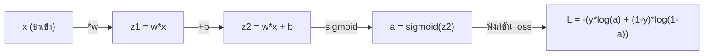
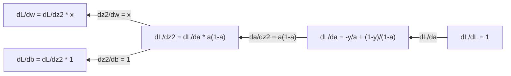
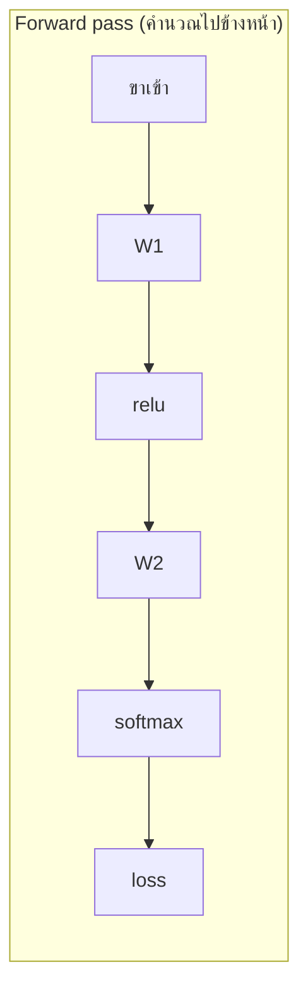
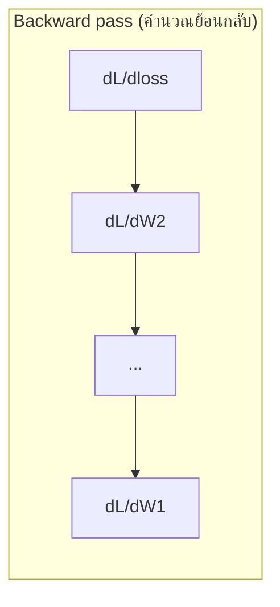

> อนุพันธ์บอกว่าทางไหนคือทางลงเขา และนั่นคือทั้งหมดที่โครงข่ายประสาทเทียมต้องใช้ในการเรียนรู้

**ประเภท:** เรียนรู้ (Learn)
**ภาษา:** Python
**ความรู้ที่ควรมีก่อน:** Phase 1 บทที่ 01-03
**เวลา:** ~60 นาที

## สิ่งที่จะได้เรียนรู้

- คำนวณอนุพันธ์แบบเชิงตัวเลขและแบบวิเคราะห์ของฟังก์ชันที่พบบ่อยใน ML ($x^2$, sigmoid, cross-entropy)
- เขียน gradient descent ตั้งแต่ศูนย์เพื่อหาค่าต่ำสุดของฟังก์ชันความสูญเสีย (loss function) ทั้งใน 1 มิติและ 2 มิติ
- หา gradient ของโมเดล linear regression แล้วเทรนด้วยการอัปเดตน้ำหนักเอง
- อธิบายเมทริกซ์ Hessian การประมาณด้วยอนุกรมเทย์เลอร์ (Taylor series) และความเชื่อมโยงกับวิธี optimization

## ปัญหา

คุณมีโครงข่ายประสาทเทียมที่มีน้ำหนักเป็นล้านตัว น้ำหนักแต่ละตัวคือปุ่มหมุนหนึ่งปุ่ม คุณต้องรู้ว่าควรหมุนทุกปุ่มไปทางไหน เพื่อให้โมเดลผิดน้อยลงอีกนิด แคลคูลัสให้ทิศทางนั้นกับคุณ

ถ้าไม่มีแคลคูลัส การเทรนโครงข่ายประสาทเทียมก็คือการลองเปลี่ยนแบบสุ่มแล้วภาวนาให้ดีขึ้น เมื่อมีอนุพันธ์ คุณรู้แน่ชัดว่าน้ำหนักแต่ละตัวส่งผลต่อความผิดพลาดอย่างไร คุณหมุนทุกปุ่มไปถูกทางได้ทุกครั้ง

## แนวคิด

### อนุพันธ์ (derivative) คืออะไร?

อนุพันธ์วัดอัตราการเปลี่ยนแปลง สำหรับฟังก์ชัน $y = f(x)$ อนุพันธ์ $f'(x)$ บอกว่า ถ้าขยับ $x$ ไปนิดเดียว $y$ จะเปลี่ยนไปเท่าไร

ในเชิงเรขาคณิต อนุพันธ์คือความชันของเส้นสัมผัสที่จุดนั้น

**$f(x) = x^2$:**

| $x$ | $f(x)$ | $f'(x)$ (ความชัน) |
|---|------|---------------|
| 0 | 0    | 0 (ราบ อยู่ก้นชาม) |
| 1 | 1    | 2 |
| 2 | 4    | 4 (ความชันของเส้นสัมผัสที่จุดนี้) |
| 3 | 9    | 6 |

ที่ $x=2$ ความชันคือ 4 ถ้าขยับ $x$ ไปทางขวานิดเดียว $y$ จะเพิ่มขึ้นประมาณ 4 เท่าของระยะที่ขยับ ที่ $x=0$ ความชันคือ 0 คุณอยู่ที่ก้นชาม

นิยามแบบเป็นทางการ:

```math
f'(x) = \lim_{h \to 0} \frac{f(x + h) - f(x)}{h}
```

ในโค้ด เราข้ามลิมิตไปและใช้ $h$ ที่เล็กมาก ๆ แทน นั่นคืออนุพันธ์เชิงตัวเลข (numerical derivative)

### อนุพันธ์ย่อย (partial derivative): ทีละตัวแปร

ฟังก์ชันจริงมีขาเข้าหลายตัว loss ของโครงข่ายประสาทเทียมขึ้นกับน้ำหนักเป็นพันตัว อนุพันธ์ย่อยตรึงตัวแปรอื่นทั้งหมดไว้เป็นค่าคงที่ ยกเว้นตัวเดียว แล้วหาอนุพันธ์เทียบกับตัวนั้น

```math
\begin{aligned}
f(x, y) &= x^2 + 3xy + y^2 \\[4pt]
\frac{\partial f}{\partial x} &= 2x + 3y \quad \text{(treat } y \text{ as a constant)} \\
\frac{\partial f}{\partial y} &= 3x + 2y \quad \text{(treat } x \text{ as a constant)}
\end{aligned}
```

(ตอนหาเทียบกับ $x$ ให้ถือว่า $y$ เป็นค่าคงที่ และตอนหาเทียบกับ $y$ ให้ถือว่า $x$ เป็นค่าคงที่)

อนุพันธ์ย่อยแต่ละตัวตอบคำถามว่า ถ้าขยับแค่น้ำหนักตัวนี้ตัวเดียว loss จะเปลี่ยนอย่างไร

### Gradient: เวกเตอร์ของอนุพันธ์ย่อยทั้งหมด

Gradient รวมอนุพันธ์ย่อยทุกตัวไว้ในเวกเตอร์เดียว สำหรับฟังก์ชัน $f(x, y, z)$ gradient คือ:

```math
\nabla f = \left[ \frac{\partial f}{\partial x}, \frac{\partial f}{\partial y}, \frac{\partial f}{\partial z} \right]
```

Gradient ชี้ไปทางที่ฟังก์ชันเพิ่มขึ้นชันที่สุด ถ้าจะหาค่าต่ำสุดของฟังก์ชัน ให้เดินไปทางตรงข้าม

**แผนภาพเส้นชั้น (contour plot) ของ $f(x,y) = x^2 + y^2$:**

ฟังก์ชันนี้เป็นรูปชาม เส้นชั้นเป็นวงกลมซ้อนกันที่มีจุดศูนย์กลางร่วมกัน ค่าต่ำสุดอยู่ที่ (0, 0)

| จุด | $\nabla f$ | $-\nabla f$ (ทิศลง) |
|-------|--------|----------------------------|
| (1, 1) | [2, 2] (ชี้ขึ้นเขา ห่างออกจากจุดต่ำสุด) | [-2, -2] (ชี้ลงเขา เข้าหาจุดต่ำสุด) |
| (0, 0) | [0, 0] (ราบ อยู่ที่จุดต่ำสุด) | [0, 0] |

นี่คือ gradient descent ในภาพเดียว คำนวณ gradient กลับเครื่องหมาย แล้วก้าวไปหนึ่งก้าว

### ความเชื่อมโยงกับ optimization

การเทรนโครงข่ายประสาทเทียมคือ optimization คุณมีฟังก์ชันความสูญเสีย $L(w_1, w_2, \ldots, w_n)$ ที่วัดว่าโมเดลผิดแค่ไหน และคุณอยากให้มันน้อยที่สุด

```
กฎการอัปเดตของ gradient descent:

  w_new = w_old - learning_rate * dL/dw

สำหรับน้ำหนักทุกตัว:
  1. คำนวณอนุพันธ์ย่อยของ loss เทียบกับน้ำหนักตัวนั้น
  2. ลบค่านั้นคูณตัวเลขเล็ก ๆ ออกจากน้ำหนัก
  3. ทำซ้ำ
```

Learning rate (อัตราการเรียนรู้) ควบคุมขนาดของก้าว ใหญ่เกินไปก็ก้าวเลยจุดต่ำสุด เล็กเกินไปก็คืบช้า ๆ

**ภูมิทัศน์ของ loss (ตัดมาดู 1 มิติ):**

ฟังก์ชันความสูญเสีย $L(w)$ เป็นเส้นโค้งที่มีทั้งยอดและหุบเมื่อน้ำหนัก $w$ เปลี่ยนไป

| ลักษณะ | คำอธิบาย |
|---------|-------------|
| ค่าต่ำสุดวงกว้าง (global minimum) | จุดที่ต่ำที่สุดของเส้นโค้งทั้งเส้น คือคำตอบที่ดีที่สุด |
| ค่าต่ำสุดเฉพาะที่ (local minimum) | หุบที่ต่ำกว่าบริเวณรอบ ๆ แต่ไม่ใช่จุดต่ำที่สุดของทั้งเส้น |
| ความชัน | gradient descent เดินตามความชันลงเขาจากจุดเริ่มต้นใดก็ได้ |

Gradient descent เดินตามความชันลงเขา มันอาจติดอยู่ในค่าต่ำสุดเฉพาะที่ได้ แต่ในปริภูมิมิติสูง (น้ำหนักเป็นล้านตัว) เรื่องนี้แทบไม่เป็นปัญหาในทางปฏิบัติ

### อนุพันธ์เชิงตัวเลขกับอนุพันธ์เชิงวิเคราะห์

การหาอนุพันธ์ทำได้สองวิธี

เชิงวิเคราะห์ (analytical): ใช้กฎของแคลคูลัสหาด้วยมือ สำหรับ $f(x) = x^2$ อนุพันธ์คือ $f'(x) = 2x$ แม่นยำ และเร็ว

เชิงตัวเลข (numerical): ประมาณจากนิยาม คำนวณ $f(x+h)$ และ $f(x-h)$ ด้วย $h$ ที่เล็กมาก แล้วใช้ผลต่าง

```
เชิงตัวเลข (ผลต่างกลาง central difference):

f'(x) ~= f(x + h) - f(x - h)
          -----------------------
                  2h

ในทางปฏิบัติ h = 0.0001 ใช้ได้ดี
```

อนุพันธ์เชิงตัวเลขช้ากว่าแต่ใช้ได้กับทุกฟังก์ชัน อนุพันธ์เชิงวิเคราะห์เร็วแต่คุณต้องหาสูตรเอง เฟรมเวิร์กของโครงข่ายประสาทเทียมใช้วิธีที่สาม คือการหาอนุพันธ์อัตโนมัติ (automatic differentiation) ซึ่งคำนวณอนุพันธ์ที่แม่นยำแบบกลไก คุณจะได้เห็นใน Phase 3

### อนุพันธ์ของฟังก์ชันง่าย ๆ ด้วยมือ

นี่คืออนุพันธ์ที่คุณจะเจอซ้ำแล้วซ้ำเล่าใน ML

```
ฟังก์ชัน        อนุพันธ์          ใช้ที่
--------        ----------       -------
f(x) = x^2     f'(x) = 2x      ฟังก์ชันความสูญเสีย (MSE)
f(x) = wx + b  f'(w) = x        ชั้นเชิงเส้น (gradient เทียบกับน้ำหนัก)
                f'(b) = 1        ชั้นเชิงเส้น (gradient เทียบกับ bias)
                f'(x) = w        ชั้นเชิงเส้น (gradient เทียบกับขาเข้า)
f(x) = e^x     f'(x) = e^x     Softmax, attention
f(x) = ln(x)   f'(x) = 1/x     cross-entropy loss
f(x) = 1/(1+e^-x)  f'(x) = f(x)(1-f(x))   ฟังก์ชันกระตุ้น sigmoid
```

สำหรับ $f(x) = x^2$:

```
f(x) = x^2    f'(x) = 2x

  x    f(x)   f'(x)   ความหมาย
  -2    4      -4      ความชันเอียงซ้าย (กำลังลดลง)
  -1    1      -2      ความชันเอียงซ้าย (กำลังลดลง)
   0    0       0      ราบ (จุดต่ำสุด!)
   1    1       2      ความชันเอียงขวา (กำลังเพิ่มขึ้น)
   2    4       4      ความชันเอียงขวา (กำลังเพิ่มขึ้น)
```

สำหรับ $f(w) = wx + b$ เมื่อ $x=3$, $b=1$:

```
f(w) = 3w + 1    f'(w) = 3

อนุพันธ์เทียบกับ w ก็คือ x นั่นเอง
ถ้า x ใหญ่ การเปลี่ยน w นิดเดียวจะทำให้ผลลัพธ์เปลี่ยนมาก
```

### กฎลูกโซ่ (chain rule)

เมื่อฟังก์ชันซ้อนกันอยู่ กฎลูกโซ่บอกวิธีหาอนุพันธ์

```
ถ้า y = f(g(x)) แล้ว dy/dx = f'(g(x)) * g'(x)

ตัวอย่าง: y = (3x + 1)^2
  ตัวนอก: f(u) = u^2       f'(u) = 2u
  ตัวใน: g(x) = 3x + 1    g'(x) = 3
  dy/dx = 2(3x + 1) * 3 = 6(3x + 1)
```

โครงข่ายประสาทเทียมคือลูกโซ่ของฟังก์ชัน: ขาเข้า -> เชิงเส้น -> ฟังก์ชันกระตุ้น -> เชิงเส้น -> ฟังก์ชันกระตุ้น -> loss Backpropagation คือการใช้กฎลูกโซ่ซ้ำ ๆ จากขาออกย้อนไปหาขาเข้า นั่นคืออัลกอริทึมทั้งหมด

### เมทริกซ์ Hessian

Gradient บอกความชัน Hessian บอกความโค้ง

Hessian คือเมทริกซ์ของอนุพันธ์ย่อยอันดับสอง สำหรับฟังก์ชัน $f(x_1, x_2, \ldots, x_n)$ ช่อง $(i, j)$ ของ Hessian คือ:

```math
H_{ij} = \frac{\partial^2 f}{\partial x_i \, \partial x_j}
```

สำหรับฟังก์ชันสองตัวแปร $f(x, y)$:

```math
H = \begin{bmatrix} \dfrac{\partial^2 f}{\partial x^2} & \dfrac{\partial^2 f}{\partial x \, \partial y} \\[8pt] \dfrac{\partial^2 f}{\partial y \, \partial x} & \dfrac{\partial^2 f}{\partial y^2} \end{bmatrix}
```

**Hessian บอกอะไรที่จุดวิกฤต (critical point คือจุดที่ gradient = 0):**

| สมบัติของ Hessian | ความหมาย | ตัวอย่างพื้นผิว |
|-----------------|---------|-----------------|
| บวกแน่นอน (positive definite: ค่าลักษณะเฉพาะทุกตัว > 0) | ค่าต่ำสุดเฉพาะที่ | ชามหงาย |
| ลบแน่นอน (negative definite: ค่าลักษณะเฉพาะทุกตัว < 0) | ค่าสูงสุดเฉพาะที่ | ชามคว่ำ |
| ไม่แน่นอน (indefinite: ค่าลักษณะเฉพาะมีทั้งบวกและลบ) | จุดอานม้า (saddle point) | รูปอานม้า |

**ตัวอย่าง:** $f(x, y) = x^2 - y^2$ (ฟังก์ชันรูปอานม้า)

```
df/dx = 2x       df/dy = -2y
d^2f/dx^2 = 2    d^2f/dy^2 = -2    d^2f/dxdy = 0

H = | 2   0 |
    | 0  -2 |

ค่าลักษณะเฉพาะ: 2 และ -2 (บวกหนึ่งตัว ลบหนึ่งตัว)
--> จุดอานม้าที่ (0, 0)
```

เทียบกับ $f(x, y) = x^2 + y^2$ (รูปชาม):

```
H = | 2  0 |
    | 0  2 |

ค่าลักษณะเฉพาะ: 2 และ 2 (บวกทั้งคู่)
--> ค่าต่ำสุดเฉพาะที่ที่ (0, 0)
```

**ทำไม Hessian จึงสำคัญใน ML:**

วิธีของนิวตัน (Newton's method) ใช้ Hessian เพื่อก้าวได้ดีกว่า gradient descent แทนที่จะเดินตามความชันอย่างเดียว มันคิดถึงความโค้งด้วย:

```math
\begin{aligned}
\text{Newton's update:} \quad & w_{\text{new}} = w_{\text{old}} - H^{-1} \cdot \text{gradient} \\
\text{Gradient descent:} \quad & w_{\text{new}} = w_{\text{old}} - \text{lr} \cdot \text{gradient}
\end{aligned}
```

(บรรทัดแรกคือการอัปเดตของวิธีของนิวตัน บรรทัดที่สองคือ gradient descent)

วิธีของนิวตันลู่เข้าเร็วกว่า เพราะ Hessian "ปรับสเกล" gradient ใหม่ ทิศที่ชันได้ก้าวสั้นลง ทิศที่ราบได้ก้าวยาวขึ้น

ข้อเสียคือ สำหรับโครงข่ายประสาทเทียมที่มีพารามิเตอร์ $N$ ตัว Hessian มีขนาด $N \times N$ โมเดลที่มีพารามิเตอร์ 1 ล้านตัวต้องใช้เมทริกซ์ที่มีถึงล้านล้านช่อง เราจึงใช้การประมาณแทน

| วิธี | สิ่งที่ใช้ | ต้นทุน | การลู่เข้า |
|--------|-------------|------|-------------|
| Gradient descent | อนุพันธ์อันดับหนึ่งอย่างเดียว | $O(N)$ ต่อก้าว | ช้า (เชิงเส้น) |
| วิธีของนิวตัน | Hessian เต็ม | $O(N^3)$ ต่อก้าว | เร็ว (กำลังสอง) |
| L-BFGS | Hessian โดยประมาณจากประวัติของ gradient | $O(N)$ ต่อก้าว | ปานกลาง (เร็วกว่าเชิงเส้น superlinear) |
| Adam | อัตราที่ปรับตัวได้ต่อพารามิเตอร์ (ประมาณ Hessian แบบทแยงมุม) | $O(N)$ ต่อก้าว | ปานกลาง |
| Natural gradient | เมทริกซ์สารสนเทศของ Fisher (Hessian เชิงสถิติ) | $O(N^2)$ ต่อก้าว | เร็ว |

ในทางปฏิบัติ Adam เป็น optimizer ตั้งต้นของ deep learning มันประมาณข้อมูลอันดับสองได้ถูก ๆ โดยติดตามค่าเฉลี่ยเคลื่อนที่และความแปรปรวนของ gradient ของแต่ละพารามิเตอร์

### การประมาณด้วยอนุกรมเทย์เลอร์ (Taylor series)

ฟังก์ชันที่เรียบใด ๆ ประมาณได้ด้วยพหุนามในบริเวณใกล้ ๆ จุดหนึ่ง:

```math
f(x + h) = f(x) + f'(x)\,h + \frac{1}{2} f''(x)\,h^2 + \frac{1}{6} f'''(x)\,h^3 + \cdots
```

ยิ่งใส่พจน์มาก การประมาณยิ่งดี แต่ใช้ได้เฉพาะใกล้ ๆ จุด $x$ เท่านั้น

**ทำไมอนุกรมเทย์เลอร์จึงสำคัญใน ML:**

- **เทย์เลอร์อันดับหนึ่ง = gradient descent** เมื่อใช้ $f(x + h) \approx f(x) + f'(x) h$ คุณกำลังประมาณแบบเชิงเส้น gradient descent ทำให้โมเดลเชิงเส้นนี้ต่ำที่สุดโดยเลือก $h = -\text{lr} \cdot f'(x)$

- **เทย์เลอร์อันดับสอง = วิธีของนิวตัน** เมื่อใช้ $f(x + h) \approx f(x) + f'(x) h + \frac{1}{2} f''(x) h^2$ คุณได้โมเดลกำลังสอง ค่าต่ำสุดของมันคือ $h = -f'(x)/f''(x)$ ซึ่งก็คือก้าวของนิวตัน

- **การออกแบบฟังก์ชันความสูญเสีย** MSE และ cross-entropy เป็นฟังก์ชันที่เรียบ แปลว่าการกระจายเทย์เลอร์ของมันมีพฤติกรรมดี เรื่องนี้ไม่ใช่ความบังเอิญ loss ที่เรียบทำให้ optimization คาดเดาได้

```
อันดับการประมาณ          สิ่งที่จับได้         วิธี optimization
-------------------    -----------------   -------------------
อันดับ 0 (ค่าคงที่)       แค่ค่าของฟังก์ชัน    การค้นหาแบบสุ่ม
อันดับ 1 (เชิงเส้น)       ความชัน             gradient descent
อันดับ 2 (กำลังสอง)      ความโค้ง            วิธีของนิวตัน
อันดับสูงกว่านั้น         โครงสร้างละเอียด      แทบไม่ใช้ใน ML
```

ใจความสำคัญ: optimization ที่ใช้ gradient ทั้งหมดคือการประมาณฟังก์ชันความสูญเสียในบริเวณใกล้ ๆ แล้วก้าวไปที่ค่าต่ำสุดของการประมาณนั้น

### ปริพันธ์ (integral) ใน ML

อนุพันธ์บอกอัตราการเปลี่ยนแปลง ปริพันธ์คำนวณการสะสม คือพื้นที่ใต้เส้นโค้ง

ใน ML คุณแทบไม่ต้องหาปริพันธ์ด้วยมือ แต่แนวคิดนี้อยู่ทุกที่:

**ความน่าจะเป็น** สำหรับตัวแปรสุ่มต่อเนื่องที่มีฟังก์ชันความหนาแน่น $p(x)$:

```math
P(a < X < b) = \int_a^b p(x) \, dx
```

พื้นที่ใต้เส้นโค้งความหนาแน่นของความน่าจะเป็นระหว่าง $a$ กับ $b$ คือความน่าจะเป็นที่ค่าจะตกในช่วงนั้น

**ค่าคาดหมาย (expected value)** ค่าเฉลี่ยของผลลัพธ์ที่ถ่วงน้ำหนักด้วยความน่าจะเป็น:

```math
\mathbb{E}[f(X)] = \int f(x) \, p(x) \, dx
```

loss ที่คาดหมายบนการแจกแจงของข้อมูลคือปริพันธ์ การเทรนคือการทำให้ค่าประมาณเชิงประจักษ์ของปริพันธ์นี้ต่ำที่สุด

**KL divergence** วัดว่าการแจกแจงสองแบบต่างกันแค่ไหน:

```math
\mathrm{KL}(p \,\|\, q) = \int p(x) \log \frac{p(x)}{q(x)} \, dx
```

ใช้ใน VAE, knowledge distillation และการอนุมานแบบเบย์ (Bayesian inference)

**ค่าคงที่สำหรับทำให้เป็นมาตรฐาน (normalization constant)** ในการอนุมานแบบเบย์:

```math
p(w \mid \text{data}) = \frac{p(\text{data} \mid w) \, p(w)}{\int p(\text{data} \mid w) \, p(w) \, dw}
```

ตัวส่วนคือปริพันธ์บนค่าพารามิเตอร์ที่เป็นไปได้ทั้งหมด บ่อยครั้งมันคำนวณตรง ๆ ไม่ได้ เราจึงใช้การประมาณอย่าง MCMC และ variational inference

| แนวคิดของปริพันธ์ | พบที่ไหนใน ML |
|-----------------|----------------------|
| พื้นที่ใต้เส้นโค้ง | ความน่าจะเป็นจากฟังก์ชันความหนาแน่น |
| ค่าคาดหมาย | ฟังก์ชันความสูญเสีย การทำให้ความเสี่ยงต่ำที่สุด |
| KL divergence | VAE, policy optimization, distillation |
| การทำให้เป็นมาตรฐาน | posterior แบบเบย์ ตัวส่วนของ softmax |
| Marginal likelihood | การเปรียบเทียบโมเดล ขอบล่างของ evidence (ELBO) |

### กฎลูกโซ่หลายตัวแปรในกราฟการคำนวณ

กฎลูกโซ่ไม่ได้ใช้แค่กับฟังก์ชันสเกลาร์ที่ต่อกันเป็นเส้นตรง ในโครงข่ายประสาทเทียม ตัวแปรแตกออกและรวมเข้าหากัน นี่คือการไหลของอนุพันธ์ผ่าน forward pass ง่าย ๆ:



Backward pass คำนวณ gradient จากขวาไปซ้าย:



ลูกศรแต่ละเส้นคูณด้วยอนุพันธ์เฉพาะที่ (local derivative) gradient ของพารามิเตอร์ใด ๆ คือผลคูณของอนุพันธ์เฉพาะที่ทั้งหมดตามเส้นทางจาก loss ไปถึงพารามิเตอร์นั้น เมื่อเส้นทางแตกออกแล้วรวมกัน ให้รวมผลจากทุกเส้นทางเข้าด้วยกัน (กฎลูกโซ่หลายตัวแปร)

Backpropagation มีแค่นี้: ใช้กฎลูกโซ่อย่างเป็นระบบผ่านกราฟการคำนวณ จากขาออกย้อนไปหาขาเข้า

### เมทริกซ์จาโคเบียน (Jacobian)

เมื่อฟังก์ชันส่งเวกเตอร์ไปเป็นเวกเตอร์ (เช่นชั้นหนึ่งของโครงข่ายประสาทเทียม) อนุพันธ์ของมันคือเมทริกซ์ จาโคเบียนเก็บอนุพันธ์ย่อยของขาออกทุกตัวเทียบกับขาเข้าทุกตัว

สำหรับ $f: \mathbb{R}^n \to \mathbb{R}^m$ จาโคเบียน $J$ คือเมทริกซ์ขนาด $m \times n$:

| | $x_1$ | $x_2$ | ... | $x_n$ |
|---|---|---|---|---|
| $f_1$ | $\partial f_1/\partial x_1$ | $\partial f_1/\partial x_2$ | ... | $\partial f_1/\partial x_n$ |
| $f_2$ | $\partial f_2/\partial x_1$ | $\partial f_2/\partial x_2$ | ... | $\partial f_2/\partial x_n$ |
| ... | ... | ... | ... | ... |
| $f_m$ | $\partial f_m/\partial x_1$ | $\partial f_m/\partial x_2$ | ... | $\partial f_m/\partial x_n$ |

คุณไม่ต้องคำนวณจาโคเบียนของโครงข่ายประสาทเทียมด้วยมือ PyTorch ทำให้ แต่การรู้ว่ามันมีอยู่ช่วยให้เข้าใจ shape ใน backpropagation: ถ้าชั้นหนึ่งส่ง $\mathbb{R}^n$ ไปเป็น $\mathbb{R}^m$ จาโคเบียนของมันมีขนาด $m \times n$ และ gradient ไหลย้อนกลับผ่าน transpose ของเมทริกซ์นี้

### ทำไมเรื่องนี้จึงสำคัญกับโครงข่ายประสาทเทียม

น้ำหนักทุกตัวในโครงข่ายประสาทเทียมได้ gradient ของตัวเอง gradient บอกว่าควรปรับน้ำหนักตัวนั้นอย่างไรเพื่อลด loss





การอัปเดตน้ำหนักแต่ละครั้ง:
- `W1 = W1 - lr * dL/dW1`
- `W2 = W2 - lr * dL/dW2`

Forward pass คำนวณคำทำนายและ loss Backward pass คำนวณ gradient ของ loss เทียบกับน้ำหนักทุกตัว จากนั้นน้ำหนักทุกตัวก้าวลงเขาไปนิดหนึ่ง ทำซ้ำเป็นล้านก้าว นั่นคือ deep learning

```figure
derivative-tangent
```

## ลงมือสร้าง (Build It)

### ขั้นที่ 1: อนุพันธ์เชิงตัวเลขตั้งแต่ศูนย์

```python
def numerical_derivative(f, x, h=1e-7):
    return (f(x + h) - f(x - h)) / (2 * h)

def f(x):
    return x ** 2

for x in [-2, -1, 0, 1, 2]:
    numerical = numerical_derivative(f, x)
    analytical = 2 * x
    print(f"x={x:2d}  f'(x) numerical={numerical:.6f}  analytical={analytical:.1f}")
```

อนุพันธ์เชิงตัวเลขตรงกับอนุพันธ์เชิงวิเคราะห์ไปหลายตำแหน่งทศนิยม

### ขั้นที่ 2: อนุพันธ์ย่อยและ gradient

```python
def numerical_gradient(f, point, h=1e-7):
    gradient = []
    for i in range(len(point)):
        point_plus = list(point)
        point_minus = list(point)
        point_plus[i] += h
        point_minus[i] -= h
        partial = (f(point_plus) - f(point_minus)) / (2 * h)
        gradient.append(partial)
    return gradient

def f_multi(point):
    x, y = point
    return x**2 + 3*x*y + y**2

grad = numerical_gradient(f_multi, [1.0, 2.0])
print(f"Numerical gradient at (1,2): {[f'{g:.4f}' for g in grad]}")
print(f"Analytical gradient at (1,2): [2*1+3*2, 3*1+2*2] = [{2*1+3*2}, {3*1+2*2}]")
```

### ขั้นที่ 3: Gradient descent หาค่าต่ำสุดของ f(x) = x^2

```python
x = 5.0
lr = 0.1
for step in range(20):
    grad = 2 * x
    x = x - lr * grad
    print(f"step {step:2d}  x={x:8.4f}  f(x)={x**2:10.6f}")
```

เริ่มที่ $x=5$ แต่ละก้าวเข้าใกล้ $x=0$ (จุดต่ำสุด) มากขึ้น

### ขั้นที่ 4: Gradient descent บนฟังก์ชัน 2 มิติ

```python
def f_2d(point):
    x, y = point
    return x**2 + y**2

point = [4.0, 3.0]
lr = 0.1
for step in range(30):
    grad = numerical_gradient(f_2d, point)
    point = [p - lr * g for p, g in zip(point, grad)]
    loss = f_2d(point)
    if step % 5 == 0 or step == 29:
        print(f"step {step:2d}  point=({point[0]:7.4f}, {point[1]:7.4f})  f={loss:.6f}")
```

### ขั้นที่ 5: เทียบอนุพันธ์เชิงตัวเลขกับเชิงวิเคราะห์

```python
import math

test_functions = [
    ("x^2",      lambda x: x**2,          lambda x: 2*x),
    ("x^3",      lambda x: x**3,          lambda x: 3*x**2),
    ("sin(x)",   lambda x: math.sin(x),   lambda x: math.cos(x)),
    ("e^x",      lambda x: math.exp(x),   lambda x: math.exp(x)),
    ("1/x",      lambda x: 1/x,           lambda x: -1/x**2),
]

x = 2.0
print(f"{'Function':<12} {'Numerical':>12} {'Analytical':>12} {'Error':>12}")
print("-" * 50)
for name, f, df in test_functions:
    num = numerical_derivative(f, x)
    ana = df(x)
    err = abs(num - ana)
    print(f"{name:<12} {num:12.6f} {ana:12.6f} {err:12.2e}")
```

### ขั้นที่ 6: คำนวณ Hessian เชิงตัวเลข

```python
def hessian_2d(f, x, y, h=1e-5):
    fxx = (f(x + h, y) - 2 * f(x, y) + f(x - h, y)) / (h ** 2)
    fyy = (f(x, y + h) - 2 * f(x, y) + f(x, y - h)) / (h ** 2)
    fxy = (f(x + h, y + h) - f(x + h, y - h) - f(x - h, y + h) + f(x - h, y - h)) / (4 * h ** 2)
    return [[fxx, fxy], [fxy, fyy]]

def saddle(x, y):
    return x ** 2 - y ** 2

def bowl(x, y):
    return x ** 2 + y ** 2

H_saddle = hessian_2d(saddle, 0.0, 0.0)
H_bowl = hessian_2d(bowl, 0.0, 0.0)
print(f"Saddle Hessian: {H_saddle}")  # [[2, 0], [0, -2]] -- mixed signs
print(f"Bowl Hessian:   {H_bowl}")    # [[2, 0], [0, 2]]  -- both positive
```

Hessian ของฟังก์ชันรูปอานม้ามีค่าลักษณะเฉพาะ 2 และ -2 (เครื่องหมายต่างกัน ยืนยันว่าเป็นจุดอานม้า) ส่วนรูปชามมีค่าลักษณะเฉพาะ 2 และ 2 (บวกทั้งคู่ ยืนยันว่าเป็นค่าต่ำสุด)

### ขั้นที่ 7: การประมาณด้วยเทย์เลอร์ในการใช้งานจริง

```python
import math

def taylor_approx(f, f_prime, f_double_prime, x0, h, order=2):
    result = f(x0)
    if order >= 1:
        result += f_prime(x0) * h
    if order >= 2:
        result += 0.5 * f_double_prime(x0) * h ** 2
    return result

x0 = 0.0
for h in [0.1, 0.5, 1.0, 2.0]:
    true_val = math.sin(h)
    t1 = taylor_approx(math.sin, math.cos, lambda x: -math.sin(x), x0, h, order=1)
    t2 = taylor_approx(math.sin, math.cos, lambda x: -math.sin(x), x0, h, order=2)
    print(f"h={h:.1f}  sin(h)={true_val:.4f}  order1={t1:.4f}  order2={t2:.4f}")
```

ใกล้ $x_0=0$ เรามี $\sin(x) \approx x$ (เทย์เลอร์อันดับหนึ่ง) การประมาณแม่นมากเมื่อ $h$ เล็ก แต่ใช้ไม่ได้เมื่อ $h$ ใหญ่ นี่คือเหตุผลที่ gradient descent ทำงานได้ดีที่สุดกับ learning rate เล็ก ๆ เพราะแต่ละก้าวสมมติว่าการประมาณเชิงเส้นแม่นยำ

### ขั้นที่ 8: ทำไมเรื่องนี้จึงสำคัญกับโครงข่ายประสาทเทียม

```python
import random

random.seed(42)

w = random.gauss(0, 1)
b = random.gauss(0, 1)
lr = 0.01

xs = [1.0, 2.0, 3.0, 4.0, 5.0]
ys = [3.0, 5.0, 7.0, 9.0, 11.0]

for epoch in range(200):
    total_loss = 0
    dw = 0
    db = 0
    for x, y in zip(xs, ys):
        pred = w * x + b
        error = pred - y
        total_loss += error ** 2
        dw += 2 * error * x
        db += 2 * error
    dw /= len(xs)
    db /= len(xs)
    total_loss /= len(xs)
    w -= lr * dw
    b -= lr * db
    if epoch % 40 == 0 or epoch == 199:
        print(f"epoch {epoch:3d}  w={w:.4f}  b={b:.4f}  loss={total_loss:.6f}")

print(f"\nLearned: y = {w:.2f}x + {b:.2f}")
print(f"Actual:  y = 2x + 1")
```

ลูปการเทรนที่ใช้ gradient ทุกแบบมีรูปแบบนี้: ทำนาย คำนวณ loss คำนวณ gradient แล้วอัปเดตน้ำหนัก

## นำไปใช้ (Use It)

ด้วย NumPy การดำเนินการเดียวกันเร็วขึ้นและสั้นลง:

```python
import numpy as np

x = np.array([1, 2, 3, 4, 5], dtype=float)
y = np.array([3, 5, 7, 9, 11], dtype=float)

w, b = np.random.randn(), np.random.randn()
lr = 0.01

for epoch in range(200):
    pred = w * x + b
    error = pred - y
    loss = np.mean(error ** 2)
    dw = np.mean(2 * error * x)
    db = np.mean(2 * error)
    w -= lr * dw
    b -= lr * db

print(f"Learned: y = {w:.2f}x + {b:.2f}")
```

คุณเพิ่งสร้าง gradient descent ตั้งแต่ศูนย์ PyTorch ทำการคำนวณ gradient ให้อัตโนมัติ แต่ลูปการอัปเดตเหมือนเดิมทุกอย่าง

## แบบฝึกหัด

1. เขียน `numerical_second_derivative(f, x)` โดยเรียก `numerical_derivative` สองชั้น ตรวจว่าอนุพันธ์อันดับสองของ $x^3$ ที่ $x=2$ เท่ากับ 12
2. ใช้ gradient descent หาค่าต่ำสุดของ $f(x, y) = (x - 3)^2 + (y + 1)^2$ เริ่มจาก $(0, 0)$ คำตอบควรลู่เข้าสู่ $(3, -1)$
3. เพิ่มโมเมนตัม (momentum) ให้ลูป gradient descent: เก็บเวกเตอร์ความเร็วที่สะสม gradient ในอดีตไว้ เทียบความเร็วในการลู่เข้าระหว่างมีและไม่มีโมเมนตัมบน $f(x) = x^4 - 3x^2$

### คำใบ้

**แบบฝึกหัดที่ 1** สร้างฟังก์ชันช่วยที่คืนค่า `numerical_derivative(f, x)` แล้วส่งฟังก์ชันช่วยนั้นเข้า `numerical_derivative` อีกครั้ง ถ้าผลลัพธ์แกว่ง ให้ใช้ก้าวที่ใหญ่ขึ้นอย่าง `h=1e-4` ในการเรียกทั้งสองครั้ง ค่าที่ $x=2$ ต้องใกล้ 12

**แบบฝึกหัดที่ 2** เขียน gradient $(2(x - 3), 2(y + 1))$ หรือใช้ `numerical_gradient` แล้วเรียก `gradient_descent_nd` จาก $(0, 0)$ พิมพ์จุดทุก 10 ก้าว จุดต้องเคลื่อนเข้าหา $(3, -1)$ และ loss ต้องลดลงจนเกือบเป็น 0

**แบบฝึกหัดที่ 3** เก็บความเร็ว `v` ไว้ อัปเดตด้วย `v = momentum * v - lr * grad` แล้วบวก `v` เข้ากับ `x` นับจำนวนก้าวที่แต่ละวิธีต้องใช้จน gradient เกือบเป็น 0 ค่าต่ำสุดอยู่ที่ $x = \pm\sqrt{1.5} \approx \pm 1.225$

## คำศัพท์สำคัญ

| คำศัพท์ | ที่คนมักพูด | ความหมายจริง |
|------|----------------|----------------------|
| Derivative (อนุพันธ์) | "ความชัน" | อัตราการเปลี่ยนแปลงของฟังก์ชันที่จุดหนึ่ง บอกว่าขาออกเปลี่ยนไปเท่าไรต่อการเปลี่ยนขาเข้าหนึ่งหน่วย |
| Partial derivative (อนุพันธ์ย่อย) | "อนุพันธ์ของตัวแปรเดียว" | อนุพันธ์เทียบกับตัวแปรหนึ่ง โดยตรึงตัวแปรอื่นทั้งหมดไว้เป็นค่าคงที่ |
| Gradient | "ทิศที่ชันขึ้นที่สุด" | เวกเตอร์ของอนุพันธ์ย่อยทั้งหมด ชี้ไปทางที่ทำให้ฟังก์ชันเพิ่มเร็วที่สุด |
| Gradient descent | "เดินลงเขา" | ลบ gradient (คูณ learning rate) ออกจากพารามิเตอร์เพื่อลด loss แกนหลักของการเทรนโครงข่ายประสาทเทียม |
| Learning rate (อัตราการเรียนรู้) | "ขนาดก้าว" | สเกลาร์ที่ควบคุมว่าแต่ละก้าวของ gradient descent ใหญ่แค่ไหน ใหญ่เกิน: ลู่ออก เล็กเกิน: ลู่เข้าช้า |
| Chain rule (กฎลูกโซ่) | "คูณอนุพันธ์ต่อกัน" | กฎหาอนุพันธ์ของฟังก์ชันที่ซ้อนกัน: $\frac{df}{dx} = \frac{df}{dg} \cdot \frac{dg}{dx}$ เป็นฐานทางคณิตศาสตร์ของ backpropagation |
| Jacobian (จาโคเบียน) | "เมทริกซ์ของอนุพันธ์" | เมื่อฟังก์ชันส่งเวกเตอร์ไปเป็นเวกเตอร์ จาโคเบียนคือเมทริกซ์ของอนุพันธ์ย่อยของขาออกทุกตัวเทียบกับขาเข้าทุกตัว |
| Numerical derivative (อนุพันธ์เชิงตัวเลข) | "ผลต่างจำกัด (finite differences)" | ประมาณอนุพันธ์โดยคำนวณฟังก์ชันที่สองจุดใกล้กันแล้วหาความชันระหว่างสองจุดนั้น |
| Backpropagation | "autodiff แบบย้อนกลับ" | คำนวณ gradient ทีละชั้นจากขาออกย้อนไปหาขาเข้าด้วยกฎลูกโซ่ คือวิธีที่โครงข่ายประสาทเทียมเรียนรู้ |
| Hessian | "เมทริกซ์ของอนุพันธ์อันดับสอง" | เมทริกซ์ของอนุพันธ์ย่อยอันดับสองทั้งหมด บรรยายความโค้งของฟังก์ชัน Hessian ที่บวกแน่นอน ณ จุดวิกฤตแปลว่าเป็นค่าต่ำสุดเฉพาะที่ |
| Taylor series (อนุกรมเทย์เลอร์) | "การประมาณด้วยพหุนาม" | ประมาณฟังก์ชันใกล้จุดหนึ่งด้วยอนุพันธ์ของมัน: $f(x+h) \approx f(x) + f'(x)h + \frac{1}{2}f''(x)h^2 + \cdots$ เป็นฐานในการเข้าใจว่าทำไม gradient descent และวิธีของนิวตันจึงได้ผล |
| Integral (ปริพันธ์) | "พื้นที่ใต้เส้นโค้ง" | การสะสมปริมาณหนึ่งตลอดช่วง ใน ML ปริพันธ์ใช้นิยามความน่าจะเป็น ค่าคาดหมาย และ KL divergence |

## อ่านเพิ่มเติม

- [3Blue1Brown: Essence of Calculus](https://www.3blue1brown.com/topics/calculus) - ภาพที่ช่วยให้เข้าใจอนุพันธ์ ปริพันธ์ และกฎลูกโซ่
- [Stanford CS231n: Backpropagation](https://cs231n.github.io/optimization-2/) - gradient ไหลผ่านชั้นต่าง ๆ ของโครงข่ายประสาทเทียมอย่างไร
