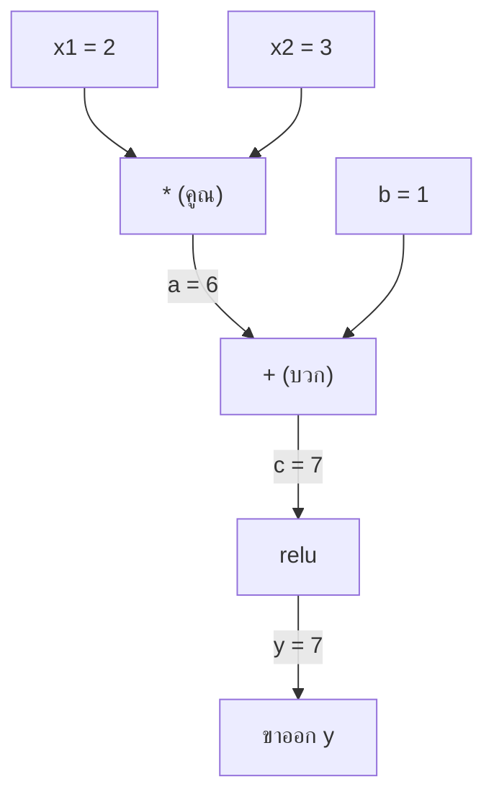
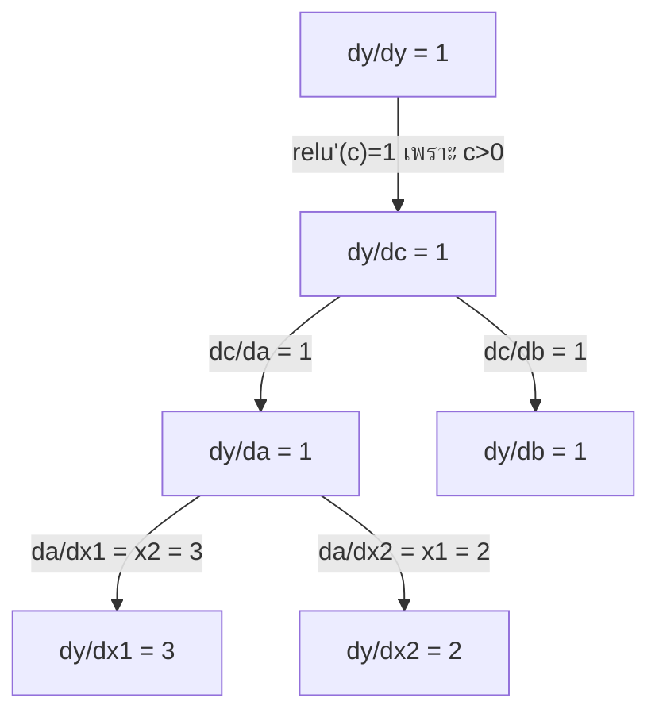

> กฎลูกโซ่คือเครื่องยนต์ที่อยู่เบื้องหลังโครงข่ายประสาทเทียมทุกตัวที่เรียนรู้ได้

**ประเภท:** ลงมือสร้าง (Build)
**ภาษา:** Python
**ความรู้ที่ควรมีก่อน:** Phase 1 บทที่ 04 (อนุพันธ์และ gradient)
**เวลา:** ~90 นาที

## สิ่งที่จะได้เรียนรู้

- สร้างเอนจิน autograd ขนาดเล็ก (คลาส Value) ที่บันทึกการดำเนินการ และคำนวณ gradient ด้วย autodiff แบบย้อนกลับ (reverse mode)
- เขียน forward pass และ backward pass ผ่านกราฟการคำนวณด้วยการเรียงลำดับแบบทอพอโลยี (topological sort)
- สร้างและเทรน multi-layer perceptron บนโจทย์ XOR โดยใช้แค่เอนจิน autograd ที่เขียนเอง
- ตรวจความถูกต้องของ autodiff ด้วย gradient checking เทียบกับผลต่างจำกัด (finite difference) เชิงตัวเลข

## ปัญหา

คุณหาอนุพันธ์ของฟังก์ชันง่าย ๆ ได้แล้ว แต่โครงข่ายประสาทเทียมไม่ใช่ฟังก์ชันง่าย ๆ มันคือฟังก์ชันหลายร้อยตัวที่ซ้อนกัน: คูณเมทริกซ์ บวก bias ใส่ฟังก์ชันกระตุ้น คูณเมทริกซ์อีกรอบ softmax แล้ว cross-entropy loss ขาออกคือฟังก์ชันของฟังก์ชันของฟังก์ชัน

ในการเทรนโครงข่าย คุณต้องได้ gradient ของ loss เทียบกับน้ำหนักทุกตัว ทำด้วยมือไม่ได้แน่เมื่อมีพารามิเตอร์เป็นล้าน ทำเชิงตัวเลข (ผลต่างจำกัด) ก็ช้าเกินไป

กฎลูกโซ่ให้คณิตศาสตร์ การหาอนุพันธ์อัตโนมัติ (automatic differentiation) ให้อัลกอริทึม เมื่อใช้ด้วยกัน คุณจะคำนวณ gradient ที่แม่นยำผ่านการซ้อนฟังก์ชันแบบใดก็ได้ ในเวลาที่เป็นสัดส่วนกับ forward pass หนึ่งรอบ

นี่คือวิธีที่ PyTorch, TensorFlow และ JAX ทำงาน คุณจะสร้างเวอร์ชันจิ๋วตั้งแต่ศูนย์

## แนวคิด

### กฎลูกโซ่ (Chain Rule)

ถ้า $y = f(g(x))$ อนุพันธ์ของ $y$ เทียบกับ $x$ คือ:

```math
\frac{dy}{dx} = \frac{dy}{dg} \cdot \frac{dg}{dx} = f'(g(x)) \cdot g'(x)
```

คูณอนุพันธ์ไปตามลูกโซ่ แต่ละข้อต่อให้อนุพันธ์เฉพาะที่ (local derivative) ของตัวเอง

ตัวอย่าง: $y = \sin(x^2)$

```math
\begin{aligned}
g(x) &= x^2 \qquad & g'(x) &= 2x \\
f(g) &= \sin(g) \qquad & f'(g) &= \cos(g) \\[4pt]
\frac{dy}{dx} &= \cos(x^2) \cdot 2x
\end{aligned}
```

ถ้าซ้อนลึกกว่านั้น ลูกโซ่ก็ยาวขึ้น:

```math
\begin{aligned}
y &= f(g(h(x))) \\[4pt]
\frac{dy}{dx} &= f'(g(h(x))) \cdot g'(h(x)) \cdot h'(x)
\end{aligned}
```

ทุกชั้นในโครงข่ายประสาทเทียมคือข้อต่อหนึ่งข้อในลูกโซ่นี้

### กราฟการคำนวณ (Computational Graphs)

กราฟการคำนวณทำให้เห็นกฎลูกโซ่เป็นภาพ ทุกการดำเนินการกลายเป็นโหนด ข้อมูลไหลไปข้างหน้าผ่านกราฟ ส่วน gradient ไหลย้อนกลับ

**Forward pass (คำนวณค่า):**



**Backward pass (คำนวณ gradient):**



Backward pass ใช้กฎลูกโซ่ที่ทุกโหนด ส่งต่อ gradient จากขาออกไปหาขาเข้า

### แบบไปข้างหน้า (Forward Mode) กับแบบย้อนกลับ (Reverse Mode)

การใช้กฎลูกโซ่ผ่านกราฟทำได้สองแบบ

**แบบไปข้างหน้า (forward mode)** เริ่มที่ขาเข้าแล้วดันอนุพันธ์ไปข้างหน้า มันตั้งต้นที่ $dx/dx = 1$ แล้วส่งผ่านทีละการดำเนินการ เหมาะเมื่อมีขาเข้าน้อยและขาออกมาก

```
แบบไปข้างหน้า: ตั้งต้น dx/dx = 1 แล้วส่งไปข้างหน้า

  x = 2       (dx/dx = 1)
  a = x^2     (da/dx = 2x = 4)
  y = sin(a)  (dy/dx = cos(a) * da/dx = cos(4) * 4 = -2.615)
```

**แบบย้อนกลับ (reverse mode)** เริ่มที่ขาออกแล้วดึง gradient ย้อนกลับ มันตั้งต้นที่ $dy/dy = 1$ แล้วส่งผ่านทีละการดำเนินการในลำดับย้อนกลับ เหมาะเมื่อมีขาเข้ามากและขาออกน้อย

```
แบบย้อนกลับ: ตั้งต้น dy/dy = 1 แล้วส่งย้อนกลับ

  y = sin(a)  (dy/dy = 1)
  a = x^2     (dy/da = cos(a) = cos(4) = -0.654)
  x = 2       (dy/dx = dy/da * da/dx = -0.654 * 4 = -2.615)
```

โครงข่ายประสาทเทียมมีขาเข้า (น้ำหนัก) เป็นล้านตัว และขาออก (loss) ตัวเดียว แบบย้อนกลับคำนวณ gradient ทั้งหมดได้ใน backward pass รอบเดียว นี่คือเหตุผลที่ backpropagation ใช้แบบย้อนกลับ

| แบบ | ค่าตั้งต้น | ทิศทาง | เหมาะเมื่อ |
|------|------|-----------|-----------|
| ไปข้างหน้า | $dx_i/dx_i = 1$ | ขาเข้าไปขาออก | ขาเข้าน้อย ขาออกมาก |
| ย้อนกลับ | $dy/dy = 1$ | ขาออกไปขาเข้า | ขาเข้ามาก ขาออกน้อย (โครงข่ายประสาทเทียม) |

### จำนวนคู่ (Dual Numbers) สำหรับแบบไปข้างหน้า

แบบไปข้างหน้าเขียนได้อย่างสวยงามด้วยจำนวนคู่ (dual number) ซึ่งมีรูป $a + b\epsilon$ โดยที่ $\epsilon^2 = 0$

```
จำนวนคู่: (ค่า, อนุพันธ์)

(2, 1) แปลว่า: ค่าคือ 2 และอนุพันธ์เทียบกับ x คือ 1

กฎการคำนวณ:
  (a, a') + (b, b') = (a+b, a'+b')
  (a, a') * (b, b') = (a*b, a'*b + a*b')
  sin(a, a')         = (sin(a), cos(a)*a')
```

ตั้งอนุพันธ์ของตัวแปรขาเข้าเป็น 1 แล้วอนุพันธ์จะไหลผ่านทุกการดำเนินการเองโดยอัตโนมัติ

### สร้างเอนจิน Autograd

เอนจิน autograd ต้องมีสามอย่าง:

1. **ห่อค่า** ห่อตัวเลขทุกตัวไว้ในออบเจกต์ที่เก็บค่าและ gradient ของมัน
2. **บันทึกกราฟ** ทุกการดำเนินการบันทึกขาเข้าและฟังก์ชันคำนวณ gradient เฉพาะที่ของมัน
3. **Backward pass** เรียงลำดับกราฟแบบทอพอโลยี แล้วเดินย้อนกลับ ใช้กฎลูกโซ่ที่ทุกโหนด

นี่คือสิ่งที่ `autograd` ของ PyTorch ทำ คลาส `torch.Tensor` ห่อค่า บันทึกการดำเนินการเมื่อ `requires_grad=True` และคำนวณ gradient เมื่อคุณเรียก `.backward()`

### Autograd ของ PyTorch ทำงานอย่างไรเบื้องหลัง

เมื่อคุณเขียนโค้ด PyTorch:

```python
x = torch.tensor(2.0, requires_grad=True)
y = x ** 2 + 3 * x + 1
y.backward()
print(x.grad)  # 7.0 = 2*x + 3 = 2*2 + 3
```

ภายใน PyTorch:

1. สร้างโหนด `Tensor` สำหรับ `x` ที่มี `requires_grad=True`
2. ทุกการดำเนินการ (`**`, `*`, `+`) สร้างโหนดใหม่และบันทึกฟังก์ชัน backward
3. `y.backward()` สั่งให้ทำ autodiff แบบย้อนกลับผ่านกราฟที่บันทึกไว้
4. `grad_fn` ของแต่ละโหนดคำนวณ gradient เฉพาะที่แล้วส่งต่อให้โหนดแม่
5. Gradient สะสมใน attribute `.grad` ด้วยการบวก (ไม่ใช่การแทนที่)

กราฟนี้เป็นแบบพลวัต (define-by-run) กราฟใหม่ถูกสร้างทุกครั้งที่ทำ forward pass นี่คือเหตุผลที่ PyTorch รองรับ control flow (if/else, ลูป) ภายในโมเดล

```figure
chain-rule
```

## ลงมือสร้าง (Build It)

### ขั้นที่ 1: คลาส Value

```python
class Value:
    def __init__(self, data, children=(), op=''):
        self.data = data
        self.grad = 0.0
        self._backward = lambda: None
        self._prev = set(children)
        self._op = op

    def __repr__(self):
        return f"Value(data={self.data:.4f}, grad={self.grad:.4f})"
```

`Value` ทุกตัวเก็บข้อมูลตัวเลข gradient ของมัน (เริ่มที่ศูนย์) ฟังก์ชัน backward และตัวชี้ไปยังโหนดลูกที่สร้างมันขึ้นมา

### ขั้นที่ 2: การดำเนินการทางคณิตศาสตร์ที่ติดตาม gradient

```python
    def __add__(self, other):
        other = other if isinstance(other, Value) else Value(other)
        out = Value(self.data + other.data, (self, other), '+')
        def _backward():
            self.grad += out.grad
            other.grad += out.grad
        out._backward = _backward
        return out

    def __mul__(self, other):
        other = other if isinstance(other, Value) else Value(other)
        out = Value(self.data * other.data, (self, other), '*')
        def _backward():
            self.grad += other.data * out.grad
            other.grad += self.data * out.grad
        out._backward = _backward
        return out

    def relu(self):
        out = Value(max(0, self.data), (self,), 'relu')
        def _backward():
            self.grad += (1.0 if out.data > 0 else 0.0) * out.grad
        out._backward = _backward
        return out
```

แต่ละการดำเนินการสร้าง closure ที่รู้วิธีคำนวณ gradient เฉพาะที่ แล้วคูณด้วย gradient ที่ไหลมาจากด้านบน (`out.grad`) การใช้ `+=` รองรับกรณีที่ค่าหนึ่งถูกใช้ในหลายการดำเนินการ

### ขั้นที่ 3: Backward pass

```python
    def backward(self):
        topo = []
        visited = set()
        def build_topo(v):
            if v not in visited:
                visited.add(v)
                for child in v._prev:
                    build_topo(child)
                topo.append(v)
        build_topo(self)

        self.grad = 1.0
        for v in reversed(topo):
            v._backward()
```

การเรียงลำดับแบบทอพอโลยีรับประกันว่า gradient ของทุกโหนดคำนวณเสร็จสมบูรณ์ก่อนที่จะส่งต่อไปยังลูกของมัน gradient ตั้งต้นคือ 1.0 ($dy/dy = 1$)

### ขั้นที่ 4: การดำเนินการเพิ่มเติมให้เอนจินครบ

คลาส Value พื้นฐานรองรับการบวก การคูณ และ relu เอนจิน autograd จริงต้องการมากกว่านั้น นี่คือการดำเนินการที่ต้องใช้ในการสร้างโครงข่ายประสาทเทียม:

```python
    def __neg__(self):
        return self * -1

    def __sub__(self, other):
        return self + (-other)

    def __radd__(self, other):
        return self + other

    def __rmul__(self, other):
        return self * other

    def __rsub__(self, other):
        return other + (-self)

    def __pow__(self, n):
        out = Value(self.data ** n, (self,), f'**{n}')
        def _backward():
            self.grad += n * (self.data ** (n - 1)) * out.grad
        out._backward = _backward
        return out

    def __truediv__(self, other):
        return self * (other ** -1) if isinstance(other, Value) else self * (Value(other) ** -1)

    def exp(self):
        import math
        e = math.exp(self.data)
        out = Value(e, (self,), 'exp')
        def _backward():
            self.grad += e * out.grad
        out._backward = _backward
        return out

    def log(self):
        import math
        out = Value(math.log(self.data), (self,), 'log')
        def _backward():
            self.grad += (1.0 / self.data) * out.grad
        out._backward = _backward
        return out

    def tanh(self):
        import math
        t = math.tanh(self.data)
        out = Value(t, (self,), 'tanh')
        def _backward():
            self.grad += (1 - t ** 2) * out.grad
        out._backward = _backward
        return out
```

**ทำไมแต่ละการดำเนินการจึงสำคัญ:**

| การดำเนินการ | กฎ backward | ใช้ที่ |
|-----------|--------------|---------|
| `__sub__` | ใช้ add + neg ซ้ำ | การคำนวณ loss (pred - target) |
| `__pow__` | $n \cdot x^{n-1}$ | ฟังก์ชันกระตุ้นแบบพหุนาม, MSE ($\text{error}^2$) |
| `__truediv__` | ใช้ mul + pow(-1) ซ้ำ | การทำให้เป็นมาตรฐาน การปรับสเกล learning rate |
| `exp` | $\exp(x) \cdot \text{upstream}$ | Softmax, log-likelihood |
| `log` | $(1/x) \cdot \text{upstream}$ | cross-entropy loss, log ของความน่าจะเป็น |
| `tanh` | $(1 - \tanh^2) \cdot \text{upstream}$ | ฟังก์ชันกระตุ้นแบบคลาสสิก |

ส่วนที่ฉลาดคือ `__sub__` และ `__truediv__` นิยามจากการดำเนินการที่มีอยู่แล้ว มันจึงได้ gradient ที่ถูกต้องมาฟรี ๆ เพราะกฎลูกโซ่ประกอบผ่านการดำเนินการ add/mul/pow ที่อยู่ข้างใต้

### ขั้นที่ 5: MLP จิ๋วตั้งแต่ศูนย์

เมื่อมีคลาส Value ที่ครบแล้ว คุณสร้างโครงข่ายประสาทเทียมได้ ไม่มี PyTorch ไม่มี NumPy มีแค่ Value กับกฎลูกโซ่

```python
import random

class Neuron:
    def __init__(self, n_inputs):
        self.w = [Value(random.uniform(-1, 1)) for _ in range(n_inputs)]
        self.b = Value(0.0)

    def __call__(self, x):
        act = sum((wi * xi for wi, xi in zip(self.w, x)), self.b)
        return act.tanh()

    def parameters(self):
        return self.w + [self.b]

class Layer:
    def __init__(self, n_inputs, n_outputs):
        self.neurons = [Neuron(n_inputs) for _ in range(n_outputs)]

    def __call__(self, x):
        return [n(x) for n in self.neurons]

    def parameters(self):
        return [p for n in self.neurons for p in n.parameters()]

class MLP:
    def __init__(self, sizes):
        self.layers = [Layer(sizes[i], sizes[i+1]) for i in range(len(sizes)-1)]

    def __call__(self, x):
        for layer in self.layers:
            x = layer(x)
        return x[0] if len(x) == 1 else x

    def parameters(self):
        return [p for layer in self.layers for p in layer.parameters()]
```

`Neuron` คำนวณ `tanh(w1*x1 + w2*x2 + ... + b)` `Layer` คือรายการของนิวรอน `MLP` ซ้อนชั้นต่าง ๆ เข้าด้วยกัน น้ำหนักทุกตัวเป็น `Value` การเรียก `loss.backward()` จึงส่ง gradient ไปถึงพารามิเตอร์ทุกตัว

**เทรนบน XOR:**

```python
random.seed(42)
model = MLP([2, 4, 1])  # 2 inputs, 4 hidden neurons, 1 output

xs = [[0, 0], [0, 1], [1, 0], [1, 1]]
ys = [-1, 1, 1, -1]  # XOR pattern (using -1/1 for tanh)

for step in range(100):
    preds = [model(x) for x in xs]
    loss = sum((p - y) ** 2 for p, y in zip(preds, ys))

    for p in model.parameters():
        p.grad = 0.0
    loss.backward()

    lr = 0.05
    for p in model.parameters():
        p.data -= lr * p.grad

    if step % 20 == 0:
        print(f"step {step:3d}  loss = {loss.data:.4f}")

print("\nPredictions after training:")
for x, y in zip(xs, ys):
    print(f"  input={x}  target={y:2d}  pred={model(x).data:6.3f}")
```

นี่คือ micrograd ลูปการเทรนโครงข่ายประสาทเทียมที่สมบูรณ์ ด้วย Python ล้วนและการหาอนุพันธ์อัตโนมัติ เฟรมเวิร์ก deep learning เชิงพาณิชย์ทุกตัวทำสิ่งเดียวกันนี้ในสเกลมหาศาล

### ขั้นที่ 6: Gradient checking

จะรู้ได้อย่างไรว่า autodiff ของคุณถูก? เทียบกับอนุพันธ์เชิงตัวเลข นี่คือ gradient checking

```python
def gradient_check(build_expr, x_val, h=1e-7):
    x = Value(x_val)
    y = build_expr(x)
    y.backward()
    autodiff_grad = x.grad

    y_plus = build_expr(Value(x_val + h)).data
    y_minus = build_expr(Value(x_val - h)).data
    numerical_grad = (y_plus - y_minus) / (2 * h)

    diff = abs(autodiff_grad - numerical_grad)
    return autodiff_grad, numerical_grad, diff
```

ทดสอบกับนิพจน์ที่ซับซ้อน:

```python
def expr(x):
    return (x ** 3 + x * 2 + 1).tanh()

ad, num, diff = gradient_check(expr, 0.5)
print(f"Autodiff:  {ad:.8f}")
print(f"Numerical: {num:.8f}")
print(f"Difference: {diff:.2e}")
# Difference should be < 1e-5
```

Gradient checking จำเป็นมากเมื่อเพิ่มการดำเนินการใหม่ ถ้า backward pass ของคุณมีบั๊ก การตรวจเชิงตัวเลขจะจับได้ งาน deep learning ที่จริงจังทุกงานรัน gradient check ระหว่างพัฒนา

**เมื่อไรควรใช้ gradient checking:**

| สถานการณ์ | ควรทำ gradient check ไหม? |
|-----------|-------------------|
| เพิ่มการดำเนินการใหม่ให้ autograd | ควร ทุกครั้ง |
| ดีบักลูปการเทรนที่ไม่ยอมลู่เข้า | ควร ตรวจ gradient ก่อนอย่างอื่น |
| การเทรนจริงในระบบใช้งาน | ไม่ ช้าเกินไป (forward pass 2 รอบต่อพารามิเตอร์หนึ่งตัว) |
| Unit test ของโค้ด autograd | ควร และทำให้อัตโนมัติ |

### ขั้นที่ 7: ตรวจเทียบกับการคำนวณด้วยมือ

```python
x1 = Value(2.0)
x2 = Value(3.0)
a = x1 * x2          # a = 6.0
b = a + Value(1.0)    # b = 7.0
y = b.relu()          # y = 7.0

y.backward()

print(f"y = {y.data}")          # 7.0
print(f"dy/dx1 = {x1.grad}")   # 3.0 (= x2)
print(f"dy/dx2 = {x2.grad}")   # 2.0 (= x1)
```

ตรวจด้วยมือ: `y = relu(x1*x2 + 1)` เพราะ `x1*x2 + 1 = 7 > 0` relu จึงส่งค่าผ่านไปเหมือนเดิม
`dy/dx1 = x2 = 3` และ `dy/dx2 = x1 = 2` เอนจินให้ผลตรงกัน

## นำไปใช้ (Use It)

### ตรวจเทียบกับ PyTorch

```python
import torch

x1 = torch.tensor(2.0, requires_grad=True)
x2 = torch.tensor(3.0, requires_grad=True)
a = x1 * x2
b = a + 1.0
y = torch.relu(b)
y.backward()

print(f"PyTorch dy/dx1 = {x1.grad.item()}")  # 3.0
print(f"PyTorch dy/dx2 = {x2.grad.item()}")  # 2.0
```

Gradient เท่ากัน เอนจินของคุณให้ผลเหมือน PyTorch เพราะคณิตศาสตร์เดียวกัน: autodiff แบบย้อนกลับผ่านกฎลูกโซ่

### นิพจน์ที่ซับซ้อนขึ้น

```python
a = Value(2.0)
b = Value(-3.0)
c = Value(10.0)
f = (a * b + c).relu()  # relu(2*(-3) + 10) = relu(4) = 4

f.backward()
print(f"df/da = {a.grad}")  # -3.0 (= b)
print(f"df/db = {b.grad}")  #  2.0 (= a)
print(f"df/dc = {c.grad}")  #  1.0
```

## ส่งมอบ (Ship It)

บทนี้สร้าง:
- `outputs/skill-autodiff.md` -- skill สำหรับสร้างและดีบักระบบ autograd
- `code/autodiff.py` -- เอนจิน autograd ขนาดเล็กที่คุณต่อยอดได้

คลาส Value ที่สร้างในบทนี้คือฐานของลูปการเทรนโครงข่ายประสาทเทียมใน Phase 3

## แบบฝึกหัด

1. เพิ่ม `__pow__` ให้คลาส Value เพื่อคำนวณ `x ** n` ได้ ตรวจว่า $\frac{d}{dx}(x^3)$ ที่ $x=2$ เท่ากับ `12.0`

2. เพิ่ม `tanh` เป็นฟังก์ชันกระตุ้น ตรวจว่า $\tanh'(0) = 1$ และ $\tanh'(2) = 0.0707$ (โดยประมาณ)

3. สร้างกราฟการคำนวณของนิวรอนหนึ่งตัว: `y = relu(w1*x1 + w2*x2 + b)` คำนวณ gradient ทั้งห้าตัวและตรวจเทียบกับ PyTorch

4. เขียน autodiff แบบไปข้างหน้าด้วยจำนวนคู่ สร้างคลาส `Dual` และตรวจว่าได้อนุพันธ์เท่ากับเอนจินแบบย้อนกลับของคุณ

### คำใบ้

**แบบฝึกหัดที่ 1** `Value` มี `__pow__` อยู่แล้ว อ่าน `_backward` ของมันแล้วยืนยันว่ามันคูณ $n x^{n-1}$ เข้ากับ gradient ที่ไหลเข้ามา รัน `x = Value(2.0)`, `y = x ** 3`, `y.backward()` แล้ว `x.grad` ต้องเป็น 12.0

**แบบฝึกหัดที่ 2** ใช้ $\tanh'(x) = 1 - \tanh(x)^2$ ใน `_backward` ตรวจเทียบกับผลต่างจำกัดที่คุณคำนวณเอง: $\frac{\tanh(x + h) - \tanh(x - h)}{2h}$ ต้องตรงกันที่ $x = 0$ และ $x = 2$

**แบบฝึกหัดที่ 3** สร้าง `w1*x1 + w2*x2 + b` จากออบเจกต์ `Value` ใส่ `relu` แล้วเรียก `backward` ก่อนเทียบกับ PyTorch ให้ตรวจด้วยมือ: ถ้าขาเข้าของ `relu` เป็นบวก gradient ของ `w1` เท่ากับ `x1` ถ้าเป็นลบ gradient ทั้งห้าตัวเป็น 0

**แบบฝึกหัดที่ 4** เก็บค่าและอนุพันธ์ไว้ใน `Dual` แต่ละตัว และใช้กฎผลคูณ $(a, a')(b, b') = (ab, a'b + ab')$ สำหรับการคูณ ตั้งอนุพันธ์ของขาเข้าเป็น 1 แล้วเทียบผลกับ `x.grad` จากเอนจินแบบย้อนกลับสำหรับฟังก์ชันเดียวกัน

## คำศัพท์สำคัญ

| คำศัพท์ | ที่คนมักพูด | ความหมายจริง |
|------|----------------|----------------------|
| Chain rule (กฎลูกโซ่) | "คูณอนุพันธ์ต่อกัน" | อนุพันธ์ของฟังก์ชันที่ซ้อนกันเท่ากับผลคูณของอนุพันธ์เฉพาะที่ของแต่ละฟังก์ชัน โดยคำนวณที่จุดที่ถูกต้อง |
| Computational graph (กราฟการคำนวณ) | "แผนภาพของโครงข่าย" | กราฟมีทิศทางไม่มีวงวน (DAG) ที่โหนดคือการดำเนินการ และเส้นเชื่อมพาค่า (ไปข้างหน้า) หรือ gradient (ย้อนกลับ) |
| Forward mode (แบบไปข้างหน้า) | "ดันอนุพันธ์ไปข้างหน้า" | autodiff ที่ส่งอนุพันธ์จากขาเข้าไปขาออก หนึ่งรอบต่อตัวแปรขาเข้าหนึ่งตัว |
| Reverse mode (แบบย้อนกลับ) | "Backpropagation" | autodiff ที่ส่ง gradient จากขาออกไปขาเข้า หนึ่งรอบต่อตัวแปรขาออกหนึ่งตัว |
| Autograd | "gradient อัตโนมัติ" | ระบบที่บันทึกการดำเนินการบนค่าต่าง ๆ สร้างกราฟ และคำนวณ gradient ที่แม่นยำด้วยกฎลูกโซ่ |
| Dual numbers (จำนวนคู่) | "ค่าบวกอนุพันธ์" | จำนวนในรูป $a + b\epsilon$ ($\epsilon^2 = 0$) ที่พาข้อมูลอนุพันธ์ไปกับการคำนวณ |
| Topological sort (การเรียงลำดับแบบทอพอโลยี) | "ลำดับตามการพึ่งพา" | การเรียงโหนดของกราฟให้ทุกโหนดมาหลังโหนดที่มันพึ่งพาทั้งหมด จำเป็นต่อการส่ง gradient อย่างถูกต้อง |
| Gradient accumulation (การสะสม gradient) | "บวก อย่าแทนที่" | เมื่อค่าหนึ่งถูกส่งไปหลายการดำเนินการ gradient ของมันคือผลรวมของ gradient ทุกส่วนที่ไหลเข้ามา |
| Dynamic graph (กราฟพลวัต) | "Define by run" | กราฟการคำนวณที่สร้างใหม่ทุก forward pass ทำให้ใช้ control flow ของ Python ในโมเดลได้ (แบบ PyTorch) |
| Gradient checking | "ตรวจด้วยตัวเลข" | การเทียบ gradient จาก autodiff กับ gradient เชิงตัวเลขจากผลต่างจำกัดเพื่อยืนยันความถูกต้อง จำเป็นมากในการดีบัก |
| MLP | "Multi-layer perceptron" | โครงข่ายประสาทเทียมที่มีชั้นซ่อนของนิวรอนตั้งแต่หนึ่งชั้นขึ้นไป นิวรอนแต่ละตัวคำนวณผลรวมถ่วงน้ำหนักบวก bias แล้วใส่ฟังก์ชันกระตุ้น |
| Neuron (นิวรอน) | "ผลรวมถ่วงน้ำหนัก + ฟังก์ชันกระตุ้น" | หน่วยพื้นฐาน: $\text{output} = \text{activation}(w_1 x_1 + w_2 x_2 + \cdots + b)$ น้ำหนักและ bias คือพารามิเตอร์ที่เรียนรู้ได้ |

## อ่านเพิ่มเติม

- [3Blue1Brown: Backpropagation calculus](https://www.youtube.com/watch?v=tIeHLnjs5U8) -- คำอธิบายเชิงภาพของกฎลูกโซ่ในโครงข่ายประสาทเทียม
- [PyTorch Autograd mechanics](https://pytorch.org/docs/stable/notes/autograd.html) -- ระบบจริงทำงานอย่างไร
- [Baydin et al., Automatic Differentiation in Machine Learning: a Survey](https://arxiv.org/abs/1502.05767) -- เอกสารอ้างอิงที่ครอบคลุม
