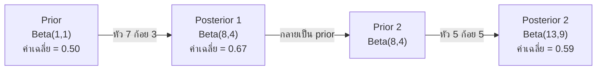

> ความน่าจะเป็นพูดถึงสิ่งที่คุณคาดไว้ ทฤษฎีบทของเบย์พูดถึงสิ่งที่คุณได้เรียนรู้

**ประเภท:** ลงมือสร้าง (Build)
**ภาษา:** Python, TypeScript
**ความรู้ที่ควรมีก่อน:** Phase 1 บทที่ 06 (พื้นฐานความน่าจะเป็น)
**เวลา:** ~75 นาที

## สิ่งที่จะได้เรียนรู้

- ใช้ทฤษฎีบทของเบย์คำนวณความน่าจะเป็นภายหลัง (posterior) จากความน่าจะเป็นก่อน (prior) ภาวะน่าจะเป็น (likelihood) และหลักฐาน (evidence)
- สร้างตัวจำแนกข้อความแบบ Naive Bayes ตั้งแต่ศูนย์ พร้อม Laplace smoothing และการคำนวณในปริภูมิ log
- เปรียบเทียบการประมาณแบบ MLE กับ MAP และอธิบายว่า MAP ตรงกับ L2 regularization อย่างไร
- เขียนการอัปเดตแบบเบย์ทีละขั้นด้วย conjugate prior แบบ Beta-Binomial สำหรับ A/B testing

## ปัญหา

ชุดตรวจโรคหนึ่งแม่นยำ 99% ผลตรวจของคุณเป็นบวก โอกาสที่คุณป่วยเป็นโรคนี้จริง ๆ คือเท่าไร?

คนส่วนใหญ่ตอบว่า 99% คำตอบจริงขึ้นกับว่าโรคนี้พบได้ยากแค่ไหน ถ้ามีคนป่วยแค่ 1 ใน 10,000 คน ผลบวกทำให้คุณมีโอกาสป่วยจริงแค่ประมาณ 1% ผลบวกอีก 99% เป็นสัญญาณเตือนผิดพลาดจากคนที่ไม่ได้ป่วย

นี่ไม่ใช่คำถามหลอก นี่คือทฤษฎีบทของเบย์ ตัวกรองสแปมทุกตัว การวินิจฉัยทางการแพทย์ทุกแบบ และโมเดล machine learning ทุกตัวที่วัดความไม่แน่นอน ใช้การให้เหตุผลแบบนี้ คุณเริ่มจากความเชื่อหนึ่ง เห็นหลักฐาน แล้วปรับความเชื่อ

ถ้าคุณสร้างระบบ ML โดยไม่เข้าใจเรื่องนี้ คุณจะตีความผลลัพธ์ของโมเดลผิด ตั้งเกณฑ์ผิด และส่งคำทำนายที่มั่นใจเกินจริงออกไป

## แนวคิด

### จากความน่าจะเป็นร่วมสู่เบย์

คุณรู้จากบทที่ 06 แล้วว่าความน่าจะเป็นแบบมีเงื่อนไขคือ:

```math
P(A \mid B) = \frac{P(A \text{ and } B)}{P(B)}
```

และในทางกลับกัน:

```math
P(B \mid A) = \frac{P(A \text{ and } B)}{P(A)}
```

ทั้งสองนิพจน์มีตัวเศษเดียวกัน: $P(A \text{ and } B)$ ตั้งให้เท่ากันแล้วจัดรูปใหม่:

```math
\begin{aligned}
P(A \text{ and } B) &= P(A \mid B) \cdot P(B) = P(B \mid A) \cdot P(A) \\[4pt]
&\text{Therefore:} \\[4pt]
P(A \mid B) &= \frac{P(B \mid A) \cdot P(A)}{P(B)}
\end{aligned}
```

นั่นคือทฤษฎีบทของเบย์ สี่ปริมาณ หนึ่งสมการ

### สี่ส่วนประกอบ

| ส่วน | ชื่อ | ความหมาย |
|------|------|---------------|
| $P(A \mid B)$ | ความน่าจะเป็นภายหลัง (posterior) | ความเชื่อเกี่ยวกับ $A$ ที่ปรับแล้วหลังเห็นหลักฐาน $B$ |
| $P(B \mid A)$ | ภาวะน่าจะเป็น (likelihood) | หลักฐาน $B$ มีโอกาสเกิดแค่ไหนถ้า $A$ เป็นจริง |
| $P(A)$ | ความน่าจะเป็นก่อน (prior) | ความเชื่อเกี่ยวกับ $A$ ก่อนเห็นหลักฐานใด ๆ |
| $P(B)$ | หลักฐาน (evidence) | ความน่าจะเป็นรวมที่จะเห็น $B$ ภายใต้ทุกความเป็นไปได้ |

พจน์หลักฐาน $P(B)$ ทำหน้าที่ทำให้เป็นมาตรฐาน กระจายได้ด้วยกฎความน่าจะเป็นรวม (law of total probability):

```math
P(B) = P(B \mid A) \cdot P(A) + P(B \mid \text{not } A) \cdot P(\text{not } A)
```

### ตัวอย่างชุดตรวจโรค

โรคหนึ่งพบใน 1 จาก 10,000 คน ชุดตรวจแม่นยำ 99% (ตรวจเจอคนป่วย 99% และให้ผลบวกลวง 1% ของเวลา)

```math
\begin{aligned}
P(\text{sick}) &= 0.0001 \quad \text{(prior: disease is rare)} \\
P(\text{positive} \mid \text{sick}) &= 0.99 \quad \text{(likelihood: test catches it)} \\
P(\text{positive} \mid \text{healthy}) &= 0.01 \quad \text{(false positive rate)} \\[6pt]
P(\text{positive}) &= P(\text{positive} \mid \text{sick}) \cdot P(\text{sick}) + P(\text{positive} \mid \text{healthy}) \cdot P(\text{healthy}) \\
&= 0.99 \cdot 0.0001 + 0.01 \cdot 0.9999 \\
&= 0.000099 + 0.009999 \\
&= 0.010098 \\[6pt]
P(\text{sick} \mid \text{positive}) &= P(\text{positive} \mid \text{sick}) \cdot P(\text{sick}) / P(\text{positive}) \\
&= 0.99 \cdot 0.0001 / 0.010098 \\
&= 0.0098 \\
&= 0.98\%
\end{aligned}
```

(sick = ป่วย, healthy = ไม่ป่วย, positive = ผลตรวจเป็นบวก prior คือโรคนี้พบได้ยาก likelihood คือชุดตรวจจับโรคได้ และอัตราผลบวกลวงคือ 0.01)

น้อยกว่า 1% ความน่าจะเป็นก่อนครอบงำผลลัพธ์ เมื่อภาวะหนึ่งพบได้ยาก แม้ชุดตรวจที่แม่นยำก็ให้ผลบวกลวงเป็นส่วนใหญ่ นี่คือเหตุผลที่แพทย์สั่งตรวจยืนยันซ้ำ

### ตัวอย่างตัวกรองสแปม

คุณได้รับอีเมลที่มีคำว่า "lottery" อีเมลนี้เป็นสแปมไหม?

```math
\begin{aligned}
P(\text{spam}) &= 0.3 \quad \text{(30\% of email is spam)} \\
P(\text{"lottery"} \mid \text{spam}) &= 0.05 \quad \text{(5\% of spam emails contain "lottery")} \\
P(\text{"lottery"} \mid \text{not spam}) &= 0.001 \quad \text{(0.1\% of legitimate emails contain "lottery")} \\[6pt]
P(\text{"lottery"}) &= 0.05 \cdot 0.3 + 0.001 \cdot 0.7 \\
&= 0.015 + 0.0007 \\
&= 0.0157 \\[6pt]
P(\text{spam} \mid \text{"lottery"}) &= 0.05 \cdot 0.3 / 0.0157 \\
&= 0.955 \\
&= 95.5\%
\end{aligned}
```

(อีเมล 30% เป็นสแปม อีเมลสแปม 5% มีคำว่า "lottery" และอีเมลปกติ 0.1% มีคำนี้)

คำเดียวขยับความน่าจะเป็นจาก 30% ไปเป็น 95.5% ตัวกรองสแปมจริงใช้เบย์กับคำหลายร้อยคำพร้อมกัน

### Naive Bayes: สมมติฐานความเป็นอิสระ

Naive Bayes ขยายแนวคิดนี้ไปสู่คุณลักษณะ (feature) หลายตัว โดยสมมติว่าทุกคุณลักษณะเป็นอิสระต่อกันแบบมีเงื่อนไขเมื่อรู้คลาส:

```math
P(\text{class} \mid \text{feature}_1, \text{feature}_2, \ldots, \text{feature}_n) = \frac{P(\text{class}) \cdot P(\text{feature}_1 \mid \text{class}) \cdot P(\text{feature}_2 \mid \text{class}) \cdots P(\text{feature}_n \mid \text{class})}{P(\text{feature}_1, \text{feature}_2, \ldots, \text{feature}_n)}
```

ส่วนที่ "ไร้เดียงสา (naive)" คือสมมติฐานความเป็นอิสระ ในข้อความ การปรากฏของคำไม่ได้เป็นอิสระต่อกัน ("New" กับ "York" มักมาด้วยกัน) แต่สมมติฐานนี้ใช้ได้ดีอย่างน่าประหลาดใจในทางปฏิบัติ เพราะตัวจำแนกแค่ต้องจัดอันดับคลาส ไม่ต้องให้ความน่าจะเป็นที่สอบเทียบแล้ว (calibrated)

เพราะตัวส่วนเท่ากันทุกคลาส คุณข้ามมันไปได้ แล้วเทียบแค่ตัวเศษ:

```math
\text{score}(\text{class}) = P(\text{class}) \cdot \prod_i P(\text{feature}_i \mid \text{class})
```

เลือกคลาสที่ได้คะแนนสูงที่สุด

### การประมาณภาวะน่าจะเป็นสูงสุด (MLE)

จะได้ $P(\text{feature} \mid \text{class})$ จากข้อมูลเทรนอย่างไร? นับเอา

```math
P(\text{"free"} \mid \text{spam}) = \frac{\text{number of spam emails containing "free"}}{\text{total spam emails}}
```

(จำนวนอีเมลสแปมที่มีคำว่า "free" หารด้วยจำนวนอีเมลสแปมทั้งหมด)

นี่คือ MLE (maximum likelihood estimation): เลือกค่าพารามิเตอร์ที่ทำให้ข้อมูลที่สังเกตได้มีโอกาสเกิดมากที่สุด คุณกำลังหาค่าสูงสุดของฟังก์ชันภาวะน่าจะเป็น ซึ่งสำหรับการนับแบบไม่ต่อเนื่องก็ลดรูปเหลือความถี่สัมพัทธ์

ปัญหา: ถ้าคำหนึ่งไม่เคยปรากฏในสแปมระหว่างเทรน MLE จะให้ความน่าจะเป็นเป็นศูนย์ คำที่ไม่เคยเห็นคำเดียวทำให้ผลคูณทั้งหมดเป็นศูนย์ แก้ด้วย Laplace smoothing:

```math
P(\text{word} \mid \text{class}) = \frac{\text{count}(\text{word}, \text{class}) + 1}{\text{total\_words\_in\_class} + \text{vocabulary\_size}}
```

การบวก 1 ให้ทุกการนับทำให้ไม่มีความน่าจะเป็นใดเป็นศูนย์

คำที่ไม่เคยปรากฏในข้อความเทรนเลยจะไม่อยู่ในคลังคำ (vocabulary) `predict` จะข้ามคำนั้นไป เพราะมันไม่ได้เป็นหลักฐานให้คลาสใดเลย

### การประมาณค่าภายหลังสูงสุด (MAP)

MLE ถามว่า: พารามิเตอร์ชุดไหนทำให้ $P(\text{data} \mid \text{parameters})$ มากที่สุด?

MAP (maximum a posteriori) ถามว่า: พารามิเตอร์ชุดไหนทำให้ $P(\text{parameters} \mid \text{data})$ มากที่สุด?

ตามทฤษฎีบทของเบย์:

```math
P(\text{parameters} \mid \text{data}) \propto P(\text{data} \mid \text{parameters}) \cdot P(\text{parameters})
```

MAP เพิ่มความน่าจะเป็นก่อนให้ตัวพารามิเตอร์เอง ถ้าคุณเชื่อว่าพารามิเตอร์ควรมีค่าเล็ก คุณเข้ารหัสความเชื่อนั้นเป็น prior ที่ลงโทษค่าที่ใหญ่ นี่เหมือนกับ L2 regularization ใน ML ทุกประการ บทลงโทษ "ridge" ใน ridge regression ก็คือ prior แบบเกาส์บนน้ำหนักนั่นเอง

| การประมาณ | สิ่งที่หาค่าสูงสุด | สิ่งที่เทียบได้ใน ML |
|------------|-----------|---------------|
| MLE | $P(\text{data} \mid \text{params})$ | การเทรนแบบไม่มี regularization |
| MAP | $P(\text{data} \mid \text{params}) \cdot P(\text{params})$ | L2 / L1 regularization |

### แบบเบย์กับแบบความถี่: ความต่างในทางปฏิบัติ

นักสถิติแบบความถี่ (frequentist) มองพารามิเตอร์เป็นค่าคงที่ที่ไม่รู้ค่า และถามว่า: "ถ้าทำการทดลองนี้ซ้ำหลายครั้ง จะเกิดอะไรขึ้น?"

นักสถิติแบบเบย์ (Bayesian) มองพารามิเตอร์เป็นการแจกแจง และถามว่า: "จากสิ่งที่สังเกตได้ ฉันเชื่ออะไรเกี่ยวกับพารามิเตอร์?"

สำหรับการสร้างระบบ ML ความต่างในทางปฏิบัติคือ:

| ด้าน | แบบความถี่ | แบบเบย์ |
|--------|-------------|----------|
| ผลลัพธ์ | ค่าประมาณแบบจุด | การแจกแจงของค่า |
| ความไม่แน่นอน | ช่วงความเชื่อมั่น (พูดถึงกระบวนการ) | ช่วงความน่าเชื่อ (credible interval พูดถึงพารามิเตอร์) |
| ข้อมูลน้อย | อาจ overfit | prior ทำหน้าที่เป็น regularization |
| การคำนวณ | ปกติเร็วกว่า | มักต้องใช้การสุ่มตัวอย่าง (MCMC) |

ML ส่วนใหญ่ในระบบจริงเป็นแบบความถี่ (SGD, ค่าประมาณแบบจุด) วิธีแบบเบย์โดดเด่นเมื่อคุณต้องการความไม่แน่นอนที่สอบเทียบแล้ว (การตัดสินใจทางการแพทย์ ระบบที่ความปลอดภัยสำคัญมาก) หรือเมื่อข้อมูลมีน้อย (few-shot learning, cold start)

### ทำไมการคิดแบบเบย์จึงสำคัญกับ ML

ความเชื่อมโยงลึกกว่าการเปรียบเทียบ:

**Prior คือ regularization** prior แบบเกาส์บนน้ำหนักคือ L2 regularization prior แบบ Laplace คือ L1 ทุกครั้งที่คุณเพิ่มพจน์ regularization คุณกำลังกล่าวแบบเบย์ว่าคาดหวังให้พารามิเตอร์มีค่าแบบไหน

**Posterior คือความไม่แน่นอน** ความน่าจะเป็นที่ทำนายออกมาค่าเดียวไม่ได้บอกเลยว่าโมเดลมั่นใจในค่าประมาณนั้นแค่ไหน วิธีแบบเบย์ให้การแจกแจงกับคุณ: "ฉันคิดว่า $P(\text{spam})$ อยู่ระหว่าง 0.8 ถึง 0.95"

**การอัปเดตแบบเบย์คือการเรียนรู้แบบออนไลน์** posterior ของวันนี้กลายเป็น prior ของพรุ่งนี้ เมื่อโมเดลเห็นข้อมูลใหม่ มันปรับความเชื่อทีละน้อยแทนที่จะเทรนใหม่ตั้งแต่ต้น

**การเปรียบเทียบโมเดลเป็นแบบเบย์** Bayesian information criterion (BIC), marginal likelihood และ Bayes factor ล้วนใช้การให้เหตุผลแบบเบย์เพื่อเลือกโมเดลโดยไม่ overfit

```figure
bayes-update
```

## ลงมือสร้าง (Build It)

### ขั้นที่ 1: ฟังก์ชันทฤษฎีบทของเบย์

```python
def bayes(prior, likelihood, false_positive_rate):
    evidence = likelihood * prior + false_positive_rate * (1 - prior)
    posterior = likelihood * prior / evidence
    return posterior

result = bayes(prior=0.0001, likelihood=0.99, false_positive_rate=0.01)
print(f"P(sick|positive) = {result:.4f}")
```

### ขั้นที่ 2: ตัวจำแนก Naive Bayes

```python
import math
from collections import defaultdict

class NaiveBayes:
    def __init__(self, smoothing=1.0):
        self.smoothing = smoothing
        self.class_counts = defaultdict(int)
        self.word_counts = defaultdict(lambda: defaultdict(int))
        self.class_word_totals = defaultdict(int)
        self.vocab = set()

    def train(self, documents, labels):
        for doc, label in zip(documents, labels):
            self.class_counts[label] += 1
            words = doc.lower().split()
            for word in words:
                self.word_counts[label][word] += 1
                self.class_word_totals[label] += 1
                self.vocab.add(word)

    def predict(self, document):
        words = [word for word in document.lower().split() if word in self.vocab]
        total_docs = sum(self.class_counts.values())
        vocab_size = len(self.vocab)
        best_class = None
        best_score = float("-inf")
        for cls in self.class_counts:
            score = math.log(self.class_counts[cls] / total_docs)
            for word in words:
                count = self.word_counts[cls].get(word, 0)
                total = self.class_word_totals[cls]
                score += math.log((count + self.smoothing) / (total + self.smoothing * vocab_size))
            if score > best_score:
                best_score = score
                best_class = cls
        return best_class
```

log ของความน่าจะเป็นป้องกัน underflow การคูณความน่าจะเป็นเล็ก ๆ หลายตัวให้ตัวเลขที่เล็กเกินกว่าเลขทศนิยมจะเก็บได้ การรวม log ของความน่าจะเป็นเสถียรเชิงตัวเลขและเทียบเท่ากันทางคณิตศาสตร์

### ขั้นที่ 3: เทรนกับข้อมูลสแปม

```python
train_docs = [
    "win free money now",
    "free lottery ticket winner",
    "claim your prize today free",
    "urgent offer free cash",
    "congratulations you won free",
    "meeting tomorrow at noon",
    "project update attached",
    "can we schedule a call",
    "quarterly report review",
    "lunch on thursday sounds good",
    "team standup notes attached",
    "please review the pull request",
]

train_labels = [
    "spam", "spam", "spam", "spam", "spam",
    "ham", "ham", "ham", "ham", "ham", "ham", "ham",
]

classifier = NaiveBayes()
classifier.train(train_docs, train_labels)

test_messages = [
    "free money waiting for you",
    "meeting rescheduled to friday",
    "you won a free prize",
    "please review the attached report",
]

for msg in test_messages:
    print(f"  '{msg}' -> {classifier.predict(msg)}")
```

### ขั้นที่ 4: ดูความน่าจะเป็นที่เรียนรู้ได้

```python
def show_top_words(classifier, cls, n=5):
    vocab_size = len(classifier.vocab)
    total = classifier.class_word_totals[cls]
    probs = {}
    for word in classifier.vocab:
        count = classifier.word_counts[cls].get(word, 0)
        probs[word] = (count + classifier.smoothing) / (total + classifier.smoothing * vocab_size)
    sorted_words = sorted(probs.items(), key=lambda x: x[1], reverse=True)
    for word, prob in sorted_words[:n]:
        print(f"    {word}: {prob:.4f}")

print("\nTop spam words:")
show_top_words(classifier, "spam")
print("\nTop ham words:")
show_top_words(classifier, "ham")
```

## นำไปใช้ (Use It)

Scikit-learn มี naive Bayes ที่พร้อมใช้ในระบบจริง:

```python
from sklearn.feature_extraction.text import CountVectorizer
from sklearn.naive_bayes import MultinomialNB
from sklearn.metrics import classification_report

vectorizer = CountVectorizer()
X_train = vectorizer.fit_transform(train_docs)
clf = MultinomialNB()
clf.fit(X_train, train_labels)

X_test = vectorizer.transform(test_messages)
predictions = clf.predict(X_test)
for msg, pred in zip(test_messages, predictions):
    print(f"  '{msg}' -> {pred}")
```

อัลกอริทึมเดียวกัน CountVectorizer จัดการการตัดคำและการสร้างคลังคำ MultinomialNB จัดการ smoothing และ log ของความน่าจะเป็นภายใน เวอร์ชันที่คุณเขียนเองทำสิ่งเดียวกันใน 40 บรรทัด

## ส่งมอบ (Ship It)

คลาส NaiveBayes ที่สร้างในบทนี้แสดงขั้นตอนครบทั้งหมด: การตัดคำ การประมาณความน่าจะเป็นด้วย Laplace smoothing และการทำนายในปริภูมิ log โค้ดใน `code/bayes.py` รันได้ตั้งแต่ต้นจนจบโดยไม่ต้องพึ่งอะไรนอกจากไลบรารีมาตรฐานของ Python ส่วนเวอร์ชัน TypeScript ใน `code/bayes.ts` ใช้แค่ไลบรารีมาตรฐานของ Node

### Conjugate Prior

เมื่อ prior และ posterior อยู่ในตระกูลการแจกแจงเดียวกัน เราเรียก prior นั้นว่า "conjugate" ซึ่งทำให้การอัปเดตแบบเบย์สะอาดทางพีชคณิต คุณได้ posterior ในรูปปิด (closed form) โดยไม่ต้องหาปริพันธ์เชิงตัวเลข

| ภาวะน่าจะเป็น | Conjugate Prior | Posterior | ตัวอย่าง |
|-----------|----------------|-----------|---------|
| Bernoulli | $\text{Beta}(a, b)$ | $\text{Beta}(a + \text{successes}, b + \text{failures})$ | ประมาณความเอนเอียงของเหรียญ |
| Normal (รู้ความแปรปรวน) | $\text{Normal}(\mu_0, \sigma_0)$ | Normal (ค่าเฉลี่ยถ่วงน้ำหนัก ความแปรปรวนเล็กลง) | การสอบเทียบเซนเซอร์ |
| Poisson | $\text{Gamma}(a, b)$ | $\text{Gamma}(a + \text{sum of counts}, b + n)$ | จำลองอัตราการมาถึง |
| Multinomial | $\text{Dirichlet}(\alpha)$ | $\text{Dirichlet}(\alpha + \text{counts})$ | Topic modeling, โมเดลภาษา |

ทำไมเรื่องนี้จึงสำคัญ: ถ้าไม่มี conjugate prior คุณต้องใช้การสุ่มแบบ Monte Carlo หรือ variational inference เพื่อประมาณ posterior แต่ถ้ามี conjugate prior คุณแค่อัปเดตตัวเลขสองตัว

การแจกแจงแบบ Beta คือ conjugate prior ที่ใช้บ่อยที่สุดในทางปฏิบัติ $\text{Beta}(a, b)$ แทนความเชื่อของคุณเกี่ยวกับพารามิเตอร์ที่เป็นความน่าจะเป็น ค่าเฉลี่ยคือ $a/(a+b)$ ยิ่ง $a+b$ มาก การแจกแจงยิ่งกระจุกตัว (มั่นใจ) มากขึ้น

กรณีพิเศษของ prior แบบ Beta:
- $\text{Beta}(1, 1)$ = สม่ำเสมอ คุณไม่มีความเห็นเกี่ยวกับพารามิเตอร์เลย
- $\text{Beta}(10, 10)$ = มียอดที่ 0.5 คุณเชื่อมากว่าพารามิเตอร์อยู่ใกล้ 0.5
- $\text{Beta}(1, 10)$ = เบ้ไปทาง 0 คุณเชื่อว่าพารามิเตอร์มีค่าน้อย

กฎการอัปเดตง่ายสุด ๆ:

```math
\begin{aligned}
\text{Prior:} \quad & \text{Beta}(a, b) \\
\text{Data:} \quad & s \text{ successes}, f \text{ failures} \\
\text{Posterior:} \quad & \text{Beta}(a + s, b + f)
\end{aligned}
```

(ข้อมูลคือสำเร็จ $s$ ครั้ง ล้มเหลว $f$ ครั้ง)

ไม่มีปริพันธ์ ไม่มีการสุ่ม มีแค่การบวก

### การอัปเดตแบบเบย์ทีละขั้น

การอนุมานแบบเบย์เป็นลำดับขั้นโดยธรรมชาติ posterior ของวันนี้กลายเป็น prior ของพรุ่งนี้ นี่คือวิธีที่ระบบจริงเรียนรู้ทีละน้อยโดยไม่ต้องประมวลผลข้อมูลในอดีตทั้งหมดซ้ำ

ตัวอย่างที่จับต้องได้: ประมาณว่าเหรียญเที่ยงตรงหรือไม่

**วันที่ 1: ยังไม่มีข้อมูล**
เริ่มจาก $\text{Beta}(1, 1)$ ซึ่งเป็น prior แบบสม่ำเสมอ คุณไม่มีความเห็นใด ๆ
- ค่าเฉลี่ยของ prior: 0.5
- prior แบนราบตลอดช่วง [0, 1]

**วันที่ 2: เห็นหัว 7 ครั้ง ก้อย 3 ครั้ง**
$\text{Posterior} = \text{Beta}(1 + 7, 1 + 3) = \text{Beta}(8, 4)$
- ค่าเฉลี่ยของ posterior: $8/12 = 0.667$
- หลักฐานบอกว่าเหรียญเอนเอียงไปทางหัว

**วันที่ 3: เห็นหัวเพิ่ม 5 ครั้ง ก้อยเพิ่ม 5 ครั้ง**
ใช้ posterior ของเมื่อวานเป็น prior ของวันนี้
$\text{Posterior} = \text{Beta}(8 + 5, 4 + 5) = \text{Beta}(13, 9)$
- ค่าเฉลี่ยของ posterior: $13/22 = 0.591$
- ข้อมูลใหม่ที่สมดุลดึงค่าประมาณกลับเข้าหา 0.5



ลำดับของการสังเกตไม่มีผล $\text{Beta}(1,1)$ ที่อัปเดตด้วยหัว 12 ครั้งและก้อย 8 ครั้งในคราวเดียวได้ $\text{Beta}(13, 9)$ ผลเดียวกัน การอัปเดตทีละขั้นกับการอัปเดตทั้งชุดเทียบเท่ากันทางคณิตศาสตร์ แต่การอัปเดตทีละขั้นทำให้คุณตัดสินใจได้ทุกขั้นโดยไม่ต้องเก็บข้อมูลดิบไว้

นี่คือรากฐานของการเรียนรู้แบบออนไลน์ในระบบ ML จริง Thompson sampling สำหรับ bandit ระบบแนะนำที่อัปเดตทีละน้อย และตัวตรวจจับความผิดปกติแบบสตรีม ล้วนใช้รูปแบบนี้

### ความเชื่อมโยงกับ A/B Testing

A/B testing คือการอนุมานแบบเบย์ที่ปลอมตัวมา

การตั้งค่า: คุณกำลังทดสอบสีปุ่มสองแบบ แบบ A (สีน้ำเงิน) และแบบ B (สีเขียว) คุณอยากรู้ว่าแบบไหนได้คลิกมากกว่า

A/B test แบบเบย์:

1. **Prior** เริ่มจาก $\text{Beta}(1, 1)$ ทั้งสองแบบ ไม่มีความชอบล่วงหน้า
2. **ข้อมูล** แบบ A: 50 คลิกจาก 1000 ครั้งที่แสดง แบบ B: 65 คลิกจาก 1000 ครั้งที่แสดง
3. **Posterior**
   - A: $\text{Beta}(1 + 50, 1 + 950) = \text{Beta}(51, 951)$ ค่าเฉลี่ย = 0.051
   - B: $\text{Beta}(1 + 65, 1 + 935) = \text{Beta}(66, 936)$ ค่าเฉลี่ย = 0.066
4. **การตัดสินใจ** คำนวณ $P(B > A)$ คือความน่าจะเป็นที่อัตราการแปลง (conversion rate) จริงของ B สูงกว่าของ A

การคำนวณ $P(B > A)$ เชิงวิเคราะห์นั้นยาก แต่ Monte Carlo ทำให้ง่ายมาก:

```
1. สุ่ม 100,000 ตัวอย่างจาก Beta(51, 951)  -> samples_A
2. สุ่ม 100,000 ตัวอย่างจาก Beta(66, 936)  -> samples_B
3. P(B > A) = สัดส่วนของตัวอย่างที่ B > A
```

ถ้า $P(B > A) > 0.95$ ให้ใช้แบบ B ถ้าอยู่ระหว่าง 0.05 ถึง 0.95 ให้เก็บข้อมูลต่อ ถ้า $P(B > A) < 0.05$ ให้ใช้แบบ A

ข้อดีเมื่อเทียบกับ A/B testing แบบความถี่:
- คุณได้ข้อความเชิงความน่าจะเป็นโดยตรง: "มีโอกาส 97% ที่ B ดีกว่า"
- ไม่สับสนกับ p-value ไม่ต้องพูดอ้อม ๆ ว่า "ปฏิเสธสมมติฐานว่างไม่ได้"
- ดูผลได้ทุกเมื่อโดยไม่ทำให้อัตราผลบวกลวงสูงขึ้น (ไม่มี "ปัญหาการแอบดู")
- ใส่ความรู้เดิมเข้าไปได้ (เช่น การทดสอบก่อน ๆ บอกว่าอัตราการแปลงมักอยู่ที่ 3-8%)

| ด้าน | A/B แบบความถี่ | A/B แบบเบย์ |
|--------|----------------|--------------|
| ผลลัพธ์ | p-value | $P(B > A)$ |
| การตีความ | "ข้อมูลนี้น่าประหลาดใจแค่ไหนถ้า A=B?" | "B มีโอกาสดีกว่า A แค่ไหน?" |
| การหยุดก่อนกำหนด | ทำให้ผลบวกลวงสูงขึ้น | ปลอดภัยทุกจุด (เมื่อเลือก prior ดีและกำหนดโมเดลถูกต้อง) |
| ความรู้เดิม | ไม่ได้ใช้ | เข้ารหัสเป็น prior แบบ Beta |
| กฎการตัดสินใจ | $p < 0.05$ | $P(B > A) > \text{threshold}$ |

## แบบฝึกหัด

1. **ตรวจหลายครั้ง** ผู้ป่วยตรวจได้ผลบวกสองครั้งจากการตรวจที่อิสระต่อกัน (แม่นยำ 99% ทั้งคู่ ความชุกของโรค 1 ใน 10,000) $P(\text{sick})$ หลังตรวจทั้งสองครั้งเป็นเท่าไร? ใช้ posterior จากการตรวจครั้งแรกเป็น prior ของครั้งที่สอง

2. **ผลของ smoothing** รันตัวจำแนกสแปมด้วยค่า smoothing 0.01, 0.1, 1.0 และ 10.0 ความน่าจะเป็นของคำอันดับต้น ๆ เปลี่ยนไปอย่างไร? จะเกิดอะไรขึ้นเมื่อ smoothing=0 กับคำที่ปรากฏเฉพาะใน ham?

3. **เพิ่มคุณลักษณะ** ขยายคลาส NaiveBayes ให้ใช้ความยาวข้อความ (สั้น/ยาว) เป็นคุณลักษณะเพิ่มจากการนับคำ ประมาณ $P(\text{short} \mid \text{spam})$ และ $P(\text{short} \mid \text{ham})$ จากข้อมูลเทรน แล้วรวมเข้ากับคะแนนการทำนาย

4. **MAP ด้วยมือ** จากข้อมูลที่สังเกตได้ (หัว 7 ครั้งจากการโยนเหรียญ 10 ครั้ง) คำนวณค่าประมาณ MAP ของความเอนเอียงด้วย prior $\text{Beta}(2,2)$ แล้วเทียบกับค่าประมาณ MLE ($7/10$)

### คำใบ้

**แบบฝึกหัดที่ 1** เรียก `bayes` หนึ่งครั้งเพื่อได้ posterior หลังการตรวจครั้งที่ 1 แล้วเรียกอีกครั้งโดยใช้ posterior นั้นเป็น prior `sequential_bayes(prior, likelihood, false_positive_rate, 2)` ต้องให้ค่าเดียวกัน ซึ่งใกล้ 0.5

**แบบฝึกหัดที่ 2** สร้าง `NaiveBayes(smoothing=s)` หนึ่งตัวต่อค่า เทรนด้วยข้อมูลเดียวกัน แล้วพิมพ์ `top_words` ของแต่ละตัว เมื่อ smoothing เป็น 0 คำที่ไม่เคยปรากฏในสแปมจะได้ความน่าจะเป็น 0 และ log ของมันหาค่าไม่ได้

**แบบฝึกหัดที่ 3** นับว่าข้อความสแปมและ ham สั้นกี่ข้อความ หารด้วยจำนวนข้อความในแต่ละคลาส แล้วบวก log ของอัตราส่วนนั้นเข้ากับคะแนนใน `predict` ตรวจว่าความน่าจะเป็นทั้งสองของแต่ละคลาสรวมกันได้ 1

**แบบฝึกหัดที่ 4** เมื่อใช้ prior $\text{Beta}(\alpha, \beta)$ ค่าประมาณ MAP คือ $\frac{h + \alpha - 1}{n + \alpha + \beta - 2}$ ใส่ $h = 7$, $n = 10$ ผลลัพธ์ต้องอยู่ระหว่าง MLE (0.7) กับฐานนิยมของ prior (0.5)

## คำศัพท์สำคัญ

| คำศัพท์ | ที่คนมักพูด | ความหมายจริง |
|------|----------------|----------------------|
| Prior (ความน่าจะเป็นก่อน) | "การเดาตั้งต้น" | $P(\text{hypothesis})$ ก่อนสังเกตหลักฐาน ใน ML คือพจน์ regularization |
| Likelihood (ภาวะน่าจะเป็น) | "ข้อมูลเข้ากันได้ดีแค่ไหน" | $P(\text{evidence} \mid \text{hypothesis})$ ข้อมูลที่สังเกตได้มีโอกาสเกิดแค่ไหนภายใต้สมมติฐานหนึ่ง |
| Posterior (ความน่าจะเป็นภายหลัง) | "ความเชื่อที่ปรับแล้ว" | $P(\text{hypothesis} \mid \text{evidence})$ คือ prior คูณ likelihood แล้วทำให้เป็นมาตรฐาน |
| Evidence (หลักฐาน) | "ค่าคงที่ทำให้เป็นมาตรฐาน" | $P(\text{data})$ บนทุกสมมติฐาน ทำให้ posterior รวมกันได้ 1 |
| Naive Bayes | "ตัวจำแนกข้อความง่าย ๆ ตัวนั้น" | ตัวจำแนกที่สมมติว่าคุณลักษณะเป็นอิสระต่อกันเมื่อรู้คลาส ทำงานได้ดีแม้สมมติฐานจะไม่จริง |
| Laplace smoothing | "บวกหนึ่ง" | การบวกจำนวนนับเล็ก ๆ ให้ทุกคุณลักษณะ เพื่อป้องกันความน่าจะเป็นศูนย์จากข้อมูลที่ไม่เคยเห็น |
| MLE | "ใช้ความถี่ไปเลย" | เลือกพารามิเตอร์ที่ทำให้ $P(\text{data} \mid \text{parameters})$ มากที่สุด ไม่มี prior อาจ overfit เมื่อข้อมูลน้อย |
| MAP | "MLE ที่มี prior" | เลือกพารามิเตอร์ที่ทำให้ $P(\text{data} \mid \text{parameters}) \cdot P(\text{parameters})$ มากที่สุด เทียบเท่า MLE ที่มี regularization |
| Log-probability | "ทำงานในปริภูมิ log" | ใช้ $\log(P)$ แทน $P$ เพื่อเลี่ยง underflow ของเลขทศนิยมเมื่อคูณตัวเลขเล็ก ๆ จำนวนมาก |
| False positive (ผลบวกลวง) | "สัญญาณเตือนผิด" | การตรวจบอกว่าเป็นบวก แต่สถานะจริงเป็นลบ เป็นต้นเหตุของการมองข้ามอัตราฐาน (base rate fallacy) |

## อ่านเพิ่มเติม

- [3Blue1Brown: Bayes' theorem](https://www.youtube.com/watch?v=HZGCoVF3YvM) - คำอธิบายเชิงภาพพร้อมตัวอย่างชุดตรวจโรค
- [Stanford CS229: Generative Learning Algorithms](https://cs229.stanford.edu/main_notes.pdf) - naive Bayes และความเชื่อมโยงกับโมเดลแบบ discriminative
- [Think Bayes](https://greenteapress.com/wp/think-bayes/) - หนังสือฟรี สถิติแบบเบย์พร้อมโค้ด Python
- [scikit-learn Naive Bayes](https://scikit-learn.org/stable/modules/naive_bayes.html) - เวอร์ชันสำหรับระบบจริง และควรใช้แต่ละแบบเมื่อไร
