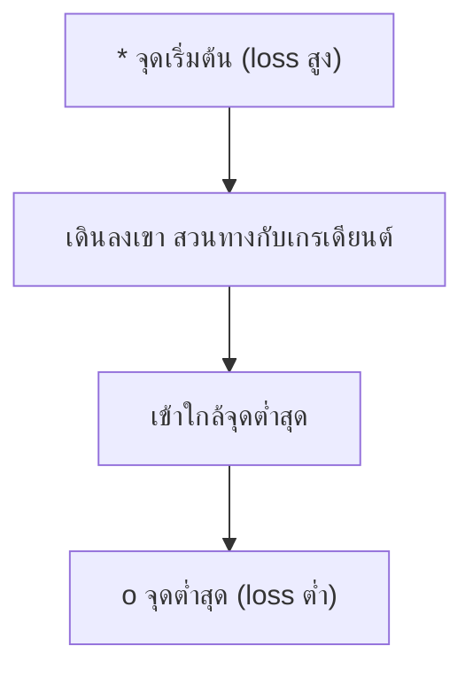
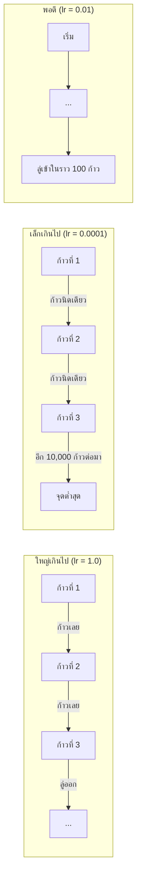
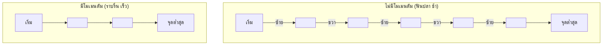
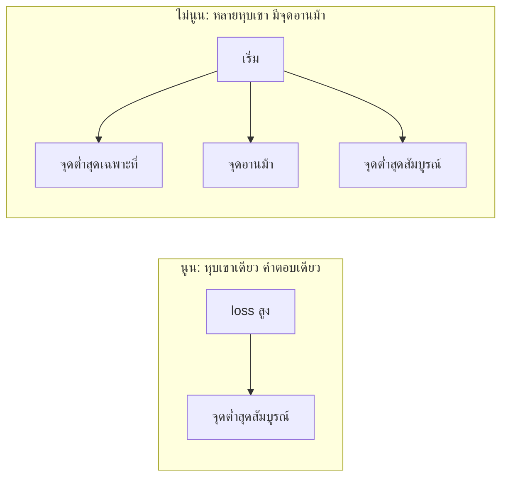
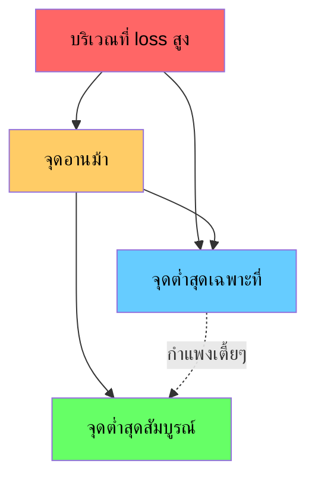

> การฝึกโครงข่ายประสาทเทียม ที่จริงก็คือการหาจุดต่ำสุดของหุบเขาเท่านั้นเอง

**ประเภท:** ลงมือสร้าง (Build)
**ภาษา:** Python
**ความรู้ที่ควรมีก่อน:** Phase 1 บทที่ 04-05 (อนุพันธ์, เกรเดียนต์)
**เวลา:** ~75 นาที

## สิ่งที่จะได้เรียนรู้

- เขียน gradient descent แบบพื้นฐาน, SGD แบบมีโมเมนตัม และ Adam ขึ้นเองตั้งแต่ศูนย์
- เปรียบเทียบการลู่เข้าของ optimizer แต่ละตัวบนฟังก์ชัน Rosenbrock และอธิบายได้ว่าทำไม Adam จึงปรับ learning rate แยกให้น้ำหนักแต่ละตัว
- แยกแยะภูมิประเทศของ loss แบบนูน (convex) กับแบบไม่นูน (non-convex) และอธิบายบทบาทของจุดอานม้า (saddle point) ในปริภูมิหลายมิติ
- ตั้งค่าตารางปรับ learning rate (step decay, cosine annealing, warmup) เพื่อให้การฝึกมีเสถียรภาพ

## ปัญหา

คุณมีฟังก์ชันความสูญเสีย (loss function) ที่บอกว่าโมเดลผิดมากแค่ไหน คุณมีเกรเดียนต์ (gradient) ที่บอกว่าทิศทางไหนทำให้ loss แย่ลง สิ่งที่ยังขาดคือกลยุทธ์ในการเดินลงเขา

วิธีตรงไปตรงมาที่สุดนั้นง่ายมาก: ก้าวไปทางตรงข้ามกับเกรเดียนต์ ปรับขนาดก้าวด้วยตัวเลขที่เรียกว่าอัตราการเรียนรู้ (learning rate) แล้วทำซ้ำ นี่คือ gradient descent และมันก็ใช้ได้จริง แต่คำว่า "ใช้ได้" ก็มีเงื่อนไข ถ้า learning rate ใหญ่เกินไป คุณจะก้าวเลยหุบเขาไปทั้งหมด เด้งไปมาระหว่างผนังหุบเขา ถ้าเล็กเกินไป คุณจะคืบคลานเข้าหาคำตอบผ่านหลายพันก้าวที่ไม่จำเป็น และถ้าไปเจอจุดอานม้า คุณจะหยุดนิ่งทั้งที่ยังไม่ถึงจุดต่ำสุด

optimizer ทุกตัวใน deep learning ล้วนเป็นคำตอบของคำถามเดียวกัน: จะไปถึงก้นหุบเขาให้เร็วขึ้นและเชื่อถือได้มากขึ้นได้อย่างไร

## แนวคิด

### การหาค่าเหมาะที่สุดหมายถึงอะไร

การหาค่าเหมาะที่สุด (optimization) คือการหาค่าของตัวแปรนำเข้าที่ทำให้ฟังก์ชันมีค่าน้อยที่สุด (หรือมากที่สุด) ใน machine learning ฟังก์ชันนั้นคือ loss ส่วนตัวแปรนำเข้าคือน้ำหนัก (weights) ของโมเดล การฝึกโมเดลก็คือการหาค่าเหมาะที่สุดนั่นเอง

```
minimize L(w) where:
  L = loss function
  w = model weights (could be millions of parameters)
```

### Gradient descent (แบบพื้นฐาน)

optimizer ที่ง่ายที่สุด คำนวณเกรเดียนต์ของ loss เทียบกับน้ำหนักทุกตัว ขยับน้ำหนักแต่ละตัวไปในทิศตรงข้ามกับเกรเดียนต์ของมัน แล้วปรับขนาดก้าวด้วย learning rate

```math
w = w - \text{lr} \cdot \text{gradient}
```

นี่คืออัลกอริทึมทั้งหมด มีแค่บรรทัดเดียว



### Learning rate: ไฮเปอร์พารามิเตอร์ที่สำคัญที่สุด

learning rate ควบคุมขนาดของแต่ละก้าว และเป็นตัวกำหนดทุกอย่างเกี่ยวกับการลู่เข้า



ไม่มีสูตรสำเร็จสำหรับ learning rate ที่เหมาะสม คุณต้องหาด้วยการทดลอง ค่าเริ่มต้นที่นิยมคือ 0.001 สำหรับ Adam และ 0.01 สำหรับ SGD แบบมีโมเมนตัม

### SGD เทียบกับ batch และ mini-batch

gradient descent แบบพื้นฐานคำนวณเกรเดียนต์จากชุดข้อมูลทั้งหมดก่อนจะก้าวหนึ่งครั้ง เรียกว่า batch gradient descent วิธีนี้เสถียรแต่ช้า

Stochastic gradient descent (SGD) คำนวณเกรเดียนต์จากตัวอย่างสุ่มเพียงตัวเดียวแล้วก้าวทันที มีสัญญาณรบกวน (noise) มากแต่เร็ว

Mini-batch gradient descent อยู่ตรงกลางระหว่างสองแบบ คำนวณเกรเดียนต์จากกลุ่มข้อมูลเล็กๆ (32, 64, 128, 256 ตัวอย่าง) แล้วจึงก้าว นี่คือแบบที่ทุกคนใช้กันจริง

| แบบ | ขนาด batch | คุณภาพของเกรเดียนต์ | ความเร็วต่อก้าว | สัญญาณรบกวน |
|---------|-----------|-----------------|---------------|-------|
| Batch GD | ข้อมูลทั้งหมด | แม่นยำ | ช้า | ไม่มี |
| SGD | 1 ตัวอย่าง | รบกวนมาก | เร็ว | สูง |
| Mini-batch | 32-256 | ประมาณได้ดี | สมดุล | ปานกลาง |

สัญญาณรบกวนใน SGD และ mini-batch ไม่ใช่ข้อบกพร่อง มันช่วยให้หลุดออกจากจุดต่ำสุดเฉพาะที่ (local minimum) ที่ตื้น และจากจุดอานม้าได้

### โมเมนตัม: ลูกบอลที่กลิ้งลงเขา

gradient descent แบบพื้นฐานดูแค่เกรเดียนต์ ณ ตอนนั้น ถ้าเกรเดียนต์เปลี่ยนทิศไปมาแบบฟันปลา (พบบ่อยในหุบเขาแคบ) การเดินหน้าจะช้า โมเมนตัม (momentum) แก้ปัญหานี้ด้วยการสะสมเกรเดียนต์ในอดีตไว้เป็นพจน์ความเร็ว (velocity)

```math
\begin{aligned}
v &= \beta \cdot v + \text{gradient} \\
w &= w - \text{lr} \cdot v
\end{aligned}
```

เปรียบได้กับลูกบอลที่กลิ้งลงเขา มันไม่ได้หยุดแล้วออกตัวใหม่ทุกครั้งที่เจอหลุมเล็กๆ แต่สะสมความเร็วในทิศที่สม่ำเสมอ และลดการแกว่งไปมา



`beta` (ปกติคือ 0.9) ควบคุมว่าจะเก็บประวัติไว้มากแค่ไหน beta สูงหมายถึงโมเมนตัมมากขึ้น เส้นทางราบรื่นขึ้น แต่ตอบสนองต่อการเปลี่ยนทิศได้ช้าลง

### Adam: learning rate ที่ปรับตัวเองได้

น้ำหนักแต่ละตัวต้องการ learning rate ไม่เท่ากัน น้ำหนักที่นานๆ จะได้เกรเดียนต์ใหญ่สักครั้ง ควรก้าวยาวขึ้นเมื่อได้มันมา ส่วนน้ำหนักที่ได้เกรเดียนต์ใหญ่อยู่ตลอด ควรก้าวสั้นลง

Adam (Adaptive Moment Estimation) ติดตามค่าสองอย่างของน้ำหนักแต่ละตัว:

1. โมเมนต์ที่หนึ่ง ($m$): ค่าเฉลี่ยสะสมของเกรเดียนต์ (คล้ายโมเมนตัม)
2. โมเมนต์ที่สอง ($v$): ค่าเฉลี่ยสะสมของเกรเดียนต์ยกกำลังสอง (ขนาดของเกรเดียนต์)

```math
\begin{aligned}
m &= \beta_1 \cdot m + (1 - \beta_1) \cdot \text{gradient} \\
v &= \beta_2 \cdot v + (1 - \beta_2) \cdot \text{gradient}^2 \\[4pt]
\hat{m} &= m / (1 - \beta_1^t) \quad \text{bias correction} \\
\hat{v} &= v / (1 - \beta_2^t) \quad \text{bias correction} \\[4pt]
w &= w - \text{lr} \cdot \hat{m} / (\sqrt{\hat{v}} + \epsilon)
\end{aligned}
```

การหารด้วย `sqrt(v_hat)` คือหัวใจสำคัญ น้ำหนักที่มีเกรเดียนต์ใหญ่จะถูกหารด้วยจำนวนที่ใหญ่ (ก้าวจริงจึงเล็ก) น้ำหนักที่มีเกรเดียนต์เล็กจะถูกหารด้วยจำนวนที่เล็ก (ก้าวจริงจึงใหญ่) น้ำหนักแต่ละตัวจึงได้ learning rate ที่ปรับตัวเองเป็นของตัวเอง

ไฮเปอร์พารามิเตอร์ค่าเริ่มต้น: `lr=0.001, beta1=0.9, beta2=0.999, epsilon=1e-8` ค่าเหล่านี้ใช้ได้ดีกับปัญหาส่วนใหญ่

### ตารางปรับ learning rate (learning rate schedule)

learning rate ที่คงที่คือการประนีประนอม ช่วงต้นของการฝึกคุณอยากก้าวยาวเพื่อไปได้เร็ว ช่วงท้ายคุณอยากก้าวสั้นเพื่อปรับละเอียดใกล้จุดต่ำสุด

ตารางที่นิยมใช้:

| ตาราง | สูตร | ใช้เมื่อ |
|----------|---------|----------|
| Step decay | $\text{lr} = \text{lr} \cdot \text{factor}$ ทุก $N$ epoch | ง่าย ควบคุมเองได้ |
| Exponential decay | $\text{lr} = \text{lr}_0 \cdot \text{decay}^t$ | ลดลงอย่างนุ่มนวล |
| Cosine annealing | $\text{lr} = \text{lr} _{\min} + 0.5 \cdot (\text{lr} _{\max} - \text{lr} _{\min}) \cdot (1 + \cos(\pi t / T))$ | Transformer และการฝึกสมัยใหม่ |
| Warmup + decay | ค่อยๆ เพิ่มแบบเส้นตรง แล้วจึงลด | โมเดลขนาดใหญ่ ป้องกันความไม่เสถียรช่วงแรก |

### นูน (convex) เทียบกับไม่นูน (non-convex)

ฟังก์ชันนูนไม่มีจุดต่ำสุดเฉพาะที่ที่ไม่ดี: จุดต่ำสุดเฉพาะที่ทุกจุดคือจุดต่ำสุดสัมบูรณ์ (global minimum) สำหรับฟังก์ชันนูนที่ราบเรียบและมีจุดต่ำสุด gradient descent ที่ใช้ learning rate เล็กพอจะลู่เข้าหาจุดนั้นได้ ฟังก์ชันกำลังสองอย่าง $f(x) = x^2$ เป็นฟังก์ชันนูน และมีจุดต่ำสุดเพียงจุดเดียว

ฟังก์ชัน loss ของโครงข่ายประสาทเทียมไม่นูน มีจุดต่ำสุดเฉพาะที่หลายจุด มีจุดอานม้า และมีบริเวณที่ราบแบน



ในทางปฏิบัติ จุดต่ำสุดเฉพาะที่ในโครงข่ายประสาทเทียมที่มีมิติสูงแทบไม่เป็นปัญหา จุดต่ำสุดเฉพาะที่ส่วนใหญ่มีค่า loss ใกล้เคียงกับจุดต่ำสุดสัมบูรณ์ อุปสรรคตัวจริงคือจุดอานม้า (แบนในบางทิศ แต่โค้งในทิศอื่น) โมเมนตัมและสัญญาณรบกวนจาก mini-batch ช่วยให้หลุดออกมาได้

### มองภาพภูมิประเทศของ loss

loss เป็นฟังก์ชันของน้ำหนักทุกตัว สำหรับโมเดลที่มีน้ำหนัก 1 ล้านตัว ภูมิประเทศของ loss (loss landscape) อยู่ในปริภูมิ 1,000,001 มิติ เราจึงมองภาพมันด้วยการสุ่มเลือกสองทิศทางในปริภูมิของน้ำหนัก แล้ววาดค่า loss ตามสองทิศนั้น ได้ออกมาเป็นพื้นผิวสองมิติ



จุดต่ำสุดที่แหลมคมมักใช้กับข้อมูลใหม่ได้ไม่ดี (generalize poorly) ส่วนจุดต่ำสุดที่ราบกว้างใช้กับข้อมูลใหม่ได้ดี นี่เป็นเหตุผลหนึ่งที่ SGD แบบมีโมเมนตัมมักได้ความแม่นยำบนชุดทดสอบสุดท้ายดีกว่า Adam: สัญญาณรบกวนของมันกันไม่ให้ไปจมอยู่ในจุดต่ำสุดที่แหลมคม

```figure
gradient-descent
```

## ลงมือสร้าง (Build It)

### ขั้นที่ 1: กำหนดฟังก์ชันทดสอบ

ฟังก์ชัน Rosenbrock เป็นฟังก์ชันมาตรฐานคลาสสิกสำหรับทดสอบการหาค่าเหมาะที่สุด จุดต่ำสุดอยู่ที่ (1, 1) ภายในหุบเขาแคบที่โค้งไปมา หาหุบเขาเจอได้ง่าย แต่เดินตามไปให้ถึงจุดต่ำสุดได้ยาก

```math
f(x, y) = (1 - x)^2 + 100 \cdot (y - x^2)^2
```

```python
def rosenbrock(params):
    x, y = params
    return (1 - x) ** 2 + 100 * (y - x ** 2) ** 2

def rosenbrock_gradient(params):
    x, y = params
    df_dx = -2 * (1 - x) + 200 * (y - x ** 2) * (-2 * x)
    df_dy = 200 * (y - x ** 2)
    return [df_dx, df_dy]
```

### ขั้นที่ 2: Gradient descent แบบพื้นฐาน

```python
class GradientDescent:
    def __init__(self, lr=0.001):
        self.lr = lr

    def step(self, params, grads):
        return [p - self.lr * g for p, g in zip(params, grads)]
```

### ขั้นที่ 3: SGD แบบมีโมเมนตัม

```python
class SGDMomentum:
    def __init__(self, lr=0.001, momentum=0.9):
        self.lr = lr
        self.momentum = momentum
        self.velocity = None

    def step(self, params, grads):
        if self.velocity is None:
            self.velocity = [0.0] * len(params)
        self.velocity = [
            self.momentum * v + g
            for v, g in zip(self.velocity, grads)
        ]
        return [p - self.lr * v for p, v in zip(params, self.velocity)]
```

### ขั้นที่ 4: Adam

```python
class Adam:
    def __init__(self, lr=0.001, beta1=0.9, beta2=0.999, epsilon=1e-8):
        self.lr = lr
        self.beta1 = beta1
        self.beta2 = beta2
        self.epsilon = epsilon
        self.m = None
        self.v = None
        self.t = 0

    def step(self, params, grads):
        if self.m is None:
            self.m = [0.0] * len(params)
            self.v = [0.0] * len(params)

        self.t += 1

        self.m = [
            self.beta1 * m + (1 - self.beta1) * g
            for m, g in zip(self.m, grads)
        ]
        self.v = [
            self.beta2 * v + (1 - self.beta2) * g ** 2
            for v, g in zip(self.v, grads)
        ]

        m_hat = [m / (1 - self.beta1 ** self.t) for m in self.m]
        v_hat = [v / (1 - self.beta2 ** self.t) for v in self.v]

        return [
            p - self.lr * mh / (vh ** 0.5 + self.epsilon)
            for p, mh, vh in zip(params, m_hat, v_hat)
        ]
```

### ขั้นที่ 5: รันและเปรียบเทียบ

```python
def optimize(optimizer, func, grad_func, start, steps=5000):
    params = list(start)
    history = [params[:]]
    for _ in range(steps):
        grads = grad_func(params)
        params = optimizer.step(params, grads)
        history.append(params[:])
    return history

start = [-1.0, 1.0]

gd_history = optimize(GradientDescent(lr=0.0005), rosenbrock, rosenbrock_gradient, start)
sgd_history = optimize(SGDMomentum(lr=0.0001, momentum=0.9), rosenbrock, rosenbrock_gradient, start)
adam_history = optimize(Adam(lr=0.01), rosenbrock, rosenbrock_gradient, start)

for name, history in [("GD", gd_history), ("SGD+M", sgd_history), ("Adam", adam_history)]:
    final = history[-1]
    loss = rosenbrock(final)
    print(f"{name:6s} -> x={final[0]:.6f}, y={final[1]:.6f}, loss={loss:.8f}")
```

ผลลัพธ์ที่ควรได้: Adam ลู่เข้าเร็วที่สุด SGD แบบมีโมเมนตัมเดินในเส้นทางที่ราบรื่นกว่า ส่วน GD แบบพื้นฐานเดินหน้าไปตามหุบเขาแคบได้ช้า

## นำไปใช้ (Use It)

ในงานจริง ให้ใช้ optimizer ของ PyTorch หรือ JAX ซึ่งจัดการกลุ่มพารามิเตอร์ (parameter groups), weight decay, การตัดเกรเดียนต์ (gradient clipping) และการเร่งความเร็วด้วย GPU ให้

```python
import torch

model = torch.nn.Linear(784, 10)

sgd = torch.optim.SGD(model.parameters(), lr=0.01, momentum=0.9)
adam = torch.optim.Adam(model.parameters(), lr=0.001)
adamw = torch.optim.AdamW(model.parameters(), lr=0.001, weight_decay=0.01)

scheduler = torch.optim.lr_scheduler.CosineAnnealingLR(adam, T_max=100)
```

หลักการคร่าวๆ:

- เริ่มจาก Adam (lr=0.001) ใช้ได้กับปัญหาส่วนใหญ่โดยไม่ต้องปรับจูน
- เปลี่ยนไปใช้ SGD แบบมีโมเมนตัม (lr=0.01, momentum=0.9) เมื่อต้องการความแม่นยำสุดท้ายที่ดีที่สุด และมีเวลาปรับจูนมากขึ้น
- ใช้ AdamW (Adam ที่แยก weight decay ออกมาต่างหาก) กับ Transformer
- ใช้ตารางปรับ learning rate เสมอ เมื่อฝึกนานกว่าไม่กี่ epoch
- ถ้าการฝึกไม่เสถียร ให้ลด learning rate ถ้าการฝึกช้าเกินไป ให้เพิ่ม

## ส่งมอบ (Ship It)

บทนี้ได้ผลงานเป็น prompt สำหรับช่วยเลือก optimizer ที่เหมาะสม ดูได้ที่ `outputs/prompt-optimizer-guide.md`

คลาส optimizer ที่สร้างในบทนี้จะกลับมาใช้อีกใน Phase 3 ตอนที่เราฝึกโครงข่ายประสาทเทียมตั้งแต่ศูนย์

## แบบฝึกหัด

1. **ไล่หา learning rate** รัน gradient descent แบบพื้นฐานบนฟังก์ชัน Rosenbrock ด้วย learning rate [0.0001, 0.0005, 0.001, 0.005, 0.01] แสดงกราฟหรือพิมพ์ loss สุดท้ายหลัง 5000 ก้าวของแต่ละค่า แล้วหา learning rate ที่ใหญ่ที่สุดที่ยังลู่เข้าได้

2. **เปรียบเทียบโมเมนตัม** รัน SGD แบบมีโมเมนตัมด้วยค่า momentum [0.0, 0.5, 0.9, 0.99] บนฟังก์ชัน Rosenbrock บันทึก loss ทุกก้าว ค่าไหนลู่เข้าเร็วที่สุด ค่าไหนก้าวเลย

3. **หนีจากจุดอานม้า** กำหนดฟังก์ชัน $f(x, y) = x^2 - y^2$ (มีจุดอานม้าที่จุดกำเนิด) เริ่มที่ (0.01, 0.01) แล้วเปรียบเทียบพฤติกรรมของ GD แบบพื้นฐาน, SGD แบบมีโมเมนตัม และ Adam ตัวไหนหนีออกจากจุดอานม้าได้

4. **เขียนการลด learning rate** เพิ่มตารางลดแบบเอกซ์โพเนนเชียลให้คลาส GradientDescent: `lr = lr_0 * 0.999^step` แล้วเปรียบเทียบการลู่เข้าระหว่างแบบที่มีและไม่มีการลดบนฟังก์ชัน Rosenbrock

### คำใบ้

**แบบฝึกหัดที่ 1** วนลูปตาม learning rate แต่ละค่า สร้าง `GradientDescent(lr=...)` แล้วส่งให้ `optimize` พร้อม `rosenbrock` และ `rosenbrock_gradient` รอบที่ลู่ออกจะมี loss ที่โตขึ้นหรือกลายเป็น `nan` ส่วนจุดต่ำสุดอยู่ที่ $(1, 1)$ โดยมี loss เป็น 0

**แบบฝึกหัดที่ 2** สร้าง `SGDMomentum(momentum=m)` สำหรับแต่ละค่า แล้วบันทึก loss หลังทุกก้าว ใช้ `find_convergence_step` เพื่อเทียบความเร็ว และมองหา loss ที่ขึ้นๆ ลงๆ เพื่อดูว่าตัวไหนก้าวเลย

**แบบฝึกหัดที่ 3** เขียนเกรเดียนต์ $(2x, -2y)$ แล้วรัน optimizer ทั้งสามตัวจาก (0.01, 0.01) พิมพ์ค่า $y$ ทุก 100 ก้าว: ตัวที่หนีออกได้คือตัวที่ $\lvert y \rvert$ โตขึ้นมาก

**แบบฝึกหัดที่ 4** เก็บ `lr_0` และตัวนับก้าวไว้ใน `GradientDescent` แล้วคำนวณ `lr = lr_0 * 0.999 ** step` ภายใน `step` พิมพ์ learning rate ที่ก้าวที่ 0 และก้าวที่ 1000 ค่าต้องลดลงจาก `lr_0` เหลือประมาณ $0.37 \times \text{lr}_0$

## คำศัพท์สำคัญ

| คำศัพท์ | ที่คนมักพูด | ความหมายจริง |
|------|----------------|----------------------|
| Gradient descent | "เดินลงเขา" | ปรับน้ำหนักโดยลบด้วยเกรเดียนต์ที่คูณ learning rate แล้ว เป็น optimizer พื้นฐานที่สุด |
| Learning rate | "ขนาดก้าว" | ตัวเลขที่ควบคุมว่าการปรับแต่ละครั้งจะขยับน้ำหนักไปไกลแค่ไหน ใหญ่เกินไปทำให้ลู่ออก เล็กเกินไปเปลืองการคำนวณ |
| Momentum | "กลิ้งต่อไป" | สะสมเกรเดียนต์ในอดีตไว้เป็นเวกเตอร์ความเร็ว ช่วยลดการแกว่งและเร่งการเคลื่อนที่ในทิศที่สม่ำเสมอ |
| SGD | "สุ่มตัวอย่าง" | Stochastic gradient descent คำนวณเกรเดียนต์จากข้อมูลส่วนย่อยที่สุ่มมาแทนข้อมูลทั้งหมด ในทางปฏิบัติเกือบทุกครั้งหมายถึง mini-batch SGD |
| Mini-batch | "ข้อมูลก้อนหนึ่ง" | ข้อมูลฝึกส่วนย่อยขนาดเล็ก (32-256 ตัวอย่าง) ที่ใช้ประมาณเกรเดียนต์ สมดุลระหว่างความเร็วกับความแม่นยำของเกรเดียนต์ |
| Adam | "optimizer มาตรฐาน" | Adaptive Moment Estimation ติดตามค่าเฉลี่ยสะสมของเกรเดียนต์และเกรเดียนต์ยกกำลังสองของน้ำหนักแต่ละตัว เพื่อให้น้ำหนักแต่ละตัวมี learning rate ของตัวเอง |
| Bias correction | "แก้ปัญหาตอนเริ่มเย็น" | โมเมนต์ที่หนึ่งและสองของ Adam เริ่มจากศูนย์ การแก้ความเอนเอียงจะหารด้วย $(1 - \beta^t)$ เพื่อชดเชยในช่วงก้าวแรกๆ |
| Learning rate schedule | "เปลี่ยน lr ตามเวลา" | ฟังก์ชันที่ปรับ learning rate ระหว่างการฝึก ก้าวยาวในช่วงต้น ก้าวสั้นในช่วงท้าย |
| Convex function | "หุบเขาเดียว" | ฟังก์ชันที่จุดต่ำสุดเฉพาะที่ใดๆ คือจุดต่ำสุดสัมบูรณ์ gradient descent หาเจอเสมอ ส่วน loss ของโครงข่ายประสาทเทียมไม่นูน |
| Saddle point | "แบนแต่ไม่ใช่จุดต่ำสุด" | จุดที่เกรเดียนต์เป็นศูนย์ แต่เป็นจุดต่ำสุดในบางทิศและจุดสูงสุดในอีกทิศ พบบ่อยในปริภูมิหลายมิติ |
| Loss landscape | "ภูมิประเทศ" | ฟังก์ชัน loss ที่วาดบนปริภูมิของน้ำหนัก มองภาพได้ด้วยการตัดตามสองทิศทางที่สุ่มมา |
| Convergence | "ไปถึงแล้ว" | optimizer มาถึงจุดที่ก้าวต่อไปไม่ได้ลด loss ลงอย่างมีนัยสำคัญอีกแล้ว |

## อ่านเพิ่มเติม

- [Sebastian Ruder: An overview of gradient descent optimization algorithms](https://ruder.io/optimizing-gradient-descent/) - บทสำรวจ optimizer หลักทุกตัวอย่างครบถ้วน
- [Why Momentum Really Works (Distill)](https://distill.pub/2017/momentum/) - ภาพ interactive อธิบายพลวัตของโมเมนตัม
- [Adam: A Method for Stochastic Optimization (Kingma & Ba, 2014)](https://arxiv.org/abs/1412.6980) - paper ต้นฉบับของ Adam อ่านง่ายและสั้น
- [Visualizing the Loss Landscape of Neural Nets (Li et al., 2018)](https://arxiv.org/abs/1712.09913) - paper ที่แสดงความต่างของจุดต่ำสุดแบบแหลมคมกับแบบราบกว้าง
