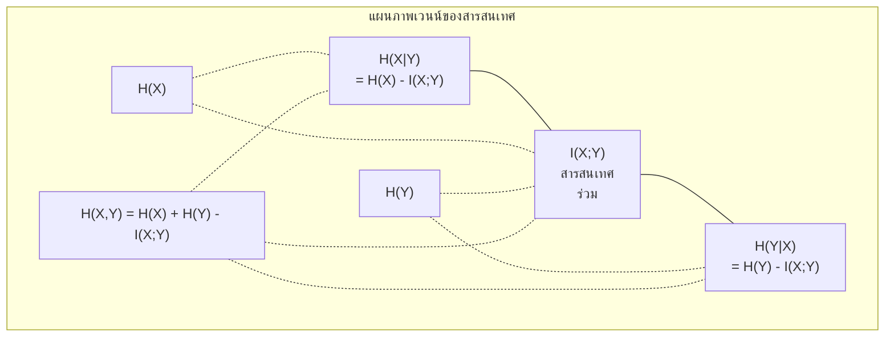

> ทฤษฎีสารสนเทศวัดความประหลาดใจ และฟังก์ชันความสูญเสียสร้างขึ้นบนมัน

**ประเภท:** เรียนรู้ (Learn)
**ภาษา:** Python, TypeScript
**ความรู้ที่ควรมีก่อน:** Phase 1 บทที่ 06 (ความน่าจะเป็น)
**เวลา:** ~60 นาที

## สิ่งที่จะได้เรียนรู้

- คำนวณเอนโทรปี (entropy), cross-entropy และ KL divergence ตั้งแต่ศูนย์ และอธิบายความสัมพันธ์ระหว่างกัน
- แสดงที่มาว่าทำไมการทำให้ cross-entropy loss ต่ำที่สุดจึงเท่ากับการทำให้ log-likelihood สูงที่สุด
- คำนวณสารสนเทศร่วม (mutual information) ระหว่างคุณลักษณะกับเป้าหมาย เพื่อจัดอันดับความสำคัญของคุณลักษณะ
- อธิบาย perplexity ว่าเป็นขนาดคลังคำที่มีผลจริงที่โมเดลภาษากำลังเลือกจาก

## ปัญหา

คุณเรียก `CrossEntropyLoss()` ในทุกโมเดลจำแนกที่เทรน คุณเห็นคำว่า "perplexity" ในเปเปอร์โมเดลภาษาทุกฉบับ คุณอ่านเรื่อง KL divergence ใน VAE, distillation และ RLHF สิ่งเหล่านี้ไม่ได้แยกขาดจากกัน มันคือแนวคิดเดียวกันที่สวมหมวกต่างใบ

ทฤษฎีสารสนเทศให้ภาษาสำหรับคิดเรื่องความไม่แน่นอน การบีบอัด และการทำนาย Claude Shannon คิดค้นมันในปี 1948 เพื่อแก้ปัญหาการสื่อสาร ปรากฏว่าการเทรนโครงข่ายประสาทเทียมก็คือปัญหาการสื่อสาร: โมเดลพยายามส่ง label ที่ถูกต้องผ่านช่องสัญญาณที่มีสัญญาณรบกวน ซึ่งก็คือน้ำหนักที่เรียนรู้มา

บทนี้สร้างทุกสูตรตั้งแต่ศูนย์ ให้คุณเห็นว่ามันมาจากไหนและทำไมจึงได้ผล

## แนวคิด

### ปริมาณสารสนเทศ (ความประหลาดใจ)

เมื่อสิ่งที่ไม่น่าจะเกิดเกิดขึ้น มันพาสารสนเทศมามากกว่า เหรียญออกหัว? ไม่น่าประหลาดใจ ถูกลอตเตอรี่? น่าประหลาดใจมาก

ปริมาณสารสนเทศ (information content) ของเหตุการณ์ที่มีความน่าจะเป็น $p$ คือ:

```math
I(x) = -\log(p(x))
```

ใช้ log ฐาน 2 จะได้หน่วยเป็นบิต (bits) ใช้ log ธรรมชาติจะได้หน่วยเป็นแนต (nats) แนวคิดเดียวกัน ต่างแค่หน่วย

```
เหตุการณ์                ความน่าจะเป็น    ความประหลาดใจ (บิต)
เหรียญเที่ยงตรงออกหัว      0.5            1.0
ทอยได้ 6                 0.167          2.58
เหตุการณ์ 1 ใน 1000       0.001          9.97
เหตุการณ์ที่แน่นอน          1.0            0.0
```

เหตุการณ์ที่แน่นอนไม่มีสารสนเทศเลย เพราะคุณรู้อยู่แล้วว่ามันจะเกิด

### เอนโทรปี (ความประหลาดใจเฉลี่ย)

เอนโทรปี (entropy) คือความประหลาดใจที่คาดหมายได้ เฉลี่ยบนผลลัพธ์ที่เป็นไปได้ทั้งหมดของการแจกแจง

```math
H(P) = -\sum_{x} p(x) \log(p(x))
```

เหรียญเที่ยงตรงมีเอนโทรปีสูงสุดสำหรับตัวแปรสองค่า: 1 บิต เหรียญที่เอนเอียง (ออกหัว 99%) มีเอนโทรปีต่ำ: 0.08 บิต คุณรู้อยู่แล้วว่าจะเกิดอะไร การโยนแต่ละครั้งจึงแทบไม่บอกอะไรใหม่

```math
\begin{aligned}
\text{Fair coin:} \quad & H = -(0.5 \log_2(0.5) + 0.5 \log_2(0.5)) = 1.0 \text{ bit} \\
\text{Biased coin:} \quad & H = -(0.99 \log_2(0.99) + 0.01 \log_2(0.01)) = 0.08 \text{ bits}
\end{aligned}
```

(Fair coin คือเหรียญเที่ยงตรง Biased coin คือเหรียญที่เอนเอียง)

เอนโทรปีวัดความไม่แน่นอนที่ลดทอนไม่ได้ของการแจกแจง คุณบีบอัดให้ต่ำกว่านั้นไม่ได้

### Cross-Entropy (ฟังก์ชันความสูญเสียที่คุณใช้ทุกวัน)

Cross-entropy วัดความประหลาดใจเฉลี่ยเมื่อคุณใช้การแจกแจง $Q$ เข้ารหัสเหตุการณ์ที่จริง ๆ มาจากการแจกแจง $P$

```math
H(P, Q) = -\sum_{x} p(x) \log(q(x))
```

$P$ คือการแจกแจงจริง (label) $Q$ คือคำทำนายของโมเดล ถ้า $Q$ ตรงกับ $P$ ทุกประการ cross-entropy จะเท่ากับเอนโทรปี ความไม่ตรงกันใด ๆ ทำให้มันใหญ่ขึ้น

ในการจำแนก $P$ เป็นเวกเตอร์ one-hot (คลาสที่ถูกมีความน่าจะเป็น 1 ที่เหลือเป็น 0) cross-entropy จึงลดรูปเหลือ:

```math
H(P, Q) = -\log(q(\text{true\_class}))
```

นั่นคือสูตร cross-entropy loss ทั้งหมดสำหรับการจำแนก ทำให้ความน่าจะเป็นที่ทำนายให้คลาสที่ถูกต้องสูงที่สุด

### KL Divergence (ระยะห่างระหว่างการแจกแจง)

KL divergence วัดว่าคุณได้ความประหลาดใจเพิ่มขึ้นเท่าไรจากการใช้ $Q$ แทน $P$

```math
\begin{aligned}
D_{KL}(P \,\|\, Q) &= \sum_{x} p(x) \log(p(x) / q(x)) \\
&= H(P, Q) - H(P)
\end{aligned}
```

Cross-entropy คือเอนโทรปีบวก KL divergence เพราะเอนโทรปีของการแจกแจงจริงคงที่ระหว่างการเทรน การทำให้ cross-entropy ต่ำที่สุดจึงเหมือนกับการทำให้ KL divergence ต่ำที่สุด คุณกำลังดันการแจกแจงของโมเดลเข้าหาการแจกแจงจริง

KL divergence ไม่สมมาตร: $D_{KL}(P \Vert Q) \ne D_{KL}(Q \Vert P)$ จึงไม่ใช่ระยะทาง (distance metric) ที่แท้จริง

### สารสนเทศร่วม (Mutual Information)

สารสนเทศร่วมวัดว่าการรู้ตัวแปรหนึ่งบอกอะไรเกี่ยวกับอีกตัวแปรหนึ่งได้มากแค่ไหน

```math
\begin{aligned}
I(X; Y) &= H(X) - H(X \mid Y) \\
&= H(X) + H(Y) - H(X, Y)
\end{aligned}
```

ถ้า $X$ และ $Y$ เป็นอิสระต่อกัน สารสนเทศร่วมเป็นศูนย์ การรู้ตัวหนึ่งไม่ได้บอกอะไรเกี่ยวกับอีกตัวเลย ถ้ามันสัมพันธ์กันสมบูรณ์ สารสนเทศร่วมจะเท่ากับเอนโทรปีของตัวใดตัวหนึ่ง

ในการเลือกคุณลักษณะ สารสนเทศร่วมที่สูงระหว่างคุณลักษณะกับเป้าหมายแปลว่าคุณลักษณะนั้นมีประโยชน์ สารสนเทศร่วมที่ต่ำแปลว่ามันเป็นสัญญาณรบกวน

### เอนโทรปีแบบมีเงื่อนไข (Conditional Entropy)

$H(Y \mid X)$ วัดว่ายังเหลือความไม่แน่นอนเกี่ยวกับ $Y$ อยู่เท่าไรหลังจากคุณสังเกต $X$ แล้ว

```math
H(Y \mid X) = H(X,Y) - H(X)
```

สองกรณีสุดขั้ว:
- ถ้า $X$ กำหนด $Y$ ได้ทั้งหมด แล้ว $H(Y \mid X) = 0$ การรู้ $X$ ขจัดความไม่แน่นอนเกี่ยวกับ $Y$ ไปหมด ตัวอย่าง: $X$ = อุณหภูมิเป็นเซลเซียส, $Y$ = อุณหภูมิเป็นฟาเรนไฮต์
- ถ้า $X$ ไม่ได้บอกอะไรเกี่ยวกับ $Y$ เลย แล้ว $H(Y \mid X) = H(Y)$ การรู้ $X$ ไม่ได้ลดความไม่แน่นอนเลย ตัวอย่าง: $X$ = การโยนเหรียญ, $Y$ = สภาพอากาศพรุ่งนี้

เอนโทรปีแบบมีเงื่อนไขไม่ติดลบเสมอและไม่เกิน $H(Y)$:

```math
0 \le H(Y \mid X) \le H(Y)
```

ใน machine learning เอนโทรปีแบบมีเงื่อนไขปรากฏใน decision tree ในการแบ่งแต่ละครั้ง อัลกอริทึมเลือกคุณลักษณะ $X$ ที่ทำให้ $H(Y \mid X)$ ต่ำที่สุด คือคุณลักษณะที่ขจัดความไม่แน่นอนเกี่ยวกับ label $Y$ ได้มากที่สุด

### เอนโทรปีร่วม (Joint Entropy)

$H(X,Y)$ คือเอนโทรปีของการแจกแจงร่วมของ $X$ และ $Y$

```math
H(X,Y) = -\sum_{x} \sum_{y} p(x,y) \log(p(x,y))
```

สมบัติสำคัญ:

```math
H(X,Y) \le H(X) + H(Y)
```

จะเท่ากันเมื่อ $X$ และ $Y$ เป็นอิสระต่อกัน ถ้ามันมีสารสนเทศร่วมกัน เอนโทรปีร่วมจะน้อยกว่าผลรวมของเอนโทรปีแต่ละตัว เอนโทรปีที่ "หายไป" คือสารสนเทศร่วมพอดี



ความสัมพันธ์:
- $H(X,Y) = H(X) + H(Y \mid X) = H(Y) + H(X \mid Y)$
- $I(X;Y) = H(X) - H(X \mid Y) = H(Y) - H(Y \mid X)$
- $H(X,Y) = H(X) + H(Y) - I(X;Y)$

### สารสนเทศร่วม (เจาะลึก)

สารสนเทศร่วม $I(X;Y)$ วัดปริมาณว่าการรู้ตัวแปรหนึ่งลดความไม่แน่นอนเกี่ยวกับอีกตัวได้แค่ไหน

```math
\begin{aligned}
I(X;Y) &= H(X) - H(X \mid Y) \\
&= H(Y) - H(Y \mid X) \\
&= H(X) + H(Y) - H(X,Y) \\
&= \sum_{x} \sum_{y} p(x,y) \log\left(\frac{p(x,y)}{p(x) \, p(y)}\right)
\end{aligned}
```

สมบัติ:
- $I(X;Y) \ge 0$ เสมอ คุณไม่เคยเสียสารสนเทศจากการสังเกตอะไรบางอย่าง
- $I(X;Y) = 0$ ก็ต่อเมื่อ $X$ และ $Y$ เป็นอิสระต่อกัน
- $I(X;Y) = I(Y;X)$ มันสมมาตร ต่างจาก KL divergence
- $I(X;X) = H(X)$ ตัวแปรหนึ่งมีสารสนเทศร่วมกับตัวเองทั้งหมด

**สารสนเทศร่วมสำหรับการเลือกคุณลักษณะ** ใน ML คุณต้องการคุณลักษณะที่ให้สารสนเทศเกี่ยวกับเป้าหมาย สารสนเทศร่วมให้วิธีจัดอันดับคุณลักษณะอย่างมีหลักการ:

1. สำหรับคุณลักษณะ $X_i$ แต่ละตัว คำนวณ $I(X_i; Y)$ โดย $Y$ คือตัวแปรเป้าหมาย
2. จัดอันดับคุณลักษณะตามคะแนน MI
3. เก็บ $k$ ตัวบนสุด

วิธีนี้ใช้ได้กับความสัมพันธ์ทุกแบบระหว่างคุณลักษณะกับเป้าหมาย ไม่ว่าจะเชิงเส้น ไม่เชิงเส้น ทางเดียว (monotonic) หรือไม่ก็ตาม สหสัมพันธ์แบบเพียร์สัน (Pearson correlation) จับได้แค่ความสัมพันธ์เชิงเส้น MI จับการพึ่งพาได้ทุกแบบ แต่เมื่อข้อมูลมีจำกัด การประมาณ MI ต้องมีตัวอย่างมากพอและแบ่งช่วง (binning) อย่างสมเหตุสมผล

| วิธี | ตรวจจับ | ต้นทุนการคำนวณ | รองรับข้อมูลเชิงหมวดหมู่? |
|--------|---------|-------------------|---------------------|
| สหสัมพันธ์แบบเพียร์สัน | ความสัมพันธ์เชิงเส้น | $O(n)$ | ไม่ |
| สหสัมพันธ์แบบสเปียร์แมน | ความสัมพันธ์แบบทางเดียว | $O(n \log n)$ | ไม่ |
| สารสนเทศร่วม | การพึ่งพาทางสถิติทุกแบบ | $O(n \log n)$ เมื่อแบ่งช่วง | ได้ |

### Label Smoothing กับ Cross-Entropy

การจำแนกแบบมาตรฐานใช้เป้าหมายแบบแข็ง: [0, 0, 1, 0] คลาสที่ถูกได้ความน่าจะเป็น 1 ที่เหลือได้ 0 Label smoothing เปลี่ยนเป็นเป้าหมายแบบนุ่ม:

```math
\text{soft\_target} = (1 - \epsilon) \cdot \text{hard\_target} + \epsilon / \text{num\_classes}
```

เมื่อ $\epsilon = 0.1$ และมี 4 คลาส:
- เป้าหมายแบบแข็ง:  [0, 0, 1, 0]
- เป้าหมายแบบนุ่ม:  [0.025, 0.025, 0.925, 0.025]

จากมุมมองของทฤษฎีสารสนเทศ label smoothing เพิ่มเอนโทรปีของการแจกแจงเป้าหมาย เป้าหมายแบบ one-hot แข็ง ๆ มีเอนโทรปี 0 คือไม่มีความไม่แน่นอนเลย เป้าหมายแบบนุ่มมีเอนโทรปีเป็นบวก

ทำไมจึงช่วยได้:
- ป้องกันไม่ให้โมเดลดัน logits ไปสุดขั้ว (ต้องใช้ logits อนันต์จึงจะตรงกับเป้าหมาย one-hot ได้สมบูรณ์ภายใต้ cross-entropy)
- ทำหน้าที่เป็น regularization: โมเดลมั่นใจ 100% ไม่ได้
- ปรับการสอบเทียบ (calibration) ให้ดีขึ้น: ความน่าจะเป็นที่ทำนายสะท้อนความไม่แน่นอนจริงได้ดีขึ้น
- ลดช่องว่างระหว่างพฤติกรรมตอนเทรนกับตอนใช้งานจริง

Cross-entropy loss ที่มี label smoothing จะกลายเป็น:

```math
L = (1 - \epsilon) \cdot \text{CE}(\text{hard\_target}, \text{prediction}) + \epsilon \cdot H_{\text{uniform}}(\text{prediction})
```

พจน์ที่สองลงโทษคำทำนายที่ห่างจากการแจกแจงสม่ำเสมอ เป็น regularization โดยตรงต่อความมั่นใจ

### ทำไม Cross-Entropy จึงเป็นฟังก์ชันความสูญเสียของการจำแนก

สามมุมมอง ข้อสรุปเดียวกัน

**มุมมองทฤษฎีสารสนเทศ** cross-entropy วัดว่าคุณเปลืองไปกี่บิตจากการใช้การแจกแจงของโมเดลแทนการแจกแจงจริง การทำให้มันต่ำที่สุดทำให้โมเดลของคุณเป็นตัวเข้ารหัสความจริงที่มีประสิทธิภาพที่สุด

**มุมมองภาวะน่าจะเป็นสูงสุด** สำหรับตัวอย่างเทรน $N$ ตัวที่มีคลาสจริง $y_i$:

```math
\begin{aligned}
\text{Likelihood} &= \prod_i q(y_i) \\
\text{Log-likelihood} &= \sum_i \log(q(y_i)) \\
\text{Negative log-likelihood} &= -\sum_i \log(q(y_i))
\end{aligned}
```

บรรทัดสุดท้ายคือ cross-entropy loss การทำให้ cross-entropy ต่ำที่สุด = การทำให้ภาวะน่าจะเป็นของข้อมูลเทรนภายใต้โมเดลของคุณสูงที่สุด

**มุมมอง gradient** gradient ของ cross-entropy เทียบกับ logits คือ (ค่าทำนาย - ค่าจริง) เท่านั้น สะอาด เสถียร และคำนวณเร็ว นี่คือเหตุผลที่มันเข้าคู่กับ softmax ได้อย่างลงตัว

### บิตกับแนต

ต่างกันแค่ฐานของ log

```
log ฐาน 2   -> บิต       (ธรรมเนียมของทฤษฎีสารสนเทศ)
log ฐาน e   -> แนต       (ธรรมเนียมของ machine learning)
log ฐาน 10  -> ฮาร์ตลีย์  (แทบไม่ใช้)
```

1 แนต = $1/\ln(2)$ บิต = 1.4427 บิต PyTorch และ TensorFlow ใช้ log ธรรมชาติ (แนต) เป็นค่าตั้งต้น

### Perplexity

Perplexity คือเลขชี้กำลังของ cross-entropy มันบอกจำนวนตัวเลือกที่มีโอกาสเท่ากันซึ่งโมเดลลังเลอยู่จริง ๆ

```math
\begin{aligned}
\text{Perplexity} &= 2^{H(P,Q)} \quad \text{(if using bits)} \\
\text{Perplexity} &= e^{H(P,Q)} \quad \text{(if using nats)}
\end{aligned}
```

(บรรทัดแรกเมื่อใช้หน่วยบิต บรรทัดที่สองเมื่อใช้หน่วยแนต)

โมเดลภาษาที่มี perplexity 50 โดยเฉลี่ยแล้วสับสนพอ ๆ กับการต้องสุ่มเลือกโทเค็นถัดไปจาก 50 ตัวที่โอกาสเท่ากัน ยิ่งต่ำยิ่งดี

GPT-2 ทำ perplexity ได้ราว 30 บน benchmark ทั่วไป โมเดลสมัยใหม่อยู่ที่หลักหน่วยสำหรับโดเมนที่มีข้อมูลมาก

```figure
entropy-kl
```

## ลงมือสร้าง (Build It)

### ขั้นที่ 1: ปริมาณสารสนเทศและเอนโทรปี

```python
import math

def information_content(p, base=2):
    if p <= 0 or p > 1:
        return float('inf') if p <= 0 else 0.0
    return -math.log(p) / math.log(base)

def entropy(probs, base=2):
    return sum(
        p * information_content(p, base)
        for p in probs if p > 0
    )

fair_coin = [0.5, 0.5]
biased_coin = [0.99, 0.01]
fair_die = [1/6] * 6

print(f"Fair coin entropy:   {entropy(fair_coin):.4f} bits")
print(f"Biased coin entropy: {entropy(biased_coin):.4f} bits")
print(f"Fair die entropy:    {entropy(fair_die):.4f} bits")
```

### ขั้นที่ 2: Cross-entropy และ KL divergence

```python
def cross_entropy(p, q, base=2):
    total = 0.0
    for pi, qi in zip(p, q):
        if pi > 0:
            if qi <= 0:
                return float('inf')
            total += pi * (-math.log(qi) / math.log(base))
    return total

def kl_divergence(p, q, base=2):
    return cross_entropy(p, q, base) - entropy(p, base)

true_dist = [0.7, 0.2, 0.1]
good_model = [0.6, 0.25, 0.15]
bad_model = [0.1, 0.1, 0.8]

print(f"Entropy of true dist:     {entropy(true_dist):.4f} bits")
print(f"CE (good model):          {cross_entropy(true_dist, good_model):.4f} bits")
print(f"CE (bad model):           {cross_entropy(true_dist, bad_model):.4f} bits")
print(f"KL divergence (good):     {kl_divergence(true_dist, good_model):.4f} bits")
print(f"KL divergence (bad):      {kl_divergence(true_dist, bad_model):.4f} bits")
```

### ขั้นที่ 3: Cross-entropy ในฐานะ loss ของการจำแนก

```python
def softmax(logits):
    max_logit = max(logits)
    exps = [math.exp(z - max_logit) for z in logits]
    total = sum(exps)
    return [e / total for e in exps]

def cross_entropy_loss(true_class, logits):
    probs = softmax(logits)
    return -math.log(probs[true_class])

logits = [2.0, 1.0, 0.1]
true_class = 0

probs = softmax(logits)
loss = cross_entropy_loss(true_class, logits)

print(f"Logits:      {logits}")
print(f"Softmax:     {[f'{p:.4f}' for p in probs]}")
print(f"True class:  {true_class}")
print(f"Loss:        {loss:.4f} nats")
print(f"Perplexity:  {math.exp(loss):.2f}")
```

### ขั้นที่ 4: Cross-entropy เท่ากับ negative log-likelihood

```python
import random

random.seed(42)

n_samples = 1000
n_classes = 3
true_labels = [random.randint(0, n_classes - 1) for _ in range(n_samples)]
model_logits = [[random.gauss(0, 1) for _ in range(n_classes)] for _ in range(n_samples)]

ce_loss = sum(
    cross_entropy_loss(label, logits)
    for label, logits in zip(true_labels, model_logits)
) / n_samples

nll = -sum(
    math.log(softmax(logits)[label])
    for label, logits in zip(true_labels, model_logits)
) / n_samples

print(f"Cross-entropy loss:      {ce_loss:.6f}")
print(f"Negative log-likelihood: {nll:.6f}")
print(f"Difference:              {abs(ce_loss - nll):.2e}")
```

### ขั้นที่ 5: สารสนเทศร่วม

```python
def mutual_information(joint_probs, base=2):
    rows = len(joint_probs)
    cols = len(joint_probs[0])

    margin_x = [sum(joint_probs[i][j] for j in range(cols)) for i in range(rows)]
    margin_y = [sum(joint_probs[i][j] for i in range(rows)) for j in range(cols)]

    mi = 0.0
    for i in range(rows):
        for j in range(cols):
            pxy = joint_probs[i][j]
            if pxy > 0:
                mi += pxy * math.log(pxy / (margin_x[i] * margin_y[j])) / math.log(base)
    return mi

independent = [[0.25, 0.25], [0.25, 0.25]]
dependent = [[0.45, 0.05], [0.05, 0.45]]

print(f"MI (independent): {mutual_information(independent):.4f} bits")
print(f"MI (dependent):   {mutual_information(dependent):.4f} bits")
```

## นำไปใช้ (Use It)

แนวคิดเดียวกันด้วย NumPy แบบที่คุณจะใช้ในทางปฏิบัติ:

```python
import numpy as np

def np_entropy(p):
    p = np.asarray(p, dtype=float)
    mask = p > 0
    result = np.zeros_like(p)
    result[mask] = p[mask] * np.log(p[mask])
    return -result.sum()

def np_cross_entropy(p, q):
    p, q = np.asarray(p, dtype=float), np.asarray(q, dtype=float)
    mask = p > 0
    return -(p[mask] * np.log(q[mask])).sum()

def np_kl_divergence(p, q):
    return np_cross_entropy(p, q) - np_entropy(p)

true = np.array([0.7, 0.2, 0.1])
pred = np.array([0.6, 0.25, 0.15])
print(f"Entropy:    {np_entropy(true):.4f} nats")
print(f"Cross-ent:  {np_cross_entropy(true, pred):.4f} nats")
print(f"KL div:     {np_kl_divergence(true, pred):.4f} nats")
```

คุณสร้างสิ่งที่ `torch.nn.CrossEntropyLoss()` ทำภายในขึ้นมาเองตั้งแต่ศูนย์ ตอนนี้คุณรู้แล้วว่าทำไม loss จึงลดลงระหว่างเทรน: การแจกแจงที่โมเดลทำนายเข้าใกล้การแจกแจงจริงมากขึ้น วัดเป็นจำนวนแนตของสารสนเทศที่เปลืองไป

## แบบฝึกหัด

1. คำนวณเอนโทรปีของตัวอักษรภาษาอังกฤษโดยสมมติว่าแจกแจงสม่ำเสมอ (26 ตัว) แล้วประมาณอีกครั้งด้วยความถี่ของตัวอักษรจริง แบบไหนสูงกว่าและเพราะอะไร?

2. โมเดลให้ logits [5.0, 2.0, 0.5] กับตัวอย่างที่คลาสจริงคือ 1 คำนวณ cross-entropy loss ด้วยมือ แล้วตรวจด้วยฟังก์ชัน `cross_entropy_loss` ของคุณ logits แบบไหนจะให้ loss เป็นศูนย์?

3. แสดงว่า KL divergence ไม่สมมาตร เลือกการแจกแจง $P$ และ $Q$ สองแบบ คำนวณ $D_{KL}(P \Vert Q)$ และ $D_{KL}(Q \Vert P)$ แล้วอธิบายว่าทำไมจึงต่างกัน

4. สร้างฟังก์ชันที่คำนวณ perplexity ของลำดับคำทำนายโทเค็น รับรายการคู่ (true_token_index, predicted_logits) แล้วคืน perplexity ของลำดับนั้น

### คำใบ้

**แบบฝึกหัดที่ 1** เรียก `entropy` ด้วยความน่าจะเป็นเท่ากัน 26 ค่า ผลต้องเป็น $\log_2 26 \approx 4.70$ บิต ความถี่ของตัวอักษรจริงไม่สม่ำเสมอ เอนโทรปีที่คำนวณจากความถี่จริงจึงต้องต่ำกว่า

**แบบฝึกหัดที่ 2** คำนวณ `softmax` ของ logits แล้วหา $-\ln$ ของความน่าจะเป็นที่ index 1 แล้วเทียบกับ `cross_entropy_loss(1, logits)` ทั้งสองต้องใกล้ 3.06 loss จะเข้าใกล้ 0 ก็ต่อเมื่อ logit ของคลาส 1 ใหญ่กว่าอีกสองตัวมาก ๆ

**แบบฝึกหัดที่ 3** ใช้การแจกแจงเล็ก ๆ สองแบบที่รูปร่างต่างกัน เช่น $P = [0.9, 0.1]$ และ $Q = [0.5, 0.5]$ แล้วเรียก `kl_divergence` ทั้งสองลำดับ ค่าทั้งสองต้องต่างกัน เพราะแต่ละทิศถ่วงน้ำหนักอัตราส่วนใน log ด้วยการแจกแจงคนละตัว

**แบบฝึกหัดที่ 4** สำหรับแต่ละคู่ คำนวณ `cross_entropy_loss(true_token_index, predicted_logits)` หาค่าเฉลี่ย แล้วส่งเข้า `perplexity` ตรวจด้วย logits ที่เท่ากันหมดบนโทเค็น $V$ ตัว: perplexity ต้องเท่ากับ $V$

## คำศัพท์สำคัญ

| คำศัพท์ | ที่คนมักพูด | ความหมายจริง |
|------|----------------|----------------------|
| Information content (ปริมาณสารสนเทศ) | "ความประหลาดใจ" | จำนวนบิต (หรือแนต) ที่ต้องใช้เข้ารหัสเหตุการณ์หนึ่ง: $-\log(p)$ |
| Entropy (เอนโทรปี) | "ความสุ่ม" | ความประหลาดใจเฉลี่ยบนผลลัพธ์ทั้งหมดของการแจกแจง วัดความไม่แน่นอนที่ลดทอนไม่ได้ |
| Cross-entropy | "ฟังก์ชันความสูญเสีย" | ความประหลาดใจเฉลี่ยเมื่อใช้การแจกแจงของโมเดล $Q$ เข้ารหัสเหตุการณ์จากการแจกแจงจริง $P$ |
| KL divergence | "ระยะห่างระหว่างการแจกแจง" | จำนวนบิตที่เปลืองเพิ่มจากการใช้ $Q$ แทน $P$ เท่ากับ cross-entropy ลบเอนโทรปี ไม่สมมาตร |
| Mutual information (สารสนเทศร่วม) | "X กับ Y เกี่ยวกันแค่ไหน" | ความไม่แน่นอนเกี่ยวกับ $X$ ที่ลดลงจากการรู้ $Y$ ศูนย์แปลว่าเป็นอิสระต่อกัน |
| Softmax | "เปลี่ยน logits เป็นความน่าจะเป็น" | ยกกำลัง exp แล้วทำให้เป็นมาตรฐาน จับคู่เวกเตอร์จำนวนจริงใด ๆ ไปเป็นการแจกแจงความน่าจะเป็นที่ถูกต้อง |
| Perplexity | "โมเดลสับสนแค่ไหน" | เลขชี้กำลังของ cross-entropy ขนาดคลังคำที่มีผลจริงที่โมเดลเลือกจากในแต่ละขั้น |
| Bits (บิต) | "หน่วยของ Shannon" | สารสนเทศที่วัดด้วย log ฐาน 2 หนึ่งบิตตอบผลการโยนเหรียญเที่ยงตรงได้หนึ่งครั้ง |
| Nats (แนต) | "หน่วยของ ML" | สารสนเทศที่วัดด้วย log ธรรมชาติ PyTorch และ TensorFlow ใช้เป็นค่าตั้งต้น |
| Negative log-likelihood | "NLL loss" | เหมือนกับ cross-entropy loss ทุกประการเมื่อ label เป็น one-hot การทำให้มันต่ำที่สุดทำให้ความน่าจะเป็นของคำทำนายที่ถูกสูงที่สุด |

## อ่านเพิ่มเติม

- [Shannon 1948: A Mathematical Theory of Communication](https://people.math.harvard.edu/~ctm/home/text/others/shannon/entropy/entropy.pdf) - เปเปอร์ต้นฉบับ ยังอ่านเข้าใจได้
- [Visual Information Theory (Chris Olah)](https://colah.github.io/posts/2015-09-Visual-Information/) - คำอธิบายเชิงภาพที่ดีที่สุดของเอนโทรปีและ KL divergence
- [PyTorch CrossEntropyLoss docs](https://pytorch.org/docs/stable/generated/torch.nn.CrossEntropyLoss.html) - เฟรมเวิร์กสร้างสิ่งที่คุณเพิ่งสร้างไปอย่างไร
