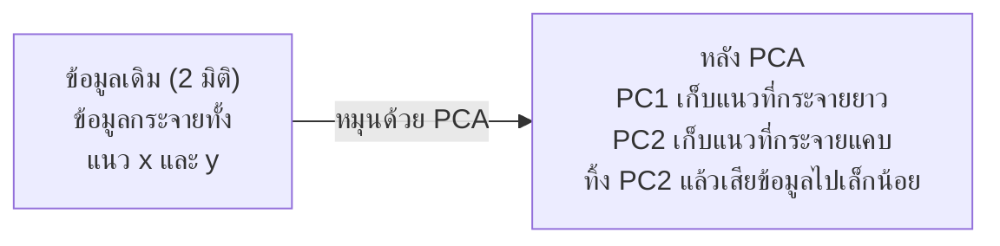

> ข้อมูลมิติสูงมีโครงสร้างซ่อนอยู่ คุณจะเห็นมันเมื่อมองจากมุมที่ถูกต้อง

**ประเภท:** ลงมือสร้าง (Build)
**ภาษา:** Python, TypeScript
**ความรู้ที่ควรมีก่อน:** Phase 1 บทที่ 01 (พีชคณิตเชิงเส้นแบบเข้าใจภาพ), 02 (เวกเตอร์ เมทริกซ์ และการดำเนินการ), 03 (ค่าลักษณะเฉพาะและเวกเตอร์ลักษณะเฉพาะ), 06 (ความน่าจะเป็นและการแจกแจง)
**เวลา:** ~90 นาที

## สิ่งที่จะได้เรียนรู้

- เขียน PCA ตั้งแต่ศูนย์: จัดข้อมูลให้อยู่กึ่งกลาง คำนวณเมทริกซ์ความแปรปรวนร่วม แยกค่าลักษณะเฉพาะ แล้วฉายข้อมูล
- ใช้สัดส่วนความแปรปรวนที่อธิบายได้ (explained variance ratio) และวิธีข้อศอก (elbow method) เลือกจำนวนองค์ประกอบหลัก
- เปรียบเทียบ PCA, t-SNE และ UMAP ในการแสดงตัวเลข MNIST เป็นภาพ 2 มิติ และอธิบายข้อดีข้อเสียของแต่ละวิธี
- ใช้ kernel PCA กับ RBF kernel แยกโครงสร้างข้อมูลแบบไม่เชิงเส้นที่ PCA มาตรฐานรับมือไม่ได้

## ปัญหา

คุณมีชุดข้อมูลที่แต่ละตัวอย่างมี 784 คุณลักษณะ อาจเป็นค่าพิกเซลของตัวเลขที่เขียนด้วยมือ อาจเป็นระดับการแสดงออกของยีน อาจเป็นสัญญาณพฤติกรรมผู้ใช้ คุณมองเห็น 784 มิติไม่ได้ วาดกราฟไม่ได้ แม้แต่จะนึกภาพก็ยังไม่ได้

แต่คุณลักษณะส่วนใหญ่ใน 784 ตัวนั้นซ้ำซ้อน สารสนเทศจริงอยู่บนพื้นผิวที่เล็กกว่ามาก เลข "7" ที่เขียนด้วยมือไม่ต้องใช้ตัวเลขอิสระ 784 ตัวในการบรรยาย ใช้แค่ไม่กี่ตัว: มุมของเส้น ความยาวของขีดขวาง เอียงไปแค่ไหน ที่เหลือคือสัญญาณรบกวน

การลดมิติ (dimensionality reduction) หาพื้นผิวที่เล็กกว่านั้น มันนำข้อมูล 784 มิติของคุณมาบีบอัดเหลือ 2, 10 หรือ 50 มิติ โดยยังเก็บโครงสร้างที่สำคัญไว้

## แนวคิด

### คำสาปของมิติ (The curse of dimensionality)

ปริภูมิมิติสูงขัดกับสัญชาตญาณ มีสามอย่างที่พังเมื่อจำนวนมิติเพิ่มขึ้น

**ระยะทางไร้ความหมาย** ในมิติสูง ระยะห่างระหว่างจุดสุ่มสองจุดใด ๆ ลู่เข้าสู่ค่าเดียวกัน ถ้าทุกจุดห่างจากจุดอื่นพอ ๆ กันหมด การค้นหาเพื่อนบ้านที่ใกล้ที่สุดก็ใช้ไม่ได้

```
จำนวนมิติ    อัตราส่วนระยะทางเฉลี่ย (มากสุด/น้อยสุดระหว่างจุดสุ่ม)
2            ~5.0
10           ~1.8
100          ~1.2
1000         ~1.02
```

**ปริมาตรกระจุกที่มุม** ลูกบาศก์หนึ่งหน่วยใน $d$ มิติมี $2^d$ มุม ใน 100 มิติ ปริมาตรเกือบทั้งหมดอยู่ที่มุม ห่างจากจุดศูนย์กลาง จุดข้อมูลกระจายออกไปที่ขอบ และโมเดลของคุณขาดข้อมูลในบริเวณด้านใน

**คุณต้องการข้อมูลมากขึ้นแบบเลขชี้กำลัง** การรักษาความหนาแน่นของตัวอย่างในปริภูมิให้เท่าเดิม เมื่อไปจาก 2 มิติเป็น 20 มิติ ต้องใช้ข้อมูลมากขึ้น $10^{18}$ เท่า คุณไม่มีทางมีพอ การลดมิติทำให้ความหนาแน่นของข้อมูลกลับมาอยู่ในระดับที่ใช้งานได้

### PCA: หาทิศทางที่สำคัญ

การวิเคราะห์องค์ประกอบหลัก (Principal Component Analysis, PCA) หาแกนที่ข้อมูลของคุณแปรผันมากที่สุด มันหมุนระบบพิกัดของคุณให้แกนแรกเก็บความแปรปรวนได้มากที่สุด แกนที่สองเก็บได้มากรองลงมา และต่อไปเรื่อย ๆ

อัลกอริทึม:

```
1. จัดข้อมูลให้อยู่กึ่งกลาง      (ลบค่าเฉลี่ยออกจากแต่ละคุณลักษณะ)
2. คำนวณความแปรปรวนร่วม     (คุณลักษณะขยับไปด้วยกันอย่างไร)
3. แยกค่าลักษณะเฉพาะ        (หาทิศทางหลัก)
4. เรียงตามค่าลักษณะเฉพาะ    (ความแปรปรวนมากที่สุดก่อน)
5. ฉาย                    (เก็บเวกเตอร์ลักษณะเฉพาะ k ตัวบนสุด ทิ้งที่เหลือ)
```

ทำไมต้องแยกค่าลักษณะเฉพาะ? เมทริกซ์ความแปรปรวนร่วมสมมาตรและเป็นกึ่งบวกแน่นอน (positive semi-definite) เวกเตอร์ลักษณะเฉพาะของมันเป็นทิศทางที่ตั้งฉากกันในปริภูมิคุณลักษณะ ค่าลักษณะเฉพาะบอกว่าแต่ละทิศเก็บความแปรปรวนได้เท่าไร เวกเตอร์ลักษณะเฉพาะที่มีค่าลักษณะเฉพาะมากที่สุดชี้ไปตามทิศที่ความแปรปรวนมากที่สุด



- **ก่อน PCA:** กลุ่มข้อมูลกระจายแนวทแยงคร่อมทั้งแกน x และ y
- **หลัง PCA:** ระบบพิกัดถูกหมุนให้ PC1 อยู่แนวเดียวกับทิศที่ความแปรปรวนมากที่สุด (แนวที่กระจายยาว) และ PC2 อยู่แนวเดียวกับทิศที่ความแปรปรวนน้อยที่สุด (แนวที่กระจายแคบ)
- **การลดมิติ:** ทิ้ง PC2 แล้วฉายข้อมูลลงบน PC1 เสียสารสนเทศไปน้อยมาก

### สัดส่วนความแปรปรวนที่อธิบายได้

องค์ประกอบหลักแต่ละตัวเก็บความแปรปรวนรวมไว้ส่วนหนึ่ง สัดส่วนความแปรปรวนที่อธิบายได้ (explained variance ratio) บอกว่าเท่าไร

```
องค์ประกอบ    ค่าลักษณะเฉพาะ    สัดส่วนที่อธิบายได้    สะสม
PC1          4.73          0.473              0.473
PC2          2.51          0.251              0.724
PC3          1.12          0.112              0.836
PC4          0.89          0.089              0.925
...
```

เมื่อความแปรปรวนที่อธิบายได้สะสมถึง 0.95 คุณรู้ว่าองค์ประกอบจำนวนนั้นเก็บสารสนเทศได้ 95% ที่เหลือหลังจากนั้นส่วนใหญ่เป็นสัญญาณรบกวน

### เลือกจำนวนองค์ประกอบ

สามกลยุทธ์:

1. **เกณฑ์** เก็บองค์ประกอบให้พอที่จะอธิบายความแปรปรวนได้ 90-95%
2. **วิธีข้อศอก** วาดกราฟความแปรปรวนที่อธิบายได้ต่อองค์ประกอบ มองหาจุดที่ลดลงอย่างฉับพลัน
3. **ผลลัพธ์ของงานปลายทาง** ใช้ PCA เป็นขั้นเตรียมข้อมูล ลองไล่ค่า $k$ แล้ววัดความแม่นยำของโมเดล $k$ ที่ดีที่สุดคือจุดที่ความแม่นยำเริ่มคงที่

### t-SNE: รักษาความเป็นเพื่อนบ้าน

t-Distributed Stochastic Neighbor Embedding (t-SNE) ออกแบบมาเพื่อการแสดงภาพ มันจับคู่ข้อมูลมิติสูงไปเป็น 2 มิติ (หรือ 3 มิติ) โดยรักษาว่าจุดไหนอยู่ใกล้จุดไหน

แนวคิด: ในปริภูมิเดิม คำนวณการแจกแจงความน่าจะเป็นบนคู่ของจุดจากระยะห่างระหว่างกัน จุดที่ใกล้กันได้ความน่าจะเป็นสูง จุดที่ไกลกันได้ความน่าจะเป็นต่ำ แล้วหาการจัดวางใน 2 มิติที่ให้การแจกแจงความน่าจะเป็นแบบเดียวกัน จุดที่เป็นเพื่อนบ้านกันใน 784 มิติจะยังเป็นเพื่อนบ้านกันใน 2 มิติ

สมบัติสำคัญของ t-SNE:
- ไม่เชิงเส้น มันคลี่ manifold ที่ซับซ้อนซึ่ง PCA ทำไม่ได้ออกมาได้
- มีความสุ่ม รันแต่ละครั้งได้การจัดวางต่างกัน
- พารามิเตอร์ perplexity ควบคุมว่าจะพิจารณาเพื่อนบ้านกี่ตัว (ช่วงปกติ: 5-50)
- ระยะห่างระหว่างกลุ่มในผลลัพธ์ไม่มีความหมาย มีแค่ตัวกลุ่มเท่านั้นที่มีความหมาย
- ช้าเมื่อชุดข้อมูลใหญ่ ค่าตั้งต้นเป็น $O(n^2)$

### UMAP: เร็วกว่า และรักษาโครงสร้างภาพรวมได้ดีกว่า

Uniform Manifold Approximation and Projection (UMAP) ทำงานคล้าย t-SNE แต่มีข้อดีสองอย่าง:
- เร็วกว่า มันใช้กราฟเพื่อนบ้านใกล้สุดแบบประมาณ แทนการคำนวณระยะห่างของทุกคู่
- รักษาโครงสร้างภาพรวมได้ดีกว่า ตำแหน่งสัมพัทธ์ของกลุ่มในผลลัพธ์มักมีความหมายมากกว่าใน t-SNE

UMAP สร้างกราฟถ่วงน้ำหนักในปริภูมิมิติสูง ("fuzzy topological representation") แล้วหาการจัดวางในมิติต่ำที่รักษากราฟนี้ไว้ให้ได้มากที่สุด

พารามิเตอร์สำคัญ:
- `n_neighbors`: ใช้เพื่อนบ้านกี่ตัวกำหนดโครงสร้างเฉพาะที่ (คล้าย perplexity) ค่าสูงขึ้นรักษาโครงสร้างภาพรวมได้มากขึ้น
- `min_dist`: จุดในผลลัพธ์อัดกันแน่นแค่ไหน ค่าต่ำสร้างกลุ่มที่หนาแน่นกว่า

### ใช้แบบไหนเมื่อไร

| วิธี | กรณีใช้งาน | รักษาอะไร | ความเร็ว |
|--------|----------|-----------|-------|
| PCA | เตรียมข้อมูลก่อนเทรน | ความแปรปรวนภาพรวม | เร็ว (แม่นยำ) ใช้ได้กับตัวอย่างเป็นล้าน |
| PCA | สำรวจข้อมูลด้วยภาพแบบรวดเร็ว | โครงสร้างเชิงเส้น | เร็ว |
| t-SNE | กราฟ 2 มิติคุณภาพระดับตีพิมพ์ | ความเป็นเพื่อนบ้านเฉพาะที่ | ช้า (เหมาะกับ < 10k ตัวอย่าง) |
| UMAP | แสดงภาพ 2 มิติในสเกลใหญ่ | โครงสร้างเฉพาะที่ + ภาพรวมบางส่วน | ปานกลาง (รับมือได้เป็นล้าน) |
| PCA | ลดคุณลักษณะสำหรับโมเดล | คุณลักษณะที่จัดอันดับตามความแปรปรวน | เร็ว |
| t-SNE / UMAP | ทำความเข้าใจโครงสร้างกลุ่ม | การแยกกลุ่ม | ปานกลางถึงช้า |

หลักทั่วไป: ใช้ PCA เตรียมข้อมูลและบีบอัดข้อมูล ใช้ t-SNE หรือ UMAP เมื่อต้องการแสดงโครงสร้างเป็นภาพ 2 มิติ

### Kernel PCA

PCA มาตรฐานหาปริภูมิย่อยเชิงเส้น มันหมุนระบบพิกัดแล้วทิ้งบางแกน แต่ถ้าข้อมูลอยู่บน manifold ที่ไม่เชิงเส้นล่ะ? วงกลมใน 2 มิติแยกด้วยเส้นตรงเส้นไหนก็ไม่ได้ PCA มาตรฐานช่วยไม่ได้

Kernel PCA ทำ PCA ในปริภูมิคุณลักษณะมิติสูงที่เกิดจากฟังก์ชัน kernel โดยไม่ต้องคำนวณพิกัดในปริภูมินั้นออกมาจริง ๆ นี่คือ kernel trick แนวคิดเดียวกับเบื้องหลังของ SVM

อัลกอริทึม:
1. คำนวณเมทริกซ์ kernel $K$ โดย $K_{ij} = k(x_i, x_j)$
2. จัดเมทริกซ์ kernel ให้อยู่กึ่งกลางในปริภูมิคุณลักษณะ
3. แยกค่าลักษณะเฉพาะของเมทริกซ์ kernel ที่จัดกึ่งกลางแล้ว
4. เวกเตอร์ลักษณะเฉพาะตัวบนสุด (คูณด้วย $1/\sqrt{\text{eigenvalue}}$) คือผลการฉาย

ฟังก์ชัน kernel ที่พบบ่อย:

| Kernel | สูตร | เหมาะกับ |
|--------|---------|----------|
| RBF (เกาส์) | $\exp(-\gamma \lVert x - y \rVert^2)$ | ข้อมูลไม่เชิงเส้นส่วนใหญ่ manifold ที่เรียบ |
| พหุนาม | $(x \cdot y + c)^d$ | ความสัมพันธ์แบบพหุนาม |
| Sigmoid | $\tanh(\alpha x \cdot y + c)$ | การจับคู่ที่คล้ายโครงข่ายประสาทเทียม |

เมื่อไรควรใช้ kernel PCA แทน PCA มาตรฐาน:

| เกณฑ์ | PCA มาตรฐาน | Kernel PCA |
|-----------|-------------|------------|
| โครงสร้างข้อมูล | ปริภูมิย่อยเชิงเส้น | manifold ไม่เชิงเส้น |
| ความเร็ว | $O(\min(n^2 d, d^2 n))$ | $O(n^2 d + n^3)$ |
| การตีความ | องค์ประกอบเป็นผลรวมเชิงเส้นของคุณลักษณะ | องค์ประกอบไม่มีความหมายในแง่คุณลักษณะโดยตรง |
| การขยายสเกล | ใช้ได้กับตัวอย่างเป็นล้าน | เมทริกซ์ kernel มีขนาด $n \times n$ ติดขีดจำกัดหน่วยความจำ |
| การสร้างกลับ | แปลงกลับได้โดยตรง | ต้องประมาณ pre-image |

ตัวอย่างคลาสสิก: วงกลมซ้อนกันใน 2 มิติ จุดเป็นวงแหวนสองวง วงหนึ่งอยู่ในอีกวง PCA มาตรฐานฉายทั้งสองวงลงบนเส้นเดียวกัน ใช้จำแนกไม่ได้ Kernel PCA ที่ใช้ RBF kernel ส่งวงในและวงนอกไปอยู่คนละบริเวณ ทำให้แยกด้วยเส้นตรงได้

### ความคลาดเคลื่อนจากการสร้างกลับ (Reconstruction Error)

การลดมิติของคุณดีแค่ไหน? คุณบีบอัด 784 มิติเหลือ 50 คุณเสียอะไรไป?

วัดความคลาดเคลื่อนจากการสร้างกลับ:
1. ฉายข้อมูลลงไป $k$ มิติ: $X_{\text{reduced}} = X W_k$
2. สร้างกลับ: $\hat{X} = X_{\text{reduced}} W_k^T$
3. คำนวณ MSE: $\text{mean}((X - \hat{X})^2)$

สำหรับ PCA ความคลาดเคลื่อนจากการสร้างกลับสัมพันธ์กับความแปรปรวนที่อธิบายได้อย่างชัดเจน:

```math
\begin{aligned}
\text{Reconstruction error} &= \text{sum of eigenvalues NOT included} \\
\text{Total variance} &= \text{sum of ALL eigenvalues} \\
\text{Fraction lost} &= \frac{\text{sum of dropped eigenvalues}}{\text{sum of all eigenvalues}}
\end{aligned}
```

(ความคลาดเคลื่อนจากการสร้างกลับคือผลรวมของค่าลักษณะเฉพาะที่ไม่ได้เก็บไว้ ความแปรปรวนรวมคือผลรวมของค่าลักษณะเฉพาะทั้งหมด และสัดส่วนที่เสียไปคืออัตราส่วนของทั้งสอง)

สัดส่วนความแปรปรวนที่อธิบายได้ขององค์ประกอบแต่ละตัวคือ:

```math
\text{explained\_ratio}_k = \frac{\text{eigenvalue}_k}{\sum \text{all eigenvalues}}
```

การวาดกราฟความแปรปรวนที่อธิบายได้สะสมเทียบกับจำนวนองค์ประกอบให้เส้นโค้ง "ข้อศอก" จำนวนองค์ประกอบที่เหมาะคือจุดที่:
- เส้นโค้งเริ่มแบน (ได้ผลเพิ่มน้อยลง)
- ความแปรปรวนสะสมข้ามเกณฑ์ (ปกติ 0.90 หรือ 0.95)
- ผลลัพธ์ของงานปลายทางเริ่มคงที่

ความคลาดเคลื่อนจากการสร้างกลับมีประโยชน์มากกว่าแค่การเลือก $k$ คุณใช้มันตรวจจับความผิดปกติได้: ตัวอย่างที่ความคลาดเคลื่อนจากการสร้างกลับสูงคือค่าผิดปกติที่ไม่เข้ากับปริภูมิย่อยที่เรียนรู้มา นี่คือพื้นฐานของการตรวจจับความผิดปกติด้วย PCA ในระบบจริง

```figure
pca-axes
```

## ลงมือสร้าง (Build It)

เวอร์ชัน TypeScript อยู่ใน `code/dim_reduction.ts` เดโม MNIST ต้องใช้ scikit-learn จึงรันได้ใน Python เท่านั้น

```bash
python3 code/dim_reduction.py
npx tsx code/dim_reduction.ts
```

### ขั้นที่ 1: PCA ตั้งแต่ศูนย์

```python
import numpy as np

class PCA:
    def __init__(self, n_components):
        self.n_components = n_components
        self.components = None
        self.mean = None
        self.eigenvalues = None
        self.explained_variance_ratio_ = None

    def fit(self, X):
        self.mean = np.mean(X, axis=0)
        X_centered = X - self.mean

        cov_matrix = np.cov(X_centered, rowvar=False)

        eigenvalues, eigenvectors = np.linalg.eigh(cov_matrix)

        sorted_idx = np.argsort(eigenvalues)[::-1]
        eigenvalues = eigenvalues[sorted_idx]
        eigenvectors = eigenvectors[:, sorted_idx]

        self.components = eigenvectors[:, :self.n_components].T
        self.eigenvalues = eigenvalues[:self.n_components]
        total_var = np.sum(eigenvalues)
        self.explained_variance_ratio_ = self.eigenvalues / total_var

        return self

    def transform(self, X):
        X_centered = X - self.mean
        return X_centered @ self.components.T

    def fit_transform(self, X):
        self.fit(X)
        return self.transform(X)
```

### ขั้นที่ 2: ทดสอบกับข้อมูลสังเคราะห์

```python
np.random.seed(42)
n_samples = 500

t = np.random.uniform(0, 2 * np.pi, n_samples)
x1 = 3 * np.cos(t) + np.random.normal(0, 0.2, n_samples)
x2 = 3 * np.sin(t) + np.random.normal(0, 0.2, n_samples)
x3 = 0.5 * x1 + 0.3 * x2 + np.random.normal(0, 0.1, n_samples)

X_synthetic = np.column_stack([x1, x2, x3])

pca = PCA(n_components=2)
X_reduced = pca.fit_transform(X_synthetic)

print(f"Original shape: {X_synthetic.shape}")
print(f"Reduced shape:  {X_reduced.shape}")
print(f"Explained variance ratios: {pca.explained_variance_ratio_}")
print(f"Total variance captured: {sum(pca.explained_variance_ratio_):.4f}")
```

### ขั้นที่ 3: ตัวเลข MNIST ใน 2 มิติ

```python
from sklearn.datasets import fetch_openml

mnist = fetch_openml("mnist_784", version=1, as_frame=False, parser="auto")
X_mnist = mnist.data[:5000].astype(float)
y_mnist = mnist.target[:5000].astype(int)

pca_mnist = PCA(n_components=50)
X_pca50 = pca_mnist.fit_transform(X_mnist)
print(f"50 components capture {sum(pca_mnist.explained_variance_ratio_):.2%} of variance")

pca_2d = PCA(n_components=2)
X_pca2d = pca_2d.fit_transform(X_mnist)
print(f"2 components capture {sum(pca_2d.explained_variance_ratio_):.2%} of variance")
```

### ขั้นที่ 4: เปรียบเทียบกับ sklearn

```python
from sklearn.decomposition import PCA as SklearnPCA
from sklearn.manifold import TSNE

sklearn_pca = SklearnPCA(n_components=2)
X_sklearn_pca = sklearn_pca.fit_transform(X_mnist)

print(f"\nOur PCA explained variance:     {pca_2d.explained_variance_ratio_}")
print(f"Sklearn PCA explained variance: {sklearn_pca.explained_variance_ratio_}")

diff = np.abs(np.abs(X_pca2d) - np.abs(X_sklearn_pca))
print(f"Max absolute difference: {diff.max():.10f}")

tsne = TSNE(n_components=2, perplexity=30, random_state=42)
X_tsne = tsne.fit_transform(X_mnist)
print(f"\nt-SNE output shape: {X_tsne.shape}")
```

### ขั้นที่ 5: เปรียบเทียบกับ UMAP

```python
try:
    from umap import UMAP

    reducer = UMAP(n_components=2, n_neighbors=15, min_dist=0.1, random_state=42)
    X_umap = reducer.fit_transform(X_mnist)
    print(f"UMAP output shape: {X_umap.shape}")
except ImportError:
    print("Install umap-learn: pip install umap-learn")
```

## นำไปใช้ (Use It)

PCA เป็นขั้นเตรียมข้อมูลก่อนตัวจำแนก:

```python
from sklearn.decomposition import PCA as SklearnPCA
from sklearn.linear_model import LogisticRegression
from sklearn.model_selection import train_test_split
from sklearn.metrics import accuracy_score

X_train, X_test, y_train, y_test = train_test_split(
    X_mnist, y_mnist, test_size=0.2, random_state=42
)

results = {}
for k in [10, 30, 50, 100, 200]:
    pca_k = SklearnPCA(n_components=k)
    X_tr = pca_k.fit_transform(X_train)
    X_te = pca_k.transform(X_test)

    clf = LogisticRegression(max_iter=1000, random_state=42)
    clf.fit(X_tr, y_train)
    acc = accuracy_score(y_test, clf.predict(X_te))
    var_captured = sum(pca_k.explained_variance_ratio_)
    results[k] = (acc, var_captured)
    print(f"k={k:>3d}  accuracy={acc:.4f}  variance={var_captured:.4f}")
```

ประสิทธิภาพคงที่ตั้งแต่ก่อนถึง 784 มิติไปมาก จุดที่คงที่นั้นคือจุดทำงานของคุณ

## ส่งมอบ (Ship It)

บทนี้สร้าง:
- `outputs/skill-dimensionality-reduction.md` - skill สำหรับเลือกเทคนิคการลดมิติที่เหมาะกับงานที่ได้รับ

## แบบฝึกหัด

1. แก้คลาส PCA ให้รองรับ `inverse_transform` สร้างตัวเลข MNIST กลับจากองค์ประกอบ 10, 50 และ 200 ตัว แล้วพิมพ์ความคลาดเคลื่อนจากการสร้างกลับ (ค่าเฉลี่ยของผลต่างกำลังสองเทียบกับต้นฉบับ) ของแต่ละแบบ

2. รัน t-SNE กับ MNIST ชุดย่อยเดิมด้วยค่า perplexity 5, 30 และ 100 บรรยายว่าผลลัพธ์เปลี่ยนไปอย่างไร ทำไม perplexity จึงมีผลต่อความแน่นของกลุ่ม?

3. ใช้ชุดข้อมูลที่มี 50 คุณลักษณะแต่มีแค่ 5 ตัวที่ให้สารสนเทศ (สร้างด้วย `sklearn.datasets.make_classification`) ใส่ PCA แล้วตรวจว่าเส้นโค้งความแปรปรวนที่อธิบายได้บอกได้ถูกต้องไหมว่าข้อมูลมีมิติที่มีผลจริงแค่ 5 มิติ

### คำใบ้

**แบบฝึกหัดที่ 1** อ่าน `inverse_transform` ในคลาส `PCA` แล้ว fit โมเดลหนึ่งตัวต่อจำนวนองค์ประกอบแต่ละค่า คำนวณ `reconstruction_error` สำหรับ 10, 50 และ 200 องค์ประกอบ ความคลาดเคลื่อนต้องลดลงเมื่อจำนวนองค์ประกอบเพิ่มขึ้น

**แบบฝึกหัดที่ 2** fit `sklearn.manifold.TSNE` สามครั้งบนชุดย่อยเดิม เปลี่ยนแค่ `perplexity` และใช้ `random_state` เดียวกัน perplexity ต่ำดูเพื่อนบ้านน้อยตัว คาดว่าจะได้กลุ่มเล็กที่แน่น perplexity สูงดูเพื่อนบ้านมากขึ้น คาดว่าจะได้กลุ่มที่ใหญ่และเรียบกว่า

**แบบฝึกหัดที่ 3** เรียก `make_classification(n_features=50, n_informative=5, n_redundant=45)` fit `PCA` แล้วพิมพ์ความแปรปรวนที่อธิบายได้สะสม คุณลักษณะที่ซ้ำซ้อนเป็นผลรวมเชิงเส้นของคุณลักษณะที่ให้สารสนเทศ เส้นโค้งจึงไปถึงเกือบ 1.0 ที่ 5 องค์ประกอบ จากนั้นลอง `n_redundant=0`: อีก 45 คุณลักษณะเป็นสัญญาณรบกวนอิสระ และเส้นโค้งจะไม่แบน

## คำศัพท์สำคัญ

| คำศัพท์ | ที่คนมักพูด | ความหมายจริง |
|------|----------------|----------------------|
| Curse of dimensionality (คำสาปของมิติ) | "คุณลักษณะเยอะเกินไป" | ระยะทาง ปริมาตร และความหนาแน่นของข้อมูล มีพฤติกรรมขัดกับสัญชาตญาณเมื่อจำนวนมิติเพิ่มขึ้น โมเดลต้องใช้ข้อมูลมากขึ้นแบบเลขชี้กำลังเพื่อชดเชย |
| PCA | "ลดมิติ" | หมุนระบบพิกัดให้แกนอยู่แนวเดียวกับทิศที่ความแปรปรวนมากที่สุด แล้วทิ้งแกนที่ความแปรปรวนต่ำ |
| Principal component (องค์ประกอบหลัก) | "ทิศทางที่สำคัญ" | เวกเตอร์ลักษณะเฉพาะของเมทริกซ์ความแปรปรวนร่วม ทิศในปริภูมิคุณลักษณะที่ข้อมูลแปรผันมากที่สุด |
| Explained variance ratio (สัดส่วนความแปรปรวนที่อธิบายได้) | "องค์ประกอบนี้มีข้อมูลแค่ไหน" | สัดส่วนของความแปรปรวนรวมที่องค์ประกอบหลักหนึ่งตัวเก็บไว้ รวมสัดส่วน $k$ ตัวบนสุดเพื่อดูว่า $k$ องค์ประกอบรักษาไว้ได้เท่าไร |
| Covariance matrix (เมทริกซ์ความแปรปรวนร่วม) | "คุณลักษณะสัมพันธ์กันอย่างไร" | เมทริกซ์สมมาตรที่ช่อง $(i,j)$ วัดว่าคุณลักษณะ $i$ กับ $j$ ขยับไปด้วยกันแค่ไหน ช่องบนเส้นทแยงมุมคือความแปรปรวนของแต่ละตัว |
| t-SNE | "กราฟกลุ่มนั่น" | วิธีไม่เชิงเส้นที่จับคู่ข้อมูลมิติสูงไปเป็น 2 มิติโดยรักษาความน่าจะเป็นของความเป็นเพื่อนบ้านระหว่างคู่จุด ดีสำหรับการแสดงภาพ ไม่ใช่การเตรียมข้อมูล |
| UMAP | "t-SNE ที่เร็วกว่า" | วิธีไม่เชิงเส้นที่ใช้การวิเคราะห์ข้อมูลเชิงทอพอโลยี รักษาโครงสร้างเฉพาะที่และภาพรวมบางส่วน ขยายสเกลได้ดีกว่า t-SNE |
| Perplexity | "ปุ่มปรับของ t-SNE" | ควบคุมจำนวนเพื่อนบ้านที่มีผลจริงที่แต่ละจุดพิจารณา perplexity ต่ำเน้นโครงสร้างเฉพาะที่มาก ๆ perplexity สูงจับรูปแบบที่กว้างกว่า |
| Manifold | "พื้นผิวที่ข้อมูลอาศัยอยู่" | พื้นผิวมิติต่ำที่ฝังอยู่ในปริภูมิมิติสูง กระดาษแผ่นหนึ่งที่ถูกขยำใน 3 มิติคือ manifold 2 มิติ |

## อ่านเพิ่มเติม

- [A Tutorial on Principal Component Analysis](https://arxiv.org/abs/1404.1100) (Shlens) - แสดงที่มาของ PCA อย่างชัดเจนตั้งแต่พื้นฐาน
- [How to Use t-SNE Effectively](https://distill.pub/2016/misread-tsne/) (Wattenberg et al.) - คู่มือเชิงโต้ตอบเรื่องกับดักและการเลือกพารามิเตอร์ของ t-SNE
- [UMAP documentation](https://umap-learn.readthedocs.io/) - ทฤษฎีและคำแนะนำในการใช้งานจากผู้สร้าง UMAP
