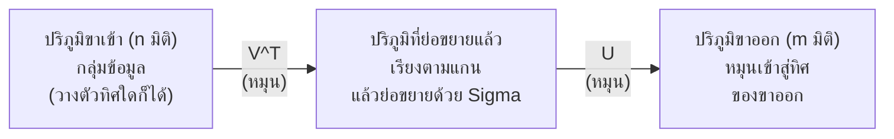
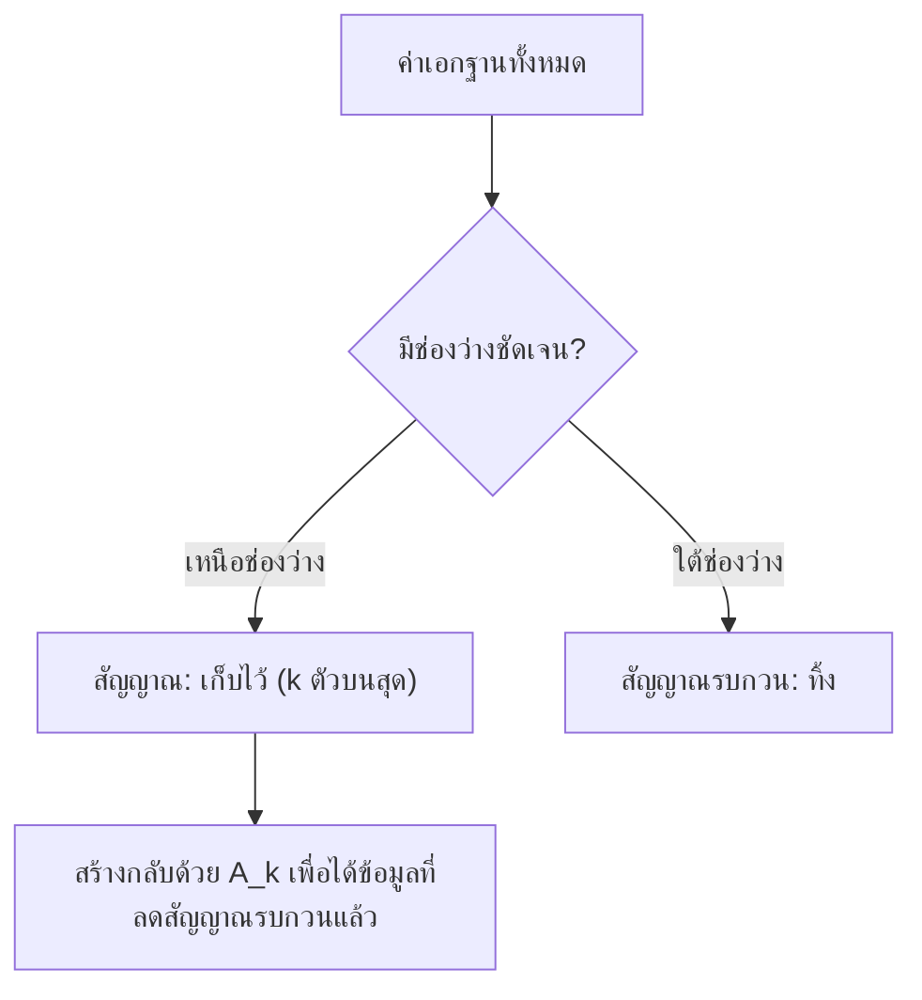

> SVD คือมีดพับสวิสของพีชคณิตเชิงเส้น ทุกเมทริกซ์มี SVD และนักวิทยาศาสตร์ข้อมูลทุกคนต้องใช้มัน

**ประเภท:** ลงมือสร้าง (Build)
**ภาษา:** Python, Julia
**ความรู้ที่ควรมีก่อน:** Phase 1 บทที่ 01 (พีชคณิตเชิงเส้นแบบเข้าใจภาพ), 02 (เวกเตอร์ เมทริกซ์ และการดำเนินการ), 03 (การแปลงด้วยเมทริกซ์)
**เวลา:** ~120 นาที

## สิ่งที่จะได้เรียนรู้

- เขียน SVD ด้วย power iteration และอธิบายความหมายเชิงเรขาคณิตของ $U$, $\Sigma$ และ $V^T$
- ใช้ truncated SVD บีบอัดภาพ และวัดอัตราการบีบอัดเทียบกับความคลาดเคลื่อนจากการสร้างกลับ
- คำนวณเมทริกซ์ผกผันเทียม (pseudoinverse) แบบ Moore-Penrose ด้วย SVD เพื่อแก้ระบบกำลังสองน้อยที่สุดที่มีสมการมากกว่าตัวแปร
- เชื่อมโยง SVD กับ PCA ระบบแนะนำ (ปัจจัยแฝง) และ Latent Semantic Analysis ใน NLP

## ปัญหา

คุณมีเมทริกซ์ขนาด 1000x2000 อาจเป็นคะแนนที่ผู้ใช้ให้ภาพยนตร์ อาจเป็นตารางความถี่ของคำในเอกสาร อาจเป็นค่าพิกเซลของภาพ คุณต้องบีบอัดมัน ลดสัญญาณรบกวน หาโครงสร้างที่ซ่อนอยู่ หรือแก้ระบบกำลังสองน้อยที่สุดด้วยมัน การแยกค่าลักษณะเฉพาะใช้ได้กับเมทริกซ์จัตุรัสเท่านั้น และถึงจะจัตุรัสก็ยังต้องมีเวกเตอร์ลักษณะเฉพาะที่เป็นอิสระเชิงเส้นครบชุด

SVD ใช้ได้กับทุกเมทริกซ์ ทุกรูปร่าง ทุกแรงก์ ไม่มีเงื่อนไข มันแยกเมทริกซ์ออกเป็นสามตัวประกอบที่เผยให้เห็นเรขาคณิตของสิ่งที่เมทริกซ์ทำกับปริภูมิ มันคือการแยกตัวประกอบที่ทั่วไปที่สุดและมีประโยชน์ที่สุดในพีชคณิตเชิงเส้นทั้งหมด

## แนวคิด

### SVD ทำอะไรในเชิงเรขาคณิต

ทุกเมทริกซ์ ไม่ว่ารูปร่างแบบไหน ทำสามอย่างตามลำดับ: หมุน ย่อขยาย หมุน SVD ทำให้การแยกนี้ชัดเจน

```math
\underset{\substack{m \times n \\ \text{(any)}}}{A} = \underset{\substack{m \times m \\ \text{(rotate)}}}{U} \cdot \underset{\substack{m \times n \\ \text{(scale)}}}{\Sigma} \cdot \underset{\substack{n \times n \\ \text{(rotate)}}}{V^T}
```

(A เป็นเมทริกซ์รูปร่างใดก็ได้ U และ $V^T$ หมุน ส่วน $\Sigma$ ย่อขยาย)

เมื่อได้เมทริกซ์ $A$ ใด ๆ SVD แยกมันเป็น:
- $V^T$ หมุนเวกเตอร์ในปริภูมิขาเข้า ($n$ มิติ)
- $\Sigma$ ย่อขยายตามแต่ละแกน (ยืดหรือหด)
- $U$ หมุนผลลัพธ์เข้าสู่ปริภูมิขาออก ($m$ มิติ)



ลองคิดแบบนี้ คุณยื่นเมทริกซ์ให้ SVD มันจะบอกว่า "เมทริกซ์นี้รับทรงกลมของขาเข้า หมุนด้วย $V^T$ ก่อน แล้วยืดเป็นทรงรีด้วย $\Sigma$ จากนั้นหมุนทรงรีด้วย $U$" ค่าเอกฐาน (singular value) คือความยาวของแกนทรงรี

### การแยกแบบเต็ม

สำหรับเมทริกซ์ $A$ ที่มีขนาด $m \times n$:

```math
\begin{aligned}
& A = U \cdot \Sigma \cdot V^T \\[6pt]
& \text{where:} \\
& \quad U \text{ is } m \times m, \text{ orthogonal } (U^T U = I) \\
& \quad \Sigma \text{ is } m \times n, \text{ diagonal (singular values on the diagonal)} \\
& \quad V \text{ is } n \times n, \text{ orthogonal } (V^T V = I) \\[6pt]
& \text{The singular values } \sigma_1 \ge \sigma_2 \ge \cdots \ge \sigma_r > 0 \\
& \text{where } r = \mathop{\mathrm{rank}}(A)
\end{aligned}
```

($U$ ขนาด $m \times m$ และ $V$ ขนาด $n \times n$ เป็นเมทริกซ์เชิงตั้งฉาก $\Sigma$ ขนาด $m \times n$ เป็นเมทริกซ์ทแยงมุมที่มีค่าเอกฐานอยู่บนเส้นทแยงมุม เรียงจากมากไปน้อย และ $r$ คือแรงก์ของ $A$)

คอลัมน์ของ $U$ เรียกว่าเวกเตอร์เอกฐานซ้าย (left singular vectors) คอลัมน์ของ $V$ เรียกว่าเวกเตอร์เอกฐานขวา (right singular vectors) ช่องบนเส้นทแยงมุมของ $\Sigma$ เรียกว่าค่าเอกฐาน (singular values) ค่าเหล่านี้ไม่ติดลบเสมอ และตามธรรมเนียมจะเรียงจากมากไปน้อย

### เวกเตอร์เอกฐานซ้าย ค่าเอกฐาน และเวกเตอร์เอกฐานขวา

แต่ละส่วนของ SVD มีความหมายเชิงเรขาคณิตต่างกัน

**เวกเตอร์เอกฐานขวา (คอลัมน์ของ $V$):** เป็นฐานหลักเชิงตั้งฉากปกติของปริภูมิขาเข้า ($\mathbb{R}^n$) เป็นทิศในปริภูมิขาเข้าที่เมทริกซ์ส่งไปเป็นทิศที่ตั้งฉากกันในปริภูมิขาออก มองว่ามันเป็นระบบพิกัดตามธรรมชาติของโดเมน

**ค่าเอกฐาน (เส้นทแยงมุมของ $\Sigma$):** เป็นตัวคูณย่อขยาย ค่าเอกฐานตัวที่ i บอกว่าเมทริกซ์ยืดเวกเตอร์ตามเวกเตอร์เอกฐานขวาตัวที่ i ไปเท่าไร ค่าเอกฐานที่เป็นศูนย์แปลว่าเมทริกซ์บดขยี้ทิศนั้นทิ้งไปทั้งหมด

**เวกเตอร์เอกฐานซ้าย (คอลัมน์ของ $U$):** เป็นฐานหลักเชิงตั้งฉากปกติของปริภูมิขาออก ($\mathbb{R}^m$) เวกเตอร์เอกฐานซ้ายตัวที่ i คือทิศในปริภูมิขาออกที่เวกเตอร์เอกฐานขวาตัวที่ i ไปตกหลังถูกย่อขยาย

ความสัมพันธ์ระหว่างกัน:

```
A * v_i = sigma_i * u_i

เมทริกซ์ A รับเวกเตอร์เอกฐานขวาตัวที่ i คือ v_i
ย่อขยายด้วย sigma_i แล้วส่งไปเป็นเวกเตอร์เอกฐานซ้ายตัวที่ i คือ u_i
```

สิ่งนี้ให้ภาพทีละพิกัดว่าเมทริกซ์ใด ๆ ทำอะไร

### รูปผลคูณภายนอก (Outer Product Form)

SVD เขียนเป็นผลรวมของเมทริกซ์แรงก์ 1 ได้:

```
A = sigma_1 * u_1 * v_1^T + sigma_2 * u_2 * v_2^T + ... + sigma_r * u_r * v_r^T

แต่ละพจน์ sigma_i * u_i * v_i^T เป็นเมทริกซ์แรงก์ 1 (ผลคูณภายนอก)
เมทริกซ์เต็มคือผลรวมของเมทริกซ์แบบนี้ r ตัว โดย r คือแรงก์
```

รูปนี้คือรากฐานของการประมาณแรงก์ต่ำ แต่ละพจน์เพิ่มโครงสร้างหนึ่งชั้น พจน์แรกจับรูปแบบที่สำคัญที่สุดเพียงรูปแบบเดียว พจน์ที่สองจับรูปแบบที่สำคัญรองลงมา และต่อไปเรื่อย ๆ การตัดผลรวมนี้ให้การประมาณที่ดีที่สุดเท่าที่เป็นไปได้ที่แรงก์ใดก็ตาม

```math
\begin{aligned}
\text{Rank-1 approx:} \quad & A_1 = \sigma_1 u_1 v_1^T \\
& \text{(captures the dominant pattern)} \\[6pt]
\text{Rank-2 approx:} \quad & A_2 = \sigma_1 u_1 v_1^T + \sigma_2 u_2 v_2^T \\
& \text{(captures the two most important patterns)} \\[6pt]
\text{Rank-}k\text{ approx:} \quad & A_k = \text{sum of top } k \text{ terms} \\
& \text{(optimal by the Eckart-Young theorem)}
\end{aligned}
```

(การประมาณแรงก์ 1 จับรูปแบบหลัก แรงก์ 2 จับสองรูปแบบที่สำคัญที่สุด และแรงก์ $k$ คือผลรวมของ $k$ พจน์บนสุด ซึ่งดีที่สุดตามทฤษฎีบทของ Eckart-Young)

### ความสัมพันธ์กับการแยกค่าลักษณะเฉพาะ

SVD กับการแยกค่าลักษณะเฉพาะเชื่อมโยงกันอย่างลึกซึ้ง ค่าเอกฐานและเวกเตอร์เอกฐานของ $A$ มาจากค่าลักษณะเฉพาะและเวกเตอร์ลักษณะเฉพาะของ $A^T A$ และ $A A^T$ โดยตรง

```
A^T A = V * Sigma^T * U^T * U * Sigma * V^T
      = V * Sigma^T * Sigma * V^T
      = V * D * V^T

โดย D = Sigma^T * Sigma เป็นเมทริกซ์ทแยงมุมที่มี sigma_i^2 บนเส้นทแยงมุม

ดังนั้น:
- เวกเตอร์เอกฐานขวา (V) คือเวกเตอร์ลักษณะเฉพาะของ A^T A
- ค่าเอกฐานยกกำลังสอง (sigma_i^2) คือค่าลักษณะเฉพาะของ A^T A

ในทำนองเดียวกัน:
A A^T = U * Sigma * V^T * V * Sigma^T * U^T
      = U * Sigma * Sigma^T * U^T

ดังนั้น:
- เวกเตอร์เอกฐานซ้าย (U) คือเวกเตอร์ลักษณะเฉพาะของ A A^T
- ค่าลักษณะเฉพาะของ A A^T ก็คือ sigma_i^2 เช่นกัน
```

ความเชื่อมโยงนี้บอกสามอย่าง:
1. ค่าเอกฐานเป็นจำนวนจริงที่ไม่ติดลบเสมอ (เป็นรากที่สองของค่าลักษณะเฉพาะของเมทริกซ์กึ่งบวกแน่นอน)
2. คุณคำนวณ SVD ผ่านการแยกค่าลักษณะเฉพาะของ $A^T A$ ได้ แต่วิธีนี้ยกกำลังสองให้ condition number และเสียความแม่นยำเชิงตัวเลข อัลกอริทึม SVD โดยเฉพาะหลีกเลี่ยงปัญหานี้
3. เมื่อ $A$ เป็นเมทริกซ์จัตุรัส สมมาตร และกึ่งบวกแน่นอน SVD กับการแยกค่าลักษณะเฉพาะคือสิ่งเดียวกัน

### Truncated SVD: การประมาณแรงก์ต่ำ

ทฤษฎีบทของ Eckart-Young-Mirsky กล่าวว่าการประมาณ $A$ ที่ดีที่สุดที่แรงก์ $k$ (ทั้งใน Frobenius norm และ spectral norm) ได้จากการเก็บแค่ค่าเอกฐาน $k$ ตัวบนสุดกับเวกเตอร์ที่คู่กัน:

```math
\begin{aligned}
& A_k = U_k \cdot \Sigma_k \cdot V_k^T \\[6pt]
& \text{where:} \\
& \quad U_k \text{ is } m \times k \quad \text{(first } k \text{ columns of } U\text{)} \\
& \quad \Sigma_k \text{ is } k \times k \quad \text{(top-left } k \times k \text{ block of } \Sigma\text{)} \\
& \quad V_k \text{ is } n \times k \quad \text{(first } k \text{ columns of } V\text{)} \\[6pt]
& \text{Approximation error} = \sigma_{k+1} \quad \text{(in spectral norm)} \\
& \text{Approximation error} = \sqrt{\sigma_{k+1}^2 + \cdots + \sigma_r^2} \quad \text{(in Frobenius norm)}
\end{aligned}
```

($U_k$ และ $V_k$ คือ $k$ คอลัมน์แรกของ $U$ และ $V$ ส่วน $\Sigma_k$ คือบล็อก $k \times k$ มุมบนซ้ายของ $\Sigma$ ความคลาดเคลื่อนใน spectral norm คือ $\sigma_{k+1}$ และใน Frobenius norm คือรากที่สองของผลรวมกำลังสองของค่าเอกฐานที่เหลือ)

นี่ไม่ใช่แค่การประมาณที่ "ดี" มันพิสูจน์ได้ว่าเป็นการประมาณที่ดีที่สุดเท่าที่เป็นไปได้ที่แรงก์ $k$ ไม่มีเมทริกซ์แรงก์ $k$ ตัวไหนที่ใกล้ $A$ มากกว่านี้

| องค์ประกอบ | ขนาดเชิงสัมพัทธ์ | เก็บไว้ในการประมาณแรงก์ 3? |
|-----------|-------------------|------------------------|
| $\sigma_1$ | ใหญ่ที่สุด | เก็บ |
| $\sigma_2$ | ใหญ่ | เก็บ |
| $\sigma_3$ | ค่อนข้างใหญ่ | เก็บ |
| $\sigma_4$ | ปานกลาง | ไม่เก็บ (เป็นความคลาดเคลื่อน) |
| $\sigma_5$ | ค่อนข้างเล็ก | ไม่เก็บ (เป็นความคลาดเคลื่อน) |
| $\sigma_6$ | เล็ก | ไม่เก็บ (เป็นความคลาดเคลื่อน) |
| $\sigma_7$ | เล็กมาก | ไม่เก็บ (เป็นความคลาดเคลื่อน) |
| $\sigma_8$ | จิ๋ว | ไม่เก็บ (เป็นความคลาดเคลื่อน) |

เก็บ 3 ตัวบนสุด: $A_3$ จับค่าเอกฐานที่ใหญ่ที่สุดสามตัว ความคลาดเคลื่อน = ค่าที่เหลือ ($\sigma_4$ ถึง $\sigma_8$)

ถ้าค่าเอกฐานลดลงเร็ว $k$ เล็ก ๆ ก็จับเมทริกซ์ได้เกือบทั้งหมด ถ้าลดลงช้า เมทริกซ์นั้นไม่มีโครงสร้างแรงก์ต่ำ

### บีบอัดภาพด้วย SVD

ภาพขาวดำคือเมทริกซ์ของความเข้มพิกเซล ภาพขนาด 800x600 มี 480,000 ค่า SVD ทำให้คุณประมาณมันด้วยค่าที่น้อยกว่ามาก

```
ภาพต้นฉบับ: 800 x 600 = 480,000 ค่า

SVD ที่แรงก์ k:
  U_k:      800 x k ค่า
  Sigma_k:  k ค่า
  V_k:      600 x k ค่า
  รวม:      k * (800 + 600 + 1) = k * 1401 ค่า

  k=10:   14,010 ค่า   (2.9% ของต้นฉบับ)
  k=50:   70,050 ค่า  (14.6% ของต้นฉบับ)
  k=100: 140,100 ค่า  (29.2% ของต้นฉบับ)

  อัตราการบีบอัดดีขึ้นเมื่อ k เล็กลง
  แต่คุณภาพของภาพลดลง
```

ใจความสำคัญ: ภาพธรรมชาติมีค่าเอกฐานที่ลดลงอย่างรวดเร็ว ค่าเอกฐานไม่กี่ตัวแรกจับโครงสร้างกว้าง ๆ (รูปทรง การไล่ระดับสี) ตัวหลัง ๆ จับรายละเอียดเล็ก ๆ และสัญญาณรบกวน การตัดที่แรงก์ 50 มักได้ภาพที่ดูแทบเหมือนต้นฉบับ แต่ใช้พื้นที่เก็บน้อยลง 85%

### SVD สำหรับระบบแนะนำ

Netflix Prize ทำให้เรื่องนี้โด่งดัง คุณมีเมทริกซ์คะแนนผู้ใช้-ภาพยนตร์ที่ช่องส่วนใหญ่ว่างอยู่

```
             Movie1  Movie2  Movie3  Movie4  Movie5
  User1      [  5      ?       3       ?       1  ]
  User2      [  ?      4       ?       2       ?  ]
  User3      [  3      ?       5       ?       ?  ]
  User4      [  ?      ?       ?       4       3  ]

  ? = คะแนนที่ไม่รู้
```

แนวคิด: เมทริกซ์คะแนนนี้มีแรงก์ต่ำ ผู้ใช้ไม่ได้มีรสนิยมที่เป็นอิสระต่อกันโดยสิ้นเชิง มีปัจจัยแฝง (latent factor) อยู่ไม่กี่ตัว (แอ็กชันกับดราม่า เก่ากับใหม่ ใช้สมองกับเร้าอารมณ์) ที่อธิบายความชอบได้เกือบทั้งหมด

SVD บนเมทริกซ์คะแนน (ที่เติมช่องว่างแล้ว) แยกมันเป็น:
- $U$: โปรไฟล์ผู้ใช้ในปริภูมิปัจจัยแฝง
- $\Sigma$: ความสำคัญของปัจจัยแฝงแต่ละตัว
- $V^T$: โปรไฟล์ภาพยนตร์ในปริภูมิปัจจัยแฝง

คะแนนที่ทำนายว่าผู้ใช้จะให้ภาพยนตร์หนึ่งคือ dot product ระหว่างโปรไฟล์ผู้ใช้กับโปรไฟล์ภาพยนตร์ (ถ่วงน้ำหนักด้วยค่าเอกฐาน) การประมาณแรงก์ต่ำเติมช่องที่หายไปให้

ในทางปฏิบัติ คุณใช้รูปแบบอื่นอย่าง incremental SVD ของ Simon Funk หรือ ALS (alternating least squares) ที่จัดการข้อมูลที่หายไปได้โดยตรง แต่แนวคิดหลักยังเหมือนเดิม: แยกปัจจัยแฝงด้วย SVD

### SVD ใน NLP: Latent Semantic Analysis

Latent Semantic Analysis (LSA) หรือ Latent Semantic Indexing (LSI) ใช้ SVD กับเมทริกซ์คำ-เอกสาร (term-document matrix)

```
             Doc1   Doc2   Doc3   Doc4
  "cat"      [  3      0      1      0  ]
  "dog"      [  2      0      0      1  ]
  "fish"     [  0      4      1      0  ]
  "pet"      [  1      1      1      1  ]
  "ocean"    [  0      3      0      0  ]

หลังทำ SVD ที่แรงก์ k=2:

  เอกสารแต่ละฉบับกลายเป็นจุดใน "ปริภูมิแนวคิด" 2 มิติ
  คำแต่ละคำกลายเป็นจุดในปริภูมิ 2 มิติเดียวกัน
  เอกสารที่หัวข้อคล้ายกันจับกลุ่มกัน
  คำที่ความหมายคล้ายกันจับกลุ่มกัน

  "cat" กับ "dog" ไปอยู่ใกล้กัน (สัตว์เลี้ยงบนบก)
  "fish" กับ "ocean" ไปอยู่ใกล้กัน (แนวคิดเรื่องน้ำ)
  Doc1 กับ Doc3 จับกลุ่มกันถ้ามีหัวข้อคล้ายกัน
```

LSA เป็นหนึ่งในวิธีแรก ๆ ที่จับความคล้ายเชิงความหมายจากข้อความดิบได้สำเร็จ มันได้ผลเพราะคำที่มีความหมายเหมือนกันมักปรากฏในเอกสารที่คล้ายกัน SVD จึงจัดมันไว้ในมิติแฝงเดียวกัน word embedding สมัยใหม่ (Word2Vec, GloVe) มองได้ว่าเป็นลูกหลานของแนวคิดนี้

### SVD สำหรับลดสัญญาณรบกวน

ข้อมูลที่มีสัญญาณรบกวนมีสัญญาณจริงกระจุกอยู่ในค่าเอกฐานตัวบน ๆ และสัญญาณรบกวนกระจายไปทุกค่าเอกฐาน การตัดทิ้งช่วยกำจัดพื้นของสัญญาณรบกวน

**ค่าเอกฐานของสัญญาณที่สะอาด:**

| องค์ประกอบ | ขนาด | ประเภท |
|-----------|-----------|------|
| $\sigma_1$ | ใหญ่มาก | สัญญาณ |
| $\sigma_2$ | ใหญ่ | สัญญาณ |
| $\sigma_3$ | ปานกลาง | สัญญาณ |
| $\sigma_4$ | เกือบศูนย์ | ไม่มีนัยสำคัญ |
| $\sigma_5$ | เกือบศูนย์ | ไม่มีนัยสำคัญ |

**ค่าเอกฐานของสัญญาณที่มีสัญญาณรบกวน (สัญญาณรบกวนเพิ่มให้ทุกตัว):**

| องค์ประกอบ | ขนาด | ประเภท |
|-----------|-----------|------|
| $\sigma_1$ | ใหญ่มาก | สัญญาณ |
| $\sigma_2$ | ใหญ่ | สัญญาณ |
| $\sigma_3$ | ปานกลาง | สัญญาณ |
| $\sigma_4$ | เล็ก | สัญญาณรบกวน |
| $\sigma_5$ | เล็ก | สัญญาณรบกวน |
| $\sigma_6$ | เล็ก | สัญญาณรบกวน |
| $\sigma_7$ | เล็ก | สัญญาณรบกวน |



เทคนิคนี้ใช้ในการประมวลผลสัญญาณ การวัดทางวิทยาศาสตร์ และการทำความสะอาดข้อมูล เมื่อใดก็ตามที่มีเมทริกซ์ที่ปนสัญญาณรบกวนแบบบวก truncated SVD คือวิธีที่มีหลักการในการแยกสัญญาณออกจากสัญญาณรบกวน

### เมทริกซ์ผกผันเทียมผ่าน SVD

เมทริกซ์ผกผันเทียม (pseudoinverse) แบบ Moore-Penrose $A^+$ ขยายการหาเมทริกซ์ผกผันไปสู่เมทริกซ์ที่ไม่จัตุรัสและเมทริกซ์เอกฐาน SVD ทำให้การคำนวณง่ายมาก

```
ถ้า A = U * Sigma * V^T แล้ว:

A+ = V * Sigma+ * U^T

โดย Sigma+ สร้างจาก:
  1. Transpose Sigma (สลับแถวกับคอลัมน์)
  2. แทนช่องบนเส้นทแยงมุมที่ไม่เป็นศูนย์ sigma_i ด้วย 1/sigma_i
  3. ช่องที่เป็นศูนย์ปล่อยเป็นศูนย์

สำหรับ A (m x n):      A+ มีขนาด (n x m)
สำหรับ Sigma (m x n):  Sigma+ มีขนาด (n x m)
```

เมทริกซ์ผกผันเทียมใช้แก้ปัญหากำลังสองน้อยที่สุด ถ้า $Ax = b$ ไม่มีคำตอบที่ตรงพอดี (ระบบที่มีสมการมากกว่าตัวแปร) แล้ว $x = A^+ b$ คือคำตอบแบบกำลังสองน้อยที่สุด (ทำให้ $\lVert Ax - b \rVert$ น้อยที่สุด)

```
ระบบที่มีสมการมากกว่าตัวแปร:

  [1  1]         [3]
  [2  1] x   =   [5]       ไม่มีคำตอบที่ตรงพอดี
  [3  1]         [6]

  x_ls = A+ b = V * Sigma+ * U^T * b

  ได้ x ที่ทำให้ผลรวมกำลังสองของเศษเหลือน้อยที่สุด
  ผลเหมือนสมการปกติ (A^T A)^(-1) A^T b
  แต่เสถียรเชิงตัวเลขกว่า
```

### ข้อได้เปรียบด้านเสถียรภาพเชิงตัวเลข

การแยกค่าลักษณะเฉพาะของ $A^T A$ ยกกำลังสองให้ค่าเอกฐาน (ค่าลักษณะเฉพาะของ $A^T A$ คือ $\sigma_i^2$) ซึ่งยกกำลังสองให้ condition number และขยายความคลาดเคลื่อนเชิงตัวเลข

```
ตัวอย่าง:
  A มีค่าเอกฐาน [1000, 1, 0.001]
  Condition number ของ A: 1000 / 0.001 = 10^6

  A^T A มีค่าลักษณะเฉพาะ [10^6, 1, 10^{-6}]
  Condition number ของ A^T A: 10^6 / 10^{-6} = 10^{12}

  คำนวณ SVD โดยตรง: ทำงานกับ condition number 10^6
  คำนวณผ่าน A^T A:   ทำงานกับ condition number 10^{12}
                     (เสียความแม่นยำไปอีก 6 หลัก)
```

อัลกอริทึม SVD สมัยใหม่ (Golub-Kahan bidiagonalization) ทำงานกับ $A$ โดยตรง ไม่เคยสร้าง $A^T A$ นี่คือเหตุผลที่คุณควรเลือก `np.linalg.svd(A)` มากกว่า `np.linalg.eig(A.T @ A)` เสมอ

### ความเชื่อมโยงกับ PCA

PCA ก็คือ SVD บนข้อมูลที่จัดกึ่งกลางแล้ว นี่ไม่ใช่การเปรียบเทียบ มันคือการคำนวณเดียวกันจริง ๆ

```
เมื่อมีเมทริกซ์ข้อมูล X (n_samples x n_features) ที่จัดกึ่งกลางแล้ว (ลบค่าเฉลี่ยออก):

เมทริกซ์ความแปรปรวนร่วม: C = (1/(n-1)) * X^T X

PCA หาเวกเตอร์ลักษณะเฉพาะของ C แต่:

  X = U * Sigma * V^T    (SVD ของ X)

  X^T X = V * Sigma^2 * V^T

  C = (1/(n-1)) * V * Sigma^2 * V^T

ดังนั้นองค์ประกอบหลักก็คือเวกเตอร์เอกฐานขวา V พอดี
ความแปรปรวนที่อธิบายได้ขององค์ประกอบแต่ละตัวคือ sigma_i^2 / (n-1)

ใน sklearn PCA สร้างด้วย SVD ไม่ใช่การแยกค่าลักษณะเฉพาะ
เพราะเร็วกว่าและเสถียรเชิงตัวเลขกว่า
```

แปลว่าทุกอย่างที่คุณเรียนเรื่องการลดมิติในบทที่ 10 คือ SVD ที่อยู่เบื้องหลัง PCA คือการประยุกต์ใช้ SVD ที่พบบ่อยที่สุดใน machine learning

```figure
svd-rank-reconstruction
```

## ลงมือสร้าง (Build It)

### ขั้นที่ 1: SVD ตั้งแต่ศูนย์ด้วย power iteration

แนวคิด: หาค่าเอกฐานที่ใหญ่ที่สุดและเวกเตอร์ของมันด้วย power iteration บน $A^T A$ (หรือ $A A^T$) แล้ว deflate เมทริกซ์ และทำซ้ำสำหรับค่าเอกฐานตัวถัดไป

```python
import numpy as np

def power_iteration(M, num_iters=100):
    n = M.shape[1]
    v = np.random.randn(n)
    v = v / np.linalg.norm(v)

    for _ in range(num_iters):
        Mv = M @ v
        v = Mv / np.linalg.norm(Mv)

    eigenvalue = v @ M @ v
    return eigenvalue, v

def svd_from_scratch(A, k=None):
    m, n = A.shape
    if k is None:
        k = min(m, n)

    sigmas = []
    us = []
    vs = []

    A_residual = A.copy().astype(float)

    for _ in range(k):
        AtA = A_residual.T @ A_residual
        eigenvalue, v = power_iteration(AtA, num_iters=200)

        if eigenvalue < 1e-10:
            break

        sigma = np.sqrt(eigenvalue)
        u = A_residual @ v / sigma

        sigmas.append(sigma)
        us.append(u)
        vs.append(v)

        A_residual = A_residual - sigma * np.outer(u, v)

    U = np.column_stack(us) if us else np.empty((m, 0))
    S = np.array(sigmas)
    V = np.column_stack(vs) if vs else np.empty((n, 0))

    return U, S, V
```

### ขั้นที่ 2: ทดสอบและเทียบกับ NumPy

```python
np.random.seed(42)
A = np.random.randn(5, 4)

U_ours, S_ours, V_ours = svd_from_scratch(A)
U_np, S_np, Vt_np = np.linalg.svd(A, full_matrices=False)

print("Our singular values:", np.round(S_ours, 4))
print("NumPy singular values:", np.round(S_np, 4))

A_reconstructed = U_ours @ np.diag(S_ours) @ V_ours.T
print(f"Reconstruction error: {np.linalg.norm(A - A_reconstructed):.8f}")
```

### ขั้นที่ 3: เดโมการบีบอัดภาพ

```python
def compress_image_svd(image_matrix, k):
    U, S, Vt = np.linalg.svd(image_matrix, full_matrices=False)
    compressed = U[:, :k] @ np.diag(S[:k]) @ Vt[:k, :]
    return compressed

image = np.random.seed(42)
rows, cols = 200, 300
image = np.random.randn(rows, cols)

for k in [1, 5, 10, 20, 50]:
    compressed = compress_image_svd(image, k)
    error = np.linalg.norm(image - compressed) / np.linalg.norm(image)
    original_size = rows * cols
    compressed_size = k * (rows + cols + 1)
    ratio = compressed_size / original_size
    print(f"k={k:>3d}  error={error:.4f}  storage={ratio:.1%}")
```

### ขั้นที่ 4: ลดสัญญาณรบกวน

```python
np.random.seed(42)
clean = np.outer(np.sin(np.linspace(0, 4*np.pi, 100)),
                 np.cos(np.linspace(0, 2*np.pi, 80)))
noise = 0.3 * np.random.randn(100, 80)
noisy = clean + noise

U, S, Vt = np.linalg.svd(noisy, full_matrices=False)
denoised = U[:, :5] @ np.diag(S[:5]) @ Vt[:5, :]

print(f"Noisy error:    {np.linalg.norm(noisy - clean):.4f}")
print(f"Denoised error: {np.linalg.norm(denoised - clean):.4f}")
print(f"Improvement:    {(1 - np.linalg.norm(denoised - clean) / np.linalg.norm(noisy - clean)):.1%}")
```

### ขั้นที่ 5: เมทริกซ์ผกผันเทียม

```python
A = np.array([[1, 1], [2, 1], [3, 1]], dtype=float)
b = np.array([3, 5, 6], dtype=float)

U, S, Vt = np.linalg.svd(A, full_matrices=False)
S_inv = np.diag(1.0 / S)
A_pinv = Vt.T @ S_inv @ U.T

x_svd = A_pinv @ b
x_lstsq = np.linalg.lstsq(A, b, rcond=None)[0]
x_pinv = np.linalg.pinv(A) @ b

print(f"SVD pseudoinverse solution:  {x_svd}")
print(f"np.linalg.lstsq solution:   {x_lstsq}")
print(f"np.linalg.pinv solution:    {x_pinv}")
```

## นำไปใช้ (Use It)

เดโมที่ใช้งานได้เต็มรูปแบบอยู่ใน `code/svd.py` รันเพื่อดู SVD ในการบีบอัดภาพ ระบบแนะนำ latent semantic analysis และการลดสัญญาณรบกวน

```bash
python svd.py
```

เวอร์ชัน Julia ใน `code/svd.jl` แสดงแนวคิดเดียวกันด้วยฟังก์ชัน `svd()` ของ Julia และแพ็กเกจ `LinearAlgebra`

```bash
julia svd.jl
```

## ส่งมอบ (Ship It)

บทนี้สร้าง:
- `outputs/skill-svd.md` - skill สำหรับรู้ว่าเมื่อไรและอย่างไรที่ควรใช้ SVD ในโปรเจกต์จริง

## แบบฝึกหัด

1. เขียน SVD เต็มรูปแบบตั้งแต่ศูนย์โดยไม่ใช้ power iteration แต่ใช้การแยกค่าลักษณะเฉพาะของ $A^T A$ เพื่อหา $V$ และค่าเอกฐาน แล้วคำนวณ $U = A V \Sigma^{-1}$ เทียบความแม่นยำเชิงตัวเลขกับเวอร์ชัน power iteration ของคุณและกับ NumPy

2. โหลดภาพขาวดำจริง (หรือแปลงภาพเป็นขาวดำ) บีบอัดที่แรงก์ 1, 5, 10, 25, 50, 100 สำหรับแต่ละแรงก์ คำนวณอัตราการบีบอัดและความคลาดเคลื่อนสัมพัทธ์ หาแรงก์ที่ภาพเริ่มดูยอมรับได้

3. สร้างระบบแนะนำเล็ก ๆ สร้างเมทริกซ์คะแนนผู้ใช้-ภาพยนตร์ขนาด 10x8 ที่รู้คะแนนบางช่อง เติมช่องว่างด้วยค่าเฉลี่ยของแถว คำนวณ SVD แล้วสร้างการประมาณแรงก์ 3 ใช้เมทริกซ์ที่สร้างกลับมาทำนายคะแนนที่หายไป ตรวจว่าคำทำนายสมเหตุสมผล

4. สร้างเมทริกซ์เอกสาร-คำขนาด 100x50 ที่มีหัวข้อสังเคราะห์ 3 หัวข้อ แต่ละหัวข้อมีคำที่เกี่ยวข้อง 5 คำ เพิ่มสัญญาณรบกวน ใช้ SVD แล้วตรวจว่าค่าเอกฐาน 3 ตัวบนสุดใหญ่กว่าที่เหลือมาก ฉายเอกสารลงในปริภูมิแฝง 3 มิติ แล้วตรวจว่าเอกสารจากหัวข้อเดียวกันจับกลุ่มกัน

5. สร้างเมทริกซ์แรงก์ต่ำที่สะอาด (แรงก์ 3 ขนาด 50x40) แล้วเพิ่มสัญญาณรบกวนแบบเกาส์ที่ระดับต่าง ๆ ($\sigma$ = 0.1, 0.5, 1.0, 2.0) สำหรับแต่ละระดับ หาแรงก์ที่ตัดได้ดีที่สุดโดยไล่ $k$ จาก 1 ถึง 40 และวัดความคลาดเคลื่อนจากการสร้างกลับเทียบกับเมทริกซ์ที่สะอาด วาดกราฟว่า $k$ ที่ดีที่สุดเปลี่ยนตามระดับสัญญาณรบกวนอย่างไร

### คำใบ้

**แบบฝึกหัดที่ 1** คำนวณ $A^T A$ หาค่าลักษณะเฉพาะและเวกเตอร์ลักษณะเฉพาะด้วย `np.linalg.eigh` แล้วเรียงจากมากไปน้อย ค่าเอกฐานคือรากที่สองของค่าลักษณะเฉพาะ ตรวจว่า $U \Sigma V^T$ สร้าง $A$ กลับได้ และเทียบความคลาดเคลื่อนกับ `svd_from_scratch` และ `np.linalg.svd`

**แบบฝึกหัดที่ 2** เรียก `truncated_svd` สำหรับแต่ละแรงก์ สร้างภาพกลับด้วย `reconstruct` และใช้ `compression_ratio(m, n, k)` หาขนาด ความคลาดเคลื่อนสัมพัทธ์ต้องลดลงเมื่อแรงก์เพิ่มขึ้น และแรงก์แรกที่คุณไม่เห็นบล็อกชัดเจนคือคำตอบ

**แบบฝึกหัดที่ 3** ทำเครื่องหมายช่องที่หายไป เติมด้วยค่าเฉลี่ยของแถว แล้วสร้างการประมาณแรงก์ 3 ด้วย `truncated_svd` และ `reconstruct` จากนั้นวัดผล: นับคำทำนายที่อยู่นอกช่วงคะแนน และพิมพ์การเปลี่ยนแปลงที่มากที่สุดในช่องที่รู้คะแนน การประมาณแรงก์ 3 ไม่ได้รับประกันทั้งสองข้อนี้ ถ้าต้องการคะแนนที่ใช้ได้ ให้ตัด (clip) คำทำนายให้อยู่ในช่วง

**แบบฝึกหัดที่ 4** ให้แต่ละหัวข้อมีบล็อกคำ 5 คำที่นับได้สูงในเอกสารของหัวข้อนั้น แล้วเพิ่มสัญญาณรบกวนเล็กน้อย พิมพ์ค่าเอกฐาน: 3 ตัวแรกต้องใหญ่กว่าตัวที่ 4 มาก จากนั้นระบายสีพิกัด 3 มิติตามหัวข้อ แล้วตรวจว่าแต่ละหัวข้อรวมเป็นกลุ่มเดียว

**แบบฝึกหัดที่ 5** สร้างเมทริกซ์ที่สะอาดจากผลคูณของเมทริกซ์สุ่มขนาด 50x3 กับ 3x40 แล้วเพิ่มสัญญาณรบกวนสำหรับแต่ละ $\sigma$ สำหรับแต่ละ $k$ เทียบการสร้างกลับแรงก์ $k$ กับเมทริกซ์ที่สะอาด คาดว่า $k$ ที่ดีที่สุดจะใกล้ 3 เมื่อสัญญาณรบกวนต่ำ และเล็กลงเมื่อสัญญาณรบกวนสูง

## คำศัพท์สำคัญ

| คำศัพท์ | ที่คนมักพูด | ความหมายจริง |
|------|----------------|----------------------|
| SVD | "แยกตัวประกอบเมทริกซ์ใดก็ได้" | แยก $A$ เป็น $U \Sigma V^T$ โดย $U$ และ $V$ เป็นเมทริกซ์เชิงตั้งฉาก และ $\Sigma$ เป็นเมทริกซ์ทแยงมุมที่ช่องไม่ติดลบ ใช้ได้กับเมทริกซ์ทุกรูปร่าง |
| Singular value (ค่าเอกฐาน) | "องค์ประกอบนี้สำคัญแค่ไหน" | ช่องที่ $i$ บนเส้นทแยงมุมของ $\Sigma$ วัดว่าเมทริกซ์ยืดตามทิศหลักตัวที่ i ไปเท่าไร ไม่ติดลบเสมอ และเรียงจากมากไปน้อย |
| Left singular vector (เวกเตอร์เอกฐานซ้าย) | "ทิศขาออก" | คอลัมน์หนึ่งของ $U$ ทิศในปริภูมิขาออกที่เวกเตอร์เอกฐานขวาตัวที่ $i$ ไปตก (หลังย่อขยายด้วย $\sigma_i$) |
| Right singular vector (เวกเตอร์เอกฐานขวา) | "ทิศขาเข้า" | คอลัมน์หนึ่งของ $V$ ทิศในปริภูมิขาเข้าที่เมทริกซ์ส่งไปเป็นเวกเตอร์เอกฐานซ้ายตัวที่ $i$ (หลังย่อขยายด้วย $\sigma_i$) |
| Truncated SVD | "การประมาณแรงก์ต่ำ" | เก็บแค่ค่าเอกฐาน $k$ ตัวบนสุดกับเวกเตอร์ของมัน ได้การประมาณแรงก์ $k$ ที่พิสูจน์ได้ว่าดีที่สุด (ทฤษฎีบทของ Eckart-Young) |
| Rank (แรงก์) | "มิติที่แท้จริง" | จำนวนค่าเอกฐานที่ไม่เป็นศูนย์ บอกว่าเมทริกซ์ใช้ทิศที่เป็นอิสระต่อกันจริง ๆ กี่ทิศ |
| Pseudoinverse (เมทริกซ์ผกผันเทียม) | "inverse แบบทั่วไป" | $V \Sigma^+ U^T$ กลับค่าเอกฐานที่ไม่เป็นศูนย์ ปล่อยศูนย์เป็นศูนย์ แก้ปัญหากำลังสองน้อยที่สุดสำหรับเมทริกซ์ที่ไม่จัตุรัสหรือเป็นเอกฐาน |
| Condition number | "อ่อนไหวต่อความคลาดเคลื่อนแค่ไหน" | $\sigma_{\max} / \sigma_{\min}$ condition number สูงแปลว่าขาเข้าเปลี่ยนนิดเดียวทำให้ขาออกเปลี่ยนมาก SVD บอกค่านี้ได้ตรง ๆ |
| Latent factor (ปัจจัยแฝง) | "ตัวแปรที่ซ่อนอยู่" | มิติในปริภูมิแรงก์ต่ำที่ SVD ค้นพบ ในระบบแนะนำ ปัจจัยแฝงอาจตรงกับความชอบแนวภาพยนตร์ ใน NLP อาจตรงกับหัวข้อ |
| Frobenius norm | "ขนาดรวมของเมทริกซ์" | รากที่สองของผลรวมกำลังสองของทุกช่อง เท่ากับรากที่สองของผลรวมกำลังสองของค่าเอกฐาน ใช้วัดความคลาดเคลื่อนของการประมาณ |
| Eckart-Young theorem | "SVD บีบอัดได้ดีที่สุด" | สำหรับแรงก์เป้าหมาย $k$ ใด ๆ truncated SVD ให้ความคลาดเคลื่อนของการประมาณน้อยที่สุดเมื่อเทียบกับเมทริกซ์แรงก์ $k$ ทุกตัว |
| Power iteration | "หาเวกเตอร์ลักษณะเฉพาะตัวใหญ่สุด" | คูณเวกเตอร์สุ่มด้วยเมทริกซ์ซ้ำ ๆ แล้วทำให้ยาว 1 จะลู่เข้าสู่เวกเตอร์ลักษณะเฉพาะที่มีค่าลักษณะเฉพาะมากที่สุด เป็นชิ้นส่วนพื้นฐานของอัลกอริทึม SVD หลายแบบ |

## อ่านเพิ่มเติม

- [Gilbert Strang: Linear Algebra and Its Applications, Chapter 7](https://math.mit.edu/~gs/linearalgebra/) - อธิบาย SVD อย่างละเอียดพร้อมการประยุกต์ใช้
- [3Blue1Brown: But what is the SVD?](https://www.youtube.com/watch?v=vSczTbgc8Rc) - สัญชาตญาณเชิงเรขาคณิตของ SVD
- [We Recommend a Singular Value Decomposition](https://www.ams.org/publicoutreach/feature-column/fcarc-svd) - ภาพรวมที่อ่านง่ายจาก American Mathematical Society
- [Netflix Prize and Matrix Factorization](https://sifter.org/~simon/journal/20061211.html) - บล็อกต้นฉบับของ Simon Funk เรื่อง SVD สำหรับระบบแนะนำ
- [Latent Semantic Analysis](https://en.wikipedia.org/wiki/Latent_semantic_analysis) - การประยุกต์ใช้ SVD ใน NLP ยุคแรก
- [Numerical Linear Algebra by Trefethen and Bau](https://people.maths.ox.ac.uk/trefethen/text.html) - ตำรามาตรฐานสำหรับทำความเข้าใจอัลกอริทึม SVD และสมบัติเชิงตัวเลขของมัน
