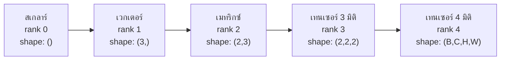
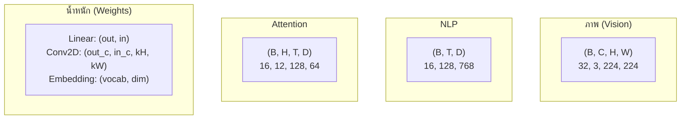
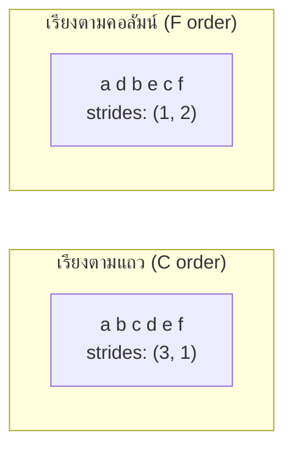
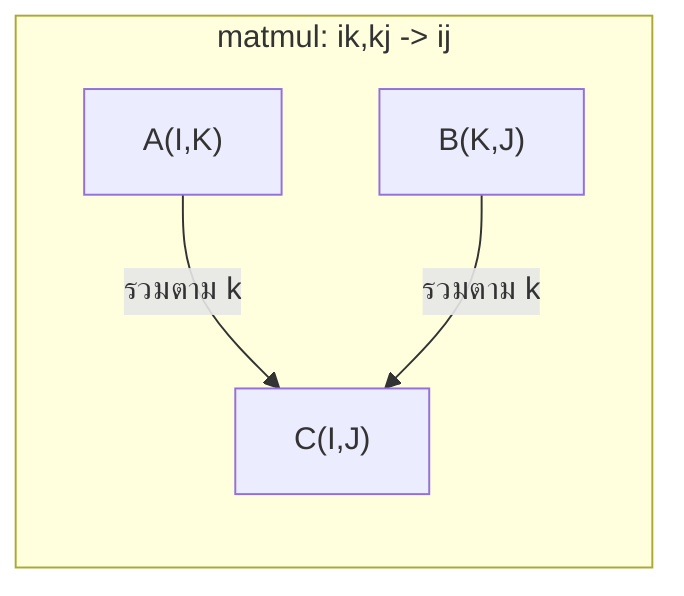

> เทนเซอร์คือภาษากลางระหว่างข้อมูลกับ deep learning ทุกภาพ ทุกประโยค และทุก gradient ไหลผ่านมัน

**ประเภท:** ลงมือสร้าง (Build)
**ภาษา:** Python, TypeScript
**ความรู้ที่ควรมีก่อน:** Phase 1 บทที่ 01 (พีชคณิตเชิงเส้นแบบเข้าใจภาพ), 02 (เวกเตอร์ เมทริกซ์ และการดำเนินการ)
**เวลา:** ~90 นาที

## สิ่งที่จะได้เรียนรู้

- เขียนคลาสเทนเซอร์ที่มี shape, strides, reshape, transpose และการดำเนินการทีละสมาชิกตั้งแต่ศูนย์
- ใช้กฎ broadcasting ดำเนินการกับเทนเซอร์ที่ shape ต่างกันโดยไม่ต้องคัดลอกข้อมูล
- เขียนนิพจน์ einsum สำหรับ dot product การคูณเมทริกซ์ ผลคูณภายนอก และการดำเนินการแบบ batch
- ไล่ shape ของเทนเซอร์ได้แม่นยำทุกขั้นของ multi-head attention

## ปัญหา

คุณสร้าง transformer forward pass ดูเรียบร้อย พอรันกลับได้: `RuntimeError: mat1 and mat2 shapes cannot be multiplied (32x768 and 512x768)` คุณจ้อง shape อยู่นาน ลอง transpose ดู คราวนี้มันบอก `Expected 4D input (got 3D input)` คุณเพิ่ม unsqueeze แล้วอย่างอื่นก็พังต่อ

ความผิดพลาดเรื่อง shape คือบั๊กที่พบบ่อยที่สุดในโค้ด deep learning มันไม่ได้ยากในเชิงแนวคิด (แต่ละการดำเนินการมีสัญญาเรื่อง shape ของมัน) แต่มันทวีคูณเร็วมาก transformer มีการ reshape, transpose และ broadcast หลายสิบครั้งต่อกันเป็นลูกโซ่ แกนผิดแกนเดียว ความผิดพลาดก็ลามต่อ ที่แย่กว่าคือความผิดพลาดเรื่อง shape บางแบบไม่ทำให้เกิด error เลย มันสร้างขยะออกมาอย่างเงียบ ๆ ด้วยการ broadcast ผิดมิติ หรือรวมผิดแกน

เมทริกซ์รับมือความสัมพันธ์แบบเป็นคู่ระหว่างของสองชุด ข้อมูลจริงไม่ได้อยู่แค่สองมิติ ภาพ RGB 32 ภาพขนาด 224x224 หนึ่ง batch คือเทนเซอร์ 4 มิติ: `(32, 3, 224, 224)` self-attention ที่มี 12 หัว (head) ก็เป็น 4 มิติ: `(batch, heads, seq_len, head_dim)` คุณต้องการโครงสร้างข้อมูลที่ขยายไปได้ทุกจำนวนมิติ และมีการดำเนินการที่ประกอบกันได้อย่างเรียบร้อยในทุกมิติ โครงสร้างนั้นคือเทนเซอร์ เมื่อคล่องการดำเนินการของมัน ความผิดพลาดเรื่อง shape ก็ดีบักได้ง่าย ๆ

## แนวคิด

### เทนเซอร์คืออะไร

เทนเซอร์คืออาร์เรย์หลายมิติของตัวเลขที่มีชนิดข้อมูลเดียวกันทั้งหมด จำนวนมิติเรียกว่า **rank** (หรือ **order**) แต่ละมิติคือ **แกน (axis)** และ **shape** คือ tuple ที่บอกขนาดตามแต่ละแกน



จำนวนสมาชิกทั้งหมด = ผลคูณของขนาดทุกแกน shape `(2, 3, 4)` มีสมาชิก $2 \cdot 3 \cdot 4 = 24$ ตัว

### Shape ของเทนเซอร์ใน deep learning

ข้อมูลแต่ละประเภทใช้ shape ของเทนเซอร์ตามธรรมเนียมที่ตกลงกัน



PyTorch ใช้ NCHW (channel มาก่อน) TensorFlow ใช้ NHWC (channel อยู่ท้าย) เป็นค่าตั้งต้น การใช้ layout ไม่ตรงกันทำให้ช้าลงอย่างเงียบ ๆ หรือเกิด error

### การจัดวางในหน่วยความจำ

อาร์เรย์ 2 มิติในหน่วยความจำคือลำดับไบต์ 1 มิติ **strides** บอกว่าต้องข้ามกี่สมาชิกเพื่อเลื่อนไปหนึ่งตำแหน่งตามแต่ละแกน



Transpose ไม่ได้ย้ายข้อมูล มันสลับ strides ทำให้เทนเซอร์ **ไม่ต่อเนื่อง (non-contiguous)** คือสมาชิกของแถวหนึ่งไม่ได้อยู่ติดกันในหน่วยความจำอีกต่อไป

### กฎของ broadcasting

Broadcasting ทำให้คุณดำเนินการกับเทนเซอร์ที่ shape ต่างกันได้โดยไม่ต้องคัดลอกข้อมูล จัด shape ให้ตรงกันจากทางขวา สองมิติเข้ากันได้เมื่อเท่ากันหรือตัวหนึ่งเป็น 1 ตัวที่มีมิติน้อยกว่าจะถูกเติม 1 ทางซ้าย

```
Tensor A:     (8, 1, 6, 1)
Tensor B:        (7, 1, 5)
Padded B:     (1, 7, 1, 5)
Result:       (8, 7, 6, 5)
```

### Einsum: การดำเนินการกับเทนเซอร์แบบครอบจักรวาล

Einstein summation ติดป้ายแต่ละแกนด้วยตัวอักษร แกนที่อยู่ในขาเข้าแต่ไม่อยู่ในขาออกจะถูกรวม (sum) แกนที่อยู่ทั้งสองฝั่งจะถูกเก็บไว้



รูปแบบสำคัญ: `i,i->` (dot product), `i,j->ij` (ผลคูณภายนอก), `ii->` (trace), `ij->ji` (transpose), `bij,bjk->bik` (การคูณเมทริกซ์แบบ batch), `bhtd,bhsd->bhts` (คะแนนของ attention)

```figure
tensor-broadcast
```

## ลงมือสร้าง (Build It)

โค้ดอยู่ใน `code/tensors.py` แต่ละขั้นอ้างถึงโค้ดในไฟล์นั้น เวอร์ชัน TypeScript ใน `code/tensors.ts` พิมพ์ผลลัพธ์เหมือนกัน

```bash
python3 code/tensors.py
npx tsx code/tensors.ts
```

### ขั้นที่ 1: การเก็บเทนเซอร์และ strides

เทนเซอร์เก็บรายการตัวเลขแบบแบนราบพร้อมข้อมูลกำกับเรื่อง shape strides บอกตรรกะการระบุตำแหน่งว่าจะแปลงดัชนีหลายมิติไปเป็นตำแหน่งในรายการแบนราบอย่างไร

```python
class Tensor:
    def __init__(self, data, shape=None):
        if isinstance(data, (list, tuple)):
            self._data, self._shape = self._flatten_nested(data)
        elif isinstance(data, np.ndarray):
            self._data = data.flatten().tolist()
            self._shape = tuple(data.shape)
        else:
            self._data = [data]
            self._shape = ()

        if shape is not None:
            total = reduce(lambda a, b: a * b, shape, 1)
            if total != len(self._data):
                raise ValueError(
                    f"Cannot reshape {len(self._data)} elements into shape {shape}"
                )
            self._shape = tuple(shape)

        self._strides = self._compute_strides(self._shape)

    @staticmethod
    def _compute_strides(shape):
        if len(shape) == 0:
            return ()
        strides = [1] * len(shape)
        for i in range(len(shape) - 2, -1, -1):
            strides[i] = strides[i + 1] * shape[i + 1]
        return tuple(strides)
```

สำหรับ shape `(3, 4)` strides คือ `(4, 1)` คือข้าม 4 สมาชิกเพื่อขึ้นแถวถัดไป และข้าม 1 สมาชิกเพื่อไปคอลัมน์ถัดไป

### ขั้นที่ 2: Reshape, squeeze, unsqueeze

Reshape เปลี่ยน shape โดยไม่เปลี่ยนลำดับของสมาชิก จำนวนสมาชิกทั้งหมดต้องเท่าเดิม ใช้ `-1` กับมิติหนึ่งมิติเพื่อให้คำนวณขนาดเอง

```python
t = Tensor(list(range(12)), shape=(2, 6))
r = t.reshape((3, 4))
r = t.reshape((-1, 3))
```

Squeeze ลบแกนที่มีขนาด 1 ออก unsqueeze แทรกแกนขนาด 1 เข้าไป unsqueeze สำคัญมากกับ broadcasting: เวกเตอร์ bias `(D,)` ที่จะบวกกับ batch `(B, T, D)` ต้อง unsqueeze เป็น `(1, 1, D)`

```python
t = Tensor(list(range(6)), shape=(1, 3, 1, 2))
s = t.squeeze()
v = Tensor([1, 2, 3])
u = v.unsqueeze(0)
```

### ขั้นที่ 3: Transpose และ permute

Transpose สลับสองแกน permute จัดเรียงแกนทั้งหมดใหม่ นี่คือวิธีแปลงระหว่าง NCHW กับ NHWC

```python
mat = Tensor(list(range(6)), shape=(2, 3))
tr = mat.transpose(0, 1)

t4d = Tensor(list(range(24)), shape=(1, 2, 3, 4))
perm = t4d.permute((0, 2, 3, 1))
```

หลัง transpose หรือ permute เทนเซอร์จะไม่ต่อเนื่องในหน่วยความจำ ใน PyTorch `view` จะล้มเหลวกับเทนเซอร์ที่ไม่ต่อเนื่อง ให้ใช้ `reshape` หรือเรียก `.contiguous()` ก่อน

### ขั้นที่ 4: การดำเนินการทีละสมาชิกและการลดรูป (reduction)

การดำเนินการทีละสมาชิก (บวก คูณ ลบ) ทำกับแต่ละสมาชิกแยกกันและรักษา shape ไว้ การลดรูป (sum, mean, max) ยุบแกนหนึ่งแกนหรือมากกว่า

```python
a = Tensor([[1, 2], [3, 4]])
b = Tensor([[10, 20], [30, 40]])
c = a + b
d = a * 2
s = a.sum(axis=0)
```

Global average pooling ใน CNN: `(B, C, H, W).mean(axis=[2, 3])` ได้ `(B, C)` การเฉลี่ยตามลำดับ (sequence mean pooling) ใน NLP: `(B, T, D).mean(axis=1)` ได้ `(B, D)`

### ขั้นที่ 5: Broadcasting ด้วย NumPy

ฟังก์ชัน `demo_broadcasting_numpy()` ใน `tensors.py` แสดงรูปแบบหลัก

```python
activations = np.random.randn(4, 3)
bias = np.array([0.1, 0.2, 0.3])
result = activations + bias

images = np.random.randn(2, 3, 4, 4)
scale = np.array([0.5, 1.0, 1.5]).reshape(1, 3, 1, 1)
result = images * scale

a = np.array([1, 2, 3]).reshape(-1, 1)
b = np.array([10, 20, 30, 40]).reshape(1, -1)
outer = a * b
```

ระยะห่างของทุกคู่ด้วย broadcasting: reshape `(M, 2)` เป็น `(M, 1, 2)` และ `(N, 2)` เป็น `(1, N, 2)` ลบกัน ยกกำลังสอง รวมตามแกนสุดท้าย แล้วถอดรากที่สอง ได้ `(M, N)`

### ขั้นที่ 6: การดำเนินการ einsum

ฟังก์ชัน `demo_einsum()` และ `demo_einsum_gallery()` พาไล่ดูทุกรูปแบบที่พบบ่อย

```python
a = np.array([1.0, 2.0, 3.0])
b = np.array([4.0, 5.0, 6.0])
dot = np.einsum("i,i->", a, b)

A = np.array([[1, 2], [3, 4], [5, 6]], dtype=float)
B = np.array([[7, 8, 9], [10, 11, 12]], dtype=float)
matmul = np.einsum("ik,kj->ij", A, B)

batch_A = np.random.randn(4, 3, 5)
batch_B = np.random.randn(4, 5, 2)
batch_mm = np.einsum("bij,bjk->bik", batch_A, batch_B)
```

ต้นทุนการคำนวณของการหดรูป (contraction) คือผลคูณของขนาดดัชนีทั้งหมด (ทั้งที่เก็บไว้และที่รวม) สำหรับ `bij,bjk->bik` ที่ $B=32$, $I=128$, $J=64$, $K=128$: $32 \cdot 128 \cdot 64 \cdot 128 = 33{,}554{,}432$ ครั้งของการคูณแล้วบวก

### ขั้นที่ 7: กลไก attention ด้วย einsum

ฟังก์ชัน `demo_attention_einsum()` เขียน multi-head attention ครบตั้งแต่ต้นจนจบ

```python
B, H, T, D = 2, 4, 8, 16
E = H * D

X = np.random.randn(B, T, E)
W_q = np.random.randn(E, E) * 0.02

Q = np.einsum("bte,ek->btk", X, W_q)
Q = Q.reshape(B, T, H, D).transpose(0, 2, 1, 3)

scores = np.einsum("bhtd,bhsd->bhts", Q, K) / np.sqrt(D)
weights = softmax(scores, axis=-1)
attn_output = np.einsum("bhts,bhsd->bhtd", weights, V)

concat = attn_output.transpose(0, 2, 1, 3).reshape(B, T, E)
output = np.einsum("bte,ek->btk", concat, W_o)
```

ทุกขั้นคือการดำเนินการกับเทนเซอร์: การฉาย (คูณเมทริกซ์ด้วย einsum) การแยกหัว (reshape + transpose) คะแนน attention (คูณเมทริกซ์แบบ batch ด้วย einsum) ผลรวมถ่วงน้ำหนัก (คูณเมทริกซ์แบบ batch ด้วย einsum) การรวมหัว (transpose + reshape) และการฉายขาออก (คูณเมทริกซ์ด้วย einsum)

## นำไปใช้ (Use It)

### เขียนเองเทียบกับ NumPy

| การดำเนินการ | เขียนเอง (คลาส Tensor) | NumPy |
|---|---|---|
| สร้าง | `Tensor([[1,2],[3,4]])` | `np.array([[1,2],[3,4]])` |
| Reshape | `t.reshape((3,4))` | `a.reshape(3,4)` |
| Transpose | `t.transpose(0,1)` | `a.T` หรือ `a.transpose(0,1)` |
| Squeeze | `t.squeeze(0)` | `np.squeeze(a, 0)` |
| Sum | `t.sum(axis=0)` | `a.sum(axis=0)` |
| Einsum | ไม่มี | `np.einsum("ij,jk->ik", a, b)` |

### เขียนเองเทียบกับ PyTorch

```python
import torch

t = torch.tensor([[1, 2, 3], [4, 5, 6]], dtype=torch.float32)
t.shape
t.stride()
t.is_contiguous()

t.reshape(3, 2)
t.unsqueeze(0)
t.transpose(0, 1)
t.transpose(0, 1).contiguous()

torch.einsum("ik,kj->ij", A, B)
```

PyTorch เพิ่ม autograd การรองรับ GPU และ BLAS kernel ที่ปรับแต่งมาแล้ว แต่ความหมายของ shape เหมือนกันทุกประการ ถ้าคุณเข้าใจเวอร์ชันที่เขียนเอง error เรื่อง shape ของ PyTorch ก็จะอ่านออก

### ทุกชั้นของโครงข่ายประสาทเทียมคือการดำเนินการกับเทนเซอร์

| การดำเนินการ | รูปเทนเซอร์ | Einsum |
|---|---|---|
| ชั้นเชิงเส้น | `Y = X @ W.T + b` | `"bd,od->bo"` + bias |
| Attention QKV | `Q = X @ W_q` | `"btd,dh->bth"` |
| คะแนน attention | `Q @ K.T / sqrt(d)` | `"bhtd,bhsd->bhts"` |
| ขาออกของ attention | `softmax(scores) @ V` | `"bhts,bhsd->bhtd"` |
| Batch norm | `(X - mu) / sigma * gamma` | ทีละสมาชิก + broadcast |
| Softmax | `exp(x) / sum(exp(x))` | ทีละสมาชิก + การลดรูป |

## ส่งมอบ (Ship It)

บทนี้สร้าง prompt ที่ใช้ซ้ำได้สองตัว:

1. **`outputs/prompt-tensor-shapes.md`** -- prompt ที่เป็นระบบสำหรับดีบัก shape ของเทนเซอร์ที่ไม่ตรงกัน มีตารางตัดสินใจสำหรับทุกการดำเนินการที่พบบ่อย (matmul, broadcast, cat, Linear, Conv2d, BatchNorm, softmax) และตารางวิธีแก้

2. **`outputs/prompt-tensor-debugger.md`** -- prompt ดีบักทีละขั้นที่คุณวางลงในผู้ช่วย AI ตัวไหนก็ได้เมื่อ error เรื่อง shape ขวางคุณอยู่ ใส่ข้อความ error และ shape ของเทนเซอร์ แล้วรับวิธีแก้ที่ตรงจุดกลับมา

## แบบฝึกหัด

1. **ง่าย -- reshape ไปกลับ** ใช้เทนเซอร์ shape `(2, 3, 4)` reshape เป็น `(6, 4)` แล้วเป็น `(24,)` แล้วกลับเป็น `(2, 3, 4)` ตรวจว่าลำดับของสมาชิกยังเหมือนเดิมทุกขั้นโดยพิมพ์ข้อมูลแบบแบนราบ

2. **ปานกลาง -- เขียน broadcasting** เพิ่มเมธอด `broadcast_to(shape)` ให้คลาส `Tensor` ที่ขยายมิติขนาด 1 ให้ตรงกับ shape เป้าหมาย แล้วแก้ `_elementwise_op` ให้ broadcast อัตโนมัติก่อนดำเนินการ ทดสอบกับ shape `(3, 1)` และ `(1, 4)` ที่ต้องได้ `(3, 4)`

3. **ยาก -- สร้าง einsum ตั้งแต่ศูนย์** เขียนฟังก์ชัน `einsum(subscripts, *tensors)` แบบพื้นฐานที่รองรับอย่างน้อย: dot product (`i,i->`), การคูณเมทริกซ์ (`ij,jk->ik`), ผลคูณภายนอก (`i,j->ij`) และ transpose (`ij->ji`) แยกวิเคราะห์สตริง subscript หาดัชนีที่ถูกหดรูป แล้ววนทุกชุดค่าของดัชนี เทียบผลกับ `np.einsum`

4. **ยาก -- ตัวติดตาม shape ของ attention** เขียนฟังก์ชันที่รับ `batch_size`, `seq_len`, `embed_dim` และ `num_heads` แล้วพิมพ์ shape ที่แม่นยำทุกขั้นของ multi-head attention: ขาเข้า การฉาย Q/K/V การแยกหัว คะแนน attention น้ำหนักจาก softmax ผลรวมถ่วงน้ำหนัก การรวมหัว และการฉายขาออก ตรวจเทียบกับผลที่ `demo_attention_einsum()` พิมพ์

### คำใบ้

**แบบฝึกหัดที่ 1** สร้างเทนเซอร์จาก `list(range(24))` เพื่อให้แต่ละสมาชิกบอกตำแหน่งของตัวเอง หลังเรียก `reshape` แต่ละครั้ง ให้พิมพ์ `flatten().to_list()` แล้วตรวจว่ายังเป็น 0 ถึง 23 ตามลำดับ

**แบบฝึกหัดที่ 2** มิติหนึ่ง broadcast ได้ก็ต่อเมื่อขนาดทั้งสองเท่ากันหรือตัวหนึ่งเป็น 1 จึงตรวจกฎนี้ก่อน และ raise error เมื่อไม่ผ่าน สำหรับ shape `(3, 1)` และ `(1, 4)` ตรวจว่าสมาชิก `[i][j]` ของผลลัพธ์เท่ากับ `a[i][0] + b[0][j]` และเทียบผลทั้งหมดกับ NumPy

**แบบฝึกหัดที่ 3** แยก subscript ด้วย `->` ตัวอักษรที่อยู่ในขาเข้าแต่ไม่อยู่ในขาออกคือดัชนีที่ถูกรวม จึงวนทุกค่าของทุกตัวอักษรแล้วบวกเข้าตำแหน่งขาออก ทดสอบทั้งสี่กรณีกับอาร์เรย์สุ่มขนาดเล็กด้วย `np.allclose(mine, np.einsum(...))`

**แบบฝึกหัดที่ 4** เริ่มจากขนาดหัว `embed_dim // num_heads` และ assert ว่า `embed_dim % num_heads == 0` คะแนน attention มี shape `(batch_size, num_heads, seq_len, seq_len)` จึงตรวจสิ่งที่พิมพ์ออกมาเทียบกับ shape นั้นและกับ shape ที่ `demo_attention_einsum()` พิมพ์

## คำศัพท์สำคัญ

| คำศัพท์ | ที่คนมักพูด | ความหมายจริง |
|---|---|---|
| Tensor (เทนเซอร์) | "เมทริกซ์ที่มีมิติมากกว่า" | อาร์เรย์หลายมิติที่มีชนิดข้อมูลเดียวกัน และมี shape, strides และการดำเนินการที่นิยามไว้ |
| Rank | "จำนวนมิติ" | จำนวนแกน เมทริกซ์มี rank 2 ซึ่งไม่ใช่แรงก์ของเมทริกซ์ (matrix rank) |
| Shape | "ขนาดของเทนเซอร์" | tuple ที่บอกขนาดตามแต่ละแกน `(2, 3)` แปลว่า 2 แถว 3 คอลัมน์ |
| Stride | "การจัดวางในหน่วยความจำ" | จำนวนสมาชิกที่ต้องข้ามเพื่อเลื่อนไปหนึ่งตำแหน่งตามแต่ละแกน |
| Broadcasting | "shape ต่างกันก็ใช้ได้เอง" | ชุดกฎที่เคร่งครัด: จัดให้ตรงกันจากทางขวา มิติต้องเท่ากันหรือตัวหนึ่งต้องเป็น 1 |
| Contiguous (ต่อเนื่อง) | "เทนเซอร์ปกติ" | สมาชิกเก็บเรียงกันในหน่วยความจำ ไม่มีช่องว่างหรือการจัดลำดับใหม่จาก layout เชิงตรรกะ |
| Einsum | "วิธีเขียน matmul แบบหรู" | สัญกรณ์ทั่วไปที่แสดงการหดรูปของเทนเซอร์ ผลคูณภายนอก trace หรือ transpose ได้ในบรรทัดเดียว |
| View | "เหมือน reshape" | เทนเซอร์ที่ใช้บัฟเฟอร์หน่วยความจำเดียวกันแต่มี shape/stride ต่างกัน ใช้ไม่ได้กับข้อมูลที่ไม่ต่อเนื่อง |
| Contraction (การหดรูป) | "รวมตามดัชนี" | การดำเนินการทั่วไปที่ดัชนีร่วมระหว่างเทนเซอร์ถูกคูณแล้วรวม ได้ผลลัพธ์ที่ rank ต่ำลง |
| NCHW / NHWC | "รูปแบบของ PyTorch กับ TensorFlow" | ธรรมเนียมการจัดวางในหน่วยความจำของเทนเซอร์ภาพ NCHW วาง channel ก่อนมิติเชิงพื้นที่ NHWC วางไว้หลัง |

## อ่านเพิ่มเติม

- [NumPy Broadcasting](https://numpy.org/doc/stable/user/basics.broadcasting.html) -- กฎมาตรฐานพร้อมตัวอย่างเป็นภาพ
- [PyTorch Tensor Views](https://pytorch.org/docs/stable/tensor_view.html) -- เมื่อไร view ใช้ได้ และเมื่อไรต้องคัดลอก
- [einops](https://github.com/arogozhnikov/einops) -- ไลบรารีที่ทำให้การ reshape เทนเซอร์อ่านง่ายและปลอดภัย
- [The Illustrated Transformer](https://jalammar.github.io/illustrated-transformer/) -- แสดงภาพ shape ของเทนเซอร์ที่ไหลผ่าน attention
- [Einstein Summation in NumPy](https://numpy.org/doc/stable/reference/generated/numpy.einsum.html) -- เอกสาร einsum ฉบับเต็มพร้อมตัวอย่าง
