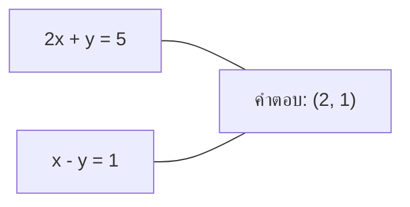

> การแก้ $Ax = b$ คือปัญหาที่เก่าแก่ที่สุดในคณิตศาสตร์ ที่ยังขับเคลื่อนโครงข่ายประสาทเทียมของคุณอยู่

**ประเภท:** ลงมือสร้าง (Build)
**ภาษา:** Python, TypeScript
**ความรู้ที่ควรมีก่อน:** Phase 1 บทที่ 01 (พีชคณิตเชิงเส้นแบบเข้าใจภาพ), 02 (เวกเตอร์และเมทริกซ์), 03 (การแปลงด้วยเมทริกซ์)
**เวลา:** ~120 นาที

## สิ่งที่จะได้เรียนรู้

- แก้ $Ax = b$ ด้วยการกำจัดแบบเกาส์ (Gaussian elimination) ที่มี partial pivoting และการแทนค่าย้อนกลับ
- แยกตัวประกอบเมทริกซ์ด้วย LU, QR และ Cholesky และอธิบายว่าแต่ละแบบเหมาะกับเมื่อไร
- แสดงที่มาของสมการปกติ (normal equations) ของกำลังสองน้อยที่สุด และเชื่อมโยงกับ linear regression และ ridge regression
- วินิจฉัยระบบที่มีสภาวะไม่ดี (ill-conditioned) ด้วย condition number และใช้ regularization ทำให้เสถียร

## ปัญหา

ทุกครั้งที่คุณเทรน linear regression คุณกำลังแก้ระบบสมการเชิงเส้น ทุกครั้งที่หาเส้นแบบกำลังสองน้อยที่สุด คุณกำลังแก้ระบบสมการเชิงเส้น ทุกครั้งที่ชั้นหนึ่งของโครงข่ายประสาทเทียมคำนวณ `y = Wx + b` มันกำลังคำนวณด้านหนึ่งของระบบสมการเชิงเส้น เมื่อเพิ่ม regularization คุณก็ปรับระบบนั้น เมื่อใช้ Gaussian process คุณแยกตัวประกอบเมทริกซ์ เมื่อหาเมทริกซ์ผกผันของเมทริกซ์ความแปรปรวนร่วมเพื่อใช้ในระยะ Mahalanobis คุณก็แก้ระบบสมการเชิงเส้น

สมการ $Ax = b$ ปรากฏทุกที่ $A$ คือเมทริกซ์ของสัมประสิทธิ์ที่รู้ค่า $b$ คือเวกเตอร์ของขาออกที่รู้ค่า $x$ คือเวกเตอร์ของตัวไม่รู้ค่าที่คุณต้องการหา ใน linear regression $A$ คือเมทริกซ์ข้อมูล $b$ คือเวกเตอร์เป้าหมาย และ $x$ คือเวกเตอร์น้ำหนัก โมเดลทั้งหมดลดรูปเหลือ: หา $x$ ที่ทำให้ $Ax$ ใกล้ $b$ ที่สุด

บทนี้สร้างวิธีหลักทุกวิธีในการแก้สมการนั้นตั้งแต่ศูนย์ คุณจะเข้าใจว่าทำไมบางวิธีเร็วและบางวิธีเสถียร ทำไมบางวิธีใช้ได้กับระบบจัตุรัสเท่านั้นและบางวิธีรับมือระบบที่มีสมการมากกว่าตัวแปรได้ และทำไม condition number ของเมทริกซ์จึงเป็นตัวกำหนดว่าคำตอบของคุณมีความหมายหรือไม่

## แนวคิด

### Ax = b หมายถึงอะไรในเชิงเรขาคณิต

ระบบสมการเชิงเส้นตีความในเชิงเรขาคณิตได้ สมการแต่ละสมการนิยามไฮเปอร์เพลน (hyperplane) หนึ่งระนาบ คำตอบคือจุด (หรือเซตของจุด) ที่ไฮเปอร์เพลนทั้งหมดตัดกัน

```
2x + y = 5          เส้นตรงสองเส้นใน 2 มิติ
x - y  = 1          ตัดกันที่ x=2, y=1
```



มีได้สามแบบ:


ในรูปเมทริกซ์ "มีคำตอบเดียว" แปลว่า $A$ หาเมทริกซ์ผกผันได้ "ไม่มีคำตอบ" แปลว่าระบบขัดแย้งกันเอง "มีคำตอบนับไม่ถ้วน" แปลว่า $A$ มีปริภูมิศูนย์ (null space) ปัญหา ML ส่วนใหญ่อยู่ในกลุ่ม "ไม่มีคำตอบที่ตรงพอดี" เพราะคุณมีสมการ (จุดข้อมูล) มากกว่าตัวไม่รู้ค่า (พารามิเตอร์) นั่นคือที่ที่กำลังสองน้อยที่สุดเข้ามา

### ภาพแบบคอลัมน์กับภาพแบบแถว

อ่าน $Ax = b$ ได้สองแบบ

**ภาพแบบแถว** แต่ละแถวของ $A$ นิยามสมการหนึ่งสมการ แต่ละสมการคือไฮเปอร์เพลน คำตอบคือจุดที่ทั้งหมดตัดกัน

**ภาพแบบคอลัมน์** แต่ละคอลัมน์ของ $A$ คือเวกเตอร์ คำถามกลายเป็น: ผลรวมเชิงเส้นของคอลัมน์ของ $A$ แบบไหนให้ $b$?

```
A = | 2  1 |    b = | 5 |
    | 1 -1 |        | 1 |

ภาพแบบแถว: แก้ 2x + y = 5 และ x - y = 1 พร้อมกัน

ภาพแบบคอลัมน์: หา x1, x2 ที่ทำให้:
  x1 * [2, 1] + x2 * [1, -1] = [5, 1]
  2 * [2, 1] + 1 * [1, -1] = [4+1, 2-1] = [5, 1]   ตรวจแล้วถูก
```

ภาพแบบคอลัมน์เป็นพื้นฐานกว่า ถ้า $b$ อยู่ในปริภูมิคอลัมน์ (column space) ของ $A$ ระบบมีคำตอบ ถ้าไม่อยู่ คุณหาจุดที่ใกล้ที่สุดในปริภูมิคอลัมน์ จุดที่ใกล้ที่สุดนั้นคือคำตอบแบบกำลังสองน้อยที่สุด

### การกำจัดแบบเกาส์

การกำจัดแบบเกาส์แปลง $Ax = b$ เป็นระบบสามเหลี่ยมบน $Ux = c$ ที่แก้ได้ด้วยการแทนค่าย้อนกลับ เป็นวิธีที่ตรงไปตรงมาที่สุด

อัลกอริทึม:

```
1. สำหรับแต่ละคอลัมน์ k (คอลัมน์ pivot):
   a. หาค่าที่ใหญ่ที่สุดในคอลัมน์ k ตั้งแต่แถว k ลงไป (partial pivoting)
   b. สลับแถวนั้นกับแถว k
   c. สำหรับแต่ละแถว i ที่อยู่ใต้ k:
      - คำนวณตัวคูณ m = A[i][k] / A[k][k]
      - ลบ m คูณแถว k ออกจากแถว i
2. แทนค่าย้อนกลับ: แก้จากสมการสุดท้ายขึ้นไป
```

ตัวอย่าง:

```
Original:
| 2  1  1 | 8 |       R2 = R2 - (2)R1     | 2  1   1 |  8 |
| 4  3  3 |20 |  -->  R3 = R3 - (1)R1 --> | 0  1   1 |  4 |
| 2  3  1 |12 |                            | 0  2   0 |  4 |

                       R3 = R3 - (2)R2     | 2  1   1 |  8 |
                                       --> | 0  1   1 |  4 |
                                           | 0  0  -2 | -4 |

Back substitute:
  -2 * x3 = -4    -->  x3 = 2
  x2 + 2  = 4     -->  x2 = 2
  2*x1 + 2 + 2 = 8 --> x1 = 2
```

การกำจัดแบบเกาส์ใช้ $O(n^3)$ การดำเนินการ สำหรับระบบ $1000 \times 1000$ คือราวหนึ่งพันล้านการดำเนินการเลขทศนิยม เร็ว แต่คุณทำได้ดีกว่านี้ถ้าต้องแก้หลายระบบที่ใช้ $A$ เดียวกัน

### Partial pivoting: ทำไมจึงสำคัญ

ถ้าไม่มี pivoting การกำจัดแบบเกาส์อาจล้มเหลวหรือให้ผลขยะ ถ้า pivot เป็นศูนย์ คุณหารด้วยศูนย์ ถ้ามันเล็ก คุณขยายความคลาดเคลื่อนจากการปัดเศษ

```
pivot ที่ไม่ดี:                       เมื่อใช้ partial pivoting:
| 0.001  1 | 1.001 |            สลับแถวก่อน:
| 1      1 | 2     |            | 1      1 | 2     |
                                 | 0.001  1 | 1.001 |
m = 1/0.001 = 1000              m = 0.001/1 = 0.001
R2 = R2 - 1000*R1               R2 = R2 - 0.001*R1
| 0.001  1     | 1.001   |      | 1      1     | 2     |
| 0     -999   | -999.0  |      | 0      0.999 | 0.999 |

x2 = 1.000 (ถูก)                 x2 = 1.000 (ถูก)
x1 = (1.001 - 1)/0.001          x1 = (2 - 1)/1 = 1.000 (ถูก)
   = 0.001/0.001 = 1.000        เสถียรเพราะตัวคูณมีค่าเล็ก
```

ในการคำนวณเลขทศนิยมที่ความแม่นยำจำกัด เวอร์ชันที่ไม่มี pivoting อาจเสียหลักนัยสำคัญไปมาก partial pivoting เลือก pivot ที่ใหญ่ที่สุดที่มีเสมอ เพื่อให้การขยายความคลาดเคลื่อนน้อยที่สุด

### การแยก LU

การแยก LU แยก $A$ เป็นเมทริกซ์สามเหลี่ยมล่าง $L$ กับเมทริกซ์สามเหลี่ยมบน $U$: $A = LU$ เมทริกซ์ $L$ เก็บตัวคูณจากการกำจัดแบบเกาส์ เมทริกซ์ $U$ คือผลลัพธ์ของการกำจัด

```
A = L @ U

| 2  1  1 |   | 1  0  0 |   | 2  1   1 |
| 4  3  3 | = | 2  1  0 | @ | 0  1   1 |
| 2  3  1 |   | 1  2  1 |   | 0  0  -2 |
```

ทำไมต้องแยกตัวประกอบแทนการกำจัดเฉย ๆ? เพราะเมื่อได้ $L$ และ $U$ แล้ว การแก้ $Ax = b$ สำหรับ $b$ ใหม่ใด ๆ ใช้แค่ $O(n^2)$:

```math
\begin{aligned}
Ax &= b \\
LUx &= b \\
&\text{Let } y = Ux\text{:} \\
Ly &= b \quad \text{(forward substitution, } O(n^2)\text{)} \\
Ux &= y \quad \text{(back substitution, } O(n^2)\text{)}
\end{aligned}
```

(ให้ $y = Ux$ แล้วแก้ $Ly = b$ ด้วยการแทนค่าไปข้างหน้า และ $Ux = y$ ด้วยการแทนค่าย้อนกลับ แต่ละขั้นใช้ $O(n^2)$)

ต้นทุน $O(n^3)$ จ่ายครั้งเดียวตอนแยกตัวประกอบ การแก้ทุกครั้งหลังจากนั้นเป็น $O(n^2)$ ถ้าคุณต้องแก้ 1000 ระบบที่ใช้ $A$ เดียวกันแต่ $b$ ต่างกัน LU ประหยัดงานรวมได้ 1000/3 เท่า

เมื่อใช้ partial pivoting คุณได้ $PA = LU$ โดย $P$ คือเมทริกซ์การเรียงสับเปลี่ยน (permutation matrix) ที่บันทึกการสลับแถว

### การแยก QR

การแยก QR แยก $A$ เป็นเมทริกซ์เชิงตั้งฉาก $Q$ กับเมทริกซ์สามเหลี่ยมบน $R$: $A = QR$

เมทริกซ์เชิงตั้งฉากมีสมบัติ $Q^T Q = I$ คอลัมน์ของมันเป็นเวกเตอร์ orthonormal การคูณด้วย $Q$ รักษาความยาวและมุมไว้

```
A = Q @ R

Q มีคอลัมน์ที่เป็น orthonormal: Q^T Q = I
R เป็นสามเหลี่ยมบน

การแก้ Ax = b:
  QRx = b
  Rx = Q^T b    (แค่คูณด้วย Q^T ไม่ต้องหาเมทริกซ์ผกผัน)
  แทนค่าย้อนกลับเพื่อได้ x
```

QR เสถียรเชิงตัวเลขกว่า LU ในการแก้ปัญหากำลังสองน้อยที่สุด กระบวนการ Gram-Schmidt สร้าง $Q$ ทีละคอลัมน์:

```
เมื่อมีคอลัมน์ a1, a2, ... ของ A:

q1 = a1 / ||a1||

q2 = a2 - (a2 . q1) * q1        (ลบภาพฉายบน q1 ออก)
q2 = q2 / ||q2||                (ทำให้ยาว 1)

q3 = a3 - (a3 . q1) * q1 - (a3 . q2) * q2
q3 = q3 / ||q3||

R[i][j] = qi . aj    สำหรับ i <= j
```

แต่ละขั้นลบส่วนประกอบตามเวกเตอร์ $q$ ทุกตัวก่อนหน้าออก เหลือแค่ทิศใหม่ที่ตั้งฉาก

### การแยก Cholesky

เมื่อ $A$ สมมาตร ($A = A^T$) และบวกแน่นอน (ค่าลักษณะเฉพาะทุกตัวเป็นบวก) คุณแยกมันเป็น $A = L L^T$ ได้ โดย $L$ เป็นสามเหลี่ยมล่าง นี่คือการแยก Cholesky

```
A = L @ L^T

| 4  2 |   | 2  0 |   | 2  1 |
| 2  5 | = | 1  2 | @ | 0  2 |

L[i][i] = sqrt(A[i][i] - sum(L[i][k]^2 for k < i))
L[i][j] = (A[i][j] - sum(L[i][k]*L[j][k] for k < j)) / L[j][j]    for i > j
```

Cholesky เร็วกว่า LU สองเท่าและใช้หน่วยความจำครึ่งหนึ่ง มันใช้ได้กับเมทริกซ์สมมาตรบวกแน่นอนเท่านั้น แต่เมทริกซ์แบบนี้โผล่มาตลอด:

- เมทริกซ์ความแปรปรวนร่วมสมมาตรและกึ่งบวกแน่นอน (บวกแน่นอนเมื่อมี regularization)
- เมทริกซ์ kernel ใน Gaussian process สมมาตรบวกแน่นอน
- Hessian ของฟังก์ชันคอนเวกซ์ ณ ค่าต่ำสุดสมมาตรบวกแน่นอน
- $A^T A$ สมมาตรกึ่งบวกแน่นอนเสมอ

ใน Gaussian process คุณแยกเมทริกซ์ kernel $K$ ด้วย Cholesky แล้วแก้ $K \alpha = y$ เพื่อได้ค่าเฉลี่ยของการทำนาย ตัวประกอบ Cholesky ยังให้ log ของดีเทอร์มิแนนต์สำหรับ marginal likelihood: $\log \det(K) = 2 \sum \log(\mathop{\mathrm{diag}}(L))$

### กำลังสองน้อยที่สุด: เมื่อ Ax = b ไม่มีคำตอบที่ตรงพอดี

ถ้า $A$ มีขนาด $m \times n$ โดย $m > n$ (สมการมากกว่าตัวไม่รู้ค่า) ระบบมีสมการมากเกิน (overdetermined) ไม่มีคำตอบที่ตรงพอดี คุณจึงหาค่าต่ำสุดของความคลาดเคลื่อนกำลังสองแทน:

```
หาค่าต่ำสุดของ ||Ax - b||^2

นี่คือผลรวมกำลังสองของเศษเหลือ:
  sum((A[i,:] @ x - b[i])^2 for i in range(m))
```

ตัวที่ทำให้ต่ำสุดเป็นไปตามสมการปกติ (normal equations):

```math
A^T A x = A^T b
```

ที่มา: กระจาย $\lVert Ax - b \rVert^2 = (Ax - b)^T (Ax - b) = x^T A^T A x - 2 x^T A^T b + b^T b$ หา gradient เทียบกับ $x$ แล้วตั้งให้เป็นศูนย์: $2 A^T A x - 2 A^T b = 0$

```
ระบบเดิม (สมการมากเกิน 4 สมการ 2 ตัวไม่รู้ค่า):
| 1  1 |         | 3 |
| 1  2 | x     = | 5 |       ไม่มี x ใดที่ทำให้ทั้ง 4 สมการเป็นจริงพอดี
| 1  3 |         | 6 |
| 1  4 |         | 8 |

สมการปกติ:
A^T A = | 4  10 |    A^T b = | 22 |
        | 10 30 |            | 63 |

แก้ได้: x = [1.5, 1.6]

นี่คือ linear regression x[0] คือจุดตัดแกน x[1] คือความชัน
```

(ต้นฉบับภาษาอังกฤษเขียนคำตอบเป็น [1.5, 1.7] ซึ่งคลาดเคลื่อน: จาก 4a + 10b = 22 และ 10a + 30b = 63 จะได้ a = 1.5 และ b = 1.6)

### สมการปกติ = linear regression

ความเชื่อมโยงนี้ตรงทุกประการ ใน linear regression เมทริกซ์ข้อมูล $X$ มีหนึ่งแถวต่อหนึ่งตัวอย่าง และหนึ่งคอลัมน์ต่อหนึ่งคุณลักษณะ เวกเตอร์เป้าหมาย $y$ มีหนึ่งช่องต่อหนึ่งตัวอย่าง เวกเตอร์น้ำหนัก $w$ เป็นไปตาม:

```math
\begin{aligned}
X^T X w &= X^T y \\
w &= (X^T X)^{-1} X^T y
\end{aligned}
```

นี่คือคำตอบแบบปิดของ linear regression ทุกครั้งที่เรียก `sklearn.linear_model.LinearRegression.fit()` มันคำนวณสิ่งนี้ (หรือสิ่งที่เทียบเท่าผ่าน QR หรือ SVD)

เพิ่มพจน์ regularization $\lambda I$ เข้าไปในเมทริกซ์ แล้วคุณจะได้ ridge regression:

```math
\begin{aligned}
(X^T X + \lambda I) w &= X^T y \\
w &= (X^T X + \lambda I)^{-1} X^T y
\end{aligned}
```

Regularization ทำให้เมทริกซ์มีสภาวะดีขึ้น (หาเมทริกซ์ผกผันได้แม่นยำขึ้น) และป้องกัน overfitting ด้วยการหดน้ำหนักเข้าหาศูนย์ เมทริกซ์ $X^T X + \lambda I$ สมมาตรบวกแน่นอนเสมอเมื่อ $\lambda > 0$ คุณจึงใช้ Cholesky แก้ได้

### เมทริกซ์ผกผันเทียม (Moore-Penrose)

เมทริกซ์ผกผันเทียม $A^+$ ขยายการหาเมทริกซ์ผกผันไปสู่เมทริกซ์ที่ไม่จัตุรัสและเมทริกซ์เอกฐาน สำหรับเมทริกซ์ $A$ ใด ๆ:

```math
\begin{aligned}
x &= A^+ b \\[4pt]
\text{where } A^+ &= V \Sigma^+ U^T \quad \text{(computed via SVD)}
\end{aligned}
```

(คำนวณ $A^+$ ผ่าน SVD)

$\Sigma^+$ สร้างจากการกลับค่าเอกฐานที่ไม่เป็นศูนย์แต่ละตัว แล้ว transpose ผลลัพธ์ ถ้า $A = U \Sigma V^T$ แล้ว $A^+ = V \Sigma^+ U^T$

```
A = U Sigma V^T        (SVD)

Sigma = | 5  0 |       Sigma+ = | 1/5  0  0 |
        | 0  2 |                | 0  1/2  0 |
        | 0  0 |

A+ = V Sigma+ U^T
```

เมทริกซ์ผกผันเทียมให้คำตอบแบบกำลังสองน้อยที่สุดที่มีนอร์มน้อยที่สุด ถ้าระบบมี:
- คำตอบเดียว: $A^+ b$ ให้คำตอบนั้น
- ไม่มีคำตอบ: $A^+ b$ ให้คำตอบแบบกำลังสองน้อยที่สุด
- คำตอบนับไม่ถ้วน: $A^+ b$ ให้ตัวที่ $\lVert x \rVert$ เล็กที่สุด

`np.linalg.lstsq` และ `np.linalg.pinv` ของ NumPy ใช้ SVD ภายในทั้งคู่

### Condition number

Condition number วัดว่าคำตอบอ่อนไหวต่อการเปลี่ยนแปลงเล็กน้อยของขาเข้าแค่ไหน สำหรับเมทริกซ์ $A$ condition number คือ:

```math
\kappa(A) = \lVert A \rVert \cdot \lVert A^{-1} \rVert = \frac{\sigma_{\max}}{\sigma_{\min}}
```

โดย $\sigma_{\max}$ และ $\sigma_{\min}$ คือค่าเอกฐานที่ใหญ่ที่สุดและเล็กที่สุด

```
สภาวะดี (kappa ~ 1):                สภาวะไม่ดี (kappa ~ 10^15):
b เปลี่ยนนิดเดียว -->                  b เปลี่ยนนิดเดียว -->
x เปลี่ยนนิดเดียว                      x เปลี่ยนมหาศาล

| 2  0 |   kappa = 2/1 = 2          | 1   1          |   kappa ~ 10^15
| 0  1 |   แก้ได้อย่างปลอดภัย          | 1   1+10^(-15) |   คำตอบเป็นขยะ
```

หลักคร่าว ๆ:
- $\kappa < 100$: ปลอดภัย คำตอบแม่นยำ
- $\kappa \approx 10^k$: คุณเสียความแม่นยำราว $k$ หลักจากการคำนวณเลขทศนิยม
- $\kappa \approx 10^{16}$ (สำหรับ float64): คำตอบไร้ความหมาย เมทริกซ์เป็นเอกฐานในทางปฏิบัติ

ใน ML สภาวะไม่ดีเกิดเมื่อคุณลักษณะเกือบอยู่ในแนวเส้นตรงเดียวกัน (collinear) Regularization (บวก $\lambda I$) ปรับ condition number จาก $\sigma_{\max} / \sigma_{\min}$ เป็น $(\sigma_{\max} + \lambda) / (\sigma_{\min} + \lambda)$

### วิธีวนซ้ำ: conjugate gradient

สำหรับระบบเบาบางขนาดใหญ่มาก (ตัวไม่รู้ค่าเป็นล้าน) วิธีตรงอย่าง LU หรือ Cholesky แพงเกินไป วิธีวนซ้ำประมาณคำตอบด้วยการปรับปรุงค่าเดาทีละรอบ

Conjugate gradient (CG) แก้ $Ax = b$ เมื่อ $A$ สมมาตรบวกแน่นอน มันหาคำตอบที่แม่นยำได้ภายใน $n$ รอบ (ในการคำนวณแบบแม่นยำ) แต่โดยทั่วไปลู่เข้าเร็วกว่านั้นมากถ้าค่าลักษณะเฉพาะของ $A$ กระจุกกัน

```
โครงร่างอัลกอริทึม:
  x0 = ค่าเดาเริ่มต้น (มักเป็นศูนย์)
  r0 = b - A x0           (เศษเหลือ residual)
  p0 = r0                 (ทิศทางการค้นหา)

  สำหรับ k = 0, 1, 2, ...:
    alpha = (rk . rk) / (pk . A pk)
    x_{k+1} = xk + alpha * pk
    r_{k+1} = rk - alpha * A pk
    beta = (r_{k+1} . r_{k+1}) / (rk . rk)
    p_{k+1} = r_{k+1} + beta * pk
    ถ้า ||r_{k+1}|| < ค่าความคลาดเคลื่อนที่ยอมรับ: หยุด
```

CG ใช้ใน:
- Optimization ขนาดใหญ่ (วิธี Newton-CG)
- การแก้ PDE ที่แบ่งเป็นช่วง
- วิธีแบบ kernel ที่เมทริกซ์ kernel ใหญ่เกินกว่าจะแยกตัวประกอบ
- Preconditioning ให้ตัวแก้แบบวนซ้ำอื่น ๆ

อัตราการลู่เข้าขึ้นกับ condition number ระบบที่สภาวะดีกว่าลู่เข้าเร็วกว่า ซึ่งเป็นอีกเหตุผลที่ regularization ช่วยได้

### ภาพรวม: ใช้วิธีไหนเมื่อไร

| วิธี | ข้อกำหนด | ต้นทุน | กรณีใช้งาน |
|--------|-------------|------|----------|
| การกำจัดแบบเกาส์ | $A$ จัตุรัส ไม่เป็นเอกฐาน | $O(n^3)$ | แก้ระบบจัตุรัสครั้งเดียว |
| การแยก LU | $A$ จัตุรัส ไม่เป็นเอกฐาน | แยก $O(n^3)$ + แก้ $O(n^2)$ | แก้หลายครั้งด้วย $A$ เดียวกัน |
| การแยก QR | $A$ ใดก็ได้ ($m \ge n$) | $O(mn^2)$ | กำลังสองน้อยที่สุด เสถียรเชิงตัวเลข |
| Cholesky | $A$ สมมาตรบวกแน่นอน | $O(n^3/3)$ | เมทริกซ์ความแปรปรวนร่วม Gaussian process ridge regression |
| สมการปกติ | สมการมากเกิน ($m > n$) | $O(mn^2 + n^3)$ | Linear regression ($n$ เล็ก) |
| SVD / เมทริกซ์ผกผันเทียม | $A$ ใดก็ได้ | $O(mn^2)$ | ระบบที่ขาดแรงก์ คำตอบที่นอร์มน้อยที่สุด |
| Conjugate gradient | $A$ สมมาตรบวกแน่นอน เบาบาง | $O(n \cdot k \cdot \text{nnz})$ | ระบบเบาบางขนาดใหญ่ $k$ = จำนวนรอบ |

### ความเชื่อมโยงกับ ML

ทุกวิธีในบทนี้ปรากฏใน ML ที่ใช้งานจริง:

**Linear regression** คำตอบแบบปิดแก้สมการปกติ $X^T X w = X^T y$ ทำผ่าน Cholesky (ถ้า $n$ เล็ก) หรือ QR (ถ้าเสถียรภาพเชิงตัวเลขสำคัญ) หรือ SVD (ถ้าเมทริกซ์อาจขาดแรงก์)

**Ridge regression** บวก $\lambda I$ เข้ากับ $X^T X$ ระบบที่มี regularization $(X^T X + \lambda I) w = X^T y$ แก้ด้วย Cholesky ได้เสมอ เพราะ $X^T X + \lambda I$ สมมาตรบวกแน่นอนเมื่อ $\lambda > 0$

**Gaussian process** ค่าเฉลี่ยของการทำนายต้องแก้ $K \alpha = y$ โดย $K$ คือเมทริกซ์ kernel การแยก Cholesky ของ $K$ คือแนวทางมาตรฐาน log marginal likelihood ใช้ $\log \det(K) = 2 \sum \log(\mathop{\mathrm{diag}}(L))$

**การกำหนดค่าเริ่มต้นของโครงข่ายประสาทเทียม** Orthogonal initialization ใช้การแยก QR สร้างเมทริกซ์น้ำหนักที่คอลัมน์เป็น orthonormal ป้องกันไม่ให้สัญญาณยุบตัวในโครงข่ายลึก

**Preconditioning** optimizer ขนาดใหญ่ใช้ incomplete Cholesky หรือ incomplete LU เป็น preconditioner ให้ตัวแก้ conjugate gradient

**Feature engineering** condition number ของ $X^T X$ บอกว่าคุณลักษณะของคุณ collinear หรือไม่ ถ้า $\kappa$ ใหญ่ ให้ตัดคุณลักษณะออกหรือเพิ่ม regularization

```figure
linear-system-conditioning
```

## ลงมือสร้าง (Build It)

### ขั้นที่ 1: การกำจัดแบบเกาส์ที่มี partial pivoting

```python
import numpy as np

def gaussian_elimination(A, b):
    n = len(b)
    Ab = np.hstack([A.astype(float), b.reshape(-1, 1).astype(float)])

    for k in range(n):
        max_row = k + np.argmax(np.abs(Ab[k:, k]))
        Ab[[k, max_row]] = Ab[[max_row, k]]

        if abs(Ab[k, k]) < 1e-12:
            raise ValueError(f"Matrix is singular or nearly singular at pivot {k}")

        for i in range(k + 1, n):
            m = Ab[i, k] / Ab[k, k]
            Ab[i, k:] -= m * Ab[k, k:]

    x = np.zeros(n)
    for i in range(n - 1, -1, -1):
        x[i] = (Ab[i, -1] - Ab[i, i+1:n] @ x[i+1:n]) / Ab[i, i]

    return x
```

### ขั้นที่ 2: การแยก LU

```python
def lu_decompose(A):
    n = A.shape[0]
    L = np.eye(n)
    U = A.astype(float).copy()
    P = np.eye(n)

    for k in range(n):
        max_row = k + np.argmax(np.abs(U[k:, k]))
        if max_row != k:
            U[[k, max_row]] = U[[max_row, k]]
            P[[k, max_row]] = P[[max_row, k]]
            if k > 0:
                L[[k, max_row], :k] = L[[max_row, k], :k]

        for i in range(k + 1, n):
            L[i, k] = U[i, k] / U[k, k]
            U[i, k:] -= L[i, k] * U[k, k:]

    return P, L, U

def lu_solve(P, L, U, b):
    n = len(b)
    Pb = P @ b.astype(float)

    y = np.zeros(n)
    for i in range(n):
        y[i] = Pb[i] - L[i, :i] @ y[:i]

    x = np.zeros(n)
    for i in range(n - 1, -1, -1):
        x[i] = (y[i] - U[i, i+1:] @ x[i+1:]) / U[i, i]

    return x
```

### ขั้นที่ 3: การแยก Cholesky

```python
def cholesky(A):
    n = A.shape[0]
    L = np.zeros_like(A, dtype=float)

    for i in range(n):
        for j in range(i + 1):
            s = A[i, j] - L[i, :j] @ L[j, :j]
            if i == j:
                if s <= 0:
                    raise ValueError("Matrix is not positive definite")
                L[i, j] = np.sqrt(s)
            else:
                L[i, j] = s / L[j, j]

    return L
```

### ขั้นที่ 4: กำลังสองน้อยที่สุดผ่านสมการปกติ

```python
def least_squares_normal(A, b):
    AtA = A.T @ A
    Atb = A.T @ b
    return gaussian_elimination(AtA, Atb)

def ridge_regression(A, b, lam):
    n = A.shape[1]
    AtA = A.T @ A + lam * np.eye(n)
    Atb = A.T @ b
    L = cholesky(AtA)
    y = np.zeros(n)
    for i in range(n):
        y[i] = (Atb[i] - L[i, :i] @ y[:i]) / L[i, i]
    x = np.zeros(n)
    for i in range(n - 1, -1, -1):
        x[i] = (y[i] - L.T[i, i+1:] @ x[i+1:]) / L.T[i, i]
    return x
```

### ขั้นที่ 5: Condition number

```python
def condition_number(A):
    U, S, Vt = np.linalg.svd(A)
    return S[0] / S[-1]
```

## นำไปใช้ (Use It)

ประกอบชิ้นส่วนทั้งหมดเข้าด้วยกันสำหรับ linear regression และ ridge regression บนข้อมูลจริง:

```python
np.random.seed(42)
X_raw = np.random.randn(100, 3)
w_true = np.array([2.0, -1.0, 0.5])
y = X_raw @ w_true + np.random.randn(100) * 0.1

X = np.column_stack([np.ones(100), X_raw])

w_ols = least_squares_normal(X, y)
print(f"OLS weights (ours):    {w_ols}")

w_np = np.linalg.lstsq(X, y, rcond=None)[0]
print(f"OLS weights (numpy):   {w_np}")
print(f"Max difference: {np.max(np.abs(w_ols - w_np)):.2e}")

w_ridge = ridge_regression(X, y, lam=1.0)
print(f"Ridge weights (ours):  {w_ridge}")

from sklearn.linear_model import Ridge
ridge_sk = Ridge(alpha=1.0, fit_intercept=False)
ridge_sk.fit(X, y)
print(f"Ridge weights (sklearn): {ridge_sk.coef_}")
```

## ส่งมอบ (Ship It)

บทนี้สร้าง:
- `code/linear_systems.py` ที่มีการกำจัดแบบเกาส์ การแยก LU การแยก Cholesky กำลังสองน้อยที่สุด และ ridge regression ที่เขียนตั้งแต่ศูนย์
- `code/linear_systems.ts` เวอร์ชัน TypeScript ของไฟล์เดียวกัน ซึ่งเทียบผลกับตัวแก้อ้างอิงขนาดเล็กที่เขียนเอง เพราะ TypeScript ไม่มี NumPy
- เดโมที่แสดงว่าสมการปกติกับ LinearRegression ของ sklearn ให้น้ำหนักเท่ากัน

## แบบฝึกหัด

1. แก้ระบบ `[[1,2,3],[4,5,6],[7,8,10]] x = [6, 15, 27]` ด้วยการกำจัดแบบเกาส์ของคุณ ตัวแก้ LU ของคุณ และ `np.linalg.solve` ตรวจว่าทั้งสามให้คำตอบเดียวกันภายในค่าความคลาดเคลื่อนของเลขทศนิยม

2. สร้างเมทริกซ์สุ่ม X ขนาด 50x5 และเป้าหมาย y = X @ w_true + noise แก้หา w ด้วยสมการปกติ QR (ผ่าน `np.linalg.qr`) SVD (ผ่าน `np.linalg.svd`) และ `np.linalg.lstsq` เทียบคำตอบทั้งสี่ วัด condition number ของ $X^T X$ แล้วอธิบายว่ามันส่งผลต่อการเลือกว่าจะเชื่อวิธีไหนอย่างไร

3. สร้างเมทริกซ์ที่เกือบเป็นเอกฐานด้วยการทำให้สองคอลัมน์เกือบเหมือนกัน (เช่น คอลัมน์ 2 = คอลัมน์ 1 + 1e-10 * noise) คำนวณ condition number แก้ $Ax = b$ ทั้งแบบมีและไม่มี regularization (บวก $0.01 I$) เทียบคำตอบและเศษเหลือ แล้วอธิบายว่าทำไม regularization จึงช่วย

4. เขียนอัลกอริทึม conjugate gradient สำหรับเมทริกซ์สมมาตรบวกแน่นอนแบบสุ่มขนาด 100x100 นับว่าใช้กี่รอบจึงลู่เข้าถึงค่าความคลาดเคลื่อน 1e-8 เทียบกับจำนวนสูงสุดทางทฤษฎี $n$ รอบ

5. จับเวลาตัวแก้ Cholesky เทียบกับตัวแก้ LU และ `np.linalg.solve` บนเมทริกซ์สมมาตรบวกแน่นอนขนาด 10, 50, 200, 500 วาดกราฟผลลัพธ์ ตรวจว่า Cholesky เร็วกว่า LU ราว 2 เท่า

### คำใบ้

**แบบฝึกหัดที่ 1** เรียก `gaussian_elimination(A, b)` แล้ว `lu_decompose(A)` ตามด้วย `lu_solve(P, L, U, b)` แล้ว `np.linalg.solve(A, b)` ตรวจแต่ละคำตอบด้วย `np.allclose(A @ x, b)` และเทียบสามคำตอบด้วย `np.allclose`

**แบบฝึกหัดที่ 2** ใช้ `least_squares_normal` สำหรับสมการปกติ และฟังก์ชัน NumPy สามตัวสำหรับวิธีอื่น ทั้งสี่คำตอบควรใกล้ `w_true` เทียบ `condition_number(X.T @ X)` กับ `condition_number(X)`: ตัวแรกเป็นกำลังสองของตัวหลัง สมการปกติจึงเสียความแม่นยำมากที่สุด

**แบบฝึกหัดที่ 3** คาดว่า condition number จะเกิน $10^{9}$ แก้ด้วย `np.linalg.solve` และด้วย `ridge_regression(A, b, 0.01)` แล้วเทียบ `np.linalg.norm(x)` กับนอร์มของเศษเหลือของแต่ละแบบ เศษเหลือของทั้งสองอาจเล็ก แต่คำตอบที่ไม่มี regularization มักมีค่าใหญ่มาก

**แบบฝึกหัดที่ 4** สร้างเมทริกซ์สมมาตรบวกแน่นอนด้วย `B @ B.T + n * np.eye(n)` ซึ่งทำให้ค่าลักษณะเฉพาะทุกตัวเป็นบวก เพิ่มตัวนับในลูปของ `conjugate_gradient` ฉบับของคุณ แล้วตรวจว่านอร์มของเศษเหลือสุดท้ายต่ำกว่า 1e-8 และจำนวนรอบไม่เกิน 100

**แบบฝึกหัดที่ 5** ใช้เมทริกซ์ `B @ B.T + n * np.eye(n)` ชุดเดียวกันกับตัวแก้ทั้งสาม และจับเวลาการแก้แต่ละครั้งด้วย `time.perf_counter` โดยเอาค่าที่ดีที่สุดจากหลายรอบ Cholesky ใช้การคำนวณราวครึ่งหนึ่งของ LU อัตราส่วนจึงเห็นชัดที่สุดในขนาดใหญ่

## คำศัพท์สำคัญ

| คำศัพท์ | ที่คนมักพูด | ความหมายจริง |
|------|----------------|----------------------|
| Linear system (ระบบสมการเชิงเส้น) | "แก้หา x" | ชุดสมการเชิงเส้น $Ax = b$ การหา $x$ คือการหาขาเข้าที่ให้ขาออก $b$ ภายใต้การแปลง $A$ |
| Gaussian elimination (การกำจัดแบบเกาส์) | "ลดรูปแถว" | ทำให้ช่องใต้เส้นทแยงมุมเป็นศูนย์อย่างเป็นระบบด้วยการดำเนินการกับแถว ได้ระบบสามเหลี่ยมบนที่แก้ได้ด้วยการแทนค่าย้อนกลับ $O(n^3)$ |
| Partial pivoting | "สลับแถวเพื่อความเสถียร" | ก่อนกำจัดในคอลัมน์ $k$ สลับแถวที่มีค่าสัมบูรณ์มากที่สุดในคอลัมน์นั้นขึ้นมาที่ตำแหน่ง pivot ป้องกันการหารด้วยตัวเลขเล็ก ๆ |
| LU decomposition (การแยก LU) | "แยกเป็นสามเหลี่ยม" | เขียน $A = LU$ โดย $L$ เป็นสามเหลี่ยมล่าง (เก็บตัวคูณ) และ $U$ เป็นสามเหลี่ยมบน (เมทริกซ์ที่กำจัดแล้ว) กระจายต้นทุน $O(n^3)$ ไปให้การแก้หลายครั้ง |
| QR decomposition (การแยก QR) | "การแยกตัวประกอบเชิงตั้งฉาก" | เขียน $A = QR$ โดย $Q$ มีคอลัมน์ orthonormal และ $R$ เป็นสามเหลี่ยมบน เสถียรกว่า LU สำหรับกำลังสองน้อยที่สุด |
| Cholesky decomposition (การแยก Cholesky) | "รากที่สองของเมทริกซ์" | สำหรับ $A$ สมมาตรบวกแน่นอน เขียน $A = LL^T$ ต้นทุนครึ่งหนึ่งของ LU ใช้กับเมทริกซ์ความแปรปรวนร่วม เมทริกซ์ kernel และ ridge regression |
| Least squares (กำลังสองน้อยที่สุด) | "เส้นที่ดีที่สุดเมื่อตรงพอดีไม่ได้" | หาค่าต่ำสุดของผลรวมกำลังสองของเศษเหลือ $\lVert Ax - b \rVert^2$ เมื่อระบบมีสมการมากเกิน (สมการมากกว่าตัวไม่รู้ค่า) |
| Normal equations (สมการปกติ) | "ทางลัดจากแคลคูลัส" | $A^T A x = A^T b$ ได้จากการตั้ง gradient ของ $\lVert Ax - b \rVert^2$ เป็นศูนย์ นี่คือคำตอบแบบปิดของ linear regression |
| Pseudoinverse (เมทริกซ์ผกผันเทียม) | "inverse สำหรับเมทริกซ์ไม่จัตุรัส" | $A^+ = V \Sigma^+ U^T$ ผ่าน SVD ให้คำตอบแบบกำลังสองน้อยที่สุดที่นอร์มน้อยที่สุดสำหรับเมทริกซ์ใดก็ได้ จัตุรัสหรือไม่ เอกฐานหรือไม่ |
| Condition number | "คำตอบนี้เชื่อถือได้แค่ไหน" | $\kappa = \sigma_{\max} / \sigma_{\min}$ วัดความอ่อนไหวต่อการรบกวนขาเข้า เสียความแม่นยำราว $\log_{10}(\kappa)$ หลัก |
| Ridge regression | "กำลังสองน้อยที่สุดที่มี regularization" | แก้ $(X^T X + \lambda I) w = X^T y$ การบวก $\lambda I$ ทำให้สภาวะดีขึ้นและหดน้ำหนักเข้าหาศูนย์ ป้องกัน overfitting |
| Conjugate gradient | "Ax=b แบบวนซ้ำสำหรับเมทริกซ์ใหญ่" | ตัวแก้แบบวนซ้ำสำหรับระบบสมมาตรบวกแน่นอน ลู่เข้าภายใน $n$ ก้าว ใช้ได้จริงกับระบบเบาบางขนาดใหญ่ที่การแยกตัวประกอบแพงเกินไป |
| Overdetermined system (ระบบที่มีสมการมากเกิน) | "ข้อมูลมากกว่าพารามิเตอร์" | $m > n$ ในระบบขนาด $m\text{-by-}n$ ไม่มีคำตอบที่ตรงพอดี กำลังสองน้อยที่สุดหาค่าประมาณที่ดีที่สุด นี่คือทุกปัญหา regression |
| Back substitution (การแทนค่าย้อนกลับ) | "แก้จากล่างขึ้นบน" | เมื่อมีระบบสามเหลี่ยมบน แก้สมการสุดท้ายก่อน แล้วแทนค่าย้อนขึ้นไป $O(n^2)$ |
| Forward substitution (การแทนค่าไปข้างหน้า) | "แก้จากบนลงล่าง" | เมื่อมีระบบสามเหลี่ยมล่าง แก้สมการแรกก่อน แล้วแทนค่าลงไป $O(n^2)$ ใช้ในขั้น L ของการแก้ด้วย LU |

## อ่านเพิ่มเติม

- [MIT 18.06: Linear Algebra](https://ocw.mit.edu/courses/18-06-linear-algebra-spring-2010/) (Gilbert Strang) -- คอร์สมาตรฐานเรื่องระบบสมการเชิงเส้นและการแยกตัวประกอบเมทริกซ์
- [Numerical Linear Algebra](https://people.maths.ox.ac.uk/trefethen/text.html) (Trefethen & Bau) -- ตำราอ้างอิงมาตรฐานสำหรับทำความเข้าใจเสถียรภาพเชิงตัวเลข สภาวะของเมทริกซ์ และทำไมอัลกอริทึมจึงล้มเหลว
- [Matrix Computations](https://www.press.jhu.edu/books/title/10678/matrix-computations) (Golub & Van Loan) -- ตำราอ้างอิงที่ครอบคลุมทุกอัลกอริทึมของเมทริกซ์
- [3Blue1Brown: Inverse Matrices](https://www.3blue1brown.com/lessons/inverse-matrices) -- สัญชาตญาณเชิงภาพว่าการแก้ $Ax = b$ หมายถึงอะไรในเชิงเรขาคณิต
