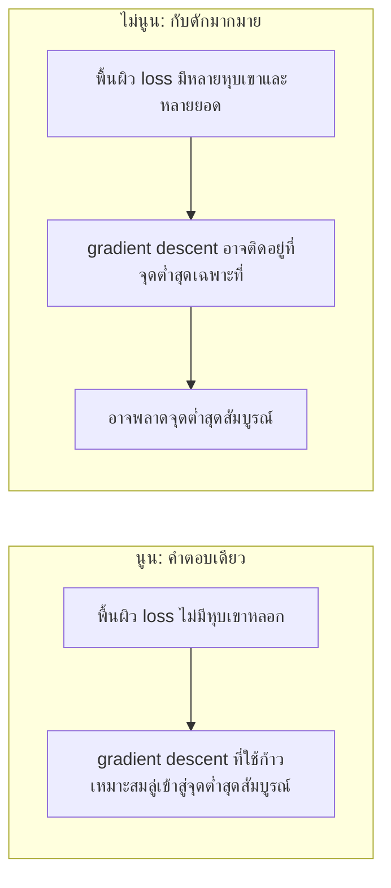
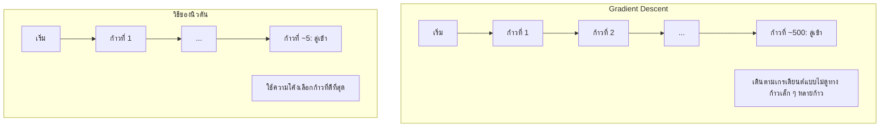
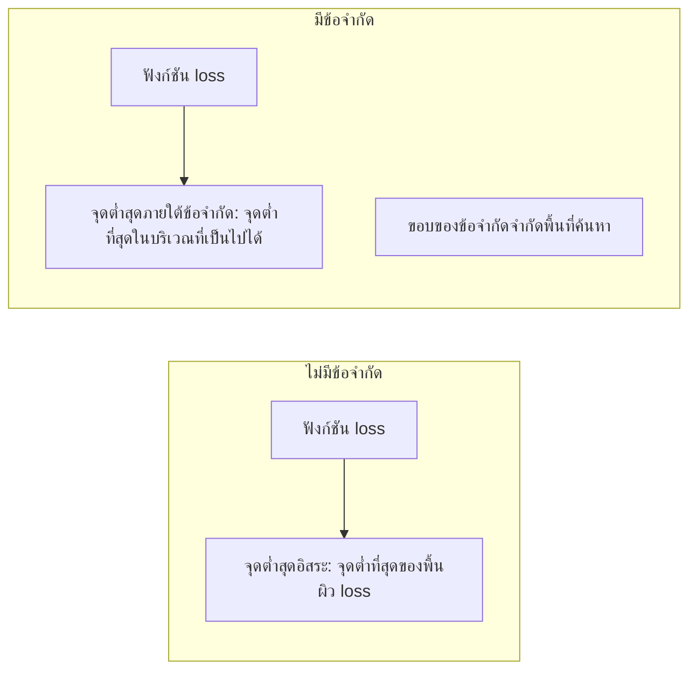
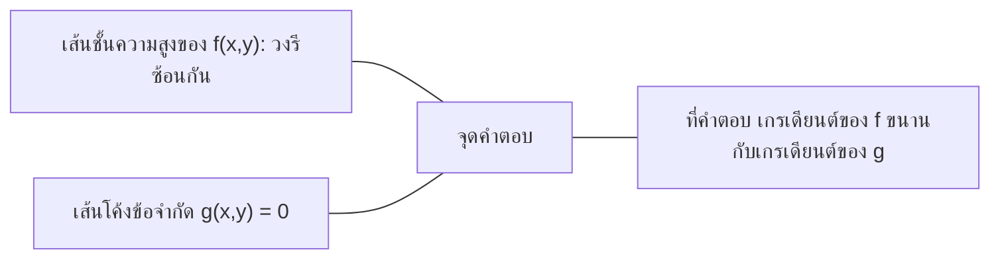

> ปัญหานูนมีหุบเขาเดียว โครงข่ายประสาทเทียมมีเป็นล้าน การรู้ความต่างนี้สำคัญ

**ประเภท:** ลงมือสร้าง (Build)
**ภาษา:** Python, TypeScript
**ความรู้ที่ควรมีก่อน:** Phase 1 บทที่ 04 (แคลคูลัสสำหรับ ML), 08 (การหาค่าเหมาะที่สุด)
**เวลา:** ~90 นาที

## สิ่งที่จะได้เรียนรู้

- ทดสอบว่าฟังก์ชันนูนหรือไม่ด้วยนิยาม อนุพันธ์อันดับสอง และเกณฑ์ของ Hessian
- เขียนวิธีของนิวตัน (Newton's method) และเปรียบเทียบการลู่เข้าแบบกำลังสองของมันกับ gradient descent
- แก้ปัญหาการหาค่าเหมาะที่สุดที่มีข้อจำกัดด้วยตัวคูณลากรองจ์ (Lagrange multipliers) และตีความเงื่อนไข KKT
- อธิบายว่าทำไมภูมิประเทศของ loss ในโครงข่ายประสาทเทียมไม่นูน แต่ SGD ก็ยังหาคำตอบที่ดีได้

## ปัญหา

บทที่ 08 สอน gradient descent, momentum และ Adam ให้คุณแล้ว optimizer เหล่านั้นเดินลงเขาได้บนพื้นผิวทุกแบบ แต่มันไม่มีการรับประกันอะไรเลย gradient descent บนภูมิประเทศที่ไม่นูนอาจไปจบที่จุดต่ำสุดเฉพาะที่ที่แย่ ติดอยู่ที่จุดอานม้า หรือแกว่งไปมาไม่สิ้นสุด คุณใช้มันอยู่ดีเพราะโครงข่ายประสาทเทียมไม่นูนและไม่มีทางเลือกอื่น

แต่ปัญหาจำนวนมากใน machine learning เป็นปัญหานูน linear regression, logistic regression, SVM, LASSO, ridge regression สำหรับปัญหาเหล่านี้มีสิ่งที่แข็งแรงกว่า: การหาค่าเหมาะที่สุดที่มีการรับประกันทางคณิตศาสตร์ ปัญหานูนไม่มีหุบเขาหลอก จุดต่ำสุดเฉพาะที่ทุกจุดคือจุดต่ำสุดสัมบูรณ์ สำหรับฟังก์ชันนูนที่เรียบและมีจุดต่ำสุด gradient descent ที่ใช้ขนาดก้าวเหมาะสมจะลู่เข้าหามัน ไม่ต้องเริ่มใหม่ ไม่ต้องมีตารางปรับ learning rate ไม่ต้องภาวนา

การเข้าใจความนูนให้สามอย่าง หนึ่ง มันบอกว่าเมื่อไรปัญหาของคุณง่าย (นูน) และเมื่อไรยาก (ไม่นูน) สอง มันให้เครื่องมือที่เร็วกว่าอย่างวิธีของนิวตันสำหรับปัญหานูน สาม มันอธิบายแนวคิดที่โผล่ทั่ว ML: regularization ในฐานะข้อจำกัด ภาวะคู่ (duality) ใน SVM และทำไม deep learning ยังใช้ได้ทั้งที่ละเมิดคุณสมบัติดี ๆ ทุกข้อที่ความนูนให้

## แนวคิด

### เซตนูน

เซต $S$ นูนถ้าสำหรับจุดสองจุดใด ๆ ใน $S$ ส่วนของเส้นตรงระหว่างมันก็อยู่ใน $S$ ทั้งหมดด้วย

| เซตนูน | ไม่นูน |
|---|---|
| **สี่เหลี่ยมผืนผ้า**: จุดสองจุดใด ๆ ข้างในเชื่อมกันได้ด้วยส่วนของเส้นตรงที่อยู่ข้างในตลอด | **รูปดาว/เสี้ยวพระจันทร์**: เส้นระหว่างสองจุดข้างในอาจผ่านออกนอกเซต |
| **สามเหลี่ยม**: คุณสมบัติเดียวกันเป็นจริงกับทุกจุดข้างใน | **โดนัท/วงแหวน**: รูตรงกลางทำให้ส่วนของเส้นตรงบางเส้นออกนอกเซต |
| ส่วนของเส้นตรงระหว่างสองจุดใด ๆ อยู่ในเซตเสมอ | ส่วนของเส้นตรงระหว่างบางคู่ออกนอกเซต |

การทดสอบแบบเป็นทางการ: สำหรับจุด $x, y$ ใด ๆ ใน $S$ และ $t \in [0, 1]$ ใด ๆ จุด $tx + (1-t)y$ ก็อยู่ใน $S$ ด้วย

ตัวอย่างเซตนูน:
- เส้นตรง ระนาบ และ $\mathbb{R}^n$ ทั้งหมด
- ลูกบอล (วงกลม ทรงกลม ทรงกลมมิติสูง)
- ครึ่งปริภูมิ (halfspace): $\lbrace x : a^T x \le b \rbrace$
- อินเตอร์เซกชันของเซตนูนกี่เซตก็ได้

ตัวอย่างเซตที่ไม่นูน:
- โดนัท (วงแหวน)
- ยูเนียนของวงกลมสองวงที่ไม่ซ้อนกัน
- เซตใดก็ตามที่มี "รอยบุ๋ม" หรือ "รู"

### ฟังก์ชันนูน

ฟังก์ชัน $f$ นูนถ้าโดเมนของมันเป็นเซตนูน และสำหรับสองจุด $x, y$ ใด ๆ ในโดเมนและ $t \in [0, 1]$ ใด ๆ:

```math
f(tx + (1-t)y) \le t f(x) + (1-t) f(y)
```

ในเชิงเรขาคณิต: ส่วนของเส้นตรงระหว่างสองจุดใด ๆ บนกราฟอยู่เหนือหรือบนกราฟ

| คุณสมบัติ | ฟังก์ชันนูน | ฟังก์ชันไม่นูน |
|---|---|---|
| **การทดสอบด้วยส่วนของเส้นตรง** | เส้นระหว่างสองจุดใด ๆ บนกราฟอยู่**เหนือหรือบน**เส้นโค้ง | เส้นระหว่างบางจุดบนกราฟจุ่ม**ลงใต้**เส้นโค้ง |
| **รูปร่าง** | ชามหรือหุบเขาเดียวที่โค้งขึ้น | มีหลายยอดและหลายหุบ ความโค้งผสมกัน |
| **จุดต่ำสุดเฉพาะที่** | จุดต่ำสุดเฉพาะที่ทุกจุดคือจุดต่ำสุดสัมบูรณ์ | อาจมีจุดต่ำสุดเฉพาะที่หลายจุดที่ความสูงต่างกัน |

ฟังก์ชันนูนที่พบบ่อย:
- $f(x) = x^2$ (พาราโบลา)
- $f(x) = \lvert x \rvert$ (ค่าสัมบูรณ์)
- $f(x) = e^x$ (เอกซ์โพเนนเชียล)
- $f(x) = \max(0, x)$ (ReLU แม้จะเป็นเชิงเส้นเป็นช่วง ๆ)
- $f(x) = -\log(x)$ สำหรับ $x > 0$ (ลบลอการิทึม)
- ฟังก์ชันเชิงเส้นใด ๆ $f(x) = a^T x + b$ (เป็นทั้งนูนและเว้า)

### การทดสอบความนูน

การทดสอบที่ใช้งานได้จริงสามแบบ จากง่ายที่สุดไปเข้มงวดที่สุด

**การทดสอบที่ 1: อนุพันธ์อันดับสอง (1 มิติ)** ถ้า $f''(x) \ge 0$ สำหรับทุก $x$ แล้ว $f$ นูน

- $f(x) = x^2$: $f''(x) = 2 \ge 0$ นูน
- $f(x) = x^3$: $f''(x) = 6x$ เป็นลบเมื่อ $x < 0$ ไม่นูน
- $f(x) = e^x$: $f''(x) = e^x > 0$ นูน

**การทดสอบที่ 2: Hessian (หลายตัวแปร)** ถ้าเมทริกซ์ Hessian $H(x)$ กึ่งบวกแน่นอน (positive semidefinite) สำหรับทุก $x$ แล้ว $f$ นูน Hessian คือเมทริกซ์ของอนุพันธ์ย่อยอันดับสอง

**การทดสอบที่ 3: นิยาม** ตรวจอสมการ $f(tx + (1-t)y) \le t f(x) + (1-t) f(y)$ โดยตรง มีประโยชน์กับฟังก์ชันที่หาอนุพันธ์ยาก

### ทำไมความนูนจึงสำคัญ

ทฤษฎีบทหลักของการหาค่าเหมาะที่สุดแบบนูน:

**สำหรับฟังก์ชันนูน จุดต่ำสุดเฉพาะที่ทุกจุดคือจุดต่ำสุดสัมบูรณ์**

แปลว่า gradient descent ไม่มีทางติดกับดักในจุดต่ำสุดเฉพาะที่ที่แย่ ทุกจุดต่ำสุดที่มันไปถึงได้มี loss เท่ากัน สำหรับฟังก์ชันนูนที่เรียบและมีจุดต่ำสุด gradient descent ที่ใช้ขนาดก้าวเหมาะสมรับประกันว่าลู่เข้าสู่ค่าเหมาะที่สุด



ผลที่ตามมา:
- ไม่ต้องสุ่มเริ่มใหม่
- ไม่ต้องมีตารางปรับ learning rate ที่ซับซ้อน
- พิสูจน์การลู่เข้าได้ (อัตราขึ้นกับคุณสมบัติของฟังก์ชัน)
- คำตอบมีเพียงหนึ่งเดียว (ยกเว้นบริเวณที่แบนราบ)

### นูนกับไม่นูนใน ML

| ปัญหา | นูน? | เพราะอะไร |
|---------|---------|-----|
| Linear regression (MSE) | ใช่ | loss เป็นกำลังสองในน้ำหนัก |
| Logistic regression | ใช่ | log-loss นูนในน้ำหนัก |
| SVM (hinge loss) | ใช่ | เป็นค่ามากสุดของฟังก์ชันเชิงเส้น |
| LASSO (L1 regression) | ใช่ | ผลรวมของฟังก์ชันนูนเป็นฟังก์ชันนูน |
| Ridge regression (L2) | ใช่ | กำลังสอง + กำลังสอง = นูน |
| โครงข่ายประสาทเทียม (loss ใดก็ได้) | ไม่ | activation ที่ไม่เป็นเชิงเส้นสร้างภูมิประเทศที่ไม่นูน |
| การจัดกลุ่ม k-means | ไม่ | ขั้นกำหนดกลุ่มเป็นแบบไม่ต่อเนื่อง |
| การแยกตัวประกอบเมทริกซ์ | ไม่ | เป็นผลคูณของตัวไม่รู้ค่า |

โมเดลเชิงเส้นที่มี loss นูนเป็นปัญหานูน ทันทีที่คุณเพิ่ม hidden layer ที่มี activation ไม่เป็นเชิงเส้น ความนูนก็พัง

### เมทริกซ์ Hessian

Hessian $H$ ของฟังก์ชัน $f: \mathbb{R}^n \to \mathbb{R}$ คือเมทริกซ์ขนาด $n \times n$ ของอนุพันธ์ย่อยอันดับสอง

```math
H_{ij} = \frac{\partial^2 f}{\partial x_i \, \partial x_j}
```

สำหรับ $f(x, y) = x^2 + 3xy + y^2$:

```math
\begin{gathered}
\begin{aligned}
\frac{\partial f}{\partial x} &= 2x + 3y & \frac{\partial^2 f}{\partial x^2} &= 2 & \frac{\partial^2 f}{\partial x \, \partial y} &= 3 \\
\frac{\partial f}{\partial y} &= 3x + 2y & \frac{\partial^2 f}{\partial y \, \partial x} &= 3 & \frac{\partial^2 f}{\partial y^2} &= 2
\end{aligned} \\[8pt]
H = \begin{bmatrix} 2 & 3 \\ 3 & 2 \end{bmatrix}
\end{gathered}
```

Hessian บอกเรื่องความโค้ง:
- ค่าลักษณะเฉพาะเป็นบวกทั้งหมด: ฟังก์ชันโค้งขึ้นในทุกทิศ (นูนที่จุดนั้น)
- ค่าลักษณะเฉพาะเป็นลบทั้งหมด: โค้งลงในทุกทิศ (เว้า เป็นจุดสูงสุดเฉพาะที่)
- เครื่องหมายผสมกัน: จุดอานม้า (โค้งขึ้นในบางทิศ โค้งลงในทิศอื่น)
- ค่าลักษณะเฉพาะเป็นศูนย์: แบนในทิศนั้น (เสื่อม)

สำหรับความนูน Hessian ต้องกึ่งบวกแน่นอน (ค่าลักษณะเฉพาะทุกตัว $\ge 0$) ทุกที่ ไม่ใช่แค่จุดเดียว

### วิธีของนิวตัน

Gradient descent ใช้ข้อมูลอันดับหนึ่ง (เกรเดียนต์) วิธีของนิวตันใช้ข้อมูลอันดับสอง (Hessian) มันประมาณฟังก์ชันด้วยกำลังสองที่จุดปัจจุบัน แล้วกระโดดไปที่จุดต่ำสุดของกำลังสองนั้นตรง ๆ

```math
\begin{aligned}
\text{Update rule:} \quad & x_{\text{new}} = x - H^{-1} \cdot \text{gradient} \\
\text{Compare to gradient descent:} \quad & x_{\text{new}} = x - \text{lr} \cdot \text{gradient}
\end{aligned}
```

วิธีของนิวตันแทน learning rate ที่เป็นสเกลาร์ด้วยเมทริกซ์ผกผันของ Hessian ซึ่งปรับขนาดและทิศของก้าวตามความโค้งเฉพาะที่ให้อัตโนมัติ



ข้อดี:
- ลู่เข้าแบบกำลังสองใกล้จุดต่ำสุด (ความคลาดเคลื่อนยกกำลังสองทุกก้าว)
- ไม่มี learning rate ให้ปรับ
- ไม่ขึ้นกับสเกล (ใช้ได้ไม่ว่าคุณจะกำหนดพารามิเตอร์ของปัญหาอย่างไร)

ข้อเสีย:
- การคำนวณ Hessian ใช้หน่วยความจำ $O(n^2)$ และใช้ $O(n^3)$ ในการหาตัวผกผัน
- สำหรับโครงข่ายประสาทเทียมที่มีน้ำหนัก 1 ล้านตัว นั่นคือ $10^{12}$ ช่องและ $10^{18}$ การดำเนินการ
- ใช้จริงกับ deep learning ไม่ได้

### การหาค่าเหมาะที่สุดที่มีข้อจำกัด

การหาค่าเหมาะที่สุดแบบไม่มีข้อจำกัด: หาค่าต่ำสุดของ $f(x)$ บน $x$ ทั้งหมด
การหาค่าเหมาะที่สุดที่มีข้อจำกัด: หาค่าต่ำสุดของ $f(x)$ ภายใต้ข้อจำกัด

ปัญหาจริงมีข้อจำกัด คุณอยากลดต้นทุนแต่งบประมาณมีจำกัด คุณอยากลดความคลาดเคลื่อนแต่ความซับซ้อนของโมเดลมีขอบเขต



### ตัวคูณลากรองจ์

วิธีตัวคูณลากรองจ์แปลงปัญหาที่มีข้อจำกัดให้เป็นปัญหาที่ไม่มีข้อจำกัด

ปัญหา: หาค่าต่ำสุดของ $f(x)$ ภายใต้ $g(x) = 0$

คำตอบ: เพิ่มตัวแปรใหม่ (ตัวคูณลากรองจ์ $\lambda$) แล้วแก้ปัญหาที่ไม่มีข้อจำกัด:

```math
L(x, \lambda) = f(x) + \lambda g(x)
```

ที่คำตอบ เกรเดียนต์ของ $L$ เป็นศูนย์:

```math
\begin{aligned}
\frac{\partial L}{\partial x} &= \frac{\partial f}{\partial x} + \lambda \frac{\partial g}{\partial x} = 0 \\
\frac{\partial L}{\partial \lambda} &= g(x) = 0
\end{aligned}
```

ภาพทางเรขาคณิต: ที่จุดต่ำสุดภายใต้ข้อจำกัด เกรเดียนต์ของ $f$ ต้องขนานกับเกรเดียนต์ของข้อจำกัด $g$ ถ้ามันไม่ขนานกัน คุณจะขยับไปตามพื้นผิวข้อจำกัดแล้วลด $f$ ลงได้อีก



ตัวอย่าง: หาค่าต่ำสุดของ $f(x,y) = x^2 + y^2$ ภายใต้ $x + y = 1$

```math
\begin{aligned}
L &= x^2 + y^2 + \lambda(x + y - 1) \\[4pt]
\frac{\partial L}{\partial x} &= 2x + \lambda = 0 \implies x = -\lambda/2 \\
\frac{\partial L}{\partial y} &= 2y + \lambda = 0 \implies y = -\lambda/2 \\
\frac{\partial L}{\partial \lambda} &= x + y - 1 = 0 \\[4pt]
&\text{From first two: } x = y \\
&\text{Substituting: } 2x = 1, \text{ so } x = y = 0.5, \ \lambda = -1
\end{aligned}
```

จุดบนเส้น $x + y = 1$ ที่ใกล้จุดกำเนิดที่สุดคือ $(0.5, 0.5)$

### เงื่อนไข KKT

เงื่อนไข Karush-Kuhn-Tucker ขยายตัวคูณลากรองจ์ไปใช้กับข้อจำกัดแบบอสมการ

ปัญหา: หาค่าต่ำสุดของ $f(x)$ ภายใต้ $g_i(x) \le 0$ สำหรับ $i = 1, \ldots, m$

เงื่อนไข KKT (เงื่อนไขจำเป็นของความเหมาะที่สุด):

```math
\begin{aligned}
&\text{1. Stationarity:} && \frac{\partial f}{\partial x} + \sum_i \lambda_i \frac{\partial g_i}{\partial x} = 0 \\
&\text{2. Primal feasibility:} && g_i(x) \le 0 \quad \text{for all } i \\
&\text{3. Dual feasibility:} && \lambda_i \ge 0 \quad \text{for all } i \\
&\text{4. Complementary slackness:} && \lambda_i \, g_i(x) = 0 \quad \text{for all } i
\end{aligned}
```

ความหย่อนเติมเต็ม (complementary slackness) คือหัวใจ: ไม่ข้อจำกัดทำงานอยู่ ($g_i = 0$ คำตอบอยู่บนขอบ) ก็ตัวคูณเป็นศูนย์ (ข้อจำกัดไม่มีผล) ข้อจำกัดที่ไม่กระทบคำตอบมี $\lambda = 0$

เงื่อนไข KKT เป็นหัวใจของ SVM support vector คือจุดข้อมูลที่ข้อจำกัดทำงานอยู่ ($\lambda > 0$) จุดข้อมูลอื่นทั้งหมดมี $\lambda = 0$ และไม่มีผลต่อเส้นแบ่ง

### Regularization ในฐานะการหาค่าเหมาะที่สุดที่มีข้อจำกัด

Regularization แบบ L1 และ L2 ไม่ใช่เทคนิคที่ตั้งขึ้นลอย ๆ มันคือปัญหาการหาค่าเหมาะที่สุดที่มีข้อจำกัดในคราบอื่น

**Regularization แบบ L2 (Ridge):**

```math
\begin{aligned}
&\text{minimize } \text{Loss}(w) \text{ subject to } \lVert w \rVert^2 \le t \\[4pt]
&\text{Equivalent unconstrained form:} \\
&\text{minimize } \text{Loss}(w) + \lambda \lVert w \rVert^2
\end{aligned}
```

ข้อจำกัด $\lVert w \rVert^2 \le t$ กำหนดลูกบอล (วงกลมใน 2 มิติ ทรงกลมใน 3 มิติ) คำตอบคือจุดที่เส้นชั้นความสูงของ loss แตะลูกบอลนี้เป็นครั้งแรก

**Regularization แบบ L1 (LASSO):**

```math
\begin{aligned}
&\text{minimize } \text{Loss}(w) \text{ subject to } \lVert w \rVert_1 \le t \\[4pt]
&\text{Equivalent unconstrained form:} \\
&\text{minimize } \text{Loss}(w) + \lambda \lVert w \rVert_1
\end{aligned}
```

ข้อจำกัด $\lVert w \rVert_1 \le t$ กำหนดรูปข้าวหลามตัด (สี่เหลี่ยมจัตุรัสที่หมุนแล้วใน 2 มิติ)

| คุณสมบัติ | ข้อจำกัด L2 (วงกลม) | ข้อจำกัด L1 (ข้าวหลามตัด) |
|---|---|---|
| **รูปร่างของข้อจำกัด** | วงกลม (ทรงกลมในมิติสูง) | ข้าวหลามตัด (สี่เหลี่ยมจัตุรัสที่หมุนแล้วใน 2 มิติ) |
| **ตำแหน่งที่เส้นชั้นความสูงของ loss แตะ** | ขอบเรียบ จุดใดบนวงกลมก็ได้ | มุม ซึ่งอยู่บนแกน |
| **พฤติกรรมของคำตอบ** | น้ำหนักเล็กแต่ไม่เป็นศูนย์ | น้ำหนักบางตัวเป็นศูนย์พอดี (เบาบาง) |
| **ผลลัพธ์** | น้ำหนักหดลง | การคัดเลือกคุณลักษณะ |

นี่อธิบายว่าทำไม L1 ให้โมเดลเบาบาง (คัดเลือกคุณลักษณะ) ส่วน L2 แค่หดน้ำหนัก ข้าวหลามตัดมีมุมอยู่บนแกน เส้นชั้นความสูงของ loss มีโอกาสแตะมุมมากกว่า ทำให้น้ำหนักหนึ่งตัวหรือมากกว่าเป็นศูนย์พอดี

### ภาวะคู่ (Duality)

ปัญหาการหาค่าเหมาะที่สุดที่มีข้อจำกัดทุกปัญหา (ปัญหาปฐม หรือ primal) มีปัญหาคู่หู (ปัญหาคู่ หรือ dual) สำหรับปัญหานูน ปัญหาปฐมและปัญหาคู่มีค่าเหมาะที่สุดเท่ากัน นี่คือภาวะคู่แบบเข้ม (strong duality)

ฟังก์ชันคู่ของลากรองจ์:

```math
\begin{aligned}
&\text{Primal:} && \text{minimize } f(x) \text{ subject to } g(x) \le 0 \\
&\text{Lagrangian:} && L(x, \lambda) = f(x) + \lambda g(x) \\
&\text{Dual function:} && d(\lambda) = \min_x L(x, \lambda) \\
&\text{Dual problem:} && \text{maximize } d(\lambda) \text{ subject to } \lambda \ge 0
\end{aligned}
```

ทำไมภาวะคู่จึงสำคัญ:
- บางครั้งปัญหาคู่แก้ง่ายกว่าปัญหาปฐม
- SVM ถูกแก้ในรูปปัญหาคู่ ซึ่งขึ้นกับผลคูณจุดระหว่างจุดข้อมูลเท่านั้น (ทำให้ใช้ kernel trick ได้)
- ปัญหาคู่ให้ขอบล่างของค่าเหมาะที่สุดของปัญหาปฐม มีประโยชน์ในการตรวจคุณภาพของคำตอบ

สำหรับ SVM โดยเฉพาะ:

```
Primal: find w, b that maximize the margin 2/||w|| subject to
        y_i(w^T x_i + b) >= 1 for all i

Dual:   maximize sum(alpha_i) - 0.5 * sum_ij(alpha_i * alpha_j * y_i * y_j * x_i^T x_j)
        subject to alpha_i >= 0 and sum(alpha_i * y_i) = 0

ปัญหาคู่มีแค่ผลคูณจุด x_i^T x_j
แทน x_i^T x_j ด้วย K(x_i, x_j) แล้วคุณจะได้ kernel trick
```

### ทำไม deep learning ใช้ได้ทั้งที่ไม่นูน

ฟังก์ชัน loss ของโครงข่ายประสาทเทียมไม่นูนอย่างรุนแรง ตามมาตรวัดแบบดั้งเดิมทุกข้อ การหาค่าเหมาะที่สุดของมันควรล้มเหลว แต่ stochastic gradient descent กลับหาคำตอบที่ดีได้อย่างสม่ำเสมอ มีหลายปัจจัยที่อธิบายเรื่องนี้

**จุดต่ำสุดเฉพาะที่ส่วนใหญ่ดีพอ** ในปริภูมิมิติสูง จุดวิกฤตแบบสุ่ม (จุดที่เกรเดียนต์เป็นศูนย์) เกือบทั้งหมดเป็นจุดอานม้า ไม่ใช่จุดต่ำสุดเฉพาะที่ จุดต่ำสุดเฉพาะที่ไม่กี่จุดที่มีอยู่มักมีค่า loss ใกล้จุดต่ำสุดสัมบูรณ์ การติดอยู่ในจุดต่ำสุดเฉพาะที่ที่แย่มากแทบเป็นไปไม่ได้เมื่อปริภูมิพารามิเตอร์มีเป็นล้านมิติ

**อุปสรรคตัวจริงคือจุดอานม้า ไม่ใช่จุดต่ำสุดเฉพาะที่** ในฟังก์ชันที่มี $n$ พารามิเตอร์ จุดอานม้ามีทั้งทิศที่ความโค้งเป็นบวกและเป็นลบปนกัน สำหรับจุดวิกฤตแบบสุ่มในมิติสูง ความน่าจะเป็นที่ค่าลักษณะเฉพาะทั้ง $n$ ตัวเป็นบวก (จุดต่ำสุดเฉพาะที่) อยู่ราว $2^{-n}$ จุดวิกฤตเกือบทั้งหมดจึงเป็นจุดอานม้า สัญญาณรบกวนของ SGD ช่วยให้หนีออกมาได้

**Overparameterization ทำให้ภูมิประเทศเรียบขึ้น** โครงข่ายที่มีพารามิเตอร์มากกว่าตัวอย่างฝึกมีพื้นผิว loss ที่เรียบกว่าและเชื่อมต่อกันมากกว่า โครงข่ายที่กว้างกว่ามีจุดต่ำสุดเฉพาะที่ที่แย่น้อยกว่า ขัดกับสัญชาตญาณแต่สอดคล้องกับผลการทดลองเสมอมา

**โครงสร้างของภูมิประเทศของ loss:**

| คุณสมบัติ | ปริภูมิมิติต่ำ | ปริภูมิมิติสูง |
|---|---|---|
| **ภูมิประเทศ** | ยอดและหุบเขาโดดเดี่ยวจำนวนมาก | หุบเขาที่เชื่อมต่อกันอย่างราบรื่น |
| **จุดต่ำสุด** | จุดต่ำสุดเฉพาะที่โดดเดี่ยวจำนวนมาก | จุดต่ำสุดที่แย่มีน้อย ส่วนใหญ่ใกล้ค่าเหมาะที่สุด |
| **การเดินทาง** | หาจุดต่ำสุดสัมบูรณ์ได้ยาก | หลายเส้นทางนำไปสู่คำตอบที่ดี |
| **จุดวิกฤต** | จุดต่ำสุดเฉพาะที่และจุดอานม้าปนกัน | เกือบทั้งหมดเป็นจุดอานม้า ไม่ใช่จุดต่ำสุดเฉพาะที่ |

**สัญญาณรบกวนแบบสุ่มทำหน้าที่เป็น regularization แฝง** SGD แบบ mini-batch เพิ่มสัญญาณรบกวนที่กันไม่ให้มันไปตกอยู่ในจุดต่ำสุดที่แหลม จุดต่ำสุดที่แหลม overfit ส่วนจุดต่ำสุดที่แบน generalize ได้ดี สัญญาณรบกวนจึงดึงการหาค่าเหมาะที่สุดไปทางบริเวณที่แบนของภูมิประเทศของ loss

### วิธีอันดับสองในทางปฏิบัติ

วิธีของนิวตันแบบตรง ๆ ใช้กับโมเดลขนาดใหญ่ไม่ได้ การประมาณหลายแบบทำให้ข้อมูลอันดับสองใช้งานได้

**L-BFGS (Limited-memory BFGS):** ประมาณเมทริกซ์ผกผันของ Hessian จากผลต่างของเกรเดียนต์ $m$ ครั้งล่าสุด ใช้หน่วยความจำ $O(mn)$ แทน $O(n^2)$ ทำงานได้ดีกับปัญหาที่มีพารามิเตอร์ถึงราว 10,000 ตัว ใช้ใน ML แบบดั้งเดิม (logistic regression, CRF) แต่ไม่ใช้ใน deep learning

**Natural gradient:** ใช้เมทริกซ์สารสนเทศของ Fisher (Hessian คาดหมายของ log-likelihood) แทน Hessian ปกติ ซึ่งคำนึงถึงเรขาคณิตของการแจกแจงความน่าจะเป็น K-FAC (Kronecker-Factored Approximate Curvature) ประมาณเมทริกซ์ Fisher เป็นผลคูณโครเนกเกอร์ ทำให้ใช้กับโครงข่ายประสาทเทียมได้จริง

**การหาค่าเหมาะที่สุดแบบไม่ใช้ Hessian (Hessian-free):** ใช้ conjugate gradient แก้ $Hx = g$ โดยไม่ต้องสร้าง $H$ เลย ต้องการแค่ผลคูณ Hessian กับเวกเตอร์ ซึ่งคำนวณได้ในเวลา $O(n)$ ด้วย automatic differentiation

**การประมาณด้วยเส้นทแยงมุม:** โมเมนต์ที่สองของ Adam คือการประมาณเส้นทแยงมุมของ Hessian แบบหนึ่ง AdaHessian ขยายแนวคิดนี้โดยใช้สมาชิกบนเส้นทแยงมุมของ Hessian จริงผ่านตัวประมาณของ Hutchinson

| วิธี | หน่วยความจำ | ต้นทุนต่อก้าว | ใช้เมื่อไร |
|--------|--------|--------------|-------------|
| Gradient descent | $O(n)$ | $O(n)$ | จุดตั้งต้น โมเดลขนาดใหญ่ |
| วิธีของนิวตัน | $O(n^2)$ | $O(n^3)$ | ปัญหานูนขนาดเล็ก |
| L-BFGS | $O(mn)$ | $O(mn)$ | ปัญหานูนขนาดกลาง |
| Adam | $O(n)$ | $O(n)$ | ค่าเริ่มต้นของ deep learning |
| K-FAC | $O(n)$ | $O(n)$ ต่อชั้น | งานวิจัย การฝึกด้วย batch ขนาดใหญ่ |

```figure
convex-vs-nonconvex
```

## ลงมือสร้าง (Build It)

### ขั้นที่ 1: ตัวตรวจความนูน

สร้างฟังก์ชันที่ทดสอบความนูนเชิงประจักษ์ด้วยการสุ่มจุดแล้วตรวจตามนิยาม

```python
import random
import math

def check_convexity(f, dim, bounds=(-5, 5), samples=1000):
    violations = 0
    for _ in range(samples):
        x = [random.uniform(*bounds) for _ in range(dim)]
        y = [random.uniform(*bounds) for _ in range(dim)]
        t = random.uniform(0, 1)
        mid = [t * xi + (1 - t) * yi for xi, yi in zip(x, y)]
        lhs = f(mid)
        rhs = t * f(x) + (1 - t) * f(y)
        if lhs > rhs + 1e-10:
            violations += 1
    return violations == 0, violations
```

### ขั้นที่ 2: วิธีของนิวตันใน 2 มิติ

เขียนวิธีของนิวตันโดยใช้ Hessian แบบชัดแจ้ง แล้วเปรียบเทียบความเร็วในการลู่เข้ากับ gradient descent

```python
def newtons_method(f, grad_f, hessian_f, x0, steps=50, tol=1e-12):
    x = list(x0)
    history = [x[:]]
    for _ in range(steps):
        g = grad_f(x)
        H = hessian_f(x)
        det = H[0][0] * H[1][1] - H[0][1] * H[1][0]
        if abs(det) < 1e-15:
            break
        H_inv = [
            [H[1][1] / det, -H[0][1] / det],
            [-H[1][0] / det, H[0][0] / det],
        ]
        dx = [
            H_inv[0][0] * g[0] + H_inv[0][1] * g[1],
            H_inv[1][0] * g[0] + H_inv[1][1] * g[1],
        ]
        x = [x[0] - dx[0], x[1] - dx[1]]
        history.append(x[:])
        if sum(gi ** 2 for gi in g) < tol:
            break
    return history
```

### ขั้นที่ 3: ตัวแก้ด้วยตัวคูณลากรองจ์

แก้ปัญหาการหาค่าเหมาะที่สุดที่มีข้อจำกัดด้วย gradient descent บนฟังก์ชันลากรองจ์

```python
def lagrange_solve(f_grad, g_val, g_grad, x0, lr=0.01,
                   lr_lambda=0.01, steps=5000):
    x = list(x0)
    lam = 0.0
    history = []
    for _ in range(steps):
        fg = f_grad(x)
        gv = g_val(x)
        gg = g_grad(x)
        x = [
            xi - lr * (fgi + lam * ggi)
            for xi, fgi, ggi in zip(x, fg, gg)
        ]
        lam = lam + lr_lambda * gv
        history.append((x[:], lam, gv))
    return history
```

### ขั้นที่ 4: เปรียบเทียบอันดับหนึ่งกับอันดับสอง

รัน gradient descent และวิธีของนิวตันบนฟังก์ชันกำลังสองเดียวกัน แล้วนับจำนวนก้าวจนลู่เข้า

```python
def quadratic(x):
    return 5 * x[0] ** 2 + x[1] ** 2

def quadratic_grad(x):
    return [10 * x[0], 2 * x[1]]

def quadratic_hessian(x):
    return [[10, 0], [0, 2]]
```

วิธีของนิวตันจะลู่เข้าใน 1 ก้าว (มันแม่นยำพอดีสำหรับฟังก์ชันกำลังสอง) ส่วน gradient descent จะใช้หลายร้อยก้าว เพราะค่าลักษณะเฉพาะของ Hessian ต่างกัน 5 เท่า ทำให้เกิดหุบเขาที่ยืดยาว

## นำไปใช้ (Use It)

การวิเคราะห์ความนูนใช้ได้ตรง ๆ ตอนเลือกโมเดลและตัวแก้ของ ML

สำหรับปัญหานูน (logistic regression, SVM, LASSO):
- ใช้ตัวแก้เฉพาะทาง (liblinear, CVXPY, scipy.optimize.minimize ที่ใช้ method='L-BFGS-B')
- คาดหวังคำตอบสัมบูรณ์ที่มีเพียงหนึ่งเดียว
- วิธีอันดับสองใช้ได้จริงและเร็ว

สำหรับปัญหาที่ไม่นูน (โครงข่ายประสาทเทียม):
- ใช้วิธีอันดับหนึ่ง (SGD, Adam)
- ยอมรับว่าคำตอบขึ้นกับการกำหนดค่าเริ่มต้นและความสุ่ม
- ใช้ overparameterization สัญญาณรบกวน และตารางปรับ learning rate เป็น regularization แฝง
- อย่าเสียเวลาหาจุดต่ำสุดสัมบูรณ์ จุดต่ำสุดเฉพาะที่ที่ดีก็เพียงพอ

```python
from scipy.optimize import minimize

result = minimize(
    fun=lambda w: sum((y - X @ w) ** 2) + 0.1 * sum(w ** 2),
    x0=np.zeros(d),
    method='L-BFGS-B',
    jac=lambda w: -2 * X.T @ (y - X @ w) + 0.2 * w,
)
```

สำหรับ SVM รูปแบบปัญหาคู่ทำให้คุณใช้ kernel trick ได้:

```python
from sklearn.svm import SVC

svm = SVC(kernel='rbf', C=1.0)
svm.fit(X_train, y_train)
print(f"Support vectors: {svm.n_support_}")
```

## แบบฝึกหัด

1. **แกลเลอรีความนูน** ทดสอบความนูนของฟังก์ชันเหล่านี้ด้วยตัวตรวจ: $f(x) = x^4$, $f(x) = \sin(x)$, $f(x,y) = x^2 + y^2$, $f(x,y) = xy$, $f(x) = \max(x, 0)$ อธิบายว่าทำไมผลแต่ละข้อจึงสมเหตุสมผล

2. **แข่งกันระหว่างนิวตันกับ gradient descent** รันทั้งสองวิธีบน $f(x,y) = 50x^2 + y^2$ จากจุดเริ่มต้น $(10, 10)$ แต่ละวิธีต้องใช้กี่ก้าวจึงได้ loss < 1e-10? เกิดอะไรขึ้นกับ gradient descent เมื่อ condition number (อัตราส่วนของค่าลักษณะเฉพาะที่ใหญ่ที่สุดต่อเล็กที่สุดของ Hessian) เพิ่มขึ้น?

3. **เรขาคณิตของตัวคูณลากรองจ์** หาค่าต่ำสุดของ $f(x,y) = (x-3)^2 + (y-3)^2$ ภายใต้ $x + 2y = 4$ ยืนยันคำตอบโดยตรวจว่าเกรเดียนต์ของ $f$ ขนานกับเกรเดียนต์ของ $g$ ที่จุดคำตอบ

4. **ข้อจำกัดของ regularization** เขียนการหาค่าเหมาะที่สุดภายใต้ข้อจำกัด L1: หาค่าต่ำสุดของ $(x-3)^2 + (y-2)^2$ ภายใต้ $\lvert x \rvert + \lvert y \rvert \le 1$ แสดงว่าคำตอบมีพิกัดหนึ่งเป็นศูนย์ (ความเบาบางจากข้อจำกัดรูปข้าวหลามตัด)

5. **วิเคราะห์ค่าลักษณะเฉพาะของ Hessian** คำนวณ Hessian ของฟังก์ชัน Rosenbrock ที่ (1,1) และที่ (-1,1) แล้วหาค่าลักษณะเฉพาะที่ทั้งสองจุด ค่าลักษณะเฉพาะบอกอะไรเกี่ยวกับความโค้งที่จุดต่ำสุดเทียบกับจุดที่อยู่ไกลออกไป?

### คำใบ้

**แบบฝึกหัดที่ 1** ทายผลแต่ละข้อก่อนรัน `check_convexity`: ใน 1 มิติ ดูเครื่องหมายของ $f''(x)$ ใน 2 มิติ ดูค่าลักษณะเฉพาะของ Hessian สำหรับ $f(x,y) = xy$ Hessian มีค่าลักษณะเฉพาะ 1 และ -1 ตัวตรวจจึงต้องรายงานว่าไม่นูน

**แบบฝึกหัดที่ 2** เรียก `optimize_gd` และ `newtons_method` พร้อมเกรเดียนต์และ Hessian ของ $f$ วิธีของนิวตันแก้ฟังก์ชันกำลังสองได้ในก้าวเดียว สำหรับ gradient descent learning rate ต้องน้อยกว่า $2/100$ เพราะพจน์ $50x^2$ ทิศ $y$ จึงขยับช้า ลองใหม่ด้วย $100x^2$ แล้วนับจำนวนก้าวอีกครั้ง

**แบบฝึกหัดที่ 3** ใช้ `lagrange_solve` กับ $g(x,y) = x + 2y - 4$ ที่คำตอบ ตรวจว่า $x + 2y = 4$ และ $\nabla f = (2(x-3), 2(y-3))$ เป็นพหุคูณของ $\nabla g = (1, 2)$

**แบบฝึกหัดที่ 4** จุดต่ำสุดแบบไม่มีข้อจำกัด (3, 2) อยู่นอกข้าวหลามตัด คำตอบจึงอยู่บนขอบของมัน ใช้ projected gradient descent: ก้าวตามเกรเดียนต์หนึ่งก้าว แล้วฉายกลับเข้า $\lvert x \rvert + \lvert y \rvert \le 1$ ตรวจว่าผลลัพธ์ทำให้ข้อจำกัดเป็นสมการพอดี และเทียบกับ `demo_regularization_geometry`

**แบบฝึกหัดที่ 5** เรียก `rosenbrock_hessian` ที่แต่ละจุดแล้วส่งผลให้ `hessian_eigenvalues_2d` ที่ (1, 1) ค่าลักษณะเฉพาะทั้งสองเป็นบวกและอัตราส่วนของมันใหญ่มาก หุบเขาจึงแคบในทิศหนึ่งและแบนในอีกทิศ เทียบอัตราส่วนนั้นกับอัตราส่วนที่ (-1, 1)

## คำศัพท์สำคัญ

| คำศัพท์ | ความหมาย |
|------|---------------|
| Convex set (เซตนูน) | เซตที่ส่วนของเส้นตรงระหว่างสองจุดใด ๆ ในเซตอยู่ในเซตเสมอ |
| Convex function (ฟังก์ชันนูน) | ฟังก์ชันที่เส้นระหว่างสองจุดใด ๆ บนกราฟอยู่เหนือหรือบนกราฟ หรือกล่าวอีกแบบ คือ Hessian กึ่งบวกแน่นอนทุกที่ |
| Local minimum (จุดต่ำสุดเฉพาะที่) | จุดที่ต่ำกว่าทุกจุดในบริเวณใกล้เคียง สำหรับฟังก์ชันนูน จุดต่ำสุดเฉพาะที่ทุกจุดคือจุดต่ำสุดสัมบูรณ์ |
| Global minimum (จุดต่ำสุดสัมบูรณ์) | จุดที่ต่ำที่สุดของฟังก์ชันบนโดเมนทั้งหมด |
| Hessian matrix (เมทริกซ์ Hessian) | เมทริกซ์ของอนุพันธ์ย่อยอันดับสองทั้งหมด เก็บข้อมูลความโค้ง |
| Positive semidefinite (กึ่งบวกแน่นอน) | เมทริกซ์ที่ค่าลักษณะเฉพาะทุกตัวไม่เป็นลบ เป็นรูปหลายมิติของ "อนุพันธ์อันดับสอง >= 0" |
| Condition number | อัตราส่วนของค่าลักษณะเฉพาะที่ใหญ่ที่สุดต่อเล็กที่สุดของ Hessian ค่าสูงหมายถึงหุบเขายืดยาวและ gradient descent ช้า |
| Newton's method (วิธีของนิวตัน) | optimizer อันดับสองที่ใช้เมทริกซ์ผกผันของ Hessian กำหนดทิศและขนาดของก้าว ลู่เข้าแบบกำลังสองใกล้จุดต่ำสุด |
| Lagrange multiplier (ตัวคูณลากรองจ์) | ตัวแปรที่เพิ่มเข้ามาเพื่อแปลงปัญหาที่มีข้อจำกัดเป็นปัญหาที่ไม่มีข้อจำกัด |
| KKT conditions (เงื่อนไข KKT) | เงื่อนไขจำเป็นของความเหมาะที่สุดเมื่อมีข้อจำกัดแบบอสมการ เป็นรูปทั่วไปของตัวคูณลากรองจ์ |
| Complementary slackness (ความหย่อนเติมเต็ม) | ที่คำตอบ ไม่ข้อจำกัดทำงานอยู่ ก็ตัวคูณของมันเป็นศูนย์ ไม่มีวันที่ทั้งคู่ไม่เป็นศูนย์ |
| Duality (ภาวะคู่) | ปัญหาที่มีข้อจำกัดทุกปัญหามีปัญหาคู่หู สำหรับปัญหานูน ทั้งสองมีค่าเหมาะที่สุดเท่ากัน |
| Strong duality (ภาวะคู่แบบเข้ม) | ค่าเหมาะที่สุดของปัญหาปฐมและปัญหาคู่เท่ากัน เป็นจริงกับปัญหานูนที่ผ่านเงื่อนไขของ Slater |
| L-BFGS | วิธีอันดับสองแบบประมาณที่เก็บผลต่างของเกรเดียนต์ $m$ ครั้งล่าสุดแทน Hessian ทั้งเมทริกซ์ |
| Saddle point (จุดอานม้า) | จุดที่เกรเดียนต์เป็นศูนย์ แต่เป็นจุดต่ำสุดในบางทิศและจุดสูงสุดในทิศอื่น |
| Overparameterization | การใช้พารามิเตอร์มากกว่าจำนวนตัวอย่างฝึก ทำให้ภูมิประเทศของ loss เรียบขึ้นและลดจุดต่ำสุดเฉพาะที่ที่แย่ |

## อ่านเพิ่มเติม

- [Boyd & Vandenberghe: Convex Optimization](https://web.stanford.edu/~boyd/cvxbook/) - ตำรามาตรฐาน อ่านออนไลน์ได้ฟรี
- [Bottou, Curtis, Nocedal: Optimization Methods for Large-Scale Machine Learning (2018)](https://arxiv.org/abs/1606.04838) - เชื่อมทฤษฎีการหาค่าเหมาะที่สุดแบบนูนเข้ากับการใช้งานจริงใน deep learning
- [Choromanska et al.: The Loss Surfaces of Multilayer Networks (2015)](https://arxiv.org/abs/1412.0233) - ทำไมภูมิประเทศที่ไม่นูนของโครงข่ายประสาทเทียมจึงไม่แย่อย่างที่คิด
- [Nocedal & Wright: Numerical Optimization](https://link.springer.com/book/10.1007/978-0-387-40065-5) - ตำราอ้างอิงครบถ้วนเรื่องวิธีของนิวตัน L-BFGS และการหาค่าเหมาะที่สุดที่มีข้อจำกัด
