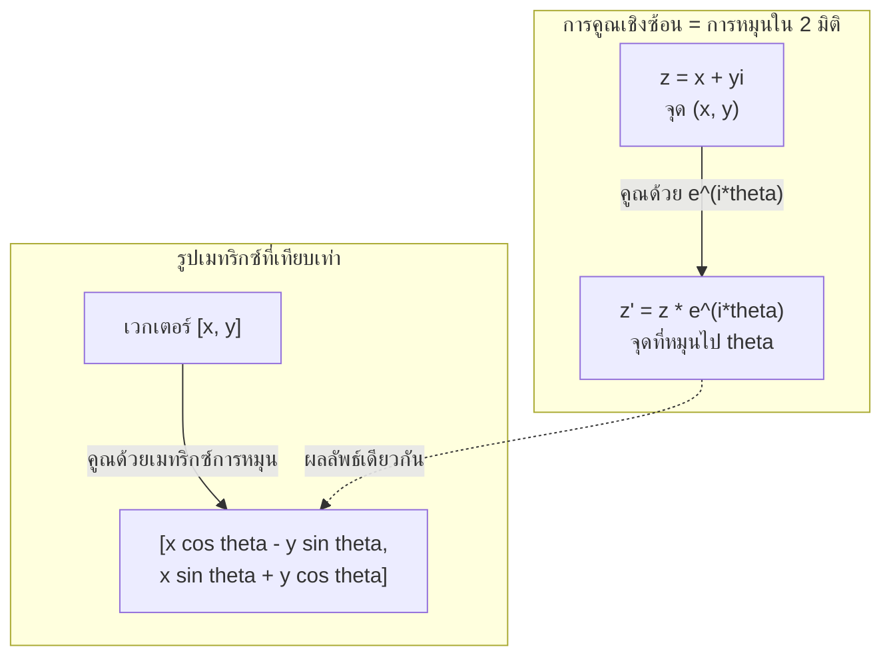
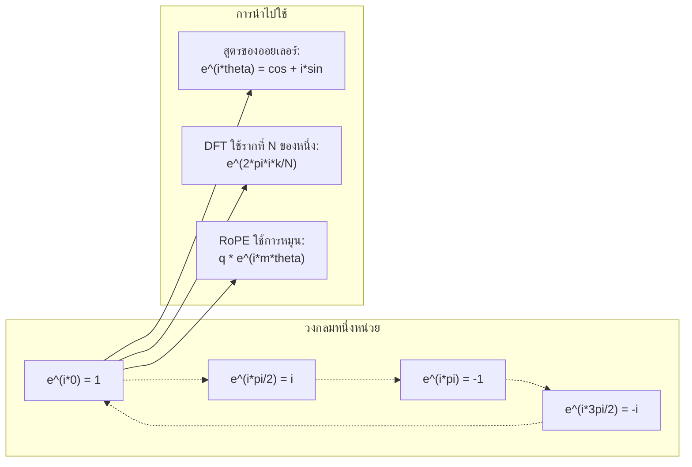

> รากที่สองของ -1 ไม่ได้เป็นแค่จินตนาการ มันคือกุญแจของการหมุน ความถี่ และครึ่งหนึ่งของการประมวลผลสัญญาณ

**ประเภท:** เรียนรู้ (Learn)
**ภาษา:** Python, TypeScript
**ความรู้ที่ควรมีก่อน:** Phase 1 บทที่ 01-04 (พีชคณิตเชิงเส้น แคลคูลัส)
**เวลา:** ~60 นาที

## สิ่งที่จะได้เรียนรู้

- คำนวณเลขคณิตของจำนวนเชิงซ้อน (บวก คูณ หาร สังยุค) ทั้งในรูปสี่เหลี่ยมและรูปเชิงขั้ว
- ใช้สูตรของออยเลอร์ (Euler's formula) แปลงระหว่างเอกซ์โพเนนเชียลเชิงซ้อนกับฟังก์ชันตรีโกณมิติ
- เขียนการแปลงฟูเรียร์แบบไม่ต่อเนื่อง (DFT) ด้วยรากที่ N ของหนึ่งในจำนวนเชิงซ้อน
- อธิบายว่าการหมุนเชิงซ้อนอยู่เบื้องหลัง RoPE และ positional encoding แบบไซน์ใน transformer อย่างไร

## ปัญหา

คุณเปิดเปเปอร์เรื่องการแปลงฟูเรียร์แล้วเจอ `i` เต็มไปหมด คุณดู positional encoding ของ transformer แล้วเห็น `sin` และ `cos` ที่ความถี่ต่าง ๆ ซึ่งก็คือส่วนจริงและส่วนจินตภาพของเอกซ์โพเนนเชียลเชิงซ้อน คุณอ่านเรื่องควอนตัมคอมพิวติงแล้วพบว่าทุกอย่างเขียนอยู่ในปริภูมิเวกเตอร์เชิงซ้อน

จำนวนเชิงซ้อนดูนามธรรม ระบบจำนวนที่สร้างบนรากที่สองของ -1 ฟังดูเหมือนกลทางคณิตศาสตร์ แต่มันไม่ใช่กล มันคือภาษาธรรมชาติของการหมุนและการแกว่ง ทุกครั้งที่บางอย่างหมุน สั่น หรือแกว่ง จำนวนเชิงซ้อนคือเครื่องมือที่ถูกต้อง

ถ้าไม่เข้าใจจำนวนเชิงซ้อน คุณจะไม่เข้าใจการแปลงฟูเรียร์แบบไม่ต่อเนื่อง ไม่เข้าใจ FFT ไม่เข้าใจว่า RoPE (Rotary Position Embedding) ทำงานอย่างไรในโมเดลภาษาสมัยใหม่ และไม่เข้าใจว่าทำไม positional encoding แบบไซน์ในเปเปอร์ Transformer ฉบับแรกจึงใช้ความถี่แบบนั้น

บทนี้สร้างเลขคณิตเชิงซ้อนตั้งแต่ศูนย์ เชื่อมมันกับเรขาคณิต และชี้ให้เห็นว่าจำนวนเชิงซ้อนโผล่ที่ไหนบ้างใน machine learning

## แนวคิด

### จำนวนเชิงซ้อนคืออะไร?

จำนวนเชิงซ้อนมีสองส่วน: ส่วนจริงและส่วนจินตภาพ

```
z = a + bi

โดยที่:
  a คือส่วนจริง
  b คือส่วนจินตภาพ
  i คือหน่วยจินตภาพ นิยามโดย i^2 = -1
```

แค่นั้นเอง คุณขยายเส้นจำนวนออกเป็นระนาบ จำนวนจริงอยู่บนแกนหนึ่ง จำนวนจินตภาพอยู่บนอีกแกน จำนวนเชิงซ้อนทุกตัวคือจุดหนึ่งบนระนาบนี้

### เลขคณิตเชิงซ้อน

**การบวก** บวกส่วนจริงเข้าด้วยกัน บวกส่วนจินตภาพเข้าด้วยกัน

```math
\begin{aligned}
(a + bi) + (c + di) &= (a + c) + (b + d)i \\[4pt]
\text{Example: } (3 + 2i) + (1 + 4i) &= 4 + 6i
\end{aligned}
```

**การคูณ** ใช้กฎการแจกแจงและจำไว้ว่า $i^2 = -1$

```math
\begin{aligned}
(a + bi)(c + di) &= ac + adi + bci + bdi^2 \\
&= ac + adi + bci - bd \\
&= (ac - bd) + (ad + bc)i \\[8pt]
\text{Example: } (3 + 2i)(1 + 4i) &= 3 + 12i + 2i + 8i^2 \\
&= 3 + 14i - 8 \\
&= -5 + 14i
\end{aligned}
```

**สังยุค (conjugate)** กลับเครื่องหมายของส่วนจินตภาพ

```math
\text{conjugate of } (a + bi) = a - bi
```

ผลคูณของจำนวนเชิงซ้อนกับสังยุคของมันเป็นจำนวนจริงเสมอ:

```math
(a + bi)(a - bi) = a^2 + b^2
```

**การหาร** คูณทั้งตัวเศษและตัวส่วนด้วยสังยุคของตัวส่วน

```math
\frac{a + bi}{c + di} = \frac{(a + bi)(c - di)}{c^2 + d^2}
```

วิธีนี้กำจัดส่วนจินตภาพออกจากตัวส่วน ได้จำนวนเชิงซ้อนที่เรียบร้อย

### ระนาบเชิงซ้อน

ระนาบเชิงซ้อนจับคู่จำนวนเชิงซ้อนทุกตัวกับจุดใน 2 มิติ แกนนอนคือแกนจริง แกนตั้งคือแกนจินตภาพ

```
z = 3 + 2i  ตรงกับจุด (3, 2)
z = -1 + 0i ตรงกับจุด (-1, 0) บนแกนจริง
z = 0 + 4i  ตรงกับจุด (0, 4) บนแกนจินตภาพ
```

จำนวนเชิงซ้อนเป็นทั้งจุดและเวกเตอร์จากจุดกำเนิดในเวลาเดียวกัน การตีความสองแบบนี้คือสิ่งที่ทำให้จำนวนเชิงซ้อนมีประโยชน์ทางเรขาคณิต

### รูปเชิงขั้ว (Polar form)

จุดใด ๆ บนระนาบบรรยายได้ด้วยระยะห่างจากจุดกำเนิดและมุมจากแกนจริงด้านบวก

```math
\begin{aligned}
z &= r (\cos\theta + i \sin\theta) \\[4pt]
\text{where: } r &= |z| = \sqrt{a^2 + b^2} \quad \text{(magnitude, or modulus)} \\
\theta &= \mathop{\mathrm{atan2}}(b, a) \quad \text{(phase, or argument)}
\end{aligned}
```

รูปสี่เหลี่ยม $(a + bi)$ เหมาะกับการบวก รูปเชิงขั้ว $(r, \theta)$ เหมาะกับการคูณ

**การคูณในรูปเชิงขั้ว** คูณขนาดเข้าด้วยกัน บวกมุมเข้าด้วยกัน

```math
\begin{aligned}
z_1 &= r_1 e^{i\theta_1} \\
z_2 &= r_2 e^{i\theta_2} \\[4pt]
z_1 z_2 &= (r_1 r_2) \, e^{i(\theta_1 + \theta_2)}
\end{aligned}
```

นี่คือเหตุผลที่จำนวนเชิงซ้อนเหมาะกับการหมุนอย่างยิ่ง การคูณด้วยจำนวนเชิงซ้อนที่มีขนาด 1 คือการหมุนล้วน ๆ

### สูตรของออยเลอร์

สะพานเชื่อมระหว่างเอกซ์โพเนนเชียลเชิงซ้อนกับตรีโกณมิติ:

```math
e^{i\theta} = \cos\theta + i \sin\theta
```

นี่คือสูตรที่สำคัญที่สุดในบทนี้ เมื่อ $\theta = \pi$:

```math
\begin{aligned}
e^{i\pi} &= \cos\pi + i \sin\pi = -1 + 0i = -1 \\[4pt]
\text{Therefore: } e^{i\pi} + 1 &= 0
\end{aligned}
```

ค่าคงตัวพื้นฐานห้าตัว ($e$, $i$, $\pi$, 1, 0) เชื่อมกันในสมการเดียว

### ทำไมสูตรของออยเลอร์จึงสำคัญต่อ ML

สูตรของออยเลอร์บอกว่า $e^{i\theta}$ วาดวงกลมหนึ่งหน่วยเมื่อ $\theta$ เปลี่ยนไป ที่ $\theta = 0$ คุณอยู่ที่ $(1, 0)$ ที่ $\theta = \pi/2$ คุณอยู่ที่ $(0, 1)$ ที่ $\theta = \pi$ คุณอยู่ที่ $(-1, 0)$ ที่ $\theta = 3\pi/2$ คุณอยู่ที่ $(0, -1)$ การหมุนครบรอบคือ $\theta = 2\pi$

แปลว่าเอกซ์โพเนนเชียลเชิงซ้อน**คือ**การหมุน และการหมุนมีอยู่ทุกที่ในการประมวลผลสัญญาณและ ML

### ความเชื่อมโยงกับการหมุนใน 2 มิติ

การคูณจำนวนเชิงซ้อน $(x + yi)$ ด้วย $e^{i\theta}$ หมุนจุด $(x, y)$ รอบจุดกำเนิดเป็นมุม $\theta$

```math
\begin{aligned}
&\text{Rotation via complex multiplication:} \\
&\quad (x + yi)(\cos\theta + i \sin\theta) = (x \cos\theta - y \sin\theta) + (x \sin\theta + y \cos\theta)i \\[8pt]
&\text{Rotation via matrix multiplication:} \\
&\quad \begin{bmatrix} \cos\theta & -\sin\theta \\ \sin\theta & \cos\theta \end{bmatrix} \begin{bmatrix} x \\ y \end{bmatrix} = \begin{bmatrix} x \cos\theta - y \sin\theta \\ x \sin\theta + y \cos\theta \end{bmatrix}
\end{aligned}
```

ทั้งสองให้ผลเหมือนกันทุกประการ การคูณเชิงซ้อน**คือ**การหมุนใน 2 มิติ เมทริกซ์การหมุนก็แค่การคูณเชิงซ้อนที่เขียนในรูปเมทริกซ์



### เฟเซอร์และสัญญาณที่หมุน

เอกซ์โพเนนเชียลเชิงซ้อน $e^{i\omega t}$ คือจุดที่หมุนรอบวงกลมหนึ่งหน่วยด้วยความถี่เชิงมุม $\omega$ เมื่อ $t$ เพิ่มขึ้น จุดก็วาดวงกลม

ส่วนจริงของจุดที่หมุนนี้คือ $\cos(\omega t)$ ส่วนจินตภาพคือ $\sin(\omega t)$ สัญญาณรูปไซน์คือเงาของจำนวนเชิงซ้อนที่กำลังหมุน

```math
\begin{aligned}
e^{i\omega t} &= \cos(\omega t) + i \sin(\omega t) \\[4pt]
\text{Real part: } & \cos(\omega t) \quad \text{-- a cosine wave} \\
\text{Imaginary part: } & \sin(\omega t) \quad \text{-- a sine wave}
\end{aligned}
```

นี่คือการแทนด้วยเฟเซอร์ (phasor) แทนที่จะติดตามคลื่นไซน์ที่ส่ายไปมา คุณติดตามลูกศรที่หมุนอย่างราบรื่น การเลื่อนเฟสกลายเป็นการชดเชยมุม การเปลี่ยนแอมพลิจูดกลายเป็นการเปลี่ยนขนาด การบวกสัญญาณกลายเป็นการบวกเวกเตอร์

### รากที่ N ของหนึ่ง (Roots of unity)

รากที่ $N$ ของหนึ่งคือ $N$ จุดที่เรียงห่างเท่า ๆ กันบนวงกลมหนึ่งหน่วย:

```math
w_k = e^{2\pi i k/N} \quad \text{for } k = 0, 1, 2, \ldots, N-1
```

สำหรับ $N = 4$ รากคือ $1, i, -1, -i$ (สี่ทิศหลักของเข็มทิศ)
สำหรับ $N = 8$ คุณได้สี่ทิศหลักบวกกับสี่ทิศเฉียง

รากที่ N ของหนึ่งคือรากฐานของการแปลงฟูเรียร์แบบไม่ต่อเนื่อง DFT แยกสัญญาณเป็นองค์ประกอบที่ $N$ ความถี่ซึ่งห่างกันเท่า ๆ กันเหล่านี้

### ความเชื่อมโยงกับ DFT

การแปลงฟูเรียร์แบบไม่ต่อเนื่องของสัญญาณ $x[0], x[1], \ldots, x[N-1]$ คือ:

```math
X[k] = \sum_{n=0}^{N-1} x[n] \, e^{-2\pi i k n/N}
```

$X[k]$ แต่ละตัววัดว่าสัญญาณสัมพันธ์กับรากที่ $k$ ของหนึ่งมากแค่ไหน ซึ่งก็คือไซน์เชิงซ้อนที่ความถี่ $k$ DFT แยกสัญญาณเป็นเฟเซอร์ที่หมุน $N$ ตัว แล้วบอกแอมพลิจูดและเฟสของแต่ละตัว

### ทำไม i ไม่ได้เป็นแค่จินตนาการ

คำว่า "จินตภาพ" (imaginary) เป็นอุบัติเหตุทางประวัติศาสตร์ เดการ์ตใช้มันในเชิงดูแคลน แต่ $i$ ไม่ได้เป็นจินตนาการมากไปกว่าจำนวนลบในสมัยที่ผู้คนปฏิเสธมันครั้งแรก จำนวนลบตอบคำถามว่า "ต้องเอาอะไรมาบวก 5 จึงจะได้ 3?" หน่วยจินตภาพตอบคำถามว่า "ต้องยกกำลังสองอะไรจึงจะได้ -1?"

ในมุมที่มีประโยชน์กว่า: $i$ คือตัวดำเนินการหมุน 90 องศา คูณจำนวนจริงด้วย $i$ หนึ่งครั้ง คุณหมุน 90 องศาไปที่แกนจินตภาพ คูณด้วย $i$ อีกครั้ง ($i^2$) คุณหมุนอีก 90 องศา ตอนนี้ชี้ไปทางจริงด้านลบ นั่นคือเหตุผลที่ $i^2 = -1$ ไม่มีอะไรลึกลับ มันคือการหมุนครึ่งรอบที่ประกอบจากการหมุนหนึ่งในสี่รอบสองครั้ง

นี่คือเหตุผลที่จำนวนเชิงซ้อนมีอยู่ทุกที่ในงานวิศวกรรม อะไรก็ตามที่หมุน ไม่ว่าจะเป็นคลื่นแม่เหล็กไฟฟ้า สถานะควอนตัม การแกว่งของสัญญาณ หรือ positional encoding ล้วนบรรยายได้อย่างเป็นธรรมชาติด้วยจำนวนเชิงซ้อน

### เอกซ์โพเนนเชียลเชิงซ้อนกับฟังก์ชันตรีโกณมิติ

ก่อนมีสูตรของออยเลอร์ วิศวกรเขียนสัญญาณเป็น $A \cos(\omega t + \phi)$ คือแอมพลิจูด $A$ ความถี่ $\omega$ และเฟส $\phi$ วิธีนี้ใช้ได้แต่ทำให้การคำนวณลำบาก การบวกโคไซน์สองตัวที่เฟสต่างกันต้องใช้เอกลักษณ์ตรีโกณมิติ

ด้วยเอกซ์โพเนนเชียลเชิงซ้อน สัญญาณเดียวกันคือ $A e^{i(\omega t + \phi)}$ การบวกสัญญาณสองตัวก็แค่บวกจำนวนเชิงซ้อนสองตัว การคูณ (มอดูเลต) ก็แค่คูณขนาดและบวกมุม การเลื่อนเฟสกลายเป็นการบวกมุม การเลื่อนความถี่กลายเป็นการคูณด้วยเฟเซอร์

ทั้งสาขาการประมวลผลสัญญาณเปลี่ยนมาใช้สัญกรณ์เอกซ์โพเนนเชียลเชิงซ้อนเพราะคณิตศาสตร์สะอาดกว่า "สัญญาณจริง" ก็แค่ส่วนจริงของการแทนแบบเชิงซ้อนเสมอ ส่วนจินตภาพถูกพกติดไปเหมือนการทำบัญชี ทำให้พีชคณิตทั้งหมดออกมาลงตัวอย่างเป็นธรรมชาติ

### ความเชื่อมโยงกับ transformer

**Positional encoding แบบไซน์** (เปเปอร์ Transformer ฉบับแรก):

```math
\begin{aligned}
PE(pos, 2i) &= \sin\left(pos / 10000^{2i/d}\right) \\
PE(pos, 2i+1) &= \cos\left(pos / 10000^{2i/d}\right)
\end{aligned}
```

คู่ sin และ cos คือส่วนจริงและส่วนจินตภาพของเอกซ์โพเนนเชียลเชิงซ้อนที่ความถี่ต่าง ๆ แต่ละความถี่ให้ "ความละเอียด" ในการเข้ารหัสตำแหน่งต่างกัน ความถี่ต่ำเปลี่ยนช้า (ตำแหน่งแบบหยาบ) ความถี่สูงเปลี่ยนเร็ว (ตำแหน่งแบบละเอียด) รวมกันแล้วทำให้แต่ละตำแหน่งมีลายนิ้วมือความถี่ที่ไม่ซ้ำกัน

**RoPE (Rotary Position Embedding)** ไปไกลกว่านั้น มันคูณเวกเตอร์ query และ key ด้วยเมทริกซ์การหมุนเชิงซ้อนอย่างชัดแจ้ง ตำแหน่งสัมพัทธ์ระหว่างสองโทเค็นกลายเป็นมุมการหมุน attention คำนวณจากเวกเตอร์ที่หมุนแล้วเหล่านี้ ทำให้โมเดลรับรู้ตำแหน่งสัมพัทธ์ผ่านการคูณเชิงซ้อน

| การดำเนินการ | รูปพีชคณิต | ความหมายทางเรขาคณิต |
|-----------|---------------|-------------------|
| การบวก | $(a+c) + (b+d)i$ | การบวกเวกเตอร์บนระนาบ |
| การคูณ | $(ac-bd) + (ad+bc)i$ | หมุนและปรับสเกล |
| สังยุค | $a - bi$ | สะท้อนข้ามแกนจริง |
| ขนาด | $\sqrt{a^2 + b^2}$ | ระยะห่างจากจุดกำเนิด |
| เฟส | $\mathop{\mathrm{atan2}}(b, a)$ | มุมจากแกนจริงด้านบวก |
| การหาร | คูณด้วยสังยุค | หมุนย้อนกลับและปรับสเกลกลับ |
| การยกกำลัง | $r^n e^{in\theta}$ | หมุน $n$ ครั้ง ปรับสเกลด้วย $r^n$ |



```figure
roots-of-unity
```

## ลงมือสร้าง (Build It)

### ขั้นที่ 1: คลาส Complex

สร้างคลาสจำนวนเชิงซ้อนที่รองรับเลขคณิต ขนาด เฟส และการแปลงระหว่างรูปสี่เหลี่ยมกับรูปเชิงขั้ว

```python
import math

class Complex:
    def __init__(self, real, imag=0.0):
        self.real = real
        self.imag = imag

    def __add__(self, other):
        return Complex(self.real + other.real, self.imag + other.imag)

    def __mul__(self, other):
        r = self.real * other.real - self.imag * other.imag
        i = self.real * other.imag + self.imag * other.real
        return Complex(r, i)

    def __truediv__(self, other):
        denom = other.real ** 2 + other.imag ** 2
        r = (self.real * other.real + self.imag * other.imag) / denom
        i = (self.imag * other.real - self.real * other.imag) / denom
        return Complex(r, i)

    def magnitude(self):
        return math.sqrt(self.real ** 2 + self.imag ** 2)

    def phase(self):
        return math.atan2(self.imag, self.real)

    def conjugate(self):
        return Complex(self.real, -self.imag)
```

### ขั้นที่ 2: การแปลงเป็นรูปเชิงขั้วและสูตรของออยเลอร์

```python
def to_polar(z):
    return z.magnitude(), z.phase()

def from_polar(r, theta):
    return Complex(r * math.cos(theta), r * math.sin(theta))

def euler(theta):
    return Complex(math.cos(theta), math.sin(theta))
```

ตรวจสอบ: `euler(theta).magnitude()` ต้องเป็น 1.0 เสมอ `euler(0)` ต้องได้ (1, 0) และ `euler(pi)` ต้องได้ (-1, 0)

### ขั้นที่ 3: การหมุน

การหมุนจุด $(x, y)$ เป็นมุม $\theta$ คือการคูณเชิงซ้อนหนึ่งครั้ง:

```python
point = Complex(3, 4)
rotated = point * euler(math.pi / 4)
```

ขนาดเท่าเดิม เปลี่ยนแค่มุม

### ขั้นที่ 4: DFT จากเลขคณิตเชิงซ้อน

```python
def dft(signal):
    N = len(signal)
    result = []
    for k in range(N):
        total = Complex(0, 0)
        for n in range(N):
            angle = -2 * math.pi * k * n / N
            total = total + Complex(signal[n], 0) * euler(angle)
        result.append(total)
    return result
```

นี่คือ DFT แบบ $O(N^2)$ ขาออก $X[k]$ แต่ละตัวคือผลรวมของค่าตัวอย่างของสัญญาณที่คูณด้วยรากที่ N ของหนึ่ง

### ขั้นที่ 5: DFT ผกผัน

DFT ผกผันสร้างสัญญาณเดิมกลับจากสเปกตรัมของมัน สิ่งที่ต่างจาก DFT ไปข้างหน้ามีแค่: กลับเครื่องหมายในเลขชี้กำลังและหารด้วย $N$

```python
def idft(spectrum):
    N = len(spectrum)
    result = []
    for n in range(N):
        total = Complex(0, 0)
        for k in range(N):
            angle = 2 * math.pi * k * n / N
            total = total + spectrum[k] * euler(angle)
        result.append(Complex(total.real / N, total.imag / N))
    return result
```

วิธีนี้สร้างกลับได้สมบูรณ์ ใช้ DFT แล้วตามด้วย IDFT คุณจะได้สัญญาณเดิมกลับมาแม่นยำถึงระดับความละเอียดของเครื่อง ไม่มีข้อมูลสูญหาย

### ขั้นที่ 6: รากที่ N ของหนึ่ง

```python
def roots_of_unity(N):
    return [euler(2 * math.pi * k / N) for k in range(N)]
```

ตรวจสอบสองคุณสมบัติ:
- รากทุกตัวมีขนาดเท่ากับ 1 พอดี
- ผลรวมของรากทั้ง $N$ ตัวเป็นศูนย์ (หักล้างกันด้วยความสมมาตร)

คุณสมบัติเหล่านี้คือสิ่งที่ทำให้ DFT ผกผันได้ รากที่ N ของหนึ่งเป็นฐานเชิงตั้งฉากของโดเมนความถี่

## นำไปใช้ (Use It)

Python รองรับจำนวนเชิงซ้อนในตัว ลิเทอรัล `j` แทนหน่วยจินตภาพ

```python
z = 3 + 2j
w = 1 + 4j

print(z + w)
print(z * w)
print(abs(z))

import cmath
print(cmath.phase(z))
print(cmath.exp(1j * cmath.pi))
```

สำหรับอาร์เรย์ numpy จัดการจำนวนเชิงซ้อนได้โดยตรง:

```python
import numpy as np

z = np.array([1+2j, 3+4j, 5+6j])
print(np.abs(z))
print(np.angle(z))
print(np.conj(z))
print(np.real(z))
print(np.imag(z))

signal = np.sin(2 * np.pi * 5 * np.linspace(0, 1, 128))
spectrum = np.fft.fft(signal)
freqs = np.fft.fftfreq(128, d=1/128)
```

## ส่งมอบ (Ship It)

รัน `code/complex_numbers.py` หรือ `npx tsx code/complex_numbers.ts` เพื่อสร้าง `outputs/skill-complex-arithmetic.md`

## แบบฝึกหัด

1. **เลขคณิตเชิงซ้อนด้วยมือ** คำนวณ $(2 + 3i)(4 - i)$ แล้วตรวจด้วยโค้ด จากนั้นคำนวณ $(5 + 2i) / (1 - 3i)$ วาดผลทั้งสองบนระนาบเชิงซ้อน และตรวจว่าการคูณหมุนและปรับสเกลจำนวนแรก

2. **ลำดับการหมุน** เริ่มที่จุด $(1, 0)$ คูณด้วย $e^{i\pi/6}$ สิบสองครั้ง ตรวจว่าคุณกลับมาที่ $(1, 0)$ หลังการคูณ 12 ครั้ง พิมพ์พิกัดทุกก้าวและยืนยันว่ามันวาดรูป 12 เหลี่ยมด้านเท่า

3. **DFT ของสัญญาณที่รู้คำตอบ** สร้างสัญญาณที่เป็นผลรวมของ $\sin(2\pi \cdot 3t)$ และ $0.5 \sin(2\pi \cdot 7t)$ สุ่มตัวอย่าง 32 จุด รัน DFT ของคุณ ตรวจว่าสเปกตรัมขนาดมียอดที่ความถี่ 3 และ 7 โดยยอดที่ 7 สูงครึ่งหนึ่งของยอดที่ 3

4. **ภาพของรากที่ N ของหนึ่ง** คำนวณรากที่ 8 ของหนึ่ง ตรวจว่าผลรวมเป็นศูนย์ ตรวจว่าการคูณรากใดก็ได้ด้วยรากปฐมฐาน $e^{2\pi i/8}$ ได้รากตัวถัดไป

5. **ความเท่ากันกับเมทริกซ์การหมุน** สำหรับมุมสุ่ม 10 มุมและจุดสุ่ม 10 จุด ตรวจว่าการคูณเชิงซ้อนให้ผลเดียวกับการคูณเมทริกซ์การหมุน 2x2 กับเวกเตอร์ พิมพ์ผลต่างเชิงตัวเลขที่มากที่สุด

### คำใบ้

**แบบฝึกหัดที่ 1** กระจายผลคูณโดยใช้ $i^2 = -1$ แล้วหารโดยคูณทั้งเศษและส่วนด้วยสังยุค $1 + 3i$ ตรวจผลคูณด้วย `Complex(2, 3) * Complex(4, -1)`: `magnitude()` ของมันต้องเท่ากับผลคูณของขนาดทั้งสอง และ `phase()` ต้องเท่ากับผลบวกของเฟสทั้งสอง

**แบบฝึกหัดที่ 2** สร้างก้าวด้วย `euler(math.pi / 6)` แล้วคูณ 12 ครั้ง ทุกก้าวตรวจว่าขนาดยังเป็น 1 และมุมเพิ่มขึ้น 30 องศา จุดสุดท้ายต้องห่างจาก (1, 0) ไม่เกินราว 1e-12

**แบบฝึกหัดที่ 3** สร้างจุดเวลาด้วย $t = n/32$ แล้วเรียก `dft` ดูแค่ bin 0 ถึง 15 เพราะครึ่งบนเป็นภาพสะท้อน ขนาดที่ bin $k$ ของไซน์ที่มีแอมพลิจูด $A$ คือ $AN/2$ จึงคาดว่าได้ราว 16 ที่ bin 3 และราว 8 ที่ bin 7

**แบบฝึกหัดที่ 4** เรียก `roots_of_unity(8)` แล้วบวกรากเข้าด้วยกัน ขนาดของผลรวมต้องใกล้ 0 หารรากแต่ละตัวด้วยรากตัวก่อนหน้า แล้วตรวจว่าทุกผลลัพธ์เท่ากับ `euler(2 * math.pi / 8)`

**แบบฝึกหัดที่ 5** เมทริกซ์การหมุนคือ [[cos t, -sin t], [sin t, cos t]] สำหรับแต่ละมุมและจุด คำนวณ `euler(t) * Complex(x, y)` และผลคูณเมทริกซ์ แล้วบันทึกผลต่างสัมบูรณ์ที่มากที่สุด คาดว่าได้ค่าราว $10^{-15}$

## คำศัพท์สำคัญ

| คำศัพท์ | ความหมาย |
|------|---------------|
| Complex number (จำนวนเชิงซ้อน) | จำนวน $a + bi$ โดย $a$ คือส่วนจริง $b$ คือส่วนจินตภาพ และ $i^2 = -1$ |
| Imaginary unit (หน่วยจินตภาพ) | จำนวน $i$ ที่นิยามโดย $i^2 = -1$ ไม่ได้เป็นจินตนาการในเชิงปรัชญา มันคือตัวดำเนินการหมุน |
| Complex plane (ระนาบเชิงซ้อน) | ระนาบ 2 มิติที่แกน x เป็นแกนจริงและแกน y เป็นแกนจินตภาพ เรียกอีกชื่อว่าระนาบอาร์กองด์ (Argand plane) |
| Magnitude / modulus (ขนาด / มอดุลัส) | ระยะห่างจากจุดกำเนิด: $\sqrt{a^2 + b^2}$ เขียนเป็น $\lvert z \rvert$ |
| Phase / argument (เฟส / อาร์กิวเมนต์) | มุมจากแกนจริงด้านบวก: $\mathop{\mathrm{atan2}}(b, a)$ เขียนเป็น $\arg(z)$ |
| Conjugate (สังยุค) | ภาพสะท้อนข้ามแกนจริง: สังยุคของ $a + bi$ คือ $a - bi$ |
| Polar form (รูปเชิงขั้ว) | การเขียน $z$ เป็น $r e^{i\theta}$ แทน $a + bi$ ทำให้การคูณง่าย |
| Euler's formula (สูตรของออยเลอร์) | $e^{i\theta} = \cos\theta + i \sin\theta$ เชื่อมเอกซ์โพเนนเชียลกับตรีโกณมิติ |
| Phasor (เฟเซอร์) | จำนวนเชิงซ้อนที่หมุน $e^{i\omega t}$ ซึ่งแทนสัญญาณรูปไซน์ |
| Roots of unity (รากที่ N ของหนึ่ง) | จำนวนเชิงซ้อน $N$ ตัว $e^{2\pi i k/N}$ สำหรับ $k = 0$ ถึง $N-1$ คือ $N$ จุดที่ห่างเท่า ๆ กันบนวงกลมหนึ่งหน่วย |
| DFT | การแปลงฟูเรียร์แบบไม่ต่อเนื่อง (Discrete Fourier Transform) แยกสัญญาณเป็นองค์ประกอบไซน์เชิงซ้อนโดยใช้รากที่ N ของหนึ่ง |
| RoPE | Rotary Position Embedding ใช้การคูณเชิงซ้อนเข้ารหัสตำแหน่งสัมพัทธ์ใน attention ของ transformer |

## อ่านเพิ่มเติม

- [Visual Introduction to Euler's Formula](https://betterexplained.com/articles/intuitive-understanding-of-eulers-formula/) - สร้างสัญชาตญาณทางเรขาคณิตโดยไม่ใช้สัญกรณ์หนัก
- [Su et al.: RoFormer (2021)](https://arxiv.org/abs/2104.09864) - เปเปอร์ที่เสนอ Rotary Position Embedding ด้วยการหมุนเชิงซ้อน
- [Vaswani et al.: Attention Is All You Need (2017)](https://arxiv.org/abs/1706.03762) - เปเปอร์ Transformer ฉบับแรกที่ใช้ positional encoding แบบไซน์
- [3Blue1Brown: Euler's formula with introductory group theory](https://www.youtube.com/watch?v=mvmuCPvRoWQ) - คำอธิบายเชิงภาพว่าทำไม $e^{i\pi} = -1$
- [Needham: Visual Complex Analysis](https://global.oup.com/academic/product/visual-complex-analysis-9780198534464) - ตำราจำนวนเชิงซ้อนเชิงภาพที่ดีที่สุด เต็มไปด้วยมุมมองทางเรขาคณิต
- [Strang: Introduction to Linear Algebra, Ch. 10](https://math.mit.edu/~gs/linearalgebra/) - จำนวนเชิงซ้อนในบริบทของพีชคณิตเชิงเส้นและค่าลักษณะเฉพาะ
