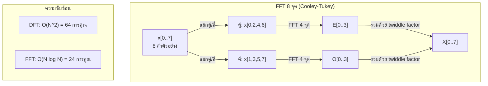
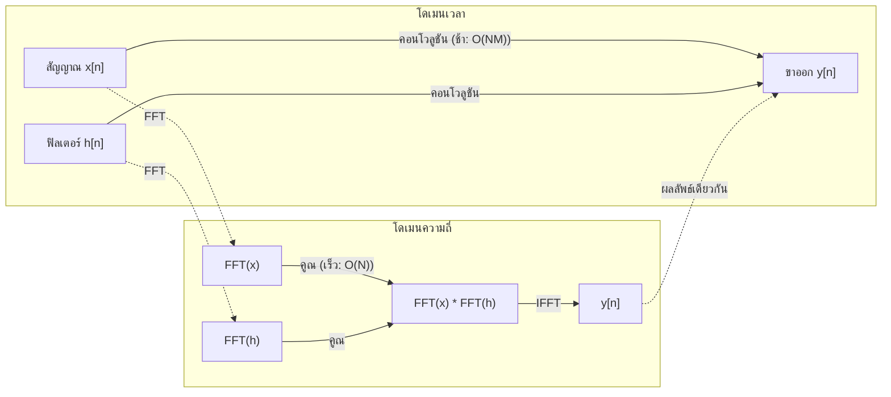

> สัญญาณทุกตัวคือผลรวมของคลื่นไซน์ การแปลงฟูเรียร์บอกว่าเป็นคลื่นตัวไหนบ้าง

**ประเภท:** ลงมือสร้าง (Build)
**ภาษา:** Python, TypeScript
**ความรู้ที่ควรมีก่อน:** Phase 1 บทที่ 01-04, 19 (จำนวนเชิงซ้อน)
**เวลา:** ~90 นาที

## สิ่งที่จะได้เรียนรู้

- เขียน DFT ตั้งแต่ศูนย์ และตรวจผลเทียบกับ FFT แบบ Cooley-Tukey ที่ใช้เวลา $O(N \log N)$
- ตีความสัมประสิทธิ์ความถี่: ดึงแอมพลิจูด เฟส และสเปกตรัมกำลังออกจากสัญญาณ
- ใช้ทฤษฎีบทคอนโวลูชันทำคอนโวลูชันด้วยการคูณผลลัพธ์ของ FFT
- เชื่อมการแยกความถี่แบบฟูเรียร์เข้ากับ positional encoding ของ transformer และชั้นคอนโวลูชันของ CNN

## ปัญหา

ไฟล์เสียงคือลำดับของค่าความดันที่วัดตามเวลา ราคาหุ้นคือลำดับของค่าตามวัน ภาพคือตารางความเข้มของพิกเซลตามพื้นที่ ทั้งหมดนี้คือข้อมูลในโดเมนเวลา (หรือโดเมนพื้นที่) คุณเห็นค่าที่เปลี่ยนไปตามดัชนีบางอย่าง

แต่รูปแบบจำนวนมากมองไม่เห็นในโดเมนเวลา สัญญาณเสียงนี้เป็นเสียงบริสุทธิ์หรือคอร์ด? ราคาหุ้นนี้มีรอบรายสัปดาห์ไหม? ภาพนี้มีพื้นผิวที่ซ้ำ ๆ หรือเปล่า? คำถามเหล่านี้เป็นเรื่องของเนื้อหาความถี่ และโดเมนเวลาซ่อนมันไว้

การแปลงฟูเรียร์แปลงข้อมูลจากโดเมนเวลาไปเป็นโดเมนความถี่ มันรับสัญญาณแล้วแยกออกเป็นคลื่นไซน์ที่ความถี่ต่าง ๆ คลื่นไซน์แต่ละตัวมีแอมพลิจูด (แรงแค่ไหน) และเฟส (เริ่มตรงไหน) การแปลงฟูเรียร์บอกทั้งสองอย่าง

เรื่องนี้สำคัญต่อ ML เพราะการคิดแบบโดเมนความถี่มีอยู่ทุกที่ โครงข่ายประสาทเทียมแบบคอนโวลูชันทำคอนโวลูชัน ซึ่งก็คือการคูณในโดเมนความถี่ positional encoding ของ transformer ใช้การแยกความถี่แทนตำแหน่ง โมเดลเสียง (รู้จำเสียงพูด สร้างดนตรี) ทำงานบนสเปกโทรแกรม ซึ่งเป็นการแทนเสียงด้วยความถี่ โมเดลอนุกรมเวลามองหารูปแบบที่เป็นคาบ การเข้าใจการแปลงฟูเรียร์ให้คำศัพท์ที่ใช้ทำงานกับทั้งหมดนี้

## แนวคิด

### นิยามของ DFT

เมื่อมีค่าตัวอย่าง $N$ ค่า $x[0], x[1], \ldots, x[N-1]$ การแปลงฟูเรียร์แบบไม่ต่อเนื่องให้สัมประสิทธิ์ความถี่ $N$ ตัว $X[0], X[1], \ldots, X[N-1]$:

```math
X[k] = \sum_{n=0}^{N-1} x[n] \, e^{-2\pi i k n/N} \qquad \text{for } k = 0, 1, \ldots, N-1
```

$X[k]$ แต่ละตัวเป็นจำนวนเชิงซ้อน ขนาด $\lvert X[k] \rvert$ ของมันแปรผันตามแอมพลิจูดของความถี่ $k$ ถ้าไม่ normalize ไซน์จริงที่มีแอมพลิจูด $A$ และตกบน bin $k$ พอดีจะให้ $\lvert X[k] \rvert = AN/2$ จึงต้องหารด้วย $N/2$ เพื่ออ่านแอมพลิจูด ส่วนเฟส $\angle X[k]$ บอกการเลื่อนเฟสของความถี่นั้น

ข้อคิดสำคัญ: $e^{-2\pi i k n/N}$ คือเฟเซอร์ที่หมุนด้วยความถี่ $k$ DFT คำนวณความสัมพันธ์ระหว่างสัญญาณกับความถี่ $N$ ตัวที่ห่างกันเท่า ๆ กัน ถ้าสัญญาณมีพลังงานที่ความถี่ $k$ ความสัมพันธ์จะสูง ถ้าไม่มี มันจะใกล้ศูนย์

### สัมประสิทธิ์แต่ละตัวหมายถึงอะไร

**$X[0]$: องค์ประกอบ DC** คือผลรวมของค่าตัวอย่างทั้งหมด ซึ่งแปรผันตามค่าเฉลี่ย มันแทนค่าชดเชยคงที่ (ความถี่ศูนย์) ของสัญญาณ

```math
X[0] = \sum_{n=0}^{N-1} x[n] \, e^0 = \text{sum of all samples}
```

**$X[k]$ สำหรับ $1 \le k \le N/2$: ความถี่บวก** $X[k]$ แทนความถี่ $k$ รอบต่อ $N$ ค่าตัวอย่าง $k$ สูงขึ้นแปลว่าความถี่สูงขึ้น (แกว่งเร็วขึ้น)

**$X[N/2]$: ความถี่ไนควิสต์ (Nyquist frequency)** ความถี่สูงสุดที่แทนได้ด้วย $N$ ค่าตัวอย่าง สูงกว่านี้คุณจะเจอ aliasing คือความถี่สูงปลอมตัวเป็นความถี่ต่ำ

**$X[k]$ สำหรับ $N/2 < k < N$: ความถี่ลบ** สำหรับสัญญาณค่าจริง $X[N-k] = \overline{X[k]}$ ความถี่ลบเป็นภาพสะท้อนของความถี่บวก นี่คือเหตุผลที่ข้อมูลที่มีประโยชน์อยู่ในสัมประสิทธิ์ $N/2 + 1$ ตัวแรก

### DFT ผกผัน

DFT ผกผันสร้างสัญญาณเดิมกลับจากสัมประสิทธิ์ความถี่:

```math
x[n] = \frac{1}{N} \sum_{k=0}^{N-1} X[k] \, e^{2\pi i k n/N} \qquad \text{for } n = 0, 1, \ldots, N-1
```

สิ่งที่ต่างจาก DFT ไปข้างหน้ามีแค่: เครื่องหมายในเลขชี้กำลังเป็นบวก (ไม่ใช่ลบ) และมีตัวประกอบ normalize $1/N$

DFT ผกผันสร้างกลับได้สมบูรณ์ ไม่มีข้อมูลสูญหาย คุณไปจากโดเมนเวลาสู่โดเมนความถี่แล้วกลับมาได้โดยไม่คลาดเคลื่อน DFT คือการเปลี่ยนฐาน มันเขียนข้อมูลเดิมใหม่ในระบบพิกัดอีกระบบ

### FFT: ทำให้เร็ว

DFT ตามนิยามข้างบนใช้ $O(N^2)$: สำหรับสัมประสิทธิ์ขาออกแต่ละตัวจาก $N$ ตัว คุณบวกค่าตัวอย่างขาเข้า $N$ ค่า เมื่อ $N$ = 1 ล้าน นั่นคือ $10^{12}$ การดำเนินการ

การแปลงฟูเรียร์แบบเร็ว (Fast Fourier Transform, FFT) คำนวณผลเดียวกันใน $O(N \log N)$ เมื่อ $N$ = 1 ล้าน นั่นคือราว 20 ล้านการดำเนินการแทนที่จะเป็นล้านล้าน นี่คือสิ่งที่ทำให้การวิเคราะห์ความถี่ใช้งานได้จริง

อัลกอริทึม Cooley-Tukey (FFT แบบที่พบบ่อยที่สุด) ทำงานแบบแบ่งแยกและเอาชนะ:

1. แยกสัญญาณเป็นค่าตัวอย่างที่ดัชนีคู่และดัชนีคี่
2. คำนวณ DFT ของแต่ละครึ่งแบบเวียนเกิด
3. รวม DFT ครึ่งขนาดทั้งสองด้วย "twiddle factor" $e^{-2\pi i k/N}$

```math
\begin{aligned}
X[k] &= E[k] + e^{-2\pi i k/N} \, O[k] && \text{for } k = 0, \ldots, N/2 - 1 \\
X[k + N/2] &= E[k] - e^{-2\pi i k/N} \, O[k] && \text{for } k = 0, \ldots, N/2 - 1 \\[6pt]
\text{where } E &= \text{DFT of even-indexed samples} \\
O &= \text{DFT of odd-indexed samples}
\end{aligned}
```

ความสมมาตรทำให้การเวียนเกิดแต่ละระดับใช้งาน $O(N)$ และมีทั้งหมด $\log_2(N)$ ระดับ รวมเป็น $O(N \log N)$



FFT แบบ radix-2 ที่สร้างในบทนี้เร็วที่สุดเมื่อความยาวสัญญาณเป็นกำลังของ 2 เมื่อไรที่ปัญหาย่อยมีความยาวคี่ มันจะถอยไปใช้ `dft` ธรรมดา จึงมักเติมศูนย์ให้สัญญาณยาวถึงกำลังของ 2 ถัดไปเพื่อความเร็ว FFT ในไลบรารีอย่าง `numpy.fft` รองรับความยาวใดก็ได้ด้วยอัลกอริทึมแบบ mixed-radix แต่ก็เร็วที่สุดกับความยาวที่มีตัวประกอบเฉพาะเล็ก ๆ

### การวิเคราะห์สเปกตรัม

**สเปกตรัมกำลัง (power spectrum)** คือ $\lvert X[k] \rvert^2$ ซึ่งเป็นกำลังสองของขนาดของสัมประสิทธิ์ความถี่แต่ละตัว มันแสดงว่ามีพลังงานที่แต่ละความถี่มากแค่ไหน

**สเปกตรัมเฟส (phase spectrum)** คือ $\angle X[k]$ ซึ่งเป็นการเลื่อนเฟสของแต่ละความถี่ ในงานวิเคราะห์ส่วนใหญ่ คุณสนใจสเปกตรัมกำลังและไม่สนใจเฟส

```math
\begin{aligned}
\text{Power at frequency } k: \quad P[k] &= |X[k]|^2 = \mathop{\mathrm{Re}}(X[k])^2 + \mathop{\mathrm{Im}}(X[k])^2 \\
\text{Phase at frequency } k: \quad \phi[k] &= \mathop{\mathrm{atan2}}(\mathop{\mathrm{Im}}(X[k]), \mathop{\mathrm{Re}}(X[k]))
\end{aligned}
```

### ความละเอียดเชิงความถี่

ความละเอียดเชิงความถี่ของ DFT ขึ้นกับจำนวนค่าตัวอย่าง $N$ และอัตราการสุ่มตัวอย่าง $f_s$

```math
\begin{aligned}
\text{Frequency of bin } k: \quad & f_k = k \cdot f_s / N \\
\text{Frequency resolution:} \quad & \Delta f = f_s / N \\
\text{Maximum frequency:} \quad & f_{\max} = f_s / 2 \quad \text{(Nyquist)}
\end{aligned}
```

ถ้าต้องการแยกสองความถี่ที่อยู่ใกล้กัน คุณต้องมีค่าตัวอย่างมากขึ้น ถ้าต้องการจับความถี่สูง คุณต้องสุ่มตัวอย่างด้วยอัตราที่สูงขึ้น

### ทฤษฎีบทคอนโวลูชัน

นี่คือหนึ่งในผลลัพธ์ที่สำคัญที่สุดในการประมวลผลสัญญาณ และเกี่ยวข้องกับ CNN โดยตรง

**คอนโวลูชันในโดเมนเวลาเท่ากับการคูณทีละจุดในโดเมนความถี่**

```math
\begin{aligned}
& x * h = \text{IFFT}(\text{FFT}(x) \cdot \text{FFT}(h)) \\[4pt]
& \text{where } * \text{ is convolution and } \cdot \text{ is element-wise multiplication}
\end{aligned}
```

ทำไมเรื่องนี้จึงสำคัญ:

- คอนโวลูชันโดยตรงของสัญญาณยาว $N$ และ $M$ ใช้ $O(NM)$ การดำเนินการ
- คอนโวลูชันผ่าน FFT ใช้ $O(N \log N)$: แปลงทั้งคู่ คูณ แล้วแปลงกลับ
- สำหรับ kernel ขนาดใหญ่ คอนโวลูชันผ่าน FFT เร็วกว่าอย่างมาก
- นี่คือสิ่งที่เกิดขึ้นจริงในชั้นคอนโวลูชันที่มี receptive field ใหญ่

หมายเหตุ: DFT คำนวณคอนโวลูชันแบบวงกลม (สัญญาณวนรอบ) ถ้าต้องการคอนโวลูชันเชิงเส้น (ไม่วนรอบ) ให้เติมศูนย์ให้สัญญาณทั้งสองยาว $N + M - 1$ ก่อนคำนวณ



### Windowing

DFT สมมติว่าสัญญาณเป็นคาบ มันมองค่าตัวอย่าง $N$ ค่าเป็นหนึ่งคาบของสัญญาณที่ซ้ำไปไม่สิ้นสุด ถ้าสัญญาณไม่ได้เริ่มและจบที่ค่าเดียวกัน จะเกิดความไม่ต่อเนื่องที่รอยต่อ ซึ่งโผล่มาเป็นเนื้อหาความถี่สูงปลอม เรียกว่าการรั่วของสเปกตรัม (spectral leakage)

Windowing ลดการรั่วด้วยการค่อย ๆ ลดสัญญาณให้เป็นศูนย์ที่ปลายทั้งสองข้างก่อนคำนวณ DFT

window ที่พบบ่อย:

| Window | รูปร่าง | ความกว้างของ main lobe | ระดับของ side lobe | ใช้เมื่อไร |
|--------|-------|----------------|-----------------|----------|
| Rectangular | แบนราบ (ไม่ใช้ window) | แคบที่สุด | สูงที่สุด (-13 dB) | เมื่อสัญญาณเป็นคาบพอดีใน N ค่าตัวอย่าง |
| Hann | โคไซน์ยกขึ้น | ปานกลาง | ต่ำ (-31 dB) | วิเคราะห์สเปกตรัมทั่วไป |
| Hamming | โคไซน์ดัดแปลง | ปานกลาง | ต่ำกว่า (-42 dB) | ประมวลผลเสียง วิเคราะห์เสียงพูด |
| Blackman | โคไซน์สามพจน์ | กว้าง | ต่ำมาก (-58 dB) | เมื่อการกด side lobe สำคัญมาก |

```math
\begin{aligned}
\text{Hann window:} \quad & w[n] = 0.5 \left(1 - \cos\frac{2\pi n}{N-1}\right) \\
\text{Hamming window:} \quad & w[n] = 0.54 - 0.46 \cos\frac{2\pi n}{N-1}
\end{aligned}
```

ใช้ window โดยคูณมันกับสัญญาณทีละสมาชิกก่อนทำ DFT: `X = DFT(x * w)`

### คุณสมบัติของ DFT

| คุณสมบัติ | โดเมนเวลา | โดเมนความถี่ |
|----------|-------------|-----------------|
| ความเป็นเชิงเส้น | $ax + by$ | $aX + bY$ |
| การเลื่อนเวลา | $x[n - k]$ | $X[f] e^{-2\pi i f k/N}$ |
| การเลื่อนความถี่ | $x[n] e^{2\pi i f_0 n/N}$ | $X[f - f_0]$ |
| คอนโวลูชัน | $x * h$ | $X \cdot H$ (ทีละจุด) |
| การคูณ | $x \cdot h$ (ทีละจุด) | $X * H$ (คอนโวลูชันแบบวงกลม คูณด้วย $1/N$) |
| ทฤษฎีบทของพาร์เซวาล | $\sum \lvert x[n] \rvert^2$ | $\frac{1}{N} \sum \lvert X[k] \rvert^2$ |
| สมมาตรแบบสังยุค (ขาเข้าเป็นจำนวนจริง) | $x[n]$ เป็นจำนวนจริง | $X[k] = \overline{X[N-k]}$ |

ทฤษฎีบทของพาร์เซวาล (Parseval's theorem) บอกว่าพลังงานรวมในสองโดเมนเท่ากัน พลังงานถูกอนุรักษ์ผ่านการแปลง

### ความเชื่อมโยงกับ positional encoding

Transformer ฉบับแรกใช้ positional encoding แบบไซน์:

```math
\begin{aligned}
PE(pos, 2i) &= \sin\left(pos / 10000^{2i/d_{\text{model}}}\right) \\
PE(pos, 2i+1) &= \cos\left(pos / 10000^{2i/d_{\text{model}}}\right)
\end{aligned}
```

มิติแต่ละคู่ $(2i, 2i+1)$ แกว่งด้วยความถี่ต่างกัน ความถี่เรียงห่างกันแบบเรขาคณิตจากสูง (มิติ 0,1) ไปต่ำ (มิติท้าย ๆ) ทำให้แต่ละตำแหน่งมีรูปแบบที่ไม่ซ้ำกันข้ามทุกย่านความถี่ คล้ายกับที่สัมประสิทธิ์ฟูเรียร์ระบุสัญญาณได้อย่างเฉพาะตัว

คุณสมบัติสำคัญที่ได้:

- **ไม่ซ้ำกัน:** ไม่มีสองตำแหน่งที่มี encoding เหมือนกัน
- **ค่ามีขอบเขต:** sin และ cos อยู่ใน $[-1, 1]$ เสมอ
- **ตำแหน่งสัมพัทธ์:** encoding ของตำแหน่ง $p+k$ เขียนได้เป็นฟังก์ชันเชิงเส้นของ encoding ที่ตำแหน่ง $p$ โมเดลจึงเรียนรู้ที่จะ attend ตามตำแหน่งสัมพัทธ์ได้

### ความเชื่อมโยงกับ CNN

ชั้นคอนโวลูชันใช้ฟิลเตอร์ (kernel) ที่เรียนรู้มากับขาเข้าโดยเลื่อนมันไปบนสัญญาณหรือภาพ ในทางคณิตศาสตร์ นี่คือการดำเนินการคอนโวลูชัน

ตามทฤษฎีบทคอนโวลูชัน สิ่งนี้เทียบเท่ากับ:
1. ทำ FFT กับขาเข้า
2. ทำ FFT กับ kernel
3. คูณกันในโดเมนความถี่
4. ทำ IFFT กับผลลัพธ์

CNN ทั่วไปใช้คอนโวลูชันโดยตรง (เร็วกว่าสำหรับ kernel 3x3 ขนาดเล็ก) แต่สำหรับ kernel ขนาดใหญ่หรือคอนโวลูชันแบบทั้งสัญญาณ วิธีผ่าน FFT เร็วกว่าอย่างเห็นได้ชัด บางสถาปัตยกรรม (อย่าง FNet) แทน attention ด้วย FFT ทั้งหมด ได้ความแม่นยำที่สูสีด้วยความซับซ้อน $O(N \log N)$ แทน $O(N^2)$

### สเปกโทรแกรมและการแปลงฟูเรียร์ช่วงเวลาสั้น

FFT ครั้งเดียวให้เนื้อหาความถี่ของสัญญาณทั้งหมด แต่ไม่บอกเลยว่าความถี่เหล่านั้นเกิดขึ้นเมื่อไร chirp (สัญญาณที่ความถี่เพิ่มขึ้นตามเวลา) กับคอร์ด (ทุกความถี่เกิดพร้อมกัน) อาจมีสเปกตรัมขนาดเหมือนกัน

การแปลงฟูเรียร์ช่วงเวลาสั้น (Short-Time Fourier Transform, STFT) แก้ปัญหานี้โดยคำนวณ FFT บน window ของสัญญาณที่ซ้อนทับกัน ผลลัพธ์คือสเปกโทรแกรม: การแทนแบบ 2 มิติที่มีเวลาบนแกนหนึ่งและความถี่บนอีกแกน ความเข้มที่แต่ละจุดแสดงพลังงานที่ความถี่นั้น ณ เวลานั้น

```
ขั้นตอนของ STFT:
1. เลือกขนาด window (เช่น 1024 ค่าตัวอย่าง)
2. เลือกระยะก้าว (hop) (เช่น 256 ค่าตัวอย่าง ซ้อนทับกัน 75%)
3. สำหรับแต่ละตำแหน่งของ window:
   a. ตัดส่วนของสัญญาณใน window ออกมา
   b. คูณด้วย window แบบ Hann/Hamming
   c. คำนวณ FFT
   d. เก็บสเปกตรัมขนาดเป็นหนึ่งคอลัมน์ของสเปกโทรแกรม
```

สเปกโทรแกรมคือรูปแบบขาเข้ามาตรฐานของโมเดล ML ด้านเสียง โมเดลรู้จำเสียงพูด (Whisper, DeepSpeech) ทำงานบน mel-spectrogram ซึ่งเป็นสเปกโทรแกรมที่จับคู่ความถี่เข้ากับสเกล mel ซึ่งใกล้เคียงการรับรู้ระดับเสียงของมนุษย์มากกว่า

### Aliasing

ถ้าสัญญาณมีความถี่สูงกว่า $f_s/2$ (ความถี่ไนควิสต์) การสุ่มตัวอย่างด้วยอัตรา $f_s$ จะสร้างสำเนาแบบ alias ขึ้น สัญญาณ 90 Hz ที่สุ่มตัวอย่างที่ 100 Hz ดูเหมือนสัญญาณ 10 Hz ทุกประการ ไม่มีทางแยกสองตัวนี้ออกจากกันได้จากค่าตัวอย่างอย่างเดียว

```
ตัวอย่าง:
  สัญญาณจริง: คลื่นไซน์ 90 Hz
  อัตราการสุ่มตัวอย่าง: 100 Hz
  ความถี่ที่ปรากฏ: 100 - 90 = 10 Hz

  ค่าตัวอย่างของสัญญาณ 90 Hz ที่สุ่มด้วยอัตรา 100 Hz
  เหมือนกับค่าตัวอย่างของสัญญาณ 10 Hz ทุกประการ
  ไม่มีคณิตศาสตร์ใดกู้ 90 Hz เดิมกลับมาได้
```

นี่คือเหตุผลที่ตัวแปลงแอนะล็อกเป็นดิจิทัลมีฟิลเตอร์กัน aliasing ที่ตัดความถี่ที่สูงกว่าไนควิสต์ออกก่อนสุ่มตัวอย่าง ใน ML aliasing เกิดขึ้นเมื่อลดขนาด feature map โดยไม่กรองความถี่ต่ำให้ถูกต้อง บางสถาปัตยกรรมแก้ปัญหานี้ด้วยชั้น pooling แบบกัน aliasing

### การเติมศูนย์ไม่ได้เพิ่มความละเอียด

ความเข้าใจผิดที่พบบ่อย: การเติมศูนย์ให้สัญญาณก่อนทำ FFT ช่วยเพิ่มความละเอียดเชิงความถี่ ซึ่งไม่จริง การเติมศูนย์แค่ประมาณค่าระหว่าง bin ความถี่ที่มีอยู่ ทำให้สเปกตรัมดูเรียบขึ้น แต่ไม่สามารถเผยรายละเอียดความถี่ที่ไม่มีในค่าตัวอย่างเดิมได้

ความละเอียดเชิงความถี่ที่แท้จริงขึ้นกับเวลาที่สังเกตเท่านั้น $T = N / f_s$ ถ้าต้องการแยกสองความถี่ที่ห่างกัน $\Delta f$ คุณต้องมีข้อมูลอย่างน้อย $T = 1 / \Delta f$ วินาที การเติมศูนย์มากเท่าไรก็เปลี่ยนขีดจำกัดพื้นฐานนี้ไม่ได้

```figure
fourier-synthesis
```

## ลงมือสร้าง (Build It)

### ขั้นที่ 1: DFT ตั้งแต่ศูนย์

DFT แบบ $O(N^2)$ ได้มาจากนิยามโดยตรง

```python
import math

class Complex:
    ...

def dft(x):
    N = len(x)
    result = []
    for k in range(N):
        total = Complex(0, 0)
        for n in range(N):
            angle = -2 * math.pi * k * n / N
            w = Complex(math.cos(angle), math.sin(angle))
            xn = x[n] if isinstance(x[n], Complex) else Complex(x[n])
            total = total + xn * w
        result.append(total)
    return result
```

### ขั้นที่ 2: DFT ผกผัน

โครงสร้างเดียวกัน เลขชี้กำลังเป็นบวก แล้วหารด้วย $N$

```python
def idft(X):
    N = len(X)
    result = []
    for n in range(N):
        total = Complex(0, 0)
        for k in range(N):
            angle = 2 * math.pi * k * n / N
            w = Complex(math.cos(angle), math.sin(angle))
            total = total + X[k] * w
        result.append(Complex(total.real / N, total.imag / N))
    return result
```

### ขั้นที่ 3: FFT (Cooley-Tukey)

FFT แบบเวียนเกิดต้องการความยาวที่เป็นกำลังของ 2 แยกเป็นคู่และคี่ เวียนเกิด แล้วรวมด้วย twiddle factor

```python
def fft(x):
    N = len(x)
    if N <= 1:
        return [x[0] if isinstance(x[0], Complex) else Complex(x[0])]
    if N % 2 != 0:
        return dft(x)

    even = fft([x[i] for i in range(0, N, 2)])
    odd = fft([x[i] for i in range(1, N, 2)])

    result = [Complex(0)] * N
    for k in range(N // 2):
        angle = -2 * math.pi * k / N
        twiddle = Complex(math.cos(angle), math.sin(angle))
        t = twiddle * odd[k]
        result[k] = even[k] + t
        result[k + N // 2] = even[k] - t
    return result
```

### ขั้นที่ 4: ฟังก์ชันช่วยวิเคราะห์สเปกตรัม

```python
def power_spectrum(X):
    return [xk.real ** 2 + xk.imag ** 2 for xk in X]

def convolve_fft(x, h):
    N = len(x) + len(h) - 1
    padded_N = 1
    while padded_N < N:
        padded_N *= 2

    x_padded = x + [0.0] * (padded_N - len(x))
    h_padded = h + [0.0] * (padded_N - len(h))

    X = fft(x_padded)
    H = fft(h_padded)

    Y = [xk * hk for xk, hk in zip(X, H)]

    y = idft(Y)
    return [y[n].real for n in range(N)]
```

## นำไปใช้ (Use It)

สำหรับงานจริง ใช้ FFT ของ numpy ซึ่งทำงานบนไลบรารี C ที่ปรับแต่งมาอย่างดี

```python
import numpy as np

signal = np.sin(2 * np.pi * 5 * np.arange(256) / 256)
spectrum = np.fft.fft(signal)
freqs = np.fft.fftfreq(256, d=1/256)

power = np.abs(spectrum) ** 2

positive_freqs = freqs[:len(freqs)//2]
positive_power = power[:len(power)//2]
```

สำหรับ windowing และการวิเคราะห์สเปกตรัมขั้นสูงขึ้น:

```python
from scipy.signal import windows, stft

window = windows.hann(256)
windowed = signal * window
spectrum = np.fft.fft(windowed)
```

สำหรับคอนโวลูชัน:

```python
from scipy.signal import fftconvolve

result = fftconvolve(signal, kernel, mode='full')
```

สำหรับสเปกโทรแกรม:

```python
from scipy.signal import stft

frequencies, times, Zxx = stft(signal, fs=sample_rate, nperseg=256)
spectrogram = np.abs(Zxx) ** 2
```

เมทริกซ์สเปกโทรแกรมมีรูปร่าง (n_frequencies, n_time_frames) แต่ละคอลัมน์คือสเปกตรัมกำลังที่ window เวลาหนึ่ง นี่คือสิ่งที่โมเดล ML ด้านเสียงรับเป็นขาเข้า

## ส่งมอบ (Ship It)

รัน `code/fourier.py` เพื่อสร้าง `outputs/prompt-spectral-analyzer.md` ส่วนเวอร์ชัน TypeScript `code/fourier.ts` เขียนไฟล์เดียวกัน

## แบบฝึกหัด

1. **ระบุเสียงบริสุทธิ์** สร้างสัญญาณที่เป็นคลื่นไซน์ตัวเดียวที่ความถี่ที่ไม่บอกล่วงหน้า (ระหว่าง 1 ถึง 50 Hz) สุ่มตัวอย่างที่ 128 Hz เป็นเวลา 1 วินาที ใช้ DFT ของคุณระบุความถี่ แล้วตรวจว่าคำตอบตรงกัน จากนั้นเติมสัญญาณรบกวนแบบเกาส์เซียนที่มีส่วนเบี่ยงเบนมาตรฐาน 0.5 แล้วทำซ้ำ สัญญาณรบกวนส่งผลต่อสเปกตรัมอย่างไร?

2. **ตรวจ FFT เทียบกับ DFT** สร้างสัญญาณสุ่มยาว 64 คำนวณทั้ง DFT ($O(N^2){}$) และ FFT ตรวจว่าสัมประสิทธิ์ทุกตัวตรงกันภายใน 1e-10 จับเวลาทั้งสองฟังก์ชันบนสัญญาณยาว 256, 512, 1024 และ 2048 แล้วพลอตอัตราส่วนเวลาของ DFT ต่อ FFT

3. **พิสูจน์ทฤษฎีบทคอนโวลูชันด้วยตัวอย่าง** สร้างสัญญาณ x = [1, 2, 3, 4, 0, 0, 0, 0] และฟิลเตอร์ h = [1, 1, 1, 0, 0, 0, 0, 0] คำนวณคอนโวลูชันแบบวงกลมของทั้งสองโดยตรง (ลูปซ้อน) แล้วคำนวณผ่าน FFT (แปลง คูณ แปลงกลับ) ตรวจว่าผลตรงกัน จากนั้นทำคอนโวลูชันเชิงเส้นด้วยการเติมศูนย์ให้เหมาะสม

4. **ผลของ windowing** สร้างสัญญาณที่เป็นผลรวมของคลื่นไซน์สองตัวที่ 10 Hz และ 12 Hz (ใกล้กันมาก) สุ่มตัวอย่างที่ 128 Hz เป็นเวลา 1 วินาที คำนวณสเปกตรัมกำลังแบบไม่ใช้ window ใช้ Hann window และใช้ Hamming window แบบไหนทำให้แยกยอดทั้งสองได้ง่ายที่สุด? เพราะอะไร?

5. **วิเคราะห์ positional encoding** สร้าง positional encoding แบบไซน์สำหรับ d_model = 128 และ max_pos = 512 สำหรับตำแหน่งแต่ละคู่ $(p_1, p_2)$ คำนวณผลคูณจุดของ encoding ทั้งสอง แสดงว่าผลคูณจุดขึ้นกับ $\lvert p_1 - p_2 \rvert$ เท่านั้น ไม่ขึ้นกับตำแหน่งสัมบูรณ์ เกิดอะไรขึ้นกับผลคูณจุดเมื่อระยะห่างเพิ่มขึ้น?

### คำใบ้

**แบบฝึกหัดที่ 1** เมื่อมี 128 ค่าตัวอย่างใน 1 วินาที bin $k$ คือ $k$ Hz ดังนั้นสำหรับความถี่ที่เป็นจำนวนเต็ม ดัชนีของค่าที่มากที่สุดใน bin 1 ถึง 63 ก็คือความถี่ เลือกความถี่เป็นจำนวนเต็มเฮิรตซ์ ความถี่ที่อยู่ระหว่างสอง bin จะกระจายไปยัง bin ข้างเคียง และยอดจะบอกได้แค่ bin ที่ใกล้ที่สุด ใช้ `generate_signal` และ `magnitude_spectrum` หลังเติมสัญญาณรบกวน ตรวจว่ายอดยังอยู่ที่ bin เดิมขณะที่ bin อื่น ๆ สูงขึ้น

**แบบฝึกหัดที่ 2** ใช้ความยาวที่เป็นกำลังของสอง เพราะ `fft` แบ่งสัญญาณเป็นครึ่ง ตรวจ `max(abs(a - b))` บนสัมประสิทธิ์ทุกตัว อัตราส่วนเวลาควรโตราว $N / \log_2 N$

**แบบฝึกหัดที่ 3** สำหรับคอนโวลูชันแบบวงกลม คำนวณ $y[n] = \sum_k h[k] x[(n-k) \bmod 8]$ ด้วยมือสำหรับ $n$ = 0, 1 และ 2 แล้วเทียบกับค่าสามตัวแรกของ `convolve_direct` และ `convolve_fft` คอนโวลูชันเชิงเส้นยาว 4 + 3 - 1 = 6 จึงตรวจก่อนว่าความยาว 8 ยาวพออยู่แล้วหรือไม่

**แบบฝึกหัดที่ 4** ใช้ `hann_window`, `hamming_window`, `apply_window` และ `power_spectrum` แล้วนับยอดที่แยกกันระหว่าง 9 ถึง 13 Hz ทั้ง 10 Hz และ 12 Hz ครบรอบพอดีใน 1 วินาที การไม่ใช้ window จึงอาจดูดีที่สุด ลองใหม่ด้วย 10.5 Hz และ 12.5 Hz เพื่อดูการรั่วที่ window ช่วยลด

**แบบฝึกหัดที่ 5** คำนวณ encoding แต่ละตัวด้วย `positional_encoding(pos, 128)` เทียบผลคูณจุดของตำแหน่ง (0, 10) กับผลคูณจุดของ (100, 110): สองค่าต้องตรงกันถึงราว 1e-10 จากนั้นพลอตผลคูณจุดเทียบกับ $\lvert p_1 - p_2 \rvert$ สำหรับ $p_1$ ค่าหนึ่งที่ตรึงไว้

## คำศัพท์สำคัญ

| คำศัพท์ | ความหมาย |
|------|---------------|
| DFT (การแปลงฟูเรียร์แบบไม่ต่อเนื่อง) | แปลงค่าตัวอย่าง $N$ ค่าในโดเมนเวลาเป็นสัมประสิทธิ์ $N$ ตัวในโดเมนความถี่ สัมประสิทธิ์แต่ละตัวคือความสัมพันธ์กับไซน์เชิงซ้อนที่ความถี่นั้น |
| FFT (การแปลงฟูเรียร์แบบเร็ว) | อัลกอริทึม $O(N \log N)$ สำหรับคำนวณ DFT อัลกอริทึม Cooley-Tukey แยกดัชนีคู่/คี่แบบเวียนเกิด |
| Inverse DFT (DFT ผกผัน) | สร้างสัญญาณในโดเมนเวลากลับจากสัมประสิทธิ์ความถี่ สูตรเดียวกับ DFT แต่กลับเครื่องหมายเลขชี้กำลังและคูณด้วย $1/N$ |
| Frequency bin | ดัชนี $k$ แต่ละตัวในขาออกของ DFT แทนความถี่ $k f_s/N$ Hz "bin" คือช่องความถี่แบบไม่ต่อเนื่อง |
| DC component (องค์ประกอบ DC) | $X[0]$ สัมประสิทธิ์ที่ความถี่ศูนย์ แปรผันตามค่าเฉลี่ยของสัญญาณ |
| Nyquist frequency (ความถี่ไนควิสต์) | $f_s/2$ ความถี่สูงสุดที่แทนได้ที่อัตราการสุ่มตัวอย่าง $f_s$ ความถี่ที่สูงกว่านี้จะเกิด alias |
| Power spectrum (สเปกตรัมกำลัง) | $\lvert X[k] \rvert^2$ กำลังสองของขนาดของสัมประสิทธิ์ความถี่แต่ละตัว แสดงการกระจายพลังงานตามความถี่ |
| Phase spectrum (สเปกตรัมเฟส) | $\angle X[k]$ การเลื่อนเฟสขององค์ประกอบความถี่แต่ละตัว มักไม่ได้ใช้ในการวิเคราะห์ |
| Spectral leakage (การรั่วของสเปกตรัม) | เนื้อหาความถี่ปลอมที่เกิดจากการมองสัญญาณที่ไม่เป็นคาบว่าเป็นคาบ ลดได้ด้วย windowing |
| Window function | ฟังก์ชันที่ค่อย ๆ ลดค่าลงที่ปลาย (Hann, Hamming, Blackman) ใช้ก่อน DFT เพื่อลดการรั่วของสเปกตรัม |
| Twiddle factor | เอกซ์โพเนนเชียลเชิงซ้อน $e^{-2\pi i k/N}$ ที่ใช้รวม DFT ย่อยในการคำนวณแบบ butterfly ของ FFT |
| Convolution theorem (ทฤษฎีบทคอนโวลูชัน) | คอนโวลูชันในโดเมนเวลาเท่ากับการคูณทีละจุดในโดเมนความถี่ เป็นพื้นฐานของการประมวลผลสัญญาณและ CNN |
| Circular convolution (คอนโวลูชันแบบวงกลม) | คอนโวลูชันที่สัญญาณวนรอบ เป็นสิ่งที่ DFT คำนวณโดยธรรมชาติ |
| Linear convolution (คอนโวลูชันเชิงเส้น) | คอนโวลูชันมาตรฐานที่ไม่วนรอบ ทำได้โดยเติมศูนย์ก่อนทำ DFT |
| Parseval's theorem (ทฤษฎีบทของพาร์เซวาล) | พลังงานรวมถูกรักษาไว้ผ่านการแปลงฟูเรียร์ $\sum \lvert x[n] \rvert^2 = \frac{1}{N} \sum \lvert X[k] \rvert^2$ |
| Aliasing | เมื่อความถี่ที่สูงกว่าไนควิสต์ปรากฏเป็นความถี่ต่ำกว่าเพราะอัตราการสุ่มตัวอย่างไม่พอ |

## อ่านเพิ่มเติม

- [Cooley & Tukey: An Algorithm for the Machine Calculation of Complex Fourier Series (1965)](https://www.ams.org/journals/mcom/1965-19-090/S0025-5718-1965-0178586-1/) - เปเปอร์ FFT ฉบับแรกที่เปลี่ยนโลกการคำนวณ
- [3Blue1Brown: But what is the Fourier Transform?](https://www.youtube.com/watch?v=spUNpyF58BY) - บทนำเชิงภาพที่ดีที่สุดเรื่องการแปลงฟูเรียร์
- [Lee-Thorp et al.: FNet: Mixing Tokens with Fourier Transforms (2021)](https://arxiv.org/abs/2105.03824) - แทน self-attention ใน transformer ด้วย FFT
- [Smith: The Scientist and Engineer's Guide to Digital Signal Processing](http://www.dspguide.com/) - ตำราออนไลน์ฟรีที่ครอบคลุม FFT, windowing และการวิเคราะห์สเปกตรัมอย่างลึกซึ้ง
- [Vaswani et al.: Attention Is All You Need (2017)](https://arxiv.org/abs/1706.03762) - positional encoding แบบไซน์ที่มาจากการแยกความถี่แบบฟูเรียร์
- [Radford et al.: Whisper (2022)](https://arxiv.org/abs/2212.04356) - การรู้จำเสียงพูดที่ใช้ mel-spectrogram เป็นรูปแบบขาเข้า
