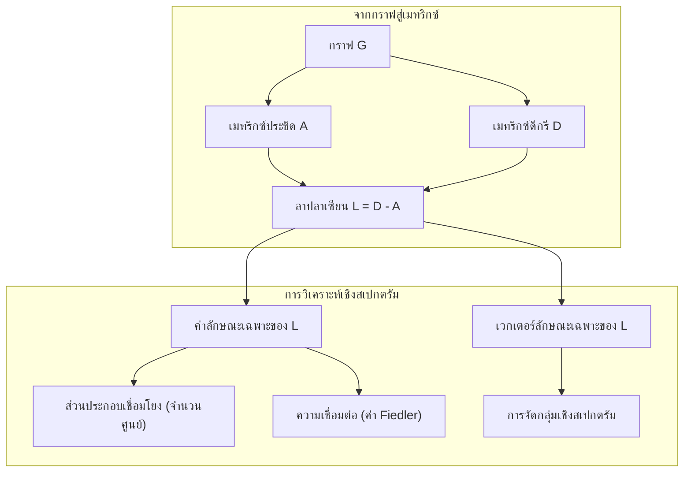
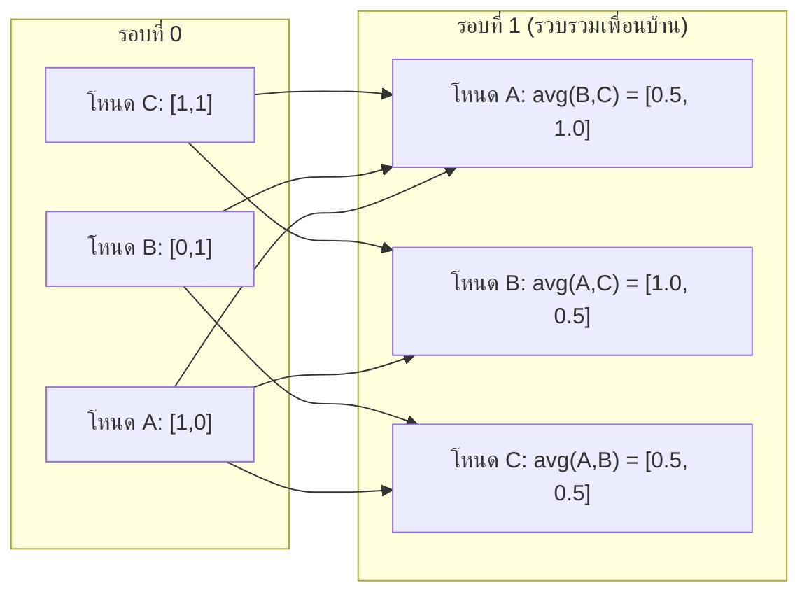

> กราฟคือโครงสร้างข้อมูลของความสัมพันธ์ ถ้าข้อมูลของคุณมีการเชื่อมโยงกัน คุณต้องใช้ทฤษฎีกราฟ

**ประเภท:** ลงมือสร้าง (Build)
**ภาษา:** Python, TypeScript
**ความรู้ที่ควรมีก่อน:** Phase 1 บทที่ 01-03 (พีชคณิตเชิงเส้น เมทริกซ์)
**เวลา:** ~90 นาที

## สิ่งที่จะได้เรียนรู้

- สร้างคลาสกราฟที่แทนด้วยเมทริกซ์ประชิดและรายการประชิด และเขียนการท่องกราฟแบบ BFS และ DFS
- คำนวณลาปลาเซียนของกราฟ (graph Laplacian) และใช้ค่าลักษณะเฉพาะของมันตรวจหาส่วนประกอบเชื่อมโยงและจัดกลุ่มโหนด
- เขียนการส่งผ่านข้อความ (message passing) แบบ GNN หนึ่งรอบในรูปการคูณด้วยเมทริกซ์ประชิดที่ normalize แล้ว
- ใช้การจัดกลุ่มเชิงสเปกตรัม (spectral clustering) แบ่งกราฟด้วยเวกเตอร์ Fiedler

## ปัญหา

เครือข่ายสังคม โมเลกุล ฐานความรู้ เครือข่ายการอ้างอิง แผนที่ถนน ทั้งหมดคือกราฟ ML แบบดั้งเดิมมองข้อมูลเป็นตารางแบน แต่ละแถวเป็นอิสระต่อกัน แต่ละคุณลักษณะเป็นคอลัมน์ แต่เมื่อโครงสร้างของการเชื่อมโยงมีความสำคัญ ตารางก็ใช้ไม่ได้

ลองนึกถึงเครือข่ายสังคม คุณอยากทำนายว่าผู้ใช้จะซื้อสินค้าอะไร ประวัติการซื้อของเขามีผล แต่ประวัติการซื้อของเพื่อน ๆ มีผลมากกว่า การเชื่อมโยงเป็นตัวพาสัญญาณ

หรือลองนึกถึงโมเลกุล คุณอยากทำนายว่ามันจับกับโปรตีนได้หรือไม่ อะตอมมีผล แต่สิ่งที่สำคัญจริง ๆ คืออะตอมเชื่อมพันธะกันอย่างไร โครงสร้างคือข้อมูล

Graph Neural Network (GNN) คือสาขาที่โตเร็วที่สุดใน deep learning มันขับเคลื่อนการค้นพบยา ระบบแนะนำทางสังคม การตรวจจับการฉ้อโกง และการให้เหตุผลบน knowledge graph GNN ทุกตัวสร้างบนรากฐานเดียวกัน: ทฤษฎีกราฟพื้นฐาน

คุณต้องการสี่อย่าง:
1. วิธีแทนกราฟด้วยเมทริกซ์ (เพื่อให้คูณมันได้)
2. อัลกอริทึมการท่องกราฟเพื่อสำรวจโครงสร้าง
3. ลาปลาเซียน ซึ่งเป็นเมทริกซ์ที่สำคัญที่สุดในทฤษฎีกราฟเชิงสเปกตรัม
4. การส่งผ่านข้อความ ซึ่งเป็นการดำเนินการที่ทำให้ GNN ทำงานได้

## แนวคิด

### กราฟ: โหนดและเส้นเชื่อม

กราฟ $G = (V, E)$ ประกอบด้วยจุดยอด (โหนด) $V$ และเส้นเชื่อม $E$ เส้นเชื่อมแต่ละเส้นเชื่อมสองโหนด

**มีทิศกับไม่มีทิศ** ในกราฟไม่มีทิศ เส้นเชื่อม $(u, v)$ หมายถึง $u$ เชื่อมกับ $v$ **และ** $v$ เชื่อมกับ $u$ ในกราฟมีทิศ (digraph) เส้นเชื่อม $(u, v)$ หมายถึง $u$ ชี้ไปที่ $v$ แต่ไม่จำเป็นต้องกลับกัน

**มีน้ำหนักกับไม่มีน้ำหนัก** ในกราฟไม่มีน้ำหนัก เส้นเชื่อมมีหรือไม่มีเท่านั้น ในกราฟมีน้ำหนัก เส้นเชื่อมแต่ละเส้นมีค่าน้ำหนักเป็นตัวเลข เช่น ระยะทาง ต้นทุน หรือความแรง

| ชนิดของกราฟ | ตัวอย่าง |
|-----------|---------|
| ไม่มีทิศ ไม่มีน้ำหนัก | เครือข่ายเพื่อนบน Facebook |
| มีทิศ ไม่มีน้ำหนัก | เครือข่ายการติดตามบน Twitter |
| ไม่มีทิศ มีน้ำหนัก | แผนที่ถนน (ระยะทาง) |
| มีทิศ มีน้ำหนัก | ลิงก์ระหว่างหน้าเว็บ (คะแนน PageRank) |

### เมทริกซ์ประชิด (Adjacency matrix)

เมทริกซ์ประชิด $A$ คือการแทนหลัก สำหรับกราฟที่มี $n$ โหนด:

```math
A[i][j] = \begin{cases} 1 & \text{if there is an edge from node } i \text{ to node } j \\ 0 & \text{otherwise} \end{cases}
```

สำหรับกราฟไม่มีทิศ $A$ สมมาตร: $A[i][j] = A[j][i]$ สำหรับกราฟมีน้ำหนัก $A[i][j]$ = น้ำหนักของเส้นเชื่อม $(i, j)$

**ตัวอย่าง: สามเหลี่ยม**

```
โหนด: 0, 1, 2
เส้นเชื่อม: (0,1), (1,2), (0,2)

A = [[0, 1, 1],
     [1, 0, 1],
     [1, 1, 0]]
```

เมทริกซ์ประชิดคือขาเข้าของ GNN ทุกตัว การดำเนินการทางเมทริกซ์บน $A$ ตรงกับการดำเนินการบนกราฟ

### ดีกรี (Degree)

ดีกรีของโหนดคือจำนวนเส้นเชื่อมที่ต่อกับมัน สำหรับกราฟมีทิศ จะมีดีกรีเข้า (เส้นเชื่อมที่เข้ามา) และดีกรีออก (เส้นเชื่อมที่ออกไป)

เมทริกซ์ดีกรี $D$ เป็นเมทริกซ์ทแยงมุม:

```math
\begin{aligned}
D[i][i] &= \text{degree of node } i \\
D[i][j] &= 0 \quad \text{for } i \ne j
\end{aligned}
```

สำหรับตัวอย่างสามเหลี่ยม: $D = \mathop{\mathrm{diag}}(2, 2, 2)$ เพราะทุกโหนดเชื่อมกับอีกสองโหนด

ดีกรีบอกความสำคัญของโหนด ดีกรีสูง = โหนดศูนย์กลาง (hub) การแจกแจงของดีกรีในเครือข่ายเผยโครงสร้างของมัน เครือข่ายสังคมเป็นไปตามกฎกำลัง (power law) คือมี hub ไม่กี่ตัวและโหนดใบจำนวนมาก ส่วนกราฟสุ่มมีดีกรีแจกแจงแบบปัวซง

### BFS และ DFS

อัลกอริทึมการท่องกราฟพื้นฐานสองตัว คุณต้องใช้ทั้งคู่

**การค้นหาตามแนวกว้าง (Breadth-First Search, BFS):** สำรวจเพื่อนบ้านทั้งหมดก่อน แล้วจึงไปเพื่อนบ้านของเพื่อนบ้าน ใช้คิว (FIFO)

```
BFS จากโหนด 0:
  เยี่ยม 0
  คิว: [1, 2]        (เพื่อนบ้านของ 0)
  เยี่ยม 1
  คิว: [2, 3]        (เพิ่มเพื่อนบ้านของ 1)
  เยี่ยม 2
  คิว: [3]           (เพื่อนบ้านของ 2 ถูกเยี่ยมแล้ว)
  เยี่ยม 3
  คิว: []            (เสร็จ)
```

BFS หาเส้นทางที่สั้นที่สุดในกราฟไม่มีน้ำหนัก ระยะจากจุดเริ่มถึงโหนดใด ๆ เท่ากับระดับของ BFS ที่พบโหนดนั้นเป็นครั้งแรก นี่คือเหตุผลที่ใช้ BFS หาระยะแบบนับจำนวนขั้นในเครือข่ายสังคม

**การค้นหาตามแนวลึก (Depth-First Search, DFS):** ไปให้ลึกที่สุดก่อนย้อนกลับ ใช้สแตก (LIFO) หรือการเวียนเกิด

```
DFS จากโหนด 0:
  เยี่ยม 0
  สแตก: [1, 2]        (เพื่อนบ้านของ 0)
  เยี่ยม 2               (pop จากสแตก)
  สแตก: [1, 3]         (เพิ่มเพื่อนบ้านของ 2)
  เยี่ยม 3               (pop จากสแตก)
  สแตก: [1]
  เยี่ยม 1               (pop จากสแตก)
  สแตก: []             (เสร็จ)
```

DFS มีประโยชน์สำหรับ:
- หาส่วนประกอบเชื่อมโยง (รัน DFS จากโหนดที่ยังไม่ถูกเยี่ยม)
- ตรวจหาวัฏจักร (back edge ในต้นไม้ของ DFS)
- การเรียงลำดับเชิงทอพอโลยี (ลำดับที่ DFS ทำเสร็จแบบย้อนกลับ)

| อัลกอริทึม | โครงสร้างข้อมูล | หาอะไร | ใช้เมื่อไร |
|-----------|---------------|-------|----------|
| BFS | คิว | เส้นทางที่สั้นที่สุด | ระยะในเครือข่ายสังคม การท่อง knowledge graph |
| DFS | สแตก | ส่วนประกอบ วัฏจักร | การเชื่อมต่อ การเรียงลำดับเชิงทอพอโลยี |

### ลาปลาเซียนของกราฟ (Graph Laplacian)

$L = D - A$ เมทริกซ์ที่สำคัญที่สุดในทฤษฎีกราฟเชิงสเปกตรัม

สำหรับสามเหลี่ยม:

```math
D = \begin{bmatrix} 2 & 0 & 0 \\ 0 & 2 & 0 \\ 0 & 0 & 2 \end{bmatrix} \qquad A = \begin{bmatrix} 0 & 1 & 1 \\ 1 & 0 & 1 \\ 1 & 1 & 0 \end{bmatrix} \qquad L = \begin{bmatrix} 2 & -1 & -1 \\ -1 & 2 & -1 \\ -1 & -1 & 2 \end{bmatrix}
```

ลาปลาเซียนมีคุณสมบัติที่น่าทึ่ง:

1. **$L$ กึ่งบวกแน่นอน** ค่าลักษณะเฉพาะทุกตัว $\ge 0$

2. **จำนวนค่าลักษณะเฉพาะที่เป็นศูนย์เท่ากับจำนวนส่วนประกอบเชื่อมโยง** กราฟที่เชื่อมต่อกันมีค่าลักษณะเฉพาะที่เป็นศูนย์พอดีหนึ่งตัว กราฟที่มี 3 ส่วนที่ไม่เชื่อมกันมีค่าลักษณะเฉพาะที่เป็นศูนย์สามตัว

3. **ค่าลักษณะเฉพาะที่ไม่เป็นศูนย์ที่เล็กที่สุด (ค่า Fiedler) วัดความเชื่อมต่อ** ค่า Fiedler ใหญ่แปลว่ากราฟเชื่อมต่อกันดี ค่า Fiedler เล็กแปลว่ากราฟมีจุดอ่อน คือคอขวด

4. **เวกเตอร์ลักษณะเฉพาะของค่า Fiedler (เวกเตอร์ Fiedler) เผยการแบ่งที่ดีที่สุด** โหนดที่มีค่าบวกอยู่กลุ่มหนึ่ง โหนดที่มีค่าลบอยู่อีกกลุ่ม นี่คือการจัดกลุ่มเชิงสเปกตรัม



### คุณสมบัติเชิงสเปกตรัม

ค่าลักษณะเฉพาะของเมทริกซ์ประชิดและลาปลาเซียนเผยคุณสมบัติเชิงโครงสร้างได้โดยไม่ต้องท่องกราฟเลย

**การจัดกลุ่มเชิงสเปกตรัม** ทำงานแบบนี้:
1. คำนวณลาปลาเซียน $L$
2. หาเวกเตอร์ลักษณะเฉพาะ $k$ ตัวที่เล็กที่สุดของ $L$ (ข้ามตัวแรก ซึ่งเป็นเวกเตอร์ที่มีค่าเท่ากันทุกช่องสำหรับกราฟที่เชื่อมต่อกัน)
3. ใช้เวกเตอร์ลักษณะเฉพาะเหล่านั้นเป็นพิกัดใหม่ของแต่ละโหนด
4. รัน $k$-means บนพิกัดเหล่านั้น

ทำไมจึงได้ผล? เวกเตอร์ลักษณะเฉพาะของ $L$ เข้ารหัสฟังก์ชันที่ "เรียบที่สุด" บนกราฟ โหนดที่เชื่อมกันแน่นได้ค่าในเวกเตอร์ลักษณะเฉพาะใกล้กัน โหนดที่ถูกแยกด้วยคอขวดได้ค่าต่างกัน เวกเตอร์ลักษณะเฉพาะจึงแยกกลุ่มได้เองตามธรรมชาติ

**ความเชื่อมโยงกับการเดินสุ่ม** ลาปลาเซียนที่ normalize แล้วเกี่ยวข้องกับการเดินสุ่ม (random walk) บนกราฟ การแจกแจงคงที่ของการเดินสุ่มแปรผันตามดีกรีของโหนด เวลาผสม (mixing time) คือการเดินลู่เข้าเร็วแค่ไหน ขึ้นกับช่องว่างสเปกตรัม (spectral gap)

### การส่งผ่านข้อความ (Message passing)

การดำเนินการหลักของ Graph Neural Network โหนดแต่ละตัวเก็บข้อความจากเพื่อนบ้าน รวบรวมมัน แล้วปรับสถานะของตัวเอง

```math
h_v^{(k+1)} = \text{UPDATE}\left(h_v^{(k)}, \text{AGGREGATE}\left(\{h_u^{(k)} : u \in \text{neighbors}(v)\}\right)\right)
```

ในรูปที่ง่ายที่สุด AGGREGATE = ค่าเฉลี่ย และ UPDATE = การแปลงเชิงเส้น + activation:

```math
h_v^{(k+1)} = \sigma\left(W \cdot \text{mean}\left(\{h_u^{(k)} : u \in \text{neighbors}(v)\}\right)\right)
```

นี่คือการคูณเมทริกซ์ในคราบอื่น ถ้า $H$ เป็นเมทริกซ์ของคุณลักษณะของทุกโหนดและ $A$ เป็นเมทริกซ์ประชิด:

```math
H^{(k+1)} = \sigma\left(A_{\text{norm}} H^{(k)} W\right)
```

โดย $A_{\text{norm}}$ คือเมทริกซ์ประชิดที่ normalize แล้ว (ผลรวมแต่ละแถวเท่ากับ 1)

การส่งผ่านข้อความหนึ่งรอบทำให้แต่ละโหนด "เห็น" เพื่อนบ้านติดกัน สองรอบทำให้เห็นเพื่อนบ้านของเพื่อนบ้าน $K$ รอบให้ข้อมูลจากละแวก $K$ ขั้นแก่แต่ละโหนด



### แนวคิดและการนำไปใช้ใน ML

| แนวคิด | การนำไปใช้ใน ML |
|---------|---------------|
| เมทริกซ์ประชิด | การแทนขาเข้าของ GNN |
| ลาปลาเซียนของกราฟ | การจัดกลุ่มเชิงสเปกตรัม การตรวจหาชุมชน |
| BFS/DFS | การท่อง knowledge graph การหาเส้นทาง |
| การแจกแจงของดีกรี | ความสำคัญของโหนด feature engineering |
| การส่งผ่านข้อความ | ชั้นของ GNN (GCN, GAT, GraphSAGE) |
| ค่าลักษณะเฉพาะของ L | การตรวจหาชุมชน การแบ่งกราฟ |
| การจัดกลุ่มเชิงสเปกตรัม | การจัดกลุ่มโหนดแบบไม่มีผู้สอน |
| PageRank | ความสำคัญของโหนด การค้นหาเว็บ |

```figure
graph-degree-distribution
```

## ลงมือสร้าง (Build It)

### ขั้นที่ 1: คลาสกราฟตั้งแต่ศูนย์

```python
class Graph:
    def __init__(self, n_nodes, directed=False):
        self.n = n_nodes
        self.directed = directed
        self.adj = {i: {} for i in range(n_nodes)}

    def add_edge(self, u, v, weight=1.0):
        self.adj[u][v] = weight
        if not self.directed:
            self.adj[v][u] = weight

    def neighbors(self, node):
        return list(self.adj[node].keys())

    def degree(self, node):
        return len(self.adj[node])

    def weighted_degree(self, node):
        return sum(self.adj[node].values())

    def adjacency_matrix(self):
        import numpy as np
        A = np.zeros((self.n, self.n))
        for u in range(self.n):
            for v, w in self.adj[u].items():
                A[u][v] = w
        return A

    def degree_matrix(self):
        import numpy as np
        D = np.zeros((self.n, self.n))
        for i in range(self.n):
            D[i][i] = self.weighted_degree(i)
        return D

    def laplacian(self):
        return self.degree_matrix() - self.adjacency_matrix()
```

รายการประชิด (`self.adj`) เก็บเพื่อนบ้านอย่างมีประสิทธิภาพ การแปลงเป็นเมทริกซ์ประชิดใช้ numpy เพราะการดำเนินการเชิงสเปกตรัมทั้งหมดต้องใช้มัน

### ขั้นที่ 2: BFS และ DFS

```python
from collections import deque

def bfs(graph, start):
    visited = set()
    order = []
    distances = {}
    queue = deque([(start, 0)])
    visited.add(start)
    while queue:
        node, dist = queue.popleft()
        order.append(node)
        distances[node] = dist
        for neighbor in graph.neighbors(node):
            if neighbor not in visited:
                visited.add(neighbor)
                queue.append((neighbor, dist + 1))
    return order, distances


def dfs(graph, start):
    visited = set()
    order = []
    stack = [start]
    while stack:
        node = stack.pop()
        if node in visited:
            continue
        visited.add(node)
        order.append(node)
        for neighbor in reversed(graph.neighbors(node)):
            if neighbor not in visited:
                stack.append(neighbor)
    return order
```

BFS ใช้ deque (คิวสองปลาย) เพื่อให้ popleft เป็น $O(1)$ DFS ใช้ list เป็นสแตก ทั้งคู่เยี่ยมทุกโหนดครั้งเดียวพอดี ใช้เวลา $O(V + E)$

### ขั้นที่ 3: ส่วนประกอบเชื่อมโยงและค่าลักษณะเฉพาะของลาปลาเซียน

```python
def connected_components(graph):
    visited = set()
    components = []
    for node in range(graph.n):
        if node not in visited:
            order, _ = bfs(graph, node)
            visited.update(order)
            components.append(order)
    return components


def laplacian_eigenvalues(graph):
    import numpy as np
    L = graph.laplacian()
    eigenvalues = np.linalg.eigvalsh(L)
    return eigenvalues
```

`eigvalsh` ใช้กับเมทริกซ์สมมาตร ลาปลาเซียนของกราฟไม่มีทิศสมมาตรเสมอ มันคืนค่าลักษณะเฉพาะเรียงจากน้อยไปมาก นับจำนวนศูนย์เพื่อหาจำนวนส่วนประกอบเชื่อมโยง

### ขั้นที่ 4: การจัดกลุ่มเชิงสเปกตรัม

```python
def spectral_clustering(graph, k=2):
    import numpy as np
    L = graph.laplacian()
    eigenvalues, eigenvectors = np.linalg.eigh(L)
    features = eigenvectors[:, 1:k+1]

    labels = np.zeros(graph.n, dtype=int)
    for i in range(graph.n):
        if features[i, 0] >= 0:
            labels[i] = 0
        else:
            labels[i] = 1
    return labels
```

สำหรับ $k=2$ เครื่องหมายของเวกเตอร์ Fiedler แบ่งกราฟเป็นสองกลุ่ม สำหรับ $k>2$ คุณจะรัน $k$-means บนเวกเตอร์ลักษณะเฉพาะ $k$ ตัวแรก (ไม่นับเวกเตอร์ที่มีค่าเท่ากันทุกช่องซึ่งไม่มีความหมาย)

### ขั้นที่ 5: การส่งผ่านข้อความ

```python
def message_passing(graph, features, weight_matrix):
    import numpy as np
    A = graph.adjacency_matrix()
    row_sums = A.sum(axis=1, keepdims=True)
    row_sums[row_sums == 0] = 1
    A_norm = A / row_sums
    aggregated = A_norm @ features
    output = aggregated @ weight_matrix
    return output
```

นี่คือการส่งผ่านข้อความของ GNN หนึ่งรอบ คุณลักษณะใหม่ของแต่ละโหนดคือค่าเฉลี่ยถ่วงน้ำหนักของคุณลักษณะของเพื่อนบ้าน แล้วแปลงด้วยเมทริกซ์น้ำหนัก ซ้อนหลายรอบเพื่อกระจายข้อมูลไปไกลขึ้น

## นำไปใช้ (Use It)

ด้วย networkx และ numpy การดำเนินการเดียวกันเหลือบรรทัดเดียว:

```python
import networkx as nx
import numpy as np

G = nx.karate_club_graph()

A = nx.adjacency_matrix(G).toarray()
L = nx.laplacian_matrix(G).toarray()

eigenvalues = np.linalg.eigvalsh(L.astype(float))
print(f"Smallest eigenvalues: {eigenvalues[:5]}")
print(f"Connected components: {nx.number_connected_components(G)}")

communities = nx.community.greedy_modularity_communities(G)
print(f"Communities found: {len(communities)}")

pr = nx.pagerank(G)
top_nodes = sorted(pr.items(), key=lambda x: x[1], reverse=True)[:5]
print(f"Top 5 PageRank nodes: {top_nodes}")
```

networkx รองรับกราฟทุกขนาดด้วย backend ภาษา C ที่ปรับแต่งมาแล้ว ใช้มันในงานจริง ส่วนโค้ดที่เขียนเองตั้งแต่ศูนย์มีไว้เพื่อเข้าใจว่ามันทำอะไร

### การวิเคราะห์เชิงสเปกตรัมด้วย numpy

```python
import numpy as np

A = np.array([
    [0, 1, 1, 0, 0],
    [1, 0, 1, 0, 0],
    [1, 1, 0, 1, 0],
    [0, 0, 1, 0, 1],
    [0, 0, 0, 1, 0]
])

D = np.diag(A.sum(axis=1))
L = D - A

eigenvalues, eigenvectors = np.linalg.eigh(L)
print(f"Eigenvalues: {np.round(eigenvalues, 4)}")
print(f"Fiedler value: {eigenvalues[1]:.4f}")
print(f"Fiedler vector: {np.round(eigenvectors[:, 1], 4)}")

fiedler = eigenvectors[:, 1]
group_a = np.where(fiedler >= 0)[0]
group_b = np.where(fiedler < 0)[0]
print(f"Cluster A: {group_a}")
print(f"Cluster B: {group_b}")
```

เวกเตอร์ Fiedler ทำงานหนักทั้งหมด ค่าบวกอยู่กลุ่มหนึ่ง ค่าลบอยู่อีกกลุ่ม ไม่ต้องใช้ optimization แบบวนซ้ำ แค่แยกค่าลักษณะเฉพาะครั้งเดียว

## ส่งมอบ (Ship It)

บทนี้สร้าง:
- `outputs/skill-graph-analysis.md` ซึ่งเป็น skill อ้างอิงสำหรับวิเคราะห์ข้อมูลที่มีโครงสร้างเป็นกราฟ

## ความเชื่อมโยง

| แนวคิด | ปรากฏที่ไหน |
|---------|------------------|
| เมทริกซ์ประชิด | ขาเข้าของ GCN, GAT, GraphSAGE |
| ลาปลาเซียน | การจัดกลุ่มเชิงสเปกตรัม ฟิลเตอร์ของ ChebNet |
| BFS | การท่อง knowledge graph การค้นหาเส้นทางที่สั้นที่สุด |
| การส่งผ่านข้อความ | ทุกชั้นของ GNN, neural message passing |
| ช่องว่างสเปกตรัม | ความเชื่อมต่อของกราฟ เวลาผสมของการเดินสุ่ม |
| การแจกแจงของดีกรี | เครือข่ายแบบกฎกำลัง feature engineering ของโหนด |
| ส่วนประกอบเชื่อมโยง | การเตรียมข้อมูล การรับมือกราฟที่ไม่เชื่อมต่อกัน |
| PageRank | การจัดอันดับความสำคัญของโหนด การกำหนดค่าเริ่มต้นของ attention |

GNN สมควรได้รับการกล่าวถึงเป็นพิเศษ การดำเนินการ graph convolution ใน GCN (Kipf & Welling, 2017) ใช้เมทริกซ์ประชิดที่เพิ่ม self-loop เข้าไป $\hat{A} = A + I$:

```math
H^{(l+1)} = \sigma\left(\hat{D}^{-1/2} \hat{A} \hat{D}^{-1/2} H^{(l)} W^{(l)}\right)
```

โดย $\hat{A} = A + I$ (เมทริกซ์ประชิดบวก self-loop) และ $\hat{D}$ คือเมทริกซ์ดีกรีของ $\hat{A}$ self-loop ทำให้แต่ละโหนดนับคุณลักษณะของตัวเองระหว่างการรวบรวมด้วย นี่คือการส่งผ่านข้อความที่ normalize แบบสมมาตรพอดี $\hat{D}^{-1/2} \hat{A} \hat{D}^{-1/2}$ คือเมทริกซ์ประชิดที่ normalize แล้ว ลาปลาเซียนโผล่มาเพราะการ normalize นี้เกี่ยวข้องกับ $L_{\text{sym}} = I - D^{-1/2} A D^{-1/2}$ การเข้าใจลาปลาเซียนจึงเท่ากับการเข้าใจว่าทำไม GCN ได้ผล

## แบบฝึกหัด

1. **เขียน PageRank ตั้งแต่ศูนย์** เริ่มด้วยคะแนนเท่ากันทุกโหนด ในแต่ละก้าว: score(v) = (1-d)/n + d * sum(score(u)/out_degree(u)) สำหรับทุก u ที่ชี้มาที่ v ใช้ d=0.85 รันจนลู่เข้า (การเปลี่ยนแปลง < 1e-6) ทดสอบบนกราฟเว็บขนาดเล็ก

2. **หาชุมชนด้วยการจัดกลุ่มเชิงสเปกตรัม** สร้างกราฟที่มีสองกลุ่มแยกกันชัดเจน (เช่น clique สองกลุ่มที่เชื่อมกันด้วยเส้นเชื่อมเส้นเดียว) รันการจัดกลุ่มเชิงสเปกตรัมแล้วตรวจว่ามันแบ่งได้ถูก เกิดอะไรขึ้นเมื่อเพิ่มเส้นเชื่อมข้ามกลุ่มมากขึ้น?

3. **เขียนอัลกอริทึมของไดค์สตรา (Dijkstra)** สำหรับเส้นทางที่สั้นที่สุดในกราฟมีน้ำหนัก เทียบผลกับ BFS บนกราฟเดียวกันที่น้ำหนักเท่ากันทุกเส้น

4. **สร้างเครือข่ายการส่งผ่านข้อความ 2 ชั้น** ใช้การส่งผ่านข้อความสองครั้งด้วยเมทริกซ์น้ำหนักต่างกัน แสดงว่าหลัง 2 รอบ แต่ละโหนดมีข้อมูลจากละแวก 2 ขั้นของมัน

5. **วิเคราะห์กราฟจากโลกจริง** ใช้กราฟ Karate Club (34 โหนด 78 เส้นเชื่อม) คำนวณการแจกแจงของดีกรี ค่าลักษณะเฉพาะของลาปลาเซียน และการจัดกลุ่มเชิงสเปกตรัม เทียบผลการจัดกลุ่มเชิงสเปกตรัมกับการแบ่งจริงที่รู้อยู่แล้ว

### คำใบ้

**แบบฝึกหัดที่ 1** ใช้สูตรในแบบฝึกหัด โหนดที่ไม่มีเส้นเชื่อมออกต้องแบ่งคะแนนของมันให้ทุกโหนดเท่า ๆ กัน ไม่อย่างนั้นผลรวมจะต่ำกว่า 1 ตรวจว่าคะแนนรวมกันได้ 1 หลังทุกก้าว และเทียบผลกับ `pagerank(graph)`

**แบบฝึกหัดที่ 2** สร้าง clique สองกลุ่มด้วย `add_edge` เชื่อมกันด้วยเส้นเชื่อมเส้นเดียว แล้วเรียก `spectral_clustering(graph, k=2)` ตรวจว่าแต่ละ clique ได้ป้ายเดียวกัน เมื่อเพิ่มเส้นเชื่อมข้ามกลุ่ม ให้พิมพ์ค่าลักษณะเฉพาะที่เล็กเป็นอันดับสองของ `laplacian()` ซึ่งจะโตขึ้นเมื่อสองกลุ่มรวมเข้าหากัน

**แบบฝึกหัดที่ 3** ใช้คิวลำดับความสำคัญด้วย `heapq` และขยายโหนดที่มีระยะที่รู้แล้วน้อยที่สุดเสมอ ตั้งน้ำหนักทุกเส้นเป็น 1 แล้วตรวจว่าระยะของ Dijkstra แต่ละโหนดเท่ากับชั้นของ BFS ของโหนดนั้นจาก `bfs(graph, start)`

**แบบฝึกหัดที่ 4** ใช้เมทริกซ์เอกลักษณ์เป็น `features` ให้แต่ละคอลัมน์ทำเครื่องหมายโหนดหนึ่งตัว แล้วเรียก `message_passing` สองครั้ง จากนั้นช่องที่ไม่เป็นศูนย์ในแถวของโหนด $v$ จะบอกว่าโหนดไหนส่งข้อมูลมาถึง $v$ เทียบเซตนั้นกับโหนดที่อยู่ในระยะ 2 จากการค้นหาตามแนวกว้าง

**แบบฝึกหัดที่ 5** `networkx.karate_club_graph()` ให้รายการเส้นเชื่อมและการแบ่งจริงในแอตทริบิวต์ `club` ของโหนด คัดลอกเส้นเชื่อมเข้า `Graph` แล้วตรวจว่ามี 34 โหนดและ 78 เส้นเชื่อม เทียบป้ายจาก `spectral_clustering` กับค่า `club` โดยยอมให้ชื่อป้ายสองกลุ่มสลับกันได้

## คำศัพท์สำคัญ

| คำศัพท์ | ที่คนมักพูด | ความหมายจริง |
|------|----------------|----------------------|
| Graph (กราฟ) | "โหนดกับเส้นเชื่อม" | โครงสร้างทางคณิตศาสตร์ $G=(V,E)$ ที่เข้ารหัสความสัมพันธ์แบบเป็นคู่ |
| Adjacency matrix (เมทริกซ์ประชิด) | "ตารางการเชื่อมต่อ" | เมทริกซ์ $n \times n$ ที่ $A[i][j] = 1$ ถ้าโหนด $i$ และ $j$ เชื่อมกัน |
| Degree (ดีกรี) | "โหนดเชื่อมต่อมากแค่ไหน" | จำนวนเส้นเชื่อมที่แตะโหนดนั้น |
| Laplacian (ลาปลาเซียน) | "D ลบ A" | $L = D - A$ เมทริกซ์ที่ค่าลักษณะเฉพาะเผยโครงสร้างของกราฟ |
| Fiedler value (ค่า Fiedler) | "ความเชื่อมต่อเชิงพีชคณิต" | ค่าลักษณะเฉพาะที่ไม่เป็นศูนย์ที่เล็กที่สุดของ $L$ วัดว่ากราฟเชื่อมต่อกันดีแค่ไหน |
| BFS | "ค้นหาทีละระดับ" | การท่องกราฟที่เยี่ยมเพื่อนบ้านทั้งหมดก่อนลงลึก หาเส้นทางที่สั้นที่สุดได้ |
| DFS | "ลงลึกก่อน" | การท่องกราฟที่ตามเส้นทางหนึ่งไปจนสุดก่อนย้อนกลับ |
| Message passing (การส่งผ่านข้อความ) | "โหนดคุยกับเพื่อนบ้าน" | แต่ละโหนดรวบรวมข้อมูลจากเพื่อนบ้าน เป็นแก่นของ GNN |
| Spectral clustering (การจัดกลุ่มเชิงสเปกตรัม) | "จัดกลุ่มด้วยเวกเตอร์ลักษณะเฉพาะ" | แบ่งกราฟโดยใช้เวกเตอร์ลักษณะเฉพาะของลาปลาเซียน |
| Connected component (ส่วนประกอบเชื่อมโยง) | "ชิ้นที่แยกออกมา" | กราฟย่อยที่ใหญ่ที่สุดที่ทุกโหนดเดินไปถึงทุกโหนดอื่นได้ |

## อ่านเพิ่มเติม

- **Kipf & Welling (2017)** "Semi-Supervised Classification with Graph Convolutional Networks" เปเปอร์ที่จุดกระแส GNN สมัยใหม่ แสดงว่า graph convolution เชิงสเปกตรัมลดรูปเป็นการส่งผ่านข้อความได้
- **Spielman (2012)** เอกสารประกอบการสอน "Spectral Graph Theory" บทนำที่ดีที่สุดเรื่องลาปลาเซียน ช่องว่างสเปกตรัม และการแบ่งกราฟ
- **Hamilton (2020)** "Graph Representation Learning" หนังสือที่ครอบคลุม GNN ตั้งแต่พื้นฐานจนถึงการนำไปใช้
- **Bronstein et al. (2021)** "Geometric Deep Learning: Grids, Groups, Graphs, Geodesics, and Gauges" เปเปอร์ที่วางกรอบรวมทุกแนวคิดเข้าด้วยกัน
- **Veličković et al. (2018)** "Graph Attention Networks" ขยายการส่งผ่านข้อความด้วยกลไก attention
