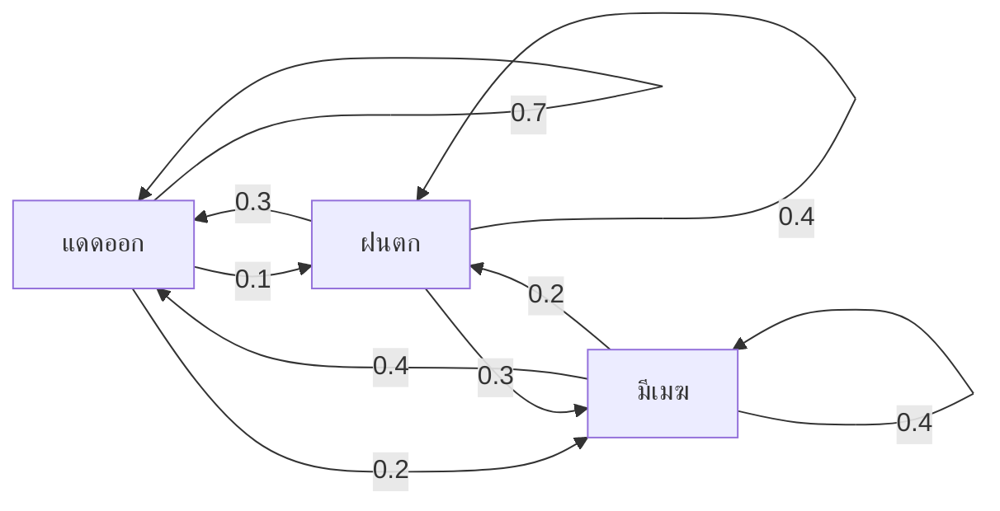
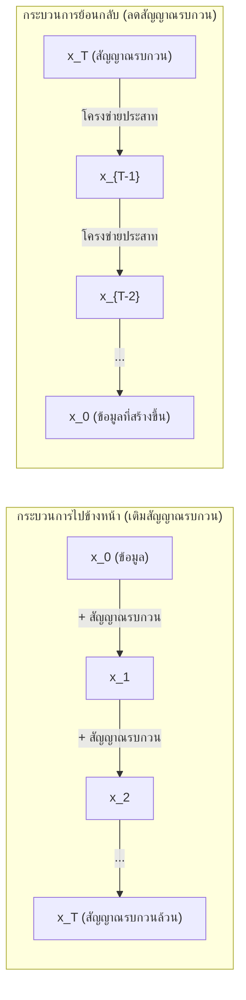

> ความสุ่มที่มีโครงสร้าง คณิตศาสตร์เบื้องหลังการเดินสุ่ม ลูกโซ่มาร์คอฟ และโมเดล diffusion

**ประเภท:** เรียนรู้ (Learn)
**ภาษา:** Python
**ความรู้ที่ควรมีก่อน:** Phase 1 บทที่ 06-07 (ความน่าจะเป็น เบย์)
**เวลา:** ~75 นาที

## สิ่งที่จะได้เรียนรู้

- จำลองการเดินสุ่มใน 1 และ 2 มิติ และตรวจว่าระยะการเคลื่อนที่โตตาม $\sqrt{n}$
- สร้างตัวจำลองลูกโซ่มาร์คอฟและคำนวณการแจกแจงคงที่ของมันด้วยการแยกค่าลักษณะเฉพาะ
- เขียน MCMC แบบ Metropolis-Hastings และ Langevin dynamics เพื่อสุ่มตัวอย่างจากการแจกแจงเป้าหมาย
- เชื่อมกระบวนการ diffusion ไปข้างหน้าเข้ากับการเคลื่อนที่แบบบราวน์ และอธิบายว่ากระบวนการย้อนกลับสร้างข้อมูลได้อย่างไร

## ปัญหา

ระบบ AI จำนวนมากมีความสุ่มที่เปลี่ยนแปลงไปตามเวลา ไม่ใช่ความสุ่มแบบนิ่ง แต่เป็นความสุ่มที่มีโครงสร้างและเป็นลำดับ ซึ่งแต่ละก้าวขึ้นกับสิ่งที่เกิดขึ้นก่อนหน้า

โมเดลภาษาสร้างโทเค็นทีละตัว แต่ละโทเค็นขึ้นกับบริบทก่อนหน้า โมเดลให้การแจกแจงความน่าจะเป็น สุ่มตัวอย่างจากมัน แล้วไปต่อ นั่นคือกระบวนการสโตแคสติก

โมเดล diffusion เติมสัญญาณรบกวนให้ภาพทีละก้าวจนกลายเป็นสัญญาณรบกวนล้วน จากนั้นย้อนกระบวนการ ลดสัญญาณรบกวนทีละก้าวจนภาพใหม่ปรากฏ กระบวนการไปข้างหน้าคือลูกโซ่มาร์คอฟ กระบวนการย้อนกลับคือลูกโซ่มาร์คอฟที่เรียนรู้มาและวิ่งถอยหลัง

agent ใน reinforcement learning ลงมือทำในสภาพแวดล้อม การกระทำแต่ละครั้งนำไปสู่สถานะใหม่ด้วยความน่าจะเป็นค่าหนึ่ง agent ทำตาม policy ที่สุ่มในโลกที่สุ่ม ทั้งหมดนี้คือกระบวนการตัดสินใจแบบมาร์คอฟ (Markov decision process)

การสุ่มตัวอย่างแบบ MCMC ซึ่งเป็นกระดูกสันหลังของการอนุมานแบบเบย์ สร้างลูกโซ่มาร์คอฟที่มีการแจกแจงคงที่เป็น posterior ที่คุณต้องการสุ่ม

ทั้งหมดนี้สร้างบนแนวคิดพื้นฐานสี่อย่าง:
1. การเดินสุ่ม กระบวนการสโตแคสติกที่ง่ายที่สุด
2. ลูกโซ่มาร์คอฟ ความสุ่มที่มีโครงสร้างผ่านเมทริกซ์การเปลี่ยนสถานะ
3. Langevin dynamics คือ gradient descent ที่มีสัญญาณรบกวน
4. Metropolis-Hastings การสุ่มตัวอย่างจากการแจกแจงใดก็ได้

## แนวคิด

### การเดินสุ่ม (Random walks)

เริ่มที่ตำแหน่ง 0 ทุกก้าวโยนเหรียญที่ยุติธรรม ออกหัว: ขยับไปขวา (+1) ออกก้อย: ขยับไปซ้าย (-1)

หลัง $n$ ก้าว ตำแหน่งของคุณคือผลรวมของค่าสุ่ม $\pm 1$ จำนวน $n$ ค่า ตำแหน่งคาดหมายคือ 0 (การเดินไม่เอนเอียง) แต่ระยะห่างจากจุดเริ่มต้นที่คาดหมายโตตาม $\sqrt{n}$

เรื่องนี้ขัดกับสัญชาตญาณ การเดินยุติธรรม ไม่มีการลอยไปทางใดทางหนึ่ง แต่เมื่อเวลาผ่านไป มันกลับเตร็ดเตร่ห่างจากจุดเริ่มต้นออกไปเรื่อย ๆ ส่วนเบี่ยงเบนมาตรฐานหลัง $n$ ก้าวคือ $\sqrt{n}$

```
ก้าวที่ 0:  ตำแหน่ง = 0
ก้าวที่ 1:  ตำแหน่ง = +1 หรือ -1
ก้าวที่ 2:  ตำแหน่ง = +2, 0 หรือ -2
...
ก้าวที่ 100: ระยะห่างจากจุดเริ่มต้นที่คาดหมาย ~ 10 (sqrt(100))
ก้าวที่ 10000: ระยะห่างจากจุดเริ่มต้นที่คาดหมาย ~ 100 (sqrt(10000))
```

**ใน 2 มิติ** การเดินขยับขึ้น ลง ซ้าย หรือขวาด้วยความน่าจะเป็นเท่ากัน การโตตาม $\sqrt{n}$ แบบเดียวกันก็ใช้กับระยะห่างจากจุดเริ่มต้น เส้นทางวาดลวดลายคล้ายแฟร็กทัล

**ทำไมถึงเป็น $\sqrt{n}$?** แต่ละก้าวเป็น +1 หรือ -1 ด้วยความน่าจะเป็นเท่ากัน หลัง $n$ ก้าว ตำแหน่ง $S_n = X_1 + X_2 + \cdots + X_n$ โดย $X_i$ แต่ละตัวเป็น $\pm 1$ ความแปรปรวนของแต่ละก้าวคือ 1 และก้าวต่าง ๆ เป็นอิสระต่อกัน ดังนั้น $\mathop{\mathrm{Var}}(S_n) = n$ ส่วนเบี่ยงเบนมาตรฐาน = $\sqrt{n}$ ตามทฤษฎีบทลิมิตกลาง $S_n / \sqrt{n}$ ลู่เข้าสู่การแจกแจงปกติมาตรฐาน

การโตตาม $\sqrt{n}$ นี้โผล่ทุกที่ใน ML สัญญาณรบกวนของ SGD แปรผันตาม 1/sqrt(batch_size) มิติของ embedding สเกลตาม $\sqrt{d}$ รากที่สองคือลายเซ็นของการบวกค่าสุ่มที่เป็นอิสระต่อกัน

**ความเชื่อมโยงกับการเคลื่อนที่แบบบราวน์** นำการเดินสุ่มที่มีขนาดก้าว $1/\sqrt{n}$ และ $n$ ก้าวต่อหนึ่งหน่วยเวลา เมื่อ $n$ เข้าสู่อนันต์ การเดินลู่เข้าสู่การเคลื่อนที่แบบบราวน์ (Brownian motion) $B(t)$ ซึ่งเป็นกระบวนการเวลาต่อเนื่องที่ $B(t)$ แจกแจงแบบปกติด้วยค่าเฉลี่ย 0 และความแปรปรวน $t$

การเคลื่อนที่แบบบราวน์คือรากฐานทางคณิตศาสตร์ของ diffusion มันจำลองการสั่นแบบสุ่มของอนุภาคในของไหล ความผันผวนของราคาหุ้น และที่สำคัญที่สุดคือกระบวนการสัญญาณรบกวนในโมเดล diffusion

**ความพินาศของนักพนัน (Gambler's ruin)** ผู้เดินสุ่มเริ่มที่ตำแหน่ง $k$ มีกำแพงดูดกลืนที่ 0 และ $N$ ความน่าจะเป็นที่จะถึง $N$ ก่อน 0 คือเท่าไร? สำหรับการเดินที่ยุติธรรม: $P(\text{reach } N) = k/N$ เรียบง่ายและสวยงามอย่างน่าประหลาดใจ มันเชื่อมกับทฤษฎีมาร์ติงเกล (martingale) การเดินสุ่มที่ยุติธรรมเป็นมาร์ติงเกล (ค่าคาดหมายในอนาคต = ค่าปัจจุบัน)

### ลูกโซ่มาร์คอฟ (Markov chains)

ลูกโซ่มาร์คอฟคือระบบที่เปลี่ยนสถานะไปมาตามความน่าจะเป็นที่ตายตัว คุณสมบัติสำคัญ: สถานะถัดไปขึ้นกับสถานะปัจจุบันเท่านั้น ไม่ขึ้นกับประวัติ

```math
P(X_{t+1} = j \mid X_t = i, X_{t-1} = \ldots) = P(X_{t+1} = j \mid X_t = i)
```

นี่คือคุณสมบัติมาร์คอฟ (Markov property) แปลว่าคุณบรรยายพลวัตทั้งหมดได้ด้วยเมทริกซ์การเปลี่ยนสถานะ $P$:

```math
P[i][j] = \text{probability of going from state } i \text{ to state } j
```

แต่ละแถวของ $P$ รวมได้ 1 (ต้องไปที่ใดที่หนึ่ง)

**ตัวอย่าง: สภาพอากาศ**

```
สถานะ: แดดออก (0), ฝนตก (1), มีเมฆ (2)

P = [[0.7, 0.1, 0.2],    (ถ้าแดดออก: แดดออก 70%, ฝนตก 10%, มีเมฆ 20%)
     [0.3, 0.4, 0.3],    (ถ้าฝนตก: แดดออก 30%, ฝนตก 40%, มีเมฆ 30%)
     [0.4, 0.2, 0.4]]    (ถ้ามีเมฆ: แดดออก 40%, ฝนตก 20%, มีเมฆ 40%)
```

เริ่มที่สถานะใดก็ได้ หลังเปลี่ยนสถานะไปหลายครั้ง การแจกแจงของสถานะจะลู่เข้าสู่การแจกแจงคงที่ $\pi$ ซึ่ง $\pi P = \pi$ นี่คือเวกเตอร์ลักษณะเฉพาะด้านซ้ายของ $P$ ที่มีค่าลักษณะเฉพาะ 1

สำหรับลูกโซ่สภาพอากาศ การแจกแจงคงที่คือ [0.55, 0.18, 0.27] ในระยะยาว แดดออก 55% ของเวลาไม่ว่าจะเริ่มที่สถานะใด



**การคำนวณการแจกแจงคงที่** มีสองวิธี:

1. **Power method**: คูณการแจกแจงเริ่มต้นใดก็ได้ด้วย $P$ ซ้ำ ๆ หลังจำนวนรอบที่มากพอ มันจะลู่เข้า
2. **วิธีค่าลักษณะเฉพาะ**: หาเวกเตอร์ลักษณะเฉพาะด้านซ้ายของ $P$ ที่มีค่าลักษณะเฉพาะ 1 ซึ่งก็คือเวกเตอร์ลักษณะเฉพาะของ $P^T$ ที่มีค่าลักษณะเฉพาะ 1

ทั้งสองวิธีต้องการให้ลูกโซ่ผ่านเงื่อนไขการลู่เข้า

**เงื่อนไขการลู่เข้า** ลูกโซ่มาร์คอฟลู่เข้าสู่การแจกแจงคงที่ที่มีเพียงหนึ่งเดียวถ้ามันเป็น:
- **Irreducible**: ทุกสถานะไปถึงได้จากทุกสถานะอื่น
- **Aperiodic**: ลูกโซ่ไม่วนเป็นคาบที่ตายตัว

ลูกโซ่ส่วนใหญ่ที่คุณเจอใน ML ผ่านทั้งสองเงื่อนไข

**สถานะดูดกลืน (Absorbing states)** สถานะหนึ่งเป็นสถานะดูดกลืนถ้าเข้าไปแล้วไม่มีวันออก ($P[i][i] = 1$) ลูกโซ่มาร์คอฟแบบดูดกลืนจำลองกระบวนการที่มีสถานะสิ้นสุด เช่น เกมที่จบ ลูกค้าที่เลิกใช้บริการ หรือลำดับโทเค็นที่เจอโทเค็นจบข้อความ

**เวลาผสม (Mixing time)** ต้องใช้กี่ก้าวจนลูกโซ่ "ใกล้" การแจกแจงคงที่? ในเชิงทางการ คือจำนวนก้าวจนระยะ total variation จากการแจกแจงคงที่ลดลงต่ำกว่าเกณฑ์ค่าหนึ่ง ผสมเร็ว = ใช้ไม่กี่ก้าว สำหรับลูกโซ่ที่ย้อนกลับได้ ช่องว่างสเปกตรัมของ $P$ (1 ลบขนาดของค่าลักษณะเฉพาะที่ใหญ่ที่สุดที่ไม่ใช่ค่าลักษณะเฉพาะ 1) ควบคุมเวลาผสม ช่องว่างใหญ่ = ผสมเร็ว

### ความเชื่อมโยงกับโมเดลภาษา

การสร้างโทเค็นในโมเดลภาษาเป็นกระบวนการมาร์คอฟโดยประมาณ เมื่อมีบริบทปัจจุบัน โมเดลให้การแจกแจงของโทเค็นถัดไป temperature ควบคุมความแหลม:

```math
P(\text{token}_i) = \frac{\exp(\text{logit}_i / \text{temperature})}{\sum_j \exp(\text{logit}_j / \text{temperature})}
```

- Temperature = 1.0: การแจกแจงมาตรฐาน
- Temperature < 1.0: แหลมขึ้น (กำหนดได้แน่นอนมากขึ้น)
- Temperature > 1.0: แบนลง (สุ่มมากขึ้น)
- Temperature $\to 0$: argmax (greedy)

การสุ่มแบบ top-k ตัดเหลือแค่ $k$ โทเค็นที่มีความน่าจะเป็นสูงสุด การสุ่มแบบ top-p (nucleus) ตัดเหลือเซตโทเค็นที่เล็กที่สุดที่ความน่าจะเป็นสะสมเกิน $p$ ทั้งสองแบบปรับความน่าจะเป็นการเปลี่ยนสถานะของลูกโซ่มาร์คอฟ

### การเคลื่อนที่แบบบราวน์ (Brownian motion)

ลิมิตเวลาต่อเนื่องของการเดินสุ่ม ตำแหน่ง $B(t)$ มีคุณสมบัติสามข้อ:
1. $B(0) = 0$
2. $B(t) - B(s)$ แจกแจงแบบปกติด้วยค่าเฉลี่ย 0 และความแปรปรวน $t - s$ (สำหรับ $t > s$)
3. ส่วนเพิ่มบนช่วงเวลาที่ไม่ซ้อนกันเป็นอิสระต่อกัน

การเคลื่อนที่แบบบราวน์ต่อเนื่องแต่หาอนุพันธ์ไม่ได้เลยสักจุด มันสั่นในทุกสเกล เส้นทางของมันมีมิติแฟร็กทัลเป็น 2 ในระนาบ

ในการจำลองแบบไม่ต่อเนื่อง คุณประมาณการเคลื่อนที่แบบบราวน์ด้วย:

```math
B(t + dt) = B(t) + \sqrt{dt} \, z, \quad \text{where } z \sim \mathcal{N}(0, 1)
```

การสเกลด้วย $\sqrt{dt}$ สำคัญ มันมาจากทฤษฎีบทลิมิตกลางที่ใช้กับการเดินสุ่ม

### Langevin dynamics

Gradient descent หาจุดต่ำสุดของฟังก์ชัน ส่วน Langevin dynamics หาการแจกแจงความน่าจะเป็นที่แปรผันตาม $\exp(-U(x)/T)$ โดย $U$ คือฟังก์ชันพลังงานและ $T$ คือ temperature

```math
x_{t+1} = x_t - dt \, \nabla U(x_t) + \sqrt{2 T \, dt} \, z_t
```

มีแรงสองแรงกระทำต่ออนุภาค:
1. **แรงจากเกรเดียนต์** ($-dt \cdot \nabla U$): ดันไปทางพลังงานต่ำ (เหมือน gradient descent)
2. **แรงสุ่ม** ($\sqrt{2T dt} \cdot z$): ดันไปในทิศสุ่ม (การสำรวจ)

ที่ temperature $T = 0$ นี่คือ gradient descent ล้วน ๆ ที่ temperature สูง มันเกือบเป็นการเดินสุ่ม ที่ temperature ที่เหมาะสม อนุภาคจะสำรวจภูมิประเทศของพลังงานและใช้เวลาในบริเวณพลังงานต่ำมากกว่า

**ความเชื่อมโยงกับโมเดล diffusion** กระบวนการไปข้างหน้าของโมเดล diffusion คือ:

```math
x_t = \sqrt{\alpha_t} \, x_{t-1} + \sqrt{1 - \alpha_t} \cdot \text{noise}
```

นี่คือลูกโซ่มาร์คอฟที่ค่อย ๆ ผสมข้อมูลกับสัญญาณรบกวน หลังก้าวที่มากพอ $x_T$ จะเป็นสัญญาณรบกวนเกาส์เซียนล้วน

กระบวนการย้อนกลับ คือจากสัญญาณรบกวนกลับไปเป็นข้อมูล ก็เป็นลูกโซ่มาร์คอฟเช่นกัน แต่ความน่าจะเป็นการเปลี่ยนสถานะเรียนรู้โดยโครงข่ายประสาทเทียม โครงข่ายเรียนรู้ที่จะทำนายสัญญาณรบกวนที่ถูกเติมในแต่ละก้าว แล้วลบมันออก



### MCMC: Markov Chain Monte Carlo

บางครั้งคุณต้องสุ่มตัวอย่างจากการแจกแจง $p(x)$ ที่คำนวณค่าได้ (ไม่นับค่าคงที่) แต่สุ่มตัวอย่างตรง ๆ ไม่ได้ posterior แบบเบย์คือตัวอย่างคลาสสิก คุณรู้ likelihood คูณ prior แต่ค่าคงที่สำหรับ normalize คำนวณไม่ได้

**Metropolis-Hastings** สร้างลูกโซ่มาร์คอฟที่มีการแจกแจงคงที่เป็น $p(x)$:

1. เริ่มที่ตำแหน่ง $x$ ใดก็ได้
2. เสนอตำแหน่งใหม่ $x'$ จากการแจกแจงเสนอ $Q(x' \mid x)$
3. คำนวณอัตราส่วนการยอมรับ: $a = p(x') Q(x \mid x') / (p(x) Q(x' \mid x))$
4. ยอมรับ $x'$ ด้วยความน่าจะเป็น $\min(1, a)$ ไม่อย่างนั้นอยู่ที่ $x$
5. ทำซ้ำ

ถ้า $Q$ สมมาตร (เช่น $Q(x' \mid x) = Q(x \mid x') = \mathcal{N}(x, \sigma^2){}$) อัตราส่วนจะลดรูปเป็น $a = p(x') / p(x)$ คุณต้องการแค่อัตราส่วนของความน่าจะเป็น ค่าคงที่สำหรับ normalize หักล้างกันไป

ลูกโซ่รับประกันว่าลู่เข้าสู่ $p(x)$ ภายใต้เงื่อนไขที่ไม่เข้มงวด แต่การลู่เข้าอาจช้าถ้าการเสนอเล็กเกินไป (เดินสุ่มทีละนิด) หรือใหญ่เกินไป (ถูกปฏิเสธบ่อย) การปรับการเสนอคือศิลปะของ MCMC

**ทำไมจึงได้ผล** อัตราส่วนการยอมรับรับประกันสมดุลโดยละเอียด (detailed balance): ความน่าจะเป็นที่จะอยู่ที่ $x$ แล้วย้ายไป $x'$ เท่ากับความน่าจะเป็นที่จะอยู่ที่ $x'$ แล้วย้ายไป $x$ สมดุลโดยละเอียดทำให้ $p(x)$ เป็นการแจกแจงคงที่ของลูกโซ่ ดังนั้นหลังก้าวที่มากพอ ตัวอย่างจะมาจาก $p(x)$

**ข้อพิจารณาในทางปฏิบัติ:**
- **Burn-in**: ทิ้งตัวอย่าง $N$ ตัวแรก ลูกโซ่ต้องใช้เวลาเดินจากจุดเริ่มต้นไปถึงการแจกแจงคงที่
- **Thinning**: เก็บทุกตัวอย่างที่ $k$ เพื่อลด autocorrelation
- **หลายลูกโซ่**: รันหลายลูกโซ่จากจุดเริ่มต้นต่างกัน ถ้าทั้งหมดลู่เข้าสู่การแจกแจงเดียวกัน คุณก็มีหลักฐานของการลู่เข้า
- **อัตราการยอมรับ**: สำหรับการเสนอแบบเกาส์เซียนใน $d$ มิติ อัตราการยอมรับที่เหมาะที่สุดอยู่ราว 23% (Roberts & Rosenthal, 2001) สูงเกินไปแปลว่าลูกโซ่แทบไม่ขยับ ต่ำเกินไปแปลว่ามันปฏิเสธทุกอย่าง

### กระบวนการสโตแคสติกใน AI

| กระบวนการ | การนำไปใช้ใน AI |
|---------|---------------|
| การเดินสุ่ม | การสำรวจใน RL, embedding แบบ Node2Vec |
| ลูกโซ่มาร์คอฟ | การสร้างข้อความ การสุ่มตัวอย่างแบบ MCMC |
| การเคลื่อนที่แบบบราวน์ | โมเดล diffusion (กระบวนการไปข้างหน้า) |
| Langevin dynamics | โมเดลสร้างแบบ score-based, SGLD |
| กระบวนการตัดสินใจแบบมาร์คอฟ | Reinforcement learning |
| Metropolis-Hastings | การอนุมานแบบเบย์ การสุ่มตัวอย่างจาก posterior |

```figure
random-walk-diffusion
```

## ลงมือสร้าง (Build It)

### ขั้นที่ 1: ตัวจำลองการเดินสุ่ม

```python
import numpy as np

def random_walk_1d(n_steps, seed=None):
    rng = np.random.RandomState(seed)
    steps = rng.choice([-1, 1], size=n_steps)
    positions = np.concatenate([[0], np.cumsum(steps)])
    return positions


def random_walk_2d(n_steps, seed=None):
    rng = np.random.RandomState(seed)
    directions = rng.choice(4, size=n_steps)
    dx = np.zeros(n_steps)
    dy = np.zeros(n_steps)
    dx[directions == 0] = 1   # right
    dx[directions == 1] = -1  # left
    dy[directions == 2] = 1   # up
    dy[directions == 3] = -1  # down
    x = np.concatenate([[0], np.cumsum(dx)])
    y = np.concatenate([[0], np.cumsum(dy)])
    return x, y
```

การเดินใน 1 มิติเก็บผลรวมสะสม แต่ละก้าวเป็น +1 หรือ -1 หลัง $n$ ก้าว ตำแหน่งคือผลรวม ความแปรปรวนโตเป็นเส้นตรงตาม $n$ ส่วนเบี่ยงเบนมาตรฐานจึงโตตาม $\sqrt{n}$

### ขั้นที่ 2: ลูกโซ่มาร์คอฟ

```python
class MarkovChain:
    def __init__(self, transition_matrix, state_names=None):
        self.P = np.array(transition_matrix, dtype=float)
        self.n_states = len(self.P)
        self.state_names = state_names or [str(i) for i in range(self.n_states)]

    def step(self, current_state, rng=None):
        if rng is None:
            rng = np.random.RandomState()
        probs = self.P[current_state]
        return rng.choice(self.n_states, p=probs)

    def simulate(self, start_state, n_steps, seed=None):
        rng = np.random.RandomState(seed)
        states = [start_state]
        current = start_state
        for _ in range(n_steps):
            current = self.step(current, rng)
            states.append(current)
        return states

    def stationary_distribution(self):
        eigenvalues, eigenvectors = np.linalg.eig(self.P.T)
        idx = np.argmin(np.abs(eigenvalues - 1.0))
        stationary = np.real(eigenvectors[:, idx])
        stationary = stationary / stationary.sum()
        return np.abs(stationary)
```

การแจกแจงคงที่คือเวกเตอร์ลักษณะเฉพาะด้านซ้ายของ $P$ ที่มีค่าลักษณะเฉพาะ 1 เราหามันด้วยการคำนวณเวกเตอร์ลักษณะเฉพาะของ $P^T$ (การทรานสโพสเปลี่ยนเวกเตอร์ลักษณะเฉพาะด้านซ้ายเป็นด้านขวา)

### ขั้นที่ 3: Langevin dynamics

```python
def langevin_dynamics(grad_U, x0, dt, temperature, n_steps, seed=None):
    rng = np.random.RandomState(seed)
    x = np.array(x0, dtype=float)
    trajectory = [x.copy()]
    for _ in range(n_steps):
        noise = rng.randn(*x.shape)
        x = x - dt * grad_U(x) + np.sqrt(2 * temperature * dt) * noise
        trajectory.append(x.copy())
    return np.array(trajectory)
```

เกรเดียนต์ดัน $x$ ไปทางพลังงานต่ำ สัญญาณรบกวนกันไม่ให้มันติด ที่สมดุล การแจกแจงของตัวอย่างแปรผันตาม $\exp(-U(x)/\text{temperature})$

### ขั้นที่ 4: Metropolis-Hastings

```python
def metropolis_hastings(target_log_prob, proposal_std, x0, n_samples, seed=None):
    rng = np.random.RandomState(seed)
    x = np.array(x0, dtype=float)
    samples = [x.copy()]
    accepted = 0
    for _ in range(n_samples - 1):
        x_proposed = x + rng.randn(*x.shape) * proposal_std
        log_ratio = target_log_prob(x_proposed) - target_log_prob(x)
        if np.log(rng.rand()) < log_ratio:
            x = x_proposed
            accepted += 1
        samples.append(x.copy())
    acceptance_rate = accepted / (n_samples - 1)
    return np.array(samples), acceptance_rate
```

อัลกอริทึมเสนอจุดใหม่ ตรวจว่ามันมีความน่าจะเป็นสูงกว่าหรือไม่ (หรือยอมรับด้วยความน่าจะเป็นตามอัตราส่วน) แล้วทำซ้ำ อัตราการยอมรับควรอยู่ราว 23-50% เพื่อให้ผสมได้ดี

## นำไปใช้ (Use It)

ในทางปฏิบัติ คุณใช้ไลบรารีที่มีอยู่แล้วสำหรับอัลกอริทึมเหล่านี้ แต่การเข้าใจกลไกสำคัญต่อการดีบักและการปรับแต่ง

```python
import numpy as np

rng = np.random.RandomState(42)
walk = np.cumsum(rng.choice([-1, 1], size=10000))
print(f"Final position: {walk[-1]}")
print(f"Expected distance: {np.sqrt(10000):.1f}")
print(f"Actual distance: {abs(walk[-1])}")
```

### numpy สำหรับเมทริกซ์การเปลี่ยนสถานะ

```python
import numpy as np

P = np.array([[0.7, 0.1, 0.2],
              [0.3, 0.4, 0.3],
              [0.4, 0.2, 0.4]])

distribution = np.array([1.0, 0.0, 0.0])
for _ in range(100):
    distribution = distribution @ P

print(f"Stationary distribution: {np.round(distribution, 4)}")
```

คูณการแจกแจงเริ่มต้นด้วย $P$ ซ้ำ ๆ หลังจำนวนรอบที่มากพอ มันลู่เข้าสู่การแจกแจงคงที่ไม่ว่าคุณจะเริ่มที่ไหน นี่คือ power method สำหรับหาเวกเตอร์ลักษณะเฉพาะด้านซ้ายที่เด่นที่สุด

### ความเชื่อมโยงกับเฟรมเวิร์กจริง

- **PyTorch diffusion:** `DDPMScheduler` ใน `diffusers` ของ Hugging Face ทำลูกโซ่มาร์คอฟไปข้างหน้าและย้อนกลับ
- **NumPyro / PyMC:** ใช้ MCMC (ตัวสุ่ม NUTS ซึ่งพัฒนาต่อจาก Metropolis-Hastings) สำหรับการอนุมานแบบเบย์
- **Gymnasium (RL):** ฟังก์ชัน step ของสภาพแวดล้อมนิยามกระบวนการตัดสินใจแบบมาร์คอฟ

### ตรวจการลู่เข้าของลูกโซ่มาร์คอฟ

```python
import numpy as np

P = np.array([[0.9, 0.1], [0.3, 0.7]])

eigenvalues = np.linalg.eigvals(P)
spectral_gap = 1 - sorted(np.abs(eigenvalues))[-2]
print(f"Eigenvalues: {eigenvalues}")
print(f"Spectral gap: {spectral_gap:.4f}")
print(f"Approximate mixing time: {1/spectral_gap:.1f} steps")
```

ช่องว่างสเปกตรัมบอกว่าลูกโซ่ลืมสถานะเริ่มต้นเร็วแค่ไหน ช่องว่าง 0.2 หมายถึงราว 5 ก้าวในการผสม ช่องว่าง 0.01 หมายถึงราว 100 ก้าว ตรวจค่านี้ก่อนรันการจำลองยาว ๆ เสมอ ลูกโซ่ที่ผสมช้าเปลืองการคำนวณ

## ส่งมอบ (Ship It)

บทนี้สร้าง:
- `outputs/prompt-stochastic-process-advisor.md` ซึ่งเป็น prompt ที่ช่วยระบุว่ากรอบกระบวนการสโตแคสติกแบบไหนเหมาะกับปัญหาที่กำหนด

## ความเชื่อมโยง

| แนวคิด | ปรากฏที่ไหน |
|---------|------------------|
| การเดินสุ่ม | graph embedding แบบ Node2Vec การสำรวจใน RL |
| ลูกโซ่มาร์คอฟ | การสร้างโทเค็นใน LLM การสุ่มตัวอย่างแบบ MCMC |
| การเคลื่อนที่แบบบราวน์ | กระบวนการ diffusion ไปข้างหน้าใน DDPM โมเดลที่ใช้ SDE |
| Langevin dynamics | โมเดลสร้างแบบ score-based, stochastic gradient Langevin dynamics (SGLD) |
| การแจกแจงคงที่ | เป้าหมายการลู่เข้าของ MCMC, PageRank |
| Metropolis-Hastings | การสุ่มตัวอย่างจาก posterior แบบเบย์ simulated annealing |
| Temperature | การสุ่มของ LLM การสำรวจแบบ Boltzmann ใน RL simulated annealing |
| เวลาผสม | ความเร็วในการลู่เข้าของ MCMC การวิเคราะห์ช่องว่างสเปกตรัม |
| สถานะดูดกลืน | โทเค็นจบลำดับ สถานะสิ้นสุดใน RL |
| สมดุลโดยละเอียด | การรับประกันความถูกต้องของตัวสุ่มแบบ MCMC |

โมเดล diffusion สมควรได้รับความสนใจเป็นพิเศษ DDPM (Ho et al., 2020) นิยามลูกโซ่มาร์คอฟไปข้างหน้า:

```math
q(x_t \mid x_{t-1}) = \mathcal{N}\left(x_t; \sqrt{1-\beta_t} \, x_{t-1}, \beta_t I\right)
```

โดย $\beta_t$ คือตารางสัญญาณรบกวน (noise schedule) หลัง $T$ ก้าว $x_T$ จะเป็น $\mathcal{N}(0, I)$ โดยประมาณ กระบวนการย้อนกลับถูกกำหนดพารามิเตอร์ด้วยโครงข่ายประสาทเทียมที่ทำนายสัญญาณรบกวน:

```math
p_\theta(x_{t-1} \mid x_t) = \mathcal{N}\left(x_{t-1}; \mu_\theta(x_t, t), \sigma_t^2 I\right)
```

ทุกก้าวของการสร้างคือก้าวหนึ่งในลูกโซ่มาร์คอฟที่เรียนรู้มา การเข้าใจลูกโซ่มาร์คอฟจึงเท่ากับการเข้าใจว่าโมเดล diffusion สร้างข้อมูลอย่างไรและทำไม

SGLD (Stochastic Gradient Langevin Dynamics) รวม gradient descent แบบ mini-batch เข้ากับสัญญาณรบกวนแบบ Langevin แทนที่จะคำนวณเกรเดียนต์เต็ม คุณใช้ค่าประมาณแบบสุ่มแล้วเติมสัญญาณรบกวนที่ปรับเทียบแล้ว เมื่อ learning rate ลดลง SGLD จะเปลี่ยนจากการหาค่าเหมาะที่สุดไปเป็นการสุ่มตัวอย่าง คุณได้ตัวอย่างจาก posterior แบบเบย์โดยประมาณมาฟรี ๆ นี่คือหนึ่งในวิธีที่ง่ายที่สุดในการได้ค่าประมาณความไม่แน่นอนจากโครงข่ายประสาทเทียม

ข้อคิดสำคัญที่ร้อยทุกความเชื่อมโยงเข้าด้วยกัน: กระบวนการสโตแคสติกไม่ใช่แค่เครื่องมือทางทฤษฎี มันคือกลไกการคำนวณภายในระบบ AI สมัยใหม่ เมื่อคุณปรับ temperature ของ LLM คุณกำลังปรับลูกโซ่มาร์คอฟ เมื่อคุณฝึกโมเดล diffusion คุณกำลังเรียนรู้ที่จะย้อนกระบวนการที่คล้ายการเคลื่อนที่แบบบราวน์ เมื่อคุณทำการอนุมานแบบเบย์ คุณกำลังสร้างลูกโซ่ที่ลู่เข้าสู่ posterior

## แบบฝึกหัด

1. **จำลองการเดินสุ่ม 1000 ครั้ง ครั้งละ 10000 ก้าว** พลอตการแจกแจงของตำแหน่งสุดท้าย ตรวจว่ามันเป็นเกาส์เซียนโดยประมาณ มีค่าเฉลี่ย 0 และส่วนเบี่ยงเบนมาตรฐาน $\sqrt{10000} = 100$

2. **สร้างตัวสร้างข้อความด้วยลูกโซ่มาร์คอฟ** ฝึกบนคลังข้อความขนาดเล็ก: สำหรับแต่ละคำ นับการเปลี่ยนไปยังคำถัดไป สร้างเมทริกซ์การเปลี่ยนสถานะ แล้วสร้างประโยคใหม่ด้วยการสุ่มตัวอย่างจากลูกโซ่

3. **เขียน simulated annealing** ด้วย Metropolis-Hastings เริ่มที่ temperature สูง (ยอมรับเกือบทุกอย่าง) แล้วค่อย ๆ ลดอุณหภูมิลง (ยอมรับเฉพาะการปรับปรุง) ใช้มันหาจุดต่ำสุดของฟังก์ชันที่มีจุดต่ำสุดเฉพาะที่จำนวนมาก

4. **เทียบ Langevin dynamics ที่ temperature ต่าง ๆ** สุ่มตัวอย่างจากศักย์แบบสองหลุม $U(x) = (x^2 - 1)^2$ ที่ temperature ต่ำ ตัวอย่างจะกระจุกอยู่ในหลุมเดียว ที่ temperature สูง มันกระจายไปทั้งสองหลุม หา temperature วิกฤตที่ลูกโซ่เริ่มผสมระหว่างสองหลุม

5. **เขียนกระบวนการ diffusion ไปข้างหน้า** เริ่มด้วยสัญญาณ 1 มิติ (เช่น คลื่นไซน์) เติมสัญญาณรบกวนทีละขั้นตลอด 100 ก้าวด้วยตารางสัญญาณรบกวนแบบเชิงเส้น แสดงว่าสัญญาณเสื่อมลงจนเป็นสัญญาณรบกวนล้วนอย่างไร จากนั้นเขียนตัวลดสัญญาณรบกวนแบบง่ายที่ย้อนกระบวนการ (แม้จะเป็นแบบซื่อ ๆ ที่แค่ลบสัญญาณรบกวนที่ประมาณได้)

### คำใบ้

**แบบฝึกหัดที่ 1** เรียก `random_walk_1d(10000, seed=i)` สำหรับ 1000 seed แล้วเก็บตำแหน่งสุดท้ายของแต่ละครั้ง ตรวจว่าค่าเฉลี่ยใกล้ 0 ส่วนเบี่ยงเบนมาตรฐานใกล้ 100 และราว 68% ของตำแหน่งสุดท้ายอยู่ระหว่าง -100 ถึง 100

**แบบฝึกหัดที่ 2** นับคู่คำแต่ละคู่ แล้วหารแต่ละแถวด้วยผลรวมของแถวนั้นเพื่อให้ทุกแถวรวมได้ 1 ส่งเมทริกซ์ให้ `MarkovChain(transition_matrix, state_names)` แล้วเรียก `simulate` ตรวจว่าทุกคู่คำในผลลัพธ์ของคุณมีอยู่ในคลังข้อความด้วย

**แบบฝึกหัดที่ 3** ยอมรับจุดที่แย่กว่าด้วยความน่าจะเป็น $\exp(-\Delta / T)$ และคูณ $T$ ด้วยตัวประกอบอย่าง 0.99 หลังทุกก้าว ทดสอบบนฟังก์ชันที่รู้จุดต่ำสุดอยู่แล้ว และตรวจคำตอบเทียบกับการค้นหาบนกริดละเอียด

**แบบฝึกหัดที่ 4** เกรเดียนต์คือ $4x(x^2 - 1)$ ส่งมันให้ `langevin_dynamics(grad_U, x0, dt, temperature, n_steps)` กำแพงที่ $x = 0$ สูง 1 จึงนับว่าเครื่องหมายของ $x$ เปลี่ยนบ่อยแค่ไหนสำหรับ temperature ตั้งแต่ 0.05 ถึง 1 แล้วมองหา temperature ที่จำนวนนั้นเริ่มพุ่งขึ้นเร็ว

**แบบฝึกหัดที่ 5** เรียก `diffusion_forward(signal, 100)` แล้วคำนวณ $\bar{\alpha}$ ที่ก้าวสุดท้ายเป็นผลคูณของ $(1 - \beta_t)$ ถ้า $\bar{\alpha}$ ยังห่างจาก 0 มาก สัญญาณยังไม่เป็นสัญญาณรบกวนล้วน ให้เพิ่ม `beta_end` ทดสอบตัวลดสัญญาณรบกวนของคุณด้วยสัญญาณรบกวนจริงก่อน: $(x_t - \sqrt{1 - \bar{\alpha}_t} \epsilon)/\sqrt{\bar{\alpha}_t}$ ต้องให้สัญญาณเดิมกลับมาพอดี

## คำศัพท์สำคัญ

| คำศัพท์ | ที่คนมักพูด | ความหมายจริง |
|------|----------------|----------------------|
| Random walk (การเดินสุ่ม) | "ขยับตามการโยนเหรียญ" | กระบวนการที่ตำแหน่งเปลี่ยนไปทีละส่วนเพิ่มแบบสุ่มในแต่ละก้าว |
| Markov property (คุณสมบัติมาร์คอฟ) | "ไม่มีความจำ" | อนาคตขึ้นกับสถานะปัจจุบันเท่านั้น ไม่ขึ้นกับประวัติ |
| Transition matrix (เมทริกซ์การเปลี่ยนสถานะ) | "ตารางความน่าจะเป็น" | $P[i][j]$ = ความน่าจะเป็นที่จะย้ายจากสถานะ $i$ ไปสถานะ $j$ |
| Stationary distribution (การแจกแจงคงที่) | "ค่าเฉลี่ยระยะยาว" | การแจกแจง $\pi$ ที่ $\pi P = \pi$ คือสมดุลของลูกโซ่ |
| Brownian motion (การเคลื่อนที่แบบบราวน์) | "การสั่นแบบสุ่ม" | ลิมิตเวลาต่อเนื่องของการเดินสุ่ม $B(t) \sim \mathcal{N}(0, t)$ |
| Langevin dynamics | "gradient descent ที่มีสัญญาณรบกวน" | กฎการปรับค่าที่รวมเกรเดียนต์แบบกำหนดแน่นอนเข้ากับการรบกวนแบบสุ่ม |
| MCMC | "เดินเข้าหาเป้าหมาย" | การสร้างลูกโซ่มาร์คอฟที่มีการแจกแจงคงที่เป็นการแจกแจงที่คุณต้องการ |
| Metropolis-Hastings | "เสนอแล้วยอมรับ/ปฏิเสธ" | อัลกอริทึม MCMC ที่ใช้อัตราส่วนการยอมรับรับประกันการลู่เข้า |
| Temperature | "ปุ่มปรับความสุ่ม" | พารามิเตอร์ที่ควบคุมการแลกเปลี่ยนระหว่างการสำรวจกับการใช้ประโยชน์ |
| Diffusion process (กระบวนการ diffusion) | "สัญญาณรบกวนเข้า สัญญาณรบกวนออก" | ไปข้างหน้า: ค่อย ๆ เติมสัญญาณรบกวน ย้อนกลับ: ค่อย ๆ เอามันออก แล้วได้ข้อมูลใหม่ |

## อ่านเพิ่มเติม

- **Ho, Jain, Abbeel (2020)** "Denoising Diffusion Probabilistic Models" เปเปอร์ DDPM ที่จุดชนวนการปฏิวัติของโมเดล diffusion มีที่มาของลูกโซ่มาร์คอฟไปข้างหน้าและย้อนกลับที่ชัดเจน
- **Song & Ermon (2019)** "Generative Modeling by Estimating Gradients of the Data Distribution" แนวทางแบบ score-based ที่ใช้ Langevin dynamics ในการสุ่มตัวอย่าง
- **Roberts & Rosenthal (2004)** "General state space Markov chains and MCMC algorithms" ทฤษฎีเบื้องหลังว่า MCMC ใช้ได้เมื่อไรและทำไม
- **Norris (1997)** "Markov Chains" ตำรามาตรฐาน ครอบคลุมการลู่เข้า การแจกแจงคงที่ และเวลาการไปถึง (hitting time)
- **Welling & Teh (2011)** "Bayesian Learning via Stochastic Gradient Langevin Dynamics" รวม SGD เข้ากับ Langevin dynamics เพื่อการอนุมานแบบเบย์ที่ขยายขนาดได้
